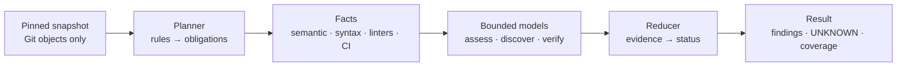

<p align="center">
  
</p>

<p align="center">
  <a href="https://github.com/bondiano/sych/releases/latest"></a>
  <a href="https://github.com/bondiano/sych/actions/workflows/ci.yml"></a>
  <a href="https://bondiano.github.io/sych/"></a>
  <a href="LICENSE"></a>
</p>

**Sych** (Russian *сыч*, the little owl) is a code reviewer with a deterministic Rust core and bounded model calls.
The engine decides what must be checked, collects evidence and computes the verdict; models only propose
hypotheses and assessments inside fixed budgets. Every finding cites exact code, and every gap is reported as
`UNKNOWN` instead of silence.

**[Documentation](https://bondiano.github.io/sych/)** · **[Install](https://bondiano.github.io/sych/install/)** ·
**[Releases](https://github.com/bondiano/sych/releases)**

## Install in one prompt

Paste this into your coding agent (Claude Code, Codex, Cursor…) in the repository you want reviewed. It installs
the CLI and runs a free review without any model calls:

```text
Install Sych 0.2.0 (https://github.com/bondiano/sych) and run a free trial review of this repository.

1. Install the CLI. Download the archive for this machine and its .sha256 file from
   https://github.com/bondiano/sych/releases/tag/v0.2.0 (targets: x86_64-unknown-linux-gnu,
   aarch64-unknown-linux-gnu, aarch64-apple-darwin), verify the checksum, and install the `sych`
   binary into ~/.local/bin (make sure that directory is on PATH). On any other platform run
   `cargo install --git https://github.com/bondiano/sych --tag v0.2.0 --locked sych-app`
   instead (needs Rust 1.94 or newer). `sych --version` must print `sych 0.2.0`.
2. In the repository root, add `.sych-data/` to .gitignore: the local store lives there.
3. Run `sych db migrate`.
4. Run `sych review --repo . --base origin/main --models fake --format markdown`. Use the
   repository's default branch instead of origin/main if it differs. If HEAD has no commits
   beyond it, use `--base HEAD~1`. `--models fake` makes no model calls. The first run downloads
   pinned language servers and linters into ~/.cache/sych/tools.
5. Show me the result and explain it: the verdict, the obligations and why they stay
   UNKNOWN/NOT_ASSESSED without a model, and the coverage gaps. Do not change any source files.
```

More prompts are on the [install page](https://bondiano.github.io/sych/install/): a real model review through
OpenRouter, a rule that makes your agent review before every push, and a self-hosted GitHub App.

By hand, on Linux (x86_64, aarch64) or macOS (Apple silicon) with a
[release archive](https://github.com/bondiano/sych/releases/latest), or from source:

```sh
cargo install --git https://github.com/bondiano/sych --tag v0.2.0 --locked sych-app
sych db migrate
sych review --repo . --base origin/main --models fake --format markdown
```

The server image is `ghcr.io/bondiano/sych:0.2.0`.

## How it works



- **Pinned snapshot.** Reads Git objects only (no work tree, hooks, filters or textconv) and pins `target_tip`,
  `diff_base` and `head`. The policy always comes from the target tip, never from the reviewed head.
- **Obligations, not vibes.** A deterministic planner turns rules into obligations with three-valued applicability.
  The reducer accepts `SUPPORTED` only with complete evidence of an acceptable kind.
- **Facts before models.** Semantic facts come from pinned language servers (rust-analyzer, TypeScript, Go, Python),
  syntax facts from syn, oxc and tree-sitter, plus pinned linters and CI reports (cargo/clippy JSON, JUnit, SARIF,
  LCOV, Cobertura, Terraform plans) bound to the tested commit.
- **Bounded models.** OpenRouter with pinned upstreams and ChatGPT, GLM Coding Plan and OpenCode Go subscriptions.
  Role routing has a bounded fallback. Every call gets a monetary upper bound before it runs and a durable ledger
  entry after it.
- **Deployment-aware rules.** Migration (`MIG-*`), Terraform and Kubernetes rollout rules are checked against a
  deployment model the owner declares and its reachable transition matrix.
- **GitHub App.** Verified webhooks, durable jobs with lease and fencing, and a reconciling outbox. Each revision
  gets a summary plus up to eight inline comments, with findings lineage, feedback and waivers and a `/v1` HTTP API.

Planning and the verdict are deterministic for the same facts and assessments. Model answers are not, so a fresh
review of the same diff can differ.

## Status

**0.2.0 is the first public release.** It ships the local CLI (`review`, `show`, `explain`, `tour`, `ask`,
`handoff`) and the GitHub App server (`serve`). Sych reviews its own pull requests through a live GitHub App; see
[self-review](docs/SERVER.md#self-review-bondianosych). Quality is measured on the labelled suite in `eval/quality`.
The numbers and their limits are in [How the analysis works](https://bondiano.github.io/sych/analysis/#measured-quality).
Before 1.0, CLI flags, JSON documents and the database schema can change between minor versions.

## Documentation

| Guide | Covers |
|---|---|
| [Install](https://bondiano.github.io/sych/install/) | agent prompts, release archives, the server image |
| [Local review](https://bondiano.github.io/sych/local-review/) | `review`, `show`, `explain`, output formats and exit codes |
| [Configuration](https://bondiano.github.io/sych/config/) | `sych.yaml`, `.sych/*`, rule packs, waivers, secret paths and redaction |
| [Models](https://bondiano.github.io/sych/models/) | providers, routing, budgets and the cost ledger |
| [Deployment model](https://bondiano.github.io/sych/deployment/) | `.sych/deploy.yaml`, transition matrix, `MIG-*` binding |
| [Server](https://bondiano.github.io/sych/server/) | GitHub App, scheduler, CI evidence, publication, API and operations |
| [Storage](https://bondiano.github.io/sych/storage/) | PostgreSQL/SQLite, artifacts, retention |
| [Analysis](https://bondiano.github.io/sych/analysis/) | assessment, discovery, audit, verifier and measured quality |
| [Semantic backends](https://bondiano.github.io/sych/semantic/) | pinned language servers, linters and context facts |

The same pages live in [docs/](docs/README.md). Each crate has its own README with its module map and invariants.

## Development

You need [rustup](https://rustup.rs/), [just](https://just.systems/) and
[cargo-machete](https://github.com/bnjbvr/cargo-machete) 0.9.2. The toolchain (Rust 1.94.1, rustfmt, Clippy) is
pinned in `rust-toolchain.toml`, dependencies in `Cargo.lock`, and every Cargo command runs with `--locked`.

```sh
cargo install cargo-machete --version 0.9.2 --locked
just check      # what CI runs: lint + test
```

| Recipe | Does |
|---|---|
| `just fmt` | format Rust code |
| `just lint` | rustfmt check, Clippy (warnings are errors), `sych-style`, `cargo machete` |
| `just test` | workspace tests; fails on stale `schemas/` |
| `just schemas` | regenerate JSON Schemas from the Rust DTOs |
| `just style-fix` | apply the house style (blank line after an `if` block) |
| `just run …` | run the CLI |

The documentation site is in `site/` (Astro Starlight): `cd site && npm ci && npm run dev`.

- [Conventional Commits 1.0.0](https://www.conventionalcommits.org/en/v1.0.0/); breaking changes use `!` or a
  `BREAKING CHANGE:` footer.
- `main` is protected: work on a branch, open a PR, wait for green CI and the Sych review of the current head.
  Agents follow [AGENTS.md](AGENTS.md).
- `unsafe` and ignored must-use results are forbidden; Clippy all/pedantic, `unwrap` and absolute-path checks are on.
- External JSON documents carry `schema_version`; an unknown major version is rejected before parsing.

## Layout

```text
crates/sych-app/       CLI and server: args, commands, services; thin bin/sych.rs
crates/sych-core/      domain types, planner, reducer, broker, model routing; no HTTP/SQL/LLM SDK
crates/sych-adapters/  Git snapshot, GitHub, model providers, language servers, syntax/CI facts, sandbox
crates/sych-storage/   PostgreSQL/SQLite runs and pointers, artifact store, ledger, GC
crates/sych-style/     the house style check rustfmt and Clippy lack
migrations/            backend-specific migrations (applied only by `sych db migrate`)
schemas/               JSON Schema and OpenAPI generated from the Rust DTOs (do not edit)
fixtures/              frozen documents, Git/config/review fixtures
examples/              working personal and corporate sych.yaml with .sych/
eval/                  smoke and labelled quality suites
docs/                  guides, ADRs, output examples, brand
site/                  the documentation website
```

## License

[Apache-2.0](LICENSE).
