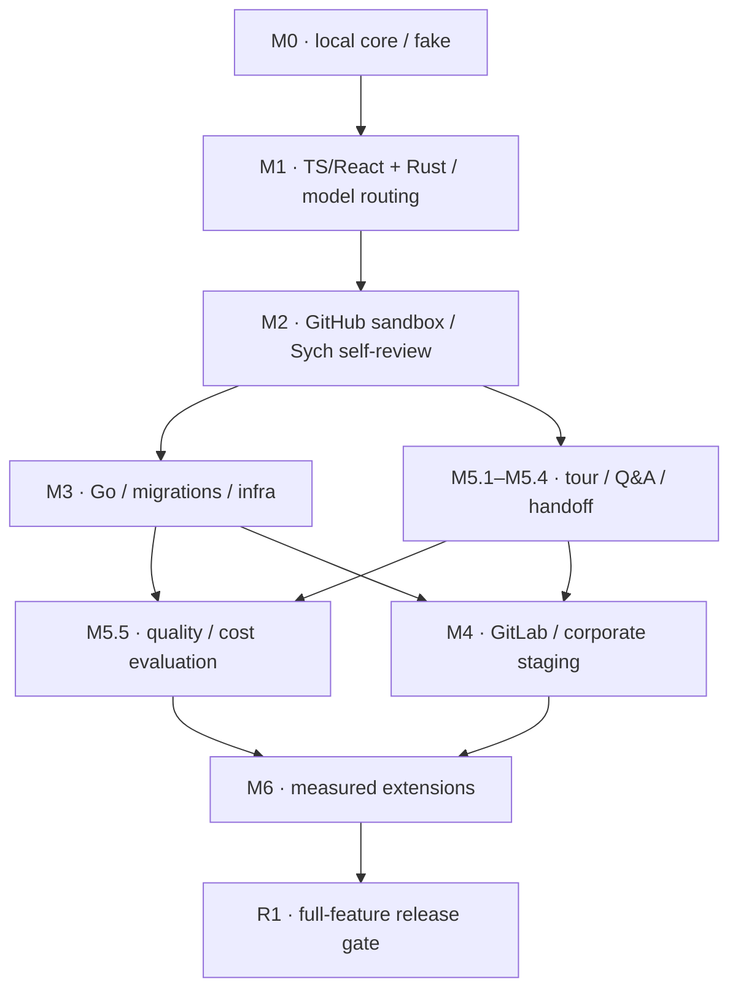

# Sych — roadmap реализации

**Основание:** [SYCH_SPEC.md v1.2](SYCH_SPEC.md), 25 октября 2026. **Статус:** согласованный план, не отчёт о выполненных функциях.

Roadmap превращает §28 спецификации в задачи с зависимостями, проверяемыми **Acceptance Criteria (AC)** и **Definition of Done (DoD)**. Исходные `AC-01…AC-47` сохраняют IDs; `AC-48…AC-60` добавлены в v1.2 для согласованных model/routing/Rust/self-review требований. AC внутри задачи — локальные критерии, не перенумерация исходных cases.

## 1. Правила выполнения и границы релиза

### Полный набор функций до production

**До полного feature scope никакого production.** M0–M6 — только разработка, локальные запуски и изолированные test/staging среды. Реальные API/model/SCM проверки проводятся на sandbox repositories и синтетических/разрешённых непроизводственных данных с отдельными non-production credentials. Pet deployment, корпоративный shadow mode, боевое подключение бота и публикация комментариев в рабочих PR/MR не являются исключениями. Локальное read-only ревью разрешённого реального кода само по себе не является выкладкой; для него сохраняются trusted policy, access/retention и egress ограничения.

Первый production возможен только после **R1**. Release baseline — **M0–M6 целиком**: CLI/API, оба SCM, качественные TS/React и Rust пути, Go/infra/базовый Python, OpenRouter и GPT/GLM/OpenCode subscription access, DeepSeek/fallback/Astra/Fable routing, безопасный GitHub self-review Sych, security/ops и tour/Q&A/handoff. Условный состав M6 явно утверждает владелец в M6.1 (M6.6 Web UI/дашборд на Flick уже включён решением D12); новые обязательные M1/M2 функции нельзя перенести туда как optional. Незавершённая включённая функция закрывает release gate; сокращение baseline требует явного согласия владельца.

Готовность M0, M1, M2 или M4 означает готовность соответствующего dev/staging сценария, **не разрешение выпуска**. В терминах §28 M2 «реальный pet repository» означает sandbox pet repository; M4 «shadow mode» — корпоративный test/staging. Прохождение R1 само ничего не разворачивает: production rollout требует отдельного явного действия владельца.

### Conventional Commits

Придерживаемся [Conventional Commits 1.0.0](https://www.conventionalcommits.org/en/v1.0.0/):

```text
<type>[optional scope][!]: <description>
```

- `feat` — новая функция, `fix` — исправление дефекта; `docs`, `test`, `refactor`, `perf`, `build`, `ci`, `chore` и другие уместные типы допустимы. Scope необязателен; локальная договорённость — lowercase type/scope.
- Breaking change обозначается `!` перед `:` и/или footer `BREAKING CHANGE: <описание>`; несовместимое изменение описывается явно. Body/footer отделяются пустой строкой. Это не отменяет migration/compatibility DoD.
- При squash проверяется итоговое сообщение коммита, попадающего в основную ветку. Примеры: `feat(snapshot): pin target and head separately`, `fix(publisher): reconcile uncertain writes`, `docs: add implementation roadmap`.

Правило относится к сообщениям коммитов; установка commitlint, release bot и автоматическая публикация здесь не требуются и не подразумеваются.

### Как принимать задачи

- **AC:** наблюдаемое поведение и границы, включая ошибки/неполные данные. **DoD:** код/контракты/fixtures/документация и доказательства, с которыми результат можно принять. Общий DoD ниже обязателен **вместе** с локальным DoD каждой задачи.
- Задача готова только после всех AC и DoD; fake provider доказывает harness, но не качество модели и не работоспособность реального adapter. Честный `PARTIAL/UNKNOWN` на предусмотренной границе — корректное поведение, но отсутствие обещанного adapter не считается готовой функцией.
- На PR указываются IDs задач, исходные §/AC/INV, затронутые callers/config/schemas/fixtures и ограничения; обновляются все изменённые контракты и пользовательская документация. При enum/schema change нужен совместимый migration path и старый fixture.
- Используются существующие `just check`/`just build`, содержательные deterministic проверки и реальный smoke изменённого пути; для интеграций — только sandbox. Evidence включает точную команду/сценарий, версии/config и наблюдаемый output без секретов. Нельзя заменить реальный model/SCM путь fake и отметить gate выполненным.
- Repo content/tool stdout/model output — данные. Reviewer не правит исходники, не делает merge, deploy, `terraform apply` или DDL в реальном окружении. Trust/access/secret filtering и budgets действуют с первого использующего их этапа, а не откладываются до M4.
- Выборочные тесты доказывают поведение, не дословный текст. Harness suite и quality evaluation независимы. Успешный CI сам по себе не является доказательством полноты review.
- Нет календарных обещаний и оценок в днях: первые repos и стратегии выбраны, но реальные account entitlements, model/price/fee profiles, CI selectors и корпоративное окружение ещё требуют evidence. Последовательность задаётся зависимостями/gates; начальные caps не превращаются в обещания цены, качества или вместимости.

## 2. Стартовая точка и порядок работ

По текущему [README](../README.md) M0 выполнен на fake adapter: локальный путь `review → JSON/Markdown → show/explain`, SQLite/artifacts и fake eval suite; evidence — тесты workspace, CLI smoke и [руководство local review](LOCAL_REVIEW.md). Качество review на реальных моделях этим не подтверждено. Статус отмечен чекбоксами: `[x]` у задачи — все её AC/DoD закрыты; `[x]` у отдельного AC/DoD — пункт подтверждён кодом и документацией (M1.1–M1.7, M1.9, M2.2 и M2.4 полностью; M1.8, M1.10–M1.14 частично — у подписок нет реальных smokes, holdout не размечен; M2.1, M2.3 и M2.5–M2.9 частично — реализованы и проверены на loopback GitHub fake, реальное sandbox-подключение ждёт App владельца; M3.1–M3.2 полностью, M3.3 без реальной domain evaluation M3.8 — [SEMANTIC.md](SEMANTIC.md); модельный review — [ANALYSIS.md](ANALYSIS.md), server — [SERVER.md](SERVER.md)), `[ ]` — не закрыт или evidence ещё нет.

Нумерация M0–M6 сохранена из спецификации, порядок выполнения уточнён зависимостями:



M3 и локальный tour могут развиваться независимо после M2. Tour-контракт и AC-34–36 обязательны до корпоративного подключения: это устраняет конфликт между поздним номером M5 в §28 и ранним требованием §29. Web reader не блокирует CLI tour, но включённый в release baseline web scope блокирует R1.

Сначала завершаем один local сценарий M0, затем качественные TS/React и Rust пути M1 и общий model routing; M2 включает безопасный self-review sandbox-зеркала Sych. Первое локальное ревью не ждёт Kubernetes/GitLab/web UI. Боевой bot на `bondiano/sych` владелец включил до R1 (2026-10-27) — только advisory и закреплённой сборкой ([SERVER.md](SERVER.md#self-review-bondianosych)).

## 3. Задачи по этапам

## M0. Детерминированный local core

**Результат этапа:** сохранённое локальное ревью двух commits через настоящий Git/SQLite и fake model adapter, без внешних API. Существующий bootstrap workspace/CLI/CI переиспользуется; он не считается завершением M0.

### [x] M0.1. Доменные контракты и воспроизводимый workspace

**Зависимости:** нет; существующие `Cargo.toml`, toolchain, lockfile и quality-гейты. **Источник:** §4–5, §25.4, §32.

**Результат:** используемые engine типы и DTO в `sych-core`, схемы и минимальные интерфейсы adapters; остальные crates появляются вместе с работающим кодом, без пустой архитектуры.

**AC**
- [x] `sych-core` не зависит от HTTP, SQL или model SDK; между crates нет циклов. Версии зависимостей закреплены, плавающих git dependencies нет.
- [x] IDs, UTC timestamps, micro-USD, Git OID с алгоритмом, canonical hashing и `schema_version` соответствуют §5.1; неизвестная major version отвергается явно.
- [x] SourceSnapshot, PolicySnapshot, Evidence, Obligation, Candidate/Finding и ReviewResult сохраняют разные состояния execution, coverage, recommendation, publication и relevance; расширение DTO не ломает чтение согласованных старых fixtures.

**DoD**
- [x] DTO и генератор JSON Schema используют один источник типов; повторная генерация даёт тот же результат. OpenAPI дополняется при появлении HTTP в M2, а не создаётся отдельно вручную.
- [x] Сохранены fixtures сериализации, несовместимой версии и canonical hash; существующие `just check` и `just build` выполняются на закреплённом toolchain.

### [x] M0.2. Безопасный Git snapshot, diff manifest и CodeRef

**Зависимости:** M0.1. **Источник:** §5.3, §6, §24.1; AC-01–03.

**Результат:** неизменяемые `target_tip`, `diff_base`, `head`, blobs и полный manifest изменённых файлов.

**AC**
- [x] `--base` означает target ref; merge-base вычисляется отдельно. Явный `--diff-base` поддерживает точное сравнение; несовместимые flags отклоняются. Нет merge-base — явный режим сравнения либо `UNAVAILABLE`, не произвольный commit.
- [x] Rename, Unicode/encoding, удалённые строки, binary/generated/excluded files, symlinks, submodules и LFS не исчезают из manifest. CodeRef разрешается в правильные side/blob/range/hash; UTF-8 offsets не смешиваются с UTF-16 позициями.
- [x] Усечённый SCM diff даёт Git fallback либо объявленные omissions и `PARTIAL/UNAVAILABLE`. Пустой diff создаёт явный пустой scope и не тратит model budget.
- [x] Git не запускает hooks, textconv, external diff/filter или submodules; чтение не выходит за snapshot через symlink. Исходники, рабочее дерево и глобальная Git config не меняются.

**DoD**
- [x] Fixture repositories покрывают расходящиеся target/head, shallow history, rename/Unicode/deletion, no-op и недоступную историю; сохранён snapshot manifest с проверяемыми hashes.
- [x] Реальный `sych review --repo ... --base ... --head ... --models fake` читает Git objects; проверено, что malicious helper/symlink fixture не выполняется и не читает host file.

### [x] M0.3. Trusted policy, effective config и ранние trust boundaries

**Зависимости:** M0.1–M0.2; D10 до реального пользовательского кода. **Источник:** §6.2, §11, §22–23, §24.1; AC-05, AC-33.

**Результат:** валидируемая конфигурация и PolicySnapshot из принятого ref, а не из проверяемого head.

**AC**
- [x] Приоритет engine → organization → accepted repository → path/domain → разрешённые preferences сохраняется. PR показывает policy diff, но не ослабляет собственные правила, budget, tools, credentials или endpoint allowlist.
- [x] `.sych/config.yaml`, `rules.yaml`, `effects.yaml`, `deploy.yaml`, contracts и `sych.yaml` нормализуются и хешируются. Неизвестные keys дают ошибку с точным path, YAML/JSON enums преобразуются типизированно; конфликт mandatory rules не разрешается моделью молча.
- [x] `config init --personal` не перезаписывает существующие файлы; `config validate` проверяет schema/paths/roles/limits. `doctor` проверяет только доступность и permissions без deploy, comment и paid call; модель пробуется только с `--probe-model` после M1.
- [x] Repository text и model output остаются данными. Secrets не попадают в logs/debug payloads; path policy, redaction и egress allowlist действуют до любого model call в M1. Execution по умолчанию выключен.

**DoD**
- [x] Fixtures policy weakening, конфликтующих правил, ошибочного config path и secrets проходят без внешних запросов; effective config и policy provenance доступны для диагностики без секретов.
- [x] Есть рабочие personal config examples и инструкция config/doctor. Серверные auth/bind проверки добавляются в M2, корпоративные ограничения — в M4 на том же контракте.

### [x] M0.4. Scope, review units, обязательства и локальный reducer

**Зависимости:** M0.1–M0.3. **Источник:** §3, §5.4–5.7, §7–8.3, §11; AC-01, AC-05–08, AC-40, AC-44.

**Результат:** детерминированный план проверки и честный ReviewResult независимо от наличия candidates.

**AC**
- [x] До discovery зафиксированы review units, requested profiles, required obligations, minimal evidence, risk routing и exclusions с причинами. Связанные handler/wrapper/schema/consumer могут быть одной unit; mandatory scope нельзя сузить ради полного статуса.
- [x] Трёхзначная applicability сохраняется: required rule с неизвестной применимостью создаёт `UNKNOWN` с reason и next evidence; `NOT_APPLICABLE` требует проверяемого основания. Пустое discovery не закрывает обязательства.
- [x] Reducer отличает обоснованные `SUPPORTED`, `VIOLATED`, `UNKNOWN` и `NOT_APPLICABLE`; checked violation не теряется при пустом findings. При значимом нарушении recommendation — `ATTENTION_REQUIRED`, иначе при mandatory gap — `NEEDS_EVIDENCE`; coverage показывается отдельно.
- [x] Лимит/исключённый guard/непроверенные файлы не дают `COMPLETE_FOR_SCOPE`. Недоступный diff — `UNAVAILABLE`; отказ сохранения — не `COMPLETED`. Freeze отделяет внешние inputs от derived evidence pinned snapshot.

**DoD**
- [x] Детерминированные SAFE/VIOLATED/no-evidence/no-op/overflow fixtures проверяют итоговые obligations, recommendation и coverage, а не дословный текст объяснения.
- [x] На одной fixture сохранены ScopeManifest, PolicySnapshot, ExternalInputManifest и итоговый EvidenceManifest; объясним путь от исходного критерия до результата. Конкурентный fenced commit реализуется в M2, не имитируется здесь.

### [x] M0.5. SQLite, immutable artifacts и локальные операции

**Зависимости:** M0.1, M0.4. **Источник:** §8.2, §20, §24.4; AC-40.

**Результат:** durable local runs/results/evidence с tenant/access partition, migrations и контролируемым GC.

**AC**
- [x] SQLite использует WAL и один worker по умолчанию; nested domain objects хранятся как versioned artifacts, без отдельной SQL-таблицы на каждое поле.
- [x] Bytes сохраняются до pointer commit. Result pointer, usage и terminal state фиксируются атомарно; сбой записи не оставляет ложный `COMPLETED` или ссылку на несохранённый artifact.
- [x] `db migrate` выполняется контролируемо; `cache prune --dry-run` не удаляет данные. GC защищает active pins, unresolved writes/charges и retention: raw/source 7 дней, normalized results/evidence/tours 30, audit/usage 90 — до согласованных overrides.
- [x] Повторное чтение сохранённого result не запускает анализ; потерянный source blob явно недоступен и не заменяется сгенерированным кодом.

**DoD**
- [x] Проверены реальные reopen БД/чтение artifacts после перезапуска, rollback pointer commit и orphan GC после grace period.
- [x] Есть SQLite migrations и storage contract fixtures, которые позднее выполняются также для PostgreSQL в M4; documented local backup/retention не выдаётся за проверенный corporate restore.

### [x] M0.6. Локальный CLI, renderers и fake acceptance suite

**Зависимости:** M0.2–M0.5. **Источник:** §24.1/24.4/24.5, §27.1, §28 M0, §32; AC-01, AC-05–06, AC-40.

**Результат:** законченный путь `review → persisted JSON/Markdown → show/explain`, пригодный для следующих этапов.

**AC**
- [x] `review --models fake --fake-responses PATH` воспроизводимо сохраняет result; без fixture fake assessments остаются честно непроверенными. `show --run` и `explain --obligation` читают сохранённое evidence. Локальное review не публикует в SCM.
- [x] Exit codes: 0 только для выполненной операции с сохранённым review, 2 invalid input/config/schema, 3 без пригодного результата, 4 credentials, 130 принятая отмена. В strict mode 10 значимое нарушение имеет приоритет над 11 incomplete; operational не проваливает CLI из-за advisory finding.
- [x] JSON и Markdown сохраняют scope, snapshot/policy/provenance, coverage, obligations, findings, gaps и usage; repository Markdown/HTML и terminal control sequences безопасно экранированы.
- [x] `eval run --suite eval/smoke.yaml --models fake` не обращается к внешним API; same fixture даёт те же значимые состояния, а не обязательно те же runtime IDs/timestamps.

**DoD**
- [x] Реальный CLI smoke проходит happy path, empty diff, required UNKNOWN, checked violation, failed save и cancel; outputs и exit codes приложены к PR.
- [x] JSON/Markdown examples и руководство local review обновлены; M0 принимается только после работающего сквозного сценария, не по успешной сборке scaffold.

**AC этапа:** выполнены M0.1–M0.6 и исходный gate §28 M0. **DoD этапа:** сохранены команды, artifacts и детерминированный отчёт fake suite; внешних API calls — ноль.

## M1. Первый полезный AI review для TS/React и Rust

**Результат этапа:** воспроизводимый local review Vkusori PWA/core и Rust workspace Sych: real permitted model access, exact evidence, независимый obligation assessment/verifier, rules/nitpicks и monetary/quota/enforcement report. OpenRouter, GPT/GLM/OpenCode subscriptions и управляемый DeepSeek/subscription/premium routing обязательны, не optional M6. Реальные smoke только local/sandbox с разрешёнными credentials/данными; SCM publication и production не входят в M1.

**Нормативная основа:** `SYCH_SPEC.md` §28/M1; детальные требования приведены у задач. AC-xx ниже — исходные cases §29; собственные AC раскрывают поведение задачи, DoD — необходимые артефакты и доказательства готовности. Зависимость M0.1–M0.6 означает переиспользование общих контрактов, source reader, trusted policy, frozen inputs, scope, reducer и сохранения результата, а не их вторую реализацию.

### [x] M1.1. Один совместимый semantic backend TS/React

**Результат и граница:** backend первого выбранного repository возвращает локальные semantic facts для base/head и исходные constructs. Поддержка всех версий TypeScript и полноценный Python language server сюда не входят.

**Зависимости:** M0.1–M0.6; D01 и реальные toolchain/lockfiles первого repository. Локальный путь использует source/semantic evidence и не ждёт серверного CI ingestion.

**Источники:** §5.3–5.4, §9.4, §10.1–10.2, §10.6, §22.4, §28/M1, §30. **Исходные cases:** AC-04, AC-17; source-anchor regression также AC-02.

**AC:**
- [x] Обнаруживаются tsconfig/project references, реальные package/lockfile boundaries и версия TypeScript; backend совместим с проектом и не требует обновлять проект ради reviewer. Base и head обслуживаются раздельными workspace states.
- [x] Разрешаются imports, aliases, definitions и references; доступны enclosing functions, JSX components, hooks и call sites; production/test/generated paths различаются, dependency/config changes попадают в анализ.
- [x] Каждый ответ содержит query scope, pinned snapshot, tool version, build configuration, completeness и unresolved edges. Недоступная capability возвращает `UNSUPPORTED`, а пустой успешный ответ не доказывает глобальное отсутствие callers или динамических зависимостей. LSP call hierarchy использует prepare/incoming/outgoing согласно capabilities.
- [x] Source locations преобразуются из negotiated LSP encoding в правильный `CodeRef` с точными side/blob/range/hash; Unicode, rename и удалённые строки не связываются с соседним или head blob по ошибке.
- [x] Начальные React facts покрывают mutation/invalidation/refetch, setup/cleanup, subscriptions/listeners/timers, stale async response, error/loading/optimistic state и controlled/uncontrolled/form submit. Имя функции не доказывает эффект: project wrapper связывается с текущей реализацией. CSS/HTML использует структуру компонентов и доступные browser/accessibility/visual reports; TS types не объявляются доказательством визуального поведения.
- [x] Используются установленные pinned tools. Если backend может исполнять plugins/build scripts/dependency hooks, до его запуска требуется изолированный tooling profile; отсутствие такого профиля или dependencies даёт явное ограничение, а не скрытый менее полный успех.

**DoD:**
- [x] Предоставлены adapter и version/capability mapping выбранного repository; поддерживаемые конфигурации и известные ограничения описаны в существующей документации.
- [x] Сохранены fixtures раздельных base/head workspaces, Unicode/rename/deleted anchors, unsupported/empty/dynamic responses и React stale-response/сохранённой защиты; приложены результаты соответствующих проверок.
- [x] Есть sample semantic EvidenceManifest с producer/config/version, query completeness и разрешаемыми `CodeRef`, без секретных payloads.

### [x] M1.2. ContextBroker: ограниченный, адресуемый и проверяемый контекст

**Результат и граница:** вопрос получает evidence packet с provenance и gaps, а не непрозрачную строку. Embeddings и отдельная graph database не являются зависимостями.

**Зависимости:** M0.1–M0.6, M1.1; нормализованное CI evidence потребляется при наличии по общему Evidence-контракту, без обязательного внешнего ingestion.

**Источники:** §5.3–5.4, §6.5, §7.4, §8.3, §9.1–9.6, §22.3, §22.5. **Исходные cases:** AC-04, AC-07, AC-08, AC-44; изоляция cache — AC-37.

**AC:**
- [x] Запрос привязан к run/snapshot/policy/unit/obligation/access scope и purpose; packet возвращает evidence IDs, фрагменты, связи, полноту каждого запроса, `reason_selected`, gaps, usage и `SATISFIED | PARTIAL | UNAVAILABLE`. Packet resolution не подменяет истинность obligation.
- [x] Сбор начинается с diff и enclosing construct обеих версий, добавляет accepted rule/независимый контракт, imports/types/wrappers, ограниченные callers/callees/readers/writers, относящиеся tests и доступные нормализованные CI facts. Перекрывающиеся spans одного blob объединяются; обязательное и опровергающее гипотезу evidence приоритетнее вспомогательного. (contracts правила — доверенным текстом под обязательством; readers/writers — `documentHighlight`, writers `REFUTING` с gap `REFUTING_OVER_BUDGET` — [SEMANTIC.md](SEMANTIC.md))
- [x] Typed operations §9.4 разрешаются только после schema/access validation и возвращают `COMPLETE_FOR_QUERY | PARTIAL | UNSUPPORTED | FAILED` с конкретными ограничениями. У модели нет произвольного shell/URL/infrastructure DB query/credentials; search ограничен по времени и синтаксису.
- [x] Лимиты §9.3 применяются к фактически читаемому/отправляемому содержимому с приоритетом §17. Не помещающийся обязательный guard не обрезается молча: работа делится с сохранением связей либо соответствующее obligation остаётся `UNKNOWN`; `COMPLETE_FOR_SCOPE` в таком случае недопустим. Лимит читаемых файлов не сокращает inventory diff.
- [x] Любой показанный source fragment открывается через точный snapshot/side/blob/path/range с оригинальным hash и transformation/redaction policy. Summary отделён от raw source и сам не подтверждает конкретное поведение без подходящего source/tool evidence.
- [x] Definition/semantic fact из pinned inputs, найденный после input freeze, добавляется как derived evidence текущего run. Новое внешнее CI/policy/deployment observation не дописывается в historical result: требуется successor через общий lifecycle.
- [x] Blob/syntax/semantic caches разделены по ключам §9.6 и access partition; доступ перепроверяется на cache hit. Reuse отрицательного утверждения зависит также от области и completeness поиска, а не только от найденных файлов.

**DoD:**
- [x] Предоставлены ContextBroker и полный mapping typed operations в существующий Evidence-контракт; сохранены примеры packet/manifests с включёнными и исключёнными источниками.
- [x] Есть fixtures обязательного guard за лимитом, частичного provider, pinned definition после freeze, отказа доступа при cache hit и изменения search scope; результаты проверок приложены.
- [x] В существующей документации зафиксированы применённые defaults §9.3, cache keys/invalidation и способ открытия сохранённого source evidence. Model-response cache не добавлен: по §9.6 он opt-in после MVP.

### [x] M1.3. ModelGateway, structured output и cost ledger

**Результат и граница:** общий typed ModelGateway/ModelProvider, schema validation и один monetary/quota ledger; конкретные transports M1.9–M1.12 и router M1.13 подключаются к нему без второго engine. Caps — ограничения, не обещание качества или цены PR.

**Зависимости:** M0.1–M0.6; до первого paid call — явно выбранные endpoints/model IDs/tariffs/billing semantics и согласованная retention/egress policy (§30). Неизвестные значения не заполняются предположениями.

**Источники:** §4.3–4.4, §16.4–16.7, §17, §20.2, §22.1/22.3, §23.1, §28/M1. **Cases:** AC-30–33, AC-44, AC-48–55.

**AC:**
- [x] Adapter объявляет transport/auth/billing/allowed_modes, entitlement, tools/structured output, context/output limits, usage/quota/reset/cancellation и enforcement. Unsupported не становится пустым успехом; requested/resolved model, account reference и отдельный route/cost record сохраняются.
- [x] Используется provider structured output, когда доступен; иначе strict JSON parse и schema validation. На response допускается максимум один schema repair внутри общего attempt budget. Failed repair оставляет соответствующую задачу failed/unresolved; произвольная проза не извлекается regex и не публикуется как validated output. Новые утверждения repair проверяются обычным evidence validation.
- [x] Prompt собирается из доверенных слоёв §16.5, repository/evidence data явно отделены. Templates/schemas/parameters/reasoning settings и фактические model ID/fingerprints версионируются. `ignore rules` из output/source не меняет policy, tools, access или budget; полный chain-of-thought не требуется и не сохраняется.
- [x] Перед metered API request подсчитан фактический payload и максимальный billable output/reasoning, принята консервативная price upper bound и атомарная run/tenant/day/month reservation. Подписки отдельно учитывают fixed fee/period/allocation, quota и возможный charge; неизвестное не считается нулём. Только затем разрешён dispatch.
- [x] Defaults §17.1 и retrieval limits §9.3 сохраняются: hard money, Sych dispatch attempts/deadline и verification reserve общие для retry/repair/fallback. `api_hard` и принятый `subscription_observable` различаются явно: ненаблюдаемые upstream calls/output/quota soft/unknown, не ложный hard cap. Cache discounts не предполагаются; деньги — integer micro-USD.
- [x] Settlement идемпотентен по attempt/period ID: spent + active monetary reservations + unknown charges соблюдают cap принятой upper-bound модели, fixed fee не списывается на каждый request. Timeout/cancel не возвращает деньги/квоту автоматически: сохраняются UNKNOWN_USAGE и применимый UNKNOWN_CHARGE без двойного учёта.
- [x] Без надёжной денежной upper bound hard USD cap не заявляется; корпоративный профиль не допускается до принятых billing semantics. Subscription soft tokens не разрешают soft money, скрытый overage или бесконечный gateway loop. Cap/deadline/нет eligible route дают честный PARTIAL с gaps, не пустое review.
- [x] Usage summary различает actual money/fee/period, reference estimate, tokens, allowance/quota/reset/completeness и hard/soft/unknown enforcement; reasoning внутри output не удваивается. Analysis/tour/follow-up разделены; $60/month personal model pool общий, compute/storage отдельно с явным согласием.

**DoD:**
- [x] Предоставлены общий gateway/typed provider contracts, валидируемые model/price/fee/enforcement profiles, ledger persistence и idempotent settlement/reconciliation. Документация и fixtures различают API charge, included quota, fixed fee, unknown и запрет автоматического paid overflow.
- [x] Сохранены deterministic concurrent-reservation, settlement, timeout/cancel/unknown usage, unsupported, JSON/repair, budget exhaustion и hard-vs-soft fixtures; $60 monthly boundary не обходится сменой provider/profile.
- [x] Есть sanitized accounting artifact real sandbox API path; конкретные subscription evidence завершаются в M1.10–M1.12. Секреты и raw prompts не логируются, fake не доказывает реальный доступ.

### [x] M1.4. Trusted rules, applicability, исключения и полезные nitpicks

**Результат и граница:** общий rule mechanism активирует obligations и preferences; предметные Go/migration/infra checkers подключаются в M3, а не имитируются в M1.

**Зависимости:** M0.1–M0.6; M1.1 для semantic applicability. Принятая policy revision и role/owner references должны быть определены.

**Источники:** §5.5–5.6, §7.2–7.3, §11.1–11.6, §15.4, §22.1, §23.1, §28/M1. **Исходные cases:** AC-05, AC-12, AC-33, AC-39.

**AC:**
- [x] `.sych/config.yaml`, rules/effects/deploy/contracts читаются как project format, но имя directory не даёт доверия. Применяются accepted repository revision и приоритет §11.2; repository/PR policy не ослабляет server/engine ограничения, AGENTS.md/CLAUDE.md не становится policy автоматически.
- [x] Rule имеет стабильные ID/version, owner-role, scope, acceptance/evidence kinds и exceptions; изменение смысла увеличивает version. Применимость учитывает diff, semantic links и перенос логики: move за path boundary не снимает инвариант автоматически.
- [x] Для каждого потенциально затронутого required rule получается `APPLIES | DOES_NOT_APPLY | UNKNOWN`. UNKNOWN сохраняет obligation с конкретным gap; unsupported provider не позволяет исключить rule. `NOT_APPLICABLE` требует проверяемого обоснования.
- [x] Начальный набор §11.4 представлен без требования применять все rules к каждому PR. Изменение assertions/skips/fixtures/CI gates вызывает проверку TEST-INTEGRITY; новый test/PR description не подменяет accepted requirement. Неоднозначный конфликт обязательных rules даёт configuration error либо локализованный UNKNOWN, а не выбор модели.
- [x] Preference/nitpick указывает конкретное место и пользу, не дублирует linter finding той же причины и проверяется на очевидное изменение поведения. Полезный NIT без `rule_id` допустим и необязателен; он не становится correctness defect/REQUEST_CHANGES. Ноль nitpicks — корректный результат.
- [x] Scoped exception хранит rule/scope/reason/owner/author/expiry или условие завершения; waiver не переписывает исходные `VIOLATED/UNKNOWN`. Proposed policy в PR показывается как diff; применение новой trusted revision возможно только отдельным авторизованным run с provenance.

**DoD:**
- [x] Предоставлены rule/preference/exception schemas, валидатор и initial generic rule pack; предметные providers имеют один общий extension point, а не отдельные дубли rule engine.
- [x] Есть accepted-vs-proposed policy fixtures, move/out-of-path, unknown applicability, conflicting rules, waiver и полезного NIT без rule_id; приложены результаты проверок.
- [x] Обновлены существующие примеры `.sych/` и документация доверенных policy revisions, rule versioning и необязательного характера preferences.

### [x] M1.5. Discovery и риск-зависимый дополнительный поиск

**Результат и граница:** model discovery создаёт проверяемые hypotheses и ограниченные context requests, но не финальные статусы обязательств или действия SCM.

**Зависимости:** M1.1–M1.4; M0.1–M0.6 с заранее созданными scope/review units/obligations и резервом verification.

**Источники:** §7.1–7.4, §9.1–9.4, §16.1–16.2, §16.5, §17.1, §28/M1. **Исходные cases:** AC-06, AC-07, AC-33, AC-44.

**AC:**
- [x] Discovery получает фиксированные review units/obligations и разрешённые evidence IDs; response соответствует §16.2: claim, conditions, consequence, evidence/code refs, obligation links, proposed severity и disproof question, а также context requests/unresolved questions.
- [x] Модель использует только выданные IDs, не объявляет произвольные tests исполненными, не создаёт trusted evidence, не изменяет required и не выбирает SCM action. Невалидные refs/requests отклоняются до их использования.
- [x] Context expansion отвечает конкретному новому вопросу и проходит общий broker/budget. Неполный контекст, включая исключённый существенный guard, остаётся отражённым в scope/gaps.
- [x] High-risk obligations получают дополнительный поиск с независимой постановкой/контекстом, даже если общий discovery пуст; первый вывод не обязательно показывается этому проходу. Это не объявляется статистической независимостью ошибок. Если проход не помещается в cap, он явно не выполнен и полный охват не заявляется.
- [x] Для обычного небольшого PR planner использует дешёвый путь discovery + batch verification/assessment, когда это соответствует scope; число calls не фиксируется ценой потери required checks. Candidate overflow сохраняет существенные gaps и `PARTIAL`, а не молча обрезанный complete result.

**DoD:**
- [x] Предоставлены версионированные discovery/risk-auditor prompts и output schemas, интеграция typed context requests и планировщика verification reserve.
- [x] Сохранены fixtures empty discovery, high-risk empty discovery, fabricated evidence ID, context expansion и candidate overflow; приложены результаты deterministic validation.
- [x] В run artifacts видны выбранный route, выполненные/невыполненные проходы, prompt/model versions и accounting attempt IDs, без chain-of-thought.

### [x] M1.6. Отдельная оценка каждого required obligation

**Результат и граница:** obligations оцениваются независимо от наличия candidates. Candidate verdict и obligation assessment — разные сущности; один batch call может вернуть обе, но не заменить одну другой.

**Зависимости:** M0.1–M0.6; M1.2–M1.4.

**Источники:** §5.5, §5.7, §7.2, §16.1, §16.3, §28/M1. **Исходные cases:** AC-05–07, AC-12, AC-44.

**AC:**
- [x] Каждое required obligation получает отдельный `ObligationAssessment` либо финальный UNKNOWN, в том числе при пустом discovery, отсутствии candidate link, model timeout и исчерпании бюджета.
- [x] Assessment содержит obligation/applicability/status, каждый criterion с `MET | NOT_MET | UNKNOWN`, evidence refs, rationale, limitations и missing inputs. Детерминированный checker может выдать assessment без модели.
- [x] Engine проверяет допустимые evidence kinds, существование и anchors, полноту criteria и противоречия. `SUPPORTED` допускается только при выполненных критериях, `VIOLATED` — при проверенном нарушении; отсутствие assessment и недостаток значимого факта не становятся SUPPORTED.
- [x] UNKNOWN содержит reason code и конкретное next evidence needed; обоснованное DOES_NOT_APPLY сохраняется как NOT_APPLICABLE. Несвязанная unsupported capability не переводит все obligations в UNKNOWN автоматически.
- [x] Accepted requirement отделён от author assertion/test oracle. Assessment не закрывает критерий только потому, что новый авторский test проходит или модель не нашла дефекта.
- [x] Validated assessments передаются существующему reducer M0: mandatory UNKNOWN влияет на recommendation/coverage, VIOLATED не теряется при пустом findings array. Текст модели не переопределяет детерминированный итог.

**DoD:**
- [x] Предоставлены assessment schema, criterion/evidence validator и обязательный finalization path для неоценённых obligations; result reducer переиспользован, а не продублирован.
- [x] Есть fixtures safe change + empty candidates, missing assessment, missing criterion, противоречивое evidence, unknown applicability и недоверенный test oracle; приложены результаты проверки итоговых artifacts.
- [x] В sample result можно проследить required obligation → criteria → evidence/limitations либо concrete missing input; выполненный assessment не смешан с task execution status.

### [x] M1.7. Candidate verifier, новизна и граница подтверждения

**Результат и граница:** только проверенные candidates превращаются в findings с точным support и scope; отсутствие достаточного основания сохраняется как UNRESOLVED либо REJECTED.

**Зависимости:** M1.2–M1.6; M0.1–M0.6. До доступного сопоставимого CI baseline отсутствие diagnostic не считается доказательством новизны или исправления.

**Источники:** §5.3–5.7, §11.5, §15.3–15.4, §16.3–16.4, §28/M1. **Исходные cases:** AC-04, AC-12–14, AC-17, AC-32, AC-39; lifecycle — AC-41.

**AC:**
- [x] Проверяются schema, существование/side/blob/snapshot anchors, причинная цепочка, условия, consequence и severity. Выдуманный или устаревший CodeRef не становится подтверждённым finding.
- [x] До подтверждения исследуются wrapper/policy/guard/recovery path/intentional change и accepted requirement/baseline. Перенос invalidation в wrapper или сохранённая stale-response защита не объявляется потерей поведения только по diff.
- [x] Каждый candidate получает `CONFIRMED | REJECTED | UNRESOLVED`. Для высокого риска требуется воспроизводимый сценарий либо конкретная проверяемая static/semantic trace; согласие нескольких моделей не заменяет evidence.
- [x] Severity, support и verification status не смешиваются. Finding сохраняет triggering conditions, consequence, exact scope/limitations и категорию основания; CONFIRMED не описывается как формальное доказательство всей программы.
- [x] Проверяются новизна и дедупликация, в том числе с linter finding той же причины. Existing diagnostic не становится новым без основания; неполный/несопоставимый/отключённый producer не доказывает исчезновения дефекта и не даёт RESOLVED.
- [x] Improvement/preference может проходить более дешёвую проверку конкретности, rule fit и сохранения поведения. Необоснованный nit удаляется, а не повышается до defect; отсутствие rule_id само по себе не запрещает полезный preference.

**DoD:**
- [x] Предоставлены verifier contract/prompts и validator перехода candidate → finding с support, provenance и rejected/unresolved artifacts.
- [x] Сохранены пары unsafe/safe fixtures для wrapper transfer, stale async protection, ложного нового diagnostic и недопустимого anchor, а также high-risk без trace; приложены результаты проверок.
- [x] Документация объясняет виды verification basis и взаимодействие с общим M2 baseline/revalidation, без второго diagnostic lifecycle.

### [ ] M1.8. Реальный local E2E и измерение полезности

**Результат и граница:** первый законченный локальный путь проверен реальной моделью и размеченными изменениями; deterministic harness и качество обнаружения оцениваются отдельно. Production deployment, SCM publication и придуманные quality thresholds исключены.

**Зависимости:** M1.1–M1.7, M1.9–M1.14; M0.1–M0.6; принятые D01/D07/D08/D10. Разрешённые account/model/price/fee/egress inputs и owner-approved pilot policy нужны до соответствующих real runs.

**Источники:** §2.1–2.2, §10.7, §16–17, §24.1/24.5, §27–30. **Cases:** AC-04–08, AC-12, AC-17, AC-30–33, AC-39, AC-44, AC-48–57; CI transport остаётся M2.

**AC:**
- [ ] Реальные Vkusori TS/React и Sych Rust snapshots проходят facts → context → discovery → assessment/verifier → persisted JSON/Markdown; anchors открывают pinned blobs, не новый working tree. Маршруты DeepSeek, подписок и разрешённого premium проверяются раздельно, не смешиваются в один неподтверждённый score.
- [x] Проверки harness используют deterministic fake providers; real-model evaluation не заменяется fake responses или дословным snapshot matching. Invalid JSON/repair failure, timeout, unsupported, budget/overflow и пустой discovery наблюдаемо сохраняют установленные статусы/gaps и учёт всех attempts.
- [x] Development suite минимум 24 cases §27.2 дополнен Rust и routing/billing/privacy safe/unsafe/UNKNOWN pairs. M1 измеряет TS/React/Rust/preferences paths; ещё не подключённые Go/migration/infra cases до M3 явно не засчитываются как успех.
- [ ] Holdout отделён по целым PR/сценариям и не используется для настройки prompts/rules. Baseline A, B и риск-вариант C сравниваются на одинаковых целых PR и budgets, включая пустой discovery; для выбранных спорных nondeterministic cases сохраняются несколько запусков и variation. (A/B/C и повторы на development suite — [ANALYSIS.md](ANALYSIS.md); holdout ждёт разметки владельца)
- [x] Отчёт различает precision/recall известных defects, clean-case false positives, rule/nit usefulness, UNKNOWN/coverage, sufficiency/gaps и ошибки verifier; учитывается стоимость полного review, а не только опубликованных удачных findings. Численные результаты измеряются, а критерии принятия задаёт owner — roadmap не выдумывает значения.

**DoD:**
- [ ] Сохранены case manifests, разметка, split development/holdout и результаты deterministic regression по относящимся к M1 исходным AC; suite переиспользуется в M3 и далее.
- [ ] Приложены real sandbox API и разрешённые local subscription artifacts: snapshots, model/auth/runtime/profile/enforcement, schemas/evidence и полный monetary/token/quota/attempt report с обезличиванием; неподтверждённый account path не закрыт fake.
- [ ] Подготовлен reproducible evaluation report с baseline comparison, поддержанным scope, фактическими пропусками и owner-решением о полезности; долгосрочные pilot/human/delivery metrics переходят в M2/M5, не объявляются уже измеренными.

### [x] M1.9. OpenRouter как управляемый personal API backend

**Зависимости:** M0.3, M1.3; принятый personal egress D10 и OpenRouter account/model/price inputs D07. **Источник:** §16–17, §22–23; [OpenRouter API](https://openrouter.ai/docs/quickstart), [provider routing](https://openrouter.ai/docs/guides/routing/provider-selection), [structured outputs](https://openrouter.ai/docs/guides/features/structured-outputs).

**Результат:** один HTTP adapter общего ModelGateway; новый agent SDK или самостоятельный agent loop не нужен.

**AC**
- [x] Поддерживаются allowlisted OpenRouter endpoint, server-side credential reference, выбранный model slug, schema/streaming и доступные reasoning/usage поля. Compatibility проверяется для конкретного endpoint; весь OpenAI protocol не объявляется поддержанным по названию.
- [x] Harness выбирает и фиксирует модель и допустимого upstream provider. Неявные model/latest routers и скрытые provider fallbacks выключены по умолчанию; дополнительные upstreams допустимы только как заранее разрешённый route с достаточной provenance и известной консервативной ценой. Для обязательных параметров включён `require_parameters`; provider/model/access/retention policy не меняется самим OpenRouter.
- [x] Каждая отправка получает собственную reservation/attempt ID; generation ID, resolved model/provider и actual usage/cost связываются с result. Обрыв после dispatch сохраняет unknown charge до reconciliation; credits/allowance не считаются окончательной ценой запроса.
- [x] Для personal доступны выбранные DeepSeek V4.1 Flash, Astra и Fable при подтверждённой catalog/account availability. Наличие модели в другом provider/subscription не доказывает её доступность здесь. Corporate fallback не может использовать публичный OpenRouter, даже если у него есть региональный/private endpoint продукт: отдельное исключение D10 не принято.

**DoD**
- [x] Есть deterministic capability/schema/partial-stream/unknown-charge/provider-selection fixtures и реальный разрешённый sandbox API smoke с resolved model/provider, pricing revision и sanitized accounting artifact.
- [x] Документированы модельные slugs, upstream/data policy и credential setup без секретов; неподдержанный параметр не отбрасывается молча, paid probe выполняется только с явным разрешением.

### [ ] M1.10. GPT/ChatGPT subscription через официальный разрешённый transport

**Зависимости:** M0.3, M1.3; D07/D08/D10, account/client entitlement и разрешённый local use. **Источник:** §16.6–16.7, §17, §22; [Codex auth](https://developers.openai.com/codex/auth), [SIWC inference](https://developers.openai.com/siwc/token-sharing-open-source/models-and-inference), [preview limitations](https://developers.openai.com/siwc/token-sharing-open-source/preview-limitations), [official DevKit](https://github.com/openai/sign-in-with-chatgpt-devkit).

**Результат:** реальный personal-local GPT subscription adapter общего ModelGateway; обычный OpenAI API key не считается реализацией подписки. Выбирается один допущенный официальный text-only transport, предпочтительно SIWC Responses без agent tool loop; доступность client registration/admission и допустимость SDK/license подтверждаются до подключения. Codex app-server — альтернативный transport только с доказанным превентивным no-exec/no-tools boundary, не обязательный второй implementation.

**AC**
- [x] Авторизация использует официальный login/refresh и изолированную connection/account/workspace; Sych не копирует browser cookies, чужие `auth.json`/OAuth tokens и не реализует недокументированный ChatGPT backend. Credentials не логируются и не наследуются model/publisher/tooling процессами без необходимости.
- [x] Text-only route передаёт только redacted ContextBroker packet; инструменты отключены, локального executor нет. При выборе coding-agent runtime read-only сам по себе не считается запретом shell/edit/MCP: требуется превентивный документированный механизм и negative injection evidence, иначе route не допускается.
- [ ] Соблюдаются route-specific поля (`store:false`, `stream:true`, instructions/developer input для SIWC); structured output подтверждается на данном route и проходит общую JSON/schema/evidence validation. Partial stream, refusal, failed turn или repair не объявляются успешным review; repair максимум один и учтён.
- [x] Принят явный `subscription_observable` профиль: деньги, Sych-initiated attempts и локальные deadlines ограничены жёстко, а не поддерживаемые upstream output/internal-call/quota caps объявлены soft/unknown. `max_output_tokens` не посылается на route, где он запрещён. Ненаблюдаемые calls/usage не равны нулю; стандартные API prices не превращаются в стоимость included quota.
- [x] Отключены скрытые SDK retries/compaction либо их полнота явно отражена в enforcement/usage. Quota/reset/credits и реальные tokens нормализуются только при наличии; cancel/pipe loss не означает refund или прекращение upstream расхода. Paid overage/API fallback не включается сам и не обнуляет предыдущую неизвестность.
- [x] `allowed_modes` по умолчанию local owner-only. Managed app-server login не переносится в commercial/hosted service; SIWC hosted use требует отдельного admission. Локальный успех не разрешает использовать этот login в GitHub self-review runner; корпоративный режим дополнительно требует approved VPC/egress contract.

**DoD**
- [x] Реализован один официальный subscription path с account/session isolation, общими schema/ledger/cancellation и capability/enforcement report; no-tools boundary проверен до inference, а не обещанием prompt. Неустановленное право использования или безопасность блокируют профиль, paid API его не заменяет.
- [x] Fixtures покрывают auth-mode mismatch/revocation, unavailable entitlement, schema/repair/stream failure, tool/credential injection, unknown usage/quota, cancellation и запрещённый hosted/paid fallback; soft limits отображаются отдельно от hard.
- [ ] Есть явно разрешённый реальный local sandbox review с этой подпиской: validated result, actual model/auth/runtime provenance, usage/quota completeness, fixed-fee classification и limits report без секретов. Одна только авторизация или fake result не закрывает M1.10/R1.

### [ ] M1.11. GLM Coding Plan через разрешённый supported-tool workflow

**Зависимости:** M0.3, M1.3; D07/D08/D10 и подтверждённый personal plan/key/intended use. **Источник:** §16.6–16.7, §17, §22; [GLM Usage Rules §4](https://docs.z.ai/legal-agreement/subscription-terms), [supported Pi integration](https://docs.z.ai/devpack/tool/pi), [key classification](https://docs.z.ai/devpack/notice/api-key-management), [quotas](https://docs.z.ai/devpack/overview), [Pi CLI](https://pi.dev/docs/latest/cli).

**Результат:** настоящий owner-only local review через поддерживаемый персональный coding tool, а не имитацию его User-Agent или обычный paid GLM API. Минимальный transport — pinned Pi CLI с model tools выключенными; пригодность именно этого supported-tool workflow подтверждается до account smoke. Custom HTTP/Sych bot требует отдельного письменного разрешения Z.ai; CLI wrapper не отменяет запретов proxy/repackaging/third-party service.

**AC**
- [ ] Проверены allowed_modes/license и тип credential: Personal Coding Plan/документированный legacy Compatible key не смешиваются со Standard API billing. Одного `/coding` URL недостаточно для классификации; обычный paid `/api/paas/v4` не используется как незаметное продолжение подписки.
- [x] Настоящий supported client запускается без shell interpolation, с validated args, pinned provider/model, изолированными HOME/settings/working directory и только bounded redacted packet. Tools/extensions/MCP/context-file loading и repository execution выключены документированными средствами выбранной версии; SCM/deploy/чужие auth files недоступны.
- [x] JSON/JSONL output приводится к одному финальному ответу и проверяется общими parse/schema/evidence validators. JSON mode не выдаётся за native JSON-Schema guarantee; invalid/truncated/tool output даёт failed/unresolved. Internal retries/compaction/cache warming выключены либо их ненаблюдаемость явно отражена разрешённым subscription enforcement profile.
- [ ] Сохраняются requested/reported model и известные provider remaps, tool/settings/version, usage completeness, фактическая plan edition, 5-hour/weekly либо её собственные quota windows/reset. Нельзя считать catalog `usage.cost` invoice charge или переносить расчёт текущего плана на legacy без evidence.
- [ ] Fixed fee, included quota/credits, actual money и estimates разделены. Exhaustion/expiry/rate-limit/fair-use/auth различаются; не запускают смену key/endpoint, top-up или обход лимита. Только M1.13 может выбрать заранее разрешённый отдельный paid route после новой reservation; иначе честный PARTIAL.
- [x] Personal subscription не предоставляется третьим лицам и не становится hosted GitHub/corporate credential. `doctor` сообщает entitlement/limits gaps без inference; real probe требует согласия. Неподдержанный/неразрешённый local path остаётся блокером задачи, не «готовой интеграцией через API».

**DoD**
- [ ] Есть реальный допустимый local adapter, pinned supported-tool configuration и schema/auth/enforcement docs; второй router/ledger и auth scraping не добавлены. Точный endpoint, key type и разрешённое использование подтверждены evidence, не сходством протокола.
- [ ] Сохранены key/endpoint mismatch, remap, quota/reset/expiry, no-tools injection, malformed output, cancellation/unknown usage, billing mismatch и запрещённый server/paid fallback fixtures.
- [ ] Выполнен разрешённый end-to-end personal Coding Plan review с validated result, model/tool provenance и отдельным token/quota/fee report. Paid GLM API или только интерактивный чат не закрывают M1.11/R1.

### [ ] M1.12. OpenCode Go / Go Plus как HTTP subscription backend

**Зависимости:** M0.3, M1.3; D07/D08/D10 и подтверждённые workspace/plan/privacy/overage settings. **Источник:** §16.6–16.7, §17, §22; [Go](https://opencode.ai/v2/docs/console/go/), [inference contract](https://opencode.ai/v2/docs/console/api/inference/), [provider budgets](https://opencode.ai/v2/docs/console/budgets/).

**Результат:** собственный read-only coding-review agent использует документированный Go HTTP; OpenCode CLI wrapper не нужен. Go/Go Plus subscription отделена от Console/бывшего Zen PAYG; baseline — реальный owner-only local path, hosted eligibility проверяется отдельно.

**AC**
- [x] Используются restricted workspace credential reference, собственный `User-Agent: sych/<version>` и стабильный opaque `x-opencode-session` на conversation, включая retry/repair; новые беседы изолированы. Single-member Go workspace не объявляется общим multi-user account; raw auth files не читаются.
- [x] Для выбранного OpenAI-compatible Go path allowlist включает `https://opencode.ai/inference/go/openai/v1/chat/completions`; discovery — `/inference/go/v1/models`. Удаление `/go`, другой API family/host и переадресация credentials не разрешаются автоматически. Model catalog не доказывает entitlement или structured-output capabilities.
- [x] DeepSeek V4.1 Flash используется по подтверждённому `deepseek-v4.1-flash` и account policy; actual/reported model, service provider, IDs и неизвестный upstream записываются честно. Native schema capability не выдумывается: локальная parse/schema validation и максимум один repair обязательны.
- [x] До inference подтверждено `Extra Usage` off; Sych не включает overage/auto-recharge и не покупает credits. При необходимости provider-side spend guard дополняет, но не заменяет atomic local reservations. Subscription quota exhaustion не переключает запрос на платный Console balance.
- [x] `cost` — reported balance charge, `billing_source` — тип доступа, `allowance` — расход подписочной квоты, `list_cost` — reference estimate. Нулевой incremental charge внутри Go допустим только как реально сообщённый факт, не как «подписка бесплатна»; fixed fee учитывается отдельно один раз за period. Reasoning, уже входящий в output, не суммируется второй раз.
- [x] Quota windows/remaining/reset сохраняются только по реальным provider данным с completeness; estimates числа requests не становятся hard quota. Неожиданный balance/byok charge фиксируется как billing mismatch и блокирует следующие subscription-only calls, не стирая возникший расход. Cancel/lost usage не означает возврат allowance.
- [ ] DeepSeek Go требует принятого Global-region/privacy профиля; region/training/retention policy не ослабляется fallback автоматически. Датированные ZDR условия повторно проверяются перед реальным кодом. Astra/Fable не считаются моделями, включёнными в Go: premium идёт только по отдельно разрешённому доступу/бюджету M1.13.

**DoD**
- [x] Есть Go/Go Plus HTTP adapter на общем gateway, personal config с точным model/path/session/privacy и отключённым overage; shared/hosted eligibility не выводится из наличия личного ключа.
- [ ] Fixtures проверяют session/access isolation, `/go` boundary, schema/stream/usage failures, billing_source/zero-charge+nonzero-allowance, quota unknown, Extra Usage guard, region/premium/paid fallback rejection и idempotent settlement.
- [ ] Реальный разрешённый sandbox coding-review выбранного Go либо Go Plus дал validated output и sanitized usage/quota/fee evidence; оба plan variants покрыты контрактными fixtures без обязанности покупать оба. PAYG или model-list GET не заменяет subscription smoke.

### [ ] M1.13. Role routing, bounded fallback loop и premium escalation

**Зависимости:** M1.3, M1.9–M1.12; M0.3. **Источник:** §7.3, §16.6–16.7, §17, §23; принятые D07/D08/D10. Образец структуры — пользовательские OMP `modelRoles` и `retry.fallbackChains`; значения и secrets OMP не импортируются автоматически.

**Результат:** один детерминированный routing/retry loop внутри ModelGateway: дешёвые модели, подписочные маршруты и дорогой анализ без отдельного оркестратора.

**AC**
- [x] Trusted config задаёт named provider/model/account profiles, роли, ordered fallback chains для точного profile/model selector, роли и provider; приоритет точный selector → роль → provider default однозначен. Валидатор отвергает отсутствующие profiles, неоднозначные ссылки и циклические/бесконечные chains. Фактические model ID, effort/settings, выбранная chain revision и причины переходов сохраняются. (account — через credentials provider'а; неоднозначность — имена селекторов `fake`/`roles`; цепочки плоские — [MODELS.md](MODELS.md))
- [x] Первый дешёвый discovery/explainer/follow-up путь — DeepSeek V4.1 Flash через допустимый OpenCode Go либо OpenRouter profile. GLM/GPT/OpenCode subscriptions используются там, где подходят capabilities, quota, license и runtime mode. Это не GPT-only pipeline; наличие роли не привязывает её навсегда к одной модели.
- [x] High-risk routing и конкретная неразрешённая гипотеза при достаточном контексте могут назначить premium Astra/Fable. High-risk поиск требуется и после пустого cheap discovery. Более дорогая модель не заменяет отсутствующие source/environment facts: соответствующие obligations остаются UNKNOWN. Premium нельзя расходовать на весь PR без объявленного плана/бюджета.
- [x] Перед каждым hop повторно проверяются schema/capabilities, role requirements, auth/license/runtime eligibility, egress/access, quota и денежные/call/token/time caps. Переключение не меняет scope/accepted policy, не переносит ChatGPT/GLM personal credentials в hosted bot и не переводит corporate код на внешние endpoints. (повторный resolve и сверка route перед hop, structured output — единственное требование ролей; caps — gateway; `tests/router.rs`)
- [x] Retryable network/429/quota/capability failures обрабатываются настроенным порядком и cooldown/reset semantics. Обычная ошибка 401/403, запрещённый endpoint, неверная схема/config или исчерпанный общий budget не «лечится» слепым повтором. Другой route допустим только по явно принятой политике соответствующего класса ошибки; repair — максимум один на response и всё равно отдельная учтённая попытка.
- [x] Повторы, repairs и fallback calls используют один оставшийся run/tenant/day/month budget и verification reserve; смена backend не сбрасывает счётчики. Unknown charge предыдущего route остаётся зарезервированным. Ограничены retries, route visits и общий deadline; ожидание reset не держит job бесконечно. После cooldown primary возвращается согласно config, а не навсегда отключается после одного сбоя.
- [x] Нет eligible route — PARTIAL/UNKNOWN с исчерпанными routes и конкретной причиной, не fake success. У metered API hidden retries/fallbacks отключены либо полностью наблюдаемы и входят в те же limits; у разрешённого subscription_observable upstream internal calls/output/quota явно soft/unknown, а Sych dispatches и деньги остаются hard. Subscription quota exhaustion не включает платный overage/API без отдельного разрешённого metered route.

**DoD**
- [x] Есть валидируемый personal routing example и отдельный corporate deny-external example; сохранены deterministic traces cheap → subscription → premium, quota/reset/cooldown/revert, cyclic config, unknown charge, cancel, cap exhaustion и rejected cross-boundary hop.
- [ ] Реальный sandbox smoke показывает выбранный DeepSeek путь, доступный подписочный backend и отдельно разрешённый Astra/Fable route; все attempts и usage связаны с одной задачей. Отсутствующая оплаченная подписка/разрешение не заменяется fake и остаётся явным prerequisite приёмки соответствующего adapter.
- [ ] Eval сравнивает cheapest-only, subscriptions и selective premium на одинаковых Rust/TS PR, budgets и labels; дорогой путь принимается по наблюдаемым пропускам/пользе, не по бренду или согласию моделей.

### [ ] M1.14. Качественный Rust review для Sych и других Rust workspace

**Зависимости:** M0.2–M0.4, M1.2–M1.7, M1.9. **Источник:** дополнение владельца о Rust/self-review; §5.3–5.7, §9–12, §15–17, §27. Это обязательный M1 путь рядом с TS/React, не текстовый fallback M6.

**Результат:** Rust AST/rust-analyzer facts, Cargo/build configuration и размеченное model evaluation; первый Rust target — собственный repository Sych.

**AC**
- [ ] Учитываются Cargo workspace/package boundaries, Cargo.lock, rust-toolchain, edition, target и features/cfg; base/head имеют отдельные workspace states. Definitions/references/impl/trait links, signatures, callers и diagnostics содержат provenance/query completeness; неизвестный dynamic dispatch или macro expansion не превращается в пустое доказанное множество.
- [x] Build scripts/proc-macros/plugins не запускаются привилегированно ради semantic facts. По умолчанию опасное исполнение выключено; разрешённый запуск только в admin sandbox без host/SCM/model/deploy secrets. Невозможная macro/build expansion даёт локализованный gap; компиляция сама по себе не доказывает runtime correctness.
- [ ] Review покрывает Result/error propagation, resource/drop/RAII/transaction boundaries, Tokio async cancellation/select/task lifetime, blocking/locks across await, публичные API/traits, feature-dependent contracts и data/serialization changes. Findings требуют конкретных conditions/consequence/evidence; безопасная Rust-идиома не считается дефектом только из-за изменения текста.
- [x] Cargo check/test/Clippy и прочие готовые CI facts импортируются с реальными features/target/toolchain/binding. Для test outcomes используется фактически поддержанный report/manifest; unstable JSON test runner не становится обязательной зависимостью stable toolchain. Отключённый lint/test не означает исправление.
- [ ] На paired unsafe/safe/UNKNOWN cases отдельно измерены error propagation, async cancellation/lifetime, lock/blocking, trait/API и cfg/macro limits; real model profile на Sych PR/fixtures демонстрирует найденные дефекты и отсутствие ложных подтверждений safe случаев. Fake или cargo build не являются доказательством «хорошо ревьювит Rust». (фикстуры v2 и движок, два прогона — [ANALYSIS.md](ANALYSIS.md): 35/36 дефектов, ложное замечание в 4 из 48 safe-прогонов, `UNKNOWN` сохранён в 8 из 10; пропуски — cfg feature в одном прогоне, cfg target теряет `UNKNOWN` на неразмеченном замечании; holdout не размечен; не закрыто)

**DoD**
- [ ] Есть Rust provider/config fixtures, exact anchors, safe/unsafe/gap Rust cases в общем development/holdout suite и воспроизводимый real-model quality/cost report первого разрешённого профиля. Сравнение DeepSeek/subscription/premium путей завершается в M1.8/M1.13, не блокируя раннюю Rust semantic реализацию.
- [x] Реальный локальный review Sych snapshot открывает findings/obligations/evidence и сохраняет честные limitations; target-specific support и способ повторить run описаны без заявления, что весь Rust или все macro/runtime paths доказаны.

**AC этапа:** выполнены M1.1–M1.14 и §28 M1. **DoD этапа:** реальные local TS/React и Rust results, четыре разрешённых access paths, bounded fallback/premium traces, truthful hard/soft/unknown ledger и раздельные harness/quality отчёты сохранены.

## M2. Автономный GitHub

**Результат этапа:** выбранный non-production pet repository проходит автономный advisory flow через GitHub App: durable admission → scheduler → CI/evidence → сохранённый result → recoverable publication, с rerun/feedback и эксплуатационным интерфейсом. Сохранённый result не требует повторной оплаты analysis при рестарте publisher.

### [ ] M2.1. GitHub App adapter, secure admission и tenant identity

**Результат и граница:** authenticated GitHub ingress и tenant-scoped connection/repository binding; webhook только принимает durable signal, не запускает модель синхронно.

**Зависимости:** M0 — typed config/trusted policy, безопасные snapshots, SQLite и tenant/access storage context; M1 — model/execution boundaries. До реального sandbox подключения выбраны pet repository и credentials GitHub App.

**Спецификация:** [§19.1](SYCH_SPEC.md#191-общий-контракт), [§19.2](SYCH_SPEC.md#192-webhook-admission), [§19.5](SYCH_SPEC.md#195-credentials), [§19.6](SYCH_SPEC.md#196-forks), [§20.1–20.2](SYCH_SPEC.md#20-хранение-и-транзакции), [§22.5](SYCH_SPEC.md#225-авторизация-artifacts-и-команд). **Source AC:** AC-22, AC-37, AC-42, AC-47.

**AC**
1. `POST /hooks/github/:connection` проверяет `X-Hub-Signature-256` по raw body до обработки, constant-time; превышение default 2 MiB, недопустимые content/event types и неверная подпись отклоняются. Поддерживается signed timestamp/replay policy там, где timestamp действительно подписан.
2. Delivery identity — `provider_instance + connection_id + X-GitHub-Delivery`; inbox insert и scheduling request атомарны. 2xx означает durable inbox либо распознанный сохранённый повтор; ошибка сохранения не маскируется ACK. В handler нет model calls. Admission <1 s в нормальном состоянии — цель реализации, не обещанный SLA.
3. Нормализованный adapter разрешает change/refs, полный diff/blobs, CI runs/jobs/artifacts, чтение собственных comments, summary/inline write, actor permissions и reconciliation. `ProviderCapabilities` фиксируется при подключении/обновлении; отсутствующая capability даёт поддержанный fallback либо явное ограничение. 403 не трактуется как unsupported, 422 — как автоматически retryable.
4. GitHub App ограничена выбранными repositories. Проверены permissions используемых endpoints: Contents read, Pull requests write, Actions read для CI; Checks write — только при включённых checks. Installation-token expiry обслуживается отдельно от run; API и webhook secrets различны. Адрес API/CA/proxy/credential задаются trusted config, URL webhook не выбирает получателя секрета.
5. Один физический repo в двух tenants/connections имеет раздельные generations, policy, credentials и mutable publication state; чужой cached artifact не читается даже при совпавшем hash. Fork анализируется read-only на requested pinned commit при наличии доступа; отсутствие доступа даёт limitation, не подмену default branch. Код fork не выполняется с publisher credentials.

**DoD**
- [ ] Сохранены capability/permission matrix GitHub App и протокол реального sandbox подключения ([SERVER.md](SERVER.md): matrix и шаги подключения готовы; реальное подключение ждёт App владельца) с используемыми endpoints, scope installation и безопасными token references, без значений секретов.
- [x] В acceptance corpus есть raw-body signature/body-limit cases, duplicate delivery и две tenant/connection bindings одного repo; receipts и scheduling records показывают атомарную границу admission и изоляцию.
- [x] Версионирован adapter error mapping: `UNAUTHORIZED | UNSUPPORTED_CAPABILITY | NOT_FOUND | RATE_LIMITED | TRANSIENT | INCOMPLETE_DIFF | INVALID_ANCHOR | PUBLICATION_UNKNOWN`; договорённость об endpoint/credential trust включена в эксплуатационную конфигурацию.

### [x] M2.2. Scheduler, durable jobs, input freeze и successor reuse

**Результат и граница:** события превращаются в ограниченное число durable analysis generations; inputs и checkpoints используются только с доказанными зависимостями.

**Зависимости:** M2.1; M0 — SourceSnapshot/PolicySnapshot/ExternalInputManifest, SQLite jobs и execution states; M1 — provenance-aware checkpoint/cache reuse и ModelGateway accounting.

**Спецификация:** [§5.1–5.2](SYCH_SPEC.md#5-модель-данных), [§6.5](SYCH_SPEC.md#65-актуальность), [§8.1–8.5](SYCH_SPEC.md#8-состояния-и-восстановление), [§9.6](SYCH_SPEC.md#96-cache-и-invalidation), [§19.3](SYCH_SPEC.md#193-события). **Source AC:** AC-08, AC-09, AC-22, AC-23.

**AC**
1. Open/reopen/ready планирует review по актуальному SCM state; source push supersedes старый active run; target/base change обновляет integration context даже при прежнем head. Draft по default не запускает дорогой analysis, ручной разрешённый запуск доступен. Close/merge прекращает новые analysis/model calls и ещё не отправленные publication intents. Bot comments не запускают self-reaction loop; команды требуют actor/project permission.
2. Повторы событий coalesce за 5 s, CI completions — за 10 s; максимальная задержка конечна и не продлевается бесконечным потоком. Сохранённый повтор существенных inputs не увеличивает generation и не создаёт новый inference; авторизованный ручной rerun увеличивает generation.
3. `WAITING_EVIDENCE` содержит конкретные expected sources и фиксированный deadline; default CI wait — 180 s. На deadline run продолжает работу с явными gaps. До input freeze можно принять ожидаемое evidence того же snapshot/config; freeze сохраняет immutable SourceSnapshot, PolicySnapshot и ExternalInputManifest.
4. После freeze новый существенный внешний CI/policy/deployment input создаёт successor с parent и dependency-checked checkpoints; завершённый result не открывается заново. Derived definition/semantic query/planned tool output на pinned inputs остаётся в текущем run. Progress-only CI event, повтор digest и нерелевантный job successor не создают; significance decision попадает в event log. Для отрицательных выводов reuse учитывает scope и completeness поиска, не только найденные файлы.
5. Queue/job uniqueness, claim и recovery сохраняются при рестарте; default один SQLite worker, lease 60 s, heartbeat 15 s, reaper 15 s, `lease_epoch` растёт при claim. Retryable reads/analysis имеют default до двух повторов с exponential backoff/jitter и deadline; 429 учитывает Retry-After. 401/403, invalid policy/schema/refs, budget exhaustion и запрещённый endpoint не retryable без изменения inputs. Каждый model retry — новая potentially paid attempt, а неопределённый SCM write передаётся reconciler, не общему retry.
6. После downtime и периодически registered open PR сверяются через API; потерянное webhook событие не оставляет систему навечно на прежнем change state. GitHub failed deliveries не считаются автоматически повторно доставленными.

**DoD**
- [x] Есть durable event→intent→generation/job trace для дубля, непрерывного потока событий, target-only change, draft/manual, close и bot comment; задан конечный debounce bound без выдуманного spec default.
- [x] Сохранены сценарии freeze до/после CI, duplicate/irrelevant artifact и derived evidence с manifest/checkpoint dependency records и immutable parent/result linkage. (freeze до/после CI, CI старого head, successor с parent и `parent_result_id`, checkpoints с dependency records и reuse только при точном совпадении, сквозной successor на loopback model route, повторный и неожидаемый CI → `CI_NOT_SIGNIFICANT` без нового run, derived evidence `DERIVED_LOCAL` вне external manifest и неизменный manifest родителя при late-CI successor — [SERVER.md](SERVER.md))
- [x] Есть restart/reaper и missed-webhook reconciliation сценарии; классификатор retry и queue state transitions привязаны к deadline, budget attempt IDs и cancellation/supersede records.

### [ ] M2.3. CI discovery, безопасный импорт, parsing и evidence binding

**Результат и граница:** существующий CI импортируется как bounded evidence с установленными provenance/binding/completeness, а не как зелёный вердикт по имени job.

**Зависимости:** M2.1–M2.2; M1 для typed Evidence, expected obligations и trust classes; D06 для provider selectors, trusted runner/checkout policy и artifact paths.

**Спецификация:** [§5.4](SYCH_SPEC.md#54-evidence), [§15.1–15.4](SYCH_SPEC.md#15-ci-evidence), [§23.3](SYCH_SPEC.md#233-repository-config--пример), [§22.3–22.4](SYCH_SPEC.md#22-границы-доверия-и-доступа). **Source AC:** AC-09, AC-10, AC-11, AC-12, AC-13, AC-43; AC-21 — последующая M3 интеграция parser/redaction.

**AC**
1. Парсятся JUnit XML, SARIF, GitLab Code Quality, LCOV/Cobertura и небольшой project JSON manifest command/test outcomes. Import ограничивает размер, число записей и глубину; XML external entities отключены. Архивы ограничены decompressed size/entry count, не пишут вне staging directory; path traversal/zip bomb отклоняются без изменения host FS.
2. `expected_reports` связывается trusted server mapping с конкретными provider selectors/runner/checkout policy/artifact path, не выбирает произвольный job по похожему имени. Reports скачиваются по точным run/attempt/job/artifact IDs, не через «последний успешный pipeline ветки»; URLs проходят endpoint/credential policy.
3. `CiBinding` сохраняет provider instance/repo, run/pipeline+attempt+job, event/source/status/allow_failure, execution/source-head/target-tip SHAs, binding kind, checkout manifest digest, tool/version/config, artifact ID/digest и timestamps. `SOURCE_HEAD` требует доказанного requested head; `MERGE_RESULT` — tested commit и подтверждённую source/target pair; непроверенный фактический checkout остаётся `UNVERIFIED` для строгого обязательства.
4. Skipped/cancelled/missing обязательный job, malformed report, expired artifact и недоступный child pipeline дают конкретный gap, не passed/пустой findings array. JUnit outcome и job exit status учитываются отдельно; allow_failure не прячет failure. Старый snapshot — только baseline, не proof head.
5. `AUTHENTICATED_CI` устанавливает происхождение, не независимость test oracle. Coverage доказывает исполнение, не правильность assertion; race detector — только исполненные пути. Изменённые tests/assertions/skips/fixtures/CI conditions исследуются, а requirement не заменяется author assertion. Несопоставимые producer/version/rules/config/build target/completeness дают `UNDETERMINED`, не ложное исчезновение diagnostic.

**DoD**
- [x] Сохранён corpus валидных/повреждённых reports и враждебных archives с перечисленными parser resource bounds, XXE/traversal/bomb случаями и evidence validity/completeness records.
- [ ] Есть mapping реальных reports выбранного sandbox repo и протокол их импорта: точные job/artifact IDs, binding/checkout provenance и нормализованные outcomes; fake payload не заменяет этот smoke. (формат mapping и импорт готовы — [SERVER.md](SERVER.md); реальный smoke ждёт App владельца)
- [x] Сохранены проверяемые примеры false-green/malformed/skipped, source/merge binding и changed-test oracle provenance; импортер выдаёт конкретные gap reason codes, usable для renderer и successor decisions.

### [x] M2.4. Fenced finalization, transactional storage и retention

**Результат и граница:** authoritative result commit выполняется ровно на допустимой generation/fence и только после сохранения artifact bytes; локальная атомарность не выдаётся за атомарность SCM HTTP.

**Зависимости:** M2.2–M2.3; M0.1, M0.4–M0.5 для DTO/reducer/SQLite/artifacts; M1.3 для usage/budget ledger.

**Спецификация:** [§8.1–8.4](SYCH_SPEC.md#8-состояния-и-восстановление), [§20.1–20.4](SYCH_SPEC.md#20-хранение-и-транзакции), [§25.3–25.4](SYCH_SPEC.md#25-http-api). **Source AC:** AC-23, AC-24, AC-25, AC-37, AC-40, AC-47.

**AC**
1. Checkpoint/result write требует совпадения `job_id + owner + lease_epoch`, действующей lease, допустимого active state и `run.generation == change.desired_generation`; cancel/supersede отзывает lease/fence. Поздний worker не может authoritative commit. Внешние HTTP/LSP/model calls не держат SQL transaction.
2. Finalization в одной транзакции повторно проверяет generation/fence/active state/frozen-input version и сохраняет result pointer, terminal run state/usage и outbox intents. Push между предварительным read и commit не превращает старый run в current result. `EvidenceManifest` заморожен при finalization, исторические evidence/results неизменяемы, STALE relevance хранится отдельно.
3. Artifact bytes сохранены до pointer commit; отказ bytes/DB не даёт ложного `COMPLETED`. Crash после успешного result/outbox commit не повторяет analysis/model calls: publisher продолжает durable intents. Orphan bytes после неуспешного pointer commit доступны GC лишь после grace period.
4. Schema соблюдает unique/tenant constraints всех минимальных логических таблиц §20.1; nested domain objects остаются versioned JSON artifacts без обязательной таблицы на каждый объект. Change→Run→Publication ссылаются на tenant-scoped Repository binding; чтение API/artifact/cache не обходит access context.
5. Retention defaults: raw CI artifacts 7 дней; source cache 7 дней с последнего использования; normalized evidence/results/tours 30 дней; audit/usage 90 дней. Active pinned runs и open reconciliation защищены от GC; unresolved publication/model charges не удаляются без разрешения либо отдельной retention policy. Удалённый source не восстанавливается генерацией модели; потребитель получает «исходник недоступен».

**DoD**
- [x] Есть controlled SQLite migrations/constraints и storage contract cases с durable snapshots до/после finalization, cancellation и generation races; записан authoritative commit predicate, а не только preflight check.
- [x] Сохранена crash/fault matrix: lease expiry, push at commit, bytes failure, DB failure, result/outbox commit followed by process death; evidence включает result/usage/outbox pointers и отсутствие новой model attempt после committed result.
- [x] Есть retention/GC inventory с active pins, orphan grace policy, unknown-charge/publication exclusions и dry-run deletion plan; schema changes имеют compatibility/migration record и fixture старой версии.

### [ ] M2.5. Durable outbox, uncertain delivery и remote reconciliation

**Результат и граница:** доставляются и сверяются bot-owned publication objects; неизвестный исход не маскируется успехом, не запускает слепой CREATE и не обещает external exactly-once.

**Зависимости:** M2.1, M2.4; M0.1–M0.3 для PublicationOperation, exact anchors и configured identity/audit context.

**Спецификация:** [§18.3–18.6](SYCH_SPEC.md#18-публикация-результатов), [§20.1–20.2](SYCH_SPEC.md#20-хранение-и-транзакции), [§26.3–26.5](SYCH_SPEC.md#26-эксплуатация-и-наблюдаемость). **Source AC:** AC-25, AC-26, AC-27, AC-28, AC-29, AC-45, AC-46.

**AC**
1. Перед каждым network SCM write транзакционно сохранены `PUBLISHING`, attempt ID, immutable request digest и fence. Operation содержит connection/change/object slot, kind, result revision/desired generation/body digest, exact anchors/finding IDs, stable marker, state/attempt/remote IDs, lease/fence, last response/error, reconciliation deadline/next action. Для одного object slot операции локально сериализованы, delivery ACK и observed IDs/revision записываются атомарно после ответа/сверки.
2. Crash/lease loss при `PUBLISHING`, включая окно после dispatch до ACK/UNCERTAIN, восстанавливается как `UNCERTAIN`; общий reaper не переводит его в PENDING. Timeout/потеря ACK не доказывают неотправку. Ограниченный обычный retry допустим при достоверно установленной неотправке либо классифицированном достоверном отказе, не при неизвестном POST outcome.
3. Reconciliation ищет по сохранённому remote ID либо stable marker с полной необходимой пагинацией и проверяет authenticated bot ownership. Найденный объект сохраняет remote ID/delivery fact; чужой скопированный marker не даёт права редактирования. Один пустой GET не разрешает повторный CREATE.
4. По исчерпании bounded reconciliation window неизвестность остаётся `UNCERTAIN` и видна оператору. Разрешение оператором нового CREATE, если применяется, — отдельное аудируемое решение с известным риском дубля, не автоматический recovery path. Для известного remote ID допустима сверка/восстановление desired body/revision по API semantics.
5. Перед write актуальный SCM API gate проверяет open state, desired generation, отсутствие cancel/supersede и сохранённое write permission; равенства head недостаточно, поэтому lost-close event блокирует публикацию. Ещё не отправленные intents закрытого change отменяются; UNCERTAIN остаётся только для read-only reconciliation без новых CREATE. Дополнительные системные сообщения после close — только отдельная явно разрешённая policy.
6. После записи заново проверяется актуальность; доставленный старый комментарий остаётся историческим фактом и получает STALE. Локальный fence не отменяет уже отправленный HTTP request: поздний old UPDATE обнаруживается и reconciler восстанавливает последнюю desired remote revision. Delivery state и relevance не смешиваются.

**DoD**
- [x] Сохранены outbox state-transition/operation records и fault-injection traces для lost POST response, dispatch-crash, lease loss, pagination, copied marker, lost close и late UPDATE; количество CREATE и remote ownership доступны проверке.
- [ ] Есть sandbox provider smoke создания/обновления/сверки собственного объекта, с remote IDs/markers/revisions и последующим readback; deterministic transport faults дополняют, но не заменяют реальную GitHub интеграцию.
- [x] Подготовлен operator reconciliation runbook: распознавание unresolved outcomes, bounded window/next action, audit нового CREATE при отдельном разрешении и known duplicate risk; подключены outbox lag/uncertain age/repair metrics и alert. ([SERVER.md](SERVER.md), alerts — `docs/examples/server/alerts.yaml`)

### [ ] M2.6. Advisory summary, verified inline comments и точные anchors

**Результат и граница:** один обновляемый summary и ограниченные inline comments по validated findings без approve/request-changes/merge или required gate.

**Зависимости:** M0 — exact CodeRef/snapshot/diff completeness и JSON/Markdown reducer; M1 — verified findings, obligations/UNKNOWN, nitpicks; M2.1, M2.3–M2.5.

**Спецификация:** [§5.3](SYCH_SPEC.md#53-source-coordinates), [§5.7](SYCH_SPEC.md#57-reviewresult), [§18.1–18.2](SYCH_SPEC.md#18-публикация-результатов), [§18.7](SYCH_SPEC.md#187-mapping-checksstatuses), [§19.4](SYCH_SPEC.md#194-diff-и-anchors). **Source AC:** AC-02, AC-03, AC-32, AC-39, AC-42, AC-44.

**AC**
1. На change поддерживается один updated summary: exact source snapshot/relevance; coverage и выполненные/невыполненные profiles; confirmed problems; конкретные UNKNOWN/missing checks; improvements/nitpicks; cost/duration; ссылка на полный result и tour, только если создан. Partial result не объявляется «ошибок нет»; все существенные gaps остаются видимыми.
2. Default — не более 8 новых inline comments за revision, остальные findings доступны в summary/full artifact. Все HIGH/CRITICAL и mandatory UNKNOWN видны в summary независимо от лимита. Nitpicks явно необязательны и доступны даже при сворачивании; полезный preference без rule_id сохраняется как NIT, но не даёт REQUEST_CHANGES.
3. Inline публикует конкретный verified finding по явным `commit_id`, `path`, `line`, `side` и start fields для диапазона; не использует устаревающий `position`. Rename, Unicode и deleted lines сохраняют правильную сторону/blob/old-new path; недопустимая inline position переносится в summary с точной ссылкой, а не приближается к соседней строке.
4. Полнота provider diff проверяется, включая GitHub Files API limit 3000 файлов; local Git fallback либо явные omissions/PARTIAL/UNAVAILABLE, не молчаливый полный scope. Непроверенный/невалидный model prose не становится published validated finding.
5. Default checks выключены, summary/comments advisory. Если включён GitHub Check Run, он pinned к explicit head SHA, completed advisory analysis имеет neutral conclusion и собственный результат; service failure различим. Nitpicks и tour completion не дают approval; success не используется как обещание корректности. Required check/merge gate не включается автоматически.

**DoD**
- [x] Есть renderer golden artifacts с полным/partial/unavailable scope, defect+UNKNOWN, HIGH/CRITICAL за inline limit, NIT без rule_id, стоимостью и links; summary contract прослеживается к immutable result, а не свободному вердикту модели.
- [ ] Сохранён anchor corpus rename/Unicode/deleted/range/non-inline и truncated diff с ожидаемыми exact coordinates/omissions; sandbox remote readback подтверждает provider mapping. (corpus — `fixtures/publication`, `sych-core --test publication`; readback ждёт реального App)
- [x] Зафиксированы advisory publication policy и optional Check Run mapping, включая требуемое дополнительное Checks write permission; подтверждено отсутствие автоматических approve/request-changes/merge/required-gate операций.

### [ ] M2.7. Finding lineage/lifecycle, structured feedback и авторизованный rerun

**Результат и граница:** findings сопоставляются между ревизиями без ложного auto-resolve; feedback/waivers не подменяют техническое evidence, rerun создаёт явный новый analysis intent.

**Зависимости:** M0 для identity/access context; M1 для finding/obligation/rule/waiver model; M2.1 для SCM actor/project permissions; M2.2–M2.3, M2.6.

**Спецификация:** [§5.2](SYCH_SPEC.md#52-основные-сущности), [§5.6](SYCH_SPEC.md#56-candidate-и-finding), [§11.6](SYCH_SPEC.md#116-исключения-и-изменения-политики), [§15.4](SYCH_SPEC.md#154-baseline-и-изменённые-тесты), [§18.4](SYCH_SPEC.md#184-идентичность-и-дедупликация), [§22.5](SYCH_SPEC.md#225-авторизация-artifacts-и-команд). **Source AC:** AC-13, AC-22, AC-29, AC-41.

**AC**
1. Fingerprint включает rule/category, semantic target, violation type и stable structural anchor, а не только model text/line number; predecessor linkage сохраняется. Rename/move ambiguity не закрывает проблему автоматически.
2. Lifecycle `OPEN | RESOLVED | DISMISSED | OBSOLETE` сохраняет историю. `RESOLVED` требует новой проверки соответствующего критерия на новом snapshot сопоставимым методом либо полноценной revalidation. Неполный scope, skipped job, parser error, отключённый analyzer/rule или отсутствие diagnostic сами по себе не разрешают finding. `DISMISSED` сохраняет автора и причину.
3. Structured feedback сохраняет actor judgement, scope и rationale; actor/repo authorization проверяется. Scoped waiver содержит rule ID/scope/reason/owner/author/expiry или completion condition, влияет на risk decision, но не меняет исходные VIOLATED/UNKNOWN и не удаляет evidence.
4. Rerun/deep/stop из SCM comments принимаются только от разрешённого actor с project permission. Авторизованный rerun создаёт новую generation с profile/provenance; повтор delivery не запускает ещё один оплаченный review. Свободный PR text не редактирует policy/budget/credentials; бот не отвечает на собственный command/comment.

**DoD**
- [x] Сохранён lineage/lifecycle corpus: rename/move, ambiguous match, partial next scope, analyzer removed, comparable revalidation, dismissal; persistent records содержат predecessor, actor/reason и evidence refs.
- [x] Feedback/waiver records и audit связываются с tenant/repository/finding/policy revision; есть role/permission matrix для API и SCM commands, включая отказ без прав.
- [ ] Записан sandbox flow «опубликованный finding → feedback → authorized rerun → новая revision» с неизменённой историей и учётом всех новых model attempts.

### [ ] M2.8. Минимальные HTTP/CLI contracts и эксплуатация personal sandbox server

**Результат и граница:** один `serve` с SQLite/local ArtifactStore/GitHub App/configured model API эксплуатируется в non-production advisory режиме; тот же engine может работать как `api + worker`, без требования Kubernetes для personal mode.

**Зависимости:** M2.1–M2.7; M0 для local CLI/config/schema generation; M1 для configured ModelGateway; D01/D06/D07/D08/D10 для реального sandbox E2E.

**Спецификация:** [§4.1](SYCH_SPEC.md#41-режимы), [§23.4](SYCH_SPEC.md#234-validation-и-doctor), [§24](SYCH_SPEC.md#24-cli), [§25](SYCH_SPEC.md#25-http-api), [§26.1](SYCH_SPEC.md#261-personal), [§26.3–26.6](SYCH_SPEC.md#26-эксплуатация-и-наблюдаемость), [§28 M2](SYCH_SPEC.md#m2-автономный-github). **Source AC:** AC-22–31, AC-37, AC-40, AC-44–47 — сквозное подтверждение contracts соответствующих M2 tasks, не новое владение алгоритмами M1.

**AC**
1. Реализованы точные HTTP/CLI группы M2 из таблиц ниже; `/v1/*` требует identity и repository authorization, webhooks имеют отдельную authentication, health не раскрывает config/secrets, metrics доступен разрешённой monitoring сети. Personal default bind — `127.0.0.1:8080`; corporate config без auth либо внешний bind без допустимой защиты отклоняются, не «временно разрешаются».
2. `POST /v1/reviews` принимает versioned change connection/repository/external_number/profile и default `publish:false`; `202` содержит request_id, run_id при назначении, status_url, reused и означает durable admission, не completed review. Все mutating API requests, кроме webhook с собственным delivery ID, требуют Idempotency-Key в scope tenant+actor+endpoint; тот же key с другим body digest даёт 409. Default TTL 24 h не отменяет durable run/publication uniqueness после его истечения.
3. Error envelope содержит `error.code/message/retryable/correlation_id/details`, без access tokens/raw prompts/source fragments/internal stack traces. HTTP: 400 input, 401/403 auth, 404 not-found/no-access по policy, 409 key/generation conflict, 413 size, 429 quota/rate limit, 503 dependency. Принятая до commit отмена сохраняет CANCELLED и даёт CLI 130; уже committed result остаётся в прежнем terminal state, COMPLETED не переписывается.
4. CLI сохраняет exit codes 0/2/3/4/10/11/130 и default operational advisory semantics; strict подтверждённое нарушение даёт 10, mandatory incomplete scope — 11, при обоих 10 имеет приоритет, coverage всё равно виден. `review` сам не публикует в SCM; локальные `publish/rerun/cancel` требуют configured authorized identity, автономная publication включается trusted repository policy. `config init` не перезаписывает существующее без отдельного explicit action; `doctor` не делает deploy/comment/paid model call без `--probe-model`.
5. Liveness проверяет process/event loop и не падает от недоступной модели; readiness учитывает role-specific DB/artifact/config. Shutdown прекращает admission/claim своей роли, сохраняет checkpoints и отдаёт/даёт истечь leases, не объявляет uncertain writes доставленными; restart возобновляет scheduler/reconciler. Memory/disk caches и analyzer indices имеют bounds; SQLite не используется на общей сетевой FS для replicas.
6. Есть обязательные metrics §26.4 для уже введённых компонентов: outcomes/stage/queue age, coverage/UNKNOWN/obligations, attempts/tokens/cost/reservations/unknown charges, cache/retrieval, provider failures, webhook duplicates/rejections, outbox lag/uncertain age/repairs, stale/superseded cost, feedback и artifact storage/GC. Tour/session producers добавляет M5. Unbounded paths/finding IDs/source text не становятся metric labels. Alert охватывает save failure, queue age, unknown writes/charges, credentials, массовую completeness degradation и isolation/budget violations.
7. Реальный выбранный non-production pet repository проходит advisory review с configured model API и CI, force-push во время analysis/publication, durable result/outbox restart recovery, rerun/feedback и отсутствием bot loop. Lost-response/crash races подтверждаются также deterministic transport faults. Цели p95 admission <1 s, небольшой PR <5 min active analysis и publication обычно <30 s при доступном SCM измеряются как pilot goals, не объявляются SLA или production approval.

**DoD**
- [x] Rust DTO/serializer генерируют воспроизводимые JSON Schema/OpenAPI; сохранены API/CLI contract fixtures для payload/identity/idempotency/TTL/conflict/error/cancel/exit codes и совместимости старого enum/status fixture.
- [x] Есть personal sandbox setup/runbook с App permissions/secret references, controlled `db migrate`, `cache prune --dry-run`, graceful stop/start, credential failure, incomplete CI и reconciliation actions; generated help/schema соответствуют таблицам API/CLI.
- [ ] Сохранён реальный non-production end-to-end protocol с run/result IDs, SCM remote links, binding, full usage/cost ledger и dashboard/alert evidence. Fake eval остаётся отдельным harness gate и не заменяет реальный SCM/model smoke. Протокол не содержит production deployment approval.

### [ ] M2.9. GitHub self-review Sych на доверенном reviewer build

**Зависимости:** M1.14, M1.8, M2.1–M2.8; D07/D08/D10. **Источник:** дополнение владельца о GitHub dogfooding; §6–8, §11, §18–20, §22, §26–29.

**Результат:** один законченный GitHub flow: PR Sych → pinned source/Rust facts/CI → configured model route → persisted result → advisory summary/inline → повторная проверка нового head. До R1 выполняется только на sandbox-зеркале Sych; боевое подключение `bondiano/sych` — после full-feature gate и отдельного явного разрешения.

**AC**
- [ ] GitHub App/существующий event pipeline получает open/reopen/synchronize/ready и подходящие CI completions, устанавливает актуальные refs API и coalesces дубли. Existing Rust CI остаётся отдельным источником evidence; review не запускает повторную сборку без разрешённого execution profile.
- [ ] Reviewer binary/image/config/prompts и активная policy берутся из доверенной принятой ревизии/закреплённого release digest, не из проверяемого PR. PR не может подменить reviewer, изменить собственный model/egress/budget policy или ослабить правила. Первую доверенную версию принимает человек; self-review не используется как доказательство собственной первоначальной корректности.
- [ ] Untrusted fork/PR код, Cargo build.rs/proc-macro и изменённые workflow files не исполняются рядом с publisher/model secrets. `pull_request_target` с checkout/execute head и write credentials запрещён. Секретные jobs не доверяют произвольному workflow_run artifact без установленного producer/revision/checkout binding.
- [ ] Result привязан к exact PR head/diff_base/target и trusted reviewer version; неполный CI или Rust semantics видны как gaps. HIGH/CRITICAL/mandatory UNKNOWN не теряются из summary. DeepSeek/subscription/premium route выбирается по M1.13 с mode/license eligibility; personal subscription не включается в hosted runner по наличию локального login.
- [ ] Force-push, late CI, duplicate webhook, self-comment, timeout/lost-ACK и restart не создают лишние inference/CREATE; устаревший результат помечается STALE и переоценка не присваивает RESOLVED без проверки. Bot не approve/request-changes/merge; D11 остаётся advisory.
- [ ] Production connection `bondiano/sych` активна только с pin доверенной сборки (`self_review` + `reviewer_commit`); решение владельца о включении до R1 — 2026-10-27. Пока реальный `sych review` не реализован, help/fake-запуск не считается self-review.

**DoD**
- [x] Есть versioned flow/configuration и setup/runbook с GitHub App permissions, trusted reviewer pin, events, CI selectors, model credentials references, budget и production activation guard; выбран один общий M2 engine/publisher, не второй бот.
- [ ] В sandbox-зеркале сохранены реальные Rust PR → review → comments/readback → исправление/new head traces, отдельный safe PR и policy/reviewer-tampering/fork/force-push/late-CI/lost-ACK cases; usage/remote IDs и immutable artifacts доступны без секретов.
- [x] R1 checklist содержит этот dogfooding gate; после R1 отдельное owner-approved подключение `bondiano/sych` использует уже проверенный flow. На этапе подготовки roadmap никакой production workflow не включается.

**AC этапа:** выполнены M2.1–M2.9 и §28 M2 в sandbox. **DoD этапа:** реальный GitHub/CI/Rust self-review E2E, trusted reviewer pin, duplicate/force-push/crash/lost-ACK evidence и operator runbook готовы; production запрещён.

## M3. Go, эффекты, миграции, infra evidence

**Результат этапа:** общий review pipeline расширен Go, базовым Python fallback, effect ledger, deployment/compatibility/recovery reasoning и нормализованным Terraform/Kubernetes evidence. Targeted execution допускается только по разрешённому профилю; по умолчанию execution off. Работы, infrastructure evidence и реальные smoke — только локальные/изолированные test/staging с non-production data/credentials. Reviewer не выполняет deploy; завершение M3 не даёт разрешения на production.

**Нормативная основа:** `SYCH_SPEC.md` §10.3–10.6, §12–§14 и §28/M3. Отсутствующие DB/framework/controller/initial versions из §30 остаются явными зависимостями соответствующего профиля. Они не блокируют несвязанные проверки и не заполняются предположениями.

### [x] M3.1. Go semantic facts и build configuration

**Результат и граница:** gopls/AST adapter возвращает Go facts через существующий SemanticResponse. Он не обещает полный динамический call graph.

**Зависимости:** M0.1–M0.6; M1.1 общий semantic contract; M1.2; M2.3 для готовых go test/vet/race/coverage reports.

**Источники:** §5.3–5.4, §9.6, §10.1, §10.3, §10.6, §15.3, §28/M3. **Исходные cases:** AC-04, AC-15–16.

**AC:**
- [x] Workspace учитывает go.mod/go.work, module replacements, GOOS/GOARCH и build tags; base/head изолированы, active build configuration и toolchain записаны в evidence/cache dependencies.
- [x] Доступны definitions, references, implementations и поддержанная call hierarchy; извлекаются receivers, context parameters, return errors, defer, goroutines/channels и transaction boundaries.
- [x] `sql.DB`, `sql.Tx` и project wrappers различаются по receiver/реализации, а не тексту SQL. Эти facts доступны общему effect ledger M3.3 и verifier M1.7.
- [x] Interface dispatch/reflection и пределы gopls call hierarchy отражены в unresolved edges/query completeness. References активной build configuration не объявляются полным множеством всех возможных builds.
- [x] Go reports потребляются через общий CI Evidence-контракт; race/coverage подтверждают только исполненные пути, а недоступные dependencies или неполный build environment дают конкретные limitations.

**DoD:**
- [x] Предоставлен adapter с runtime capability/version/config manifest; поддержанные build profiles описаны в существующей документации.
- [x] Сохранены fixtures build tags/replacement, Tx→DB, interface/reflection и неполного environment; приложены результаты проверок и разрешаемые Go anchors.
- [x] Go report consumption интегрирован без второго CI downloader/parser/binding implementation.

### [x] M3.2. Базовый Python fallback без требования language server

**Результат и граница:** Python в смешанном repository получает минимальную проверяемую поддержку, а не игнорируется до M6. Полноценный Python semantic adapter — отдельное расширение M6 только по измеренной необходимости.

**Зависимости:** M0.1–M0.6; M1.1–M1.2 общий provider/context contract; M2.3 для существующих typecheck/lint/test reports.

**Источники:** §9.4–9.5, §10.1, §10.4, §10.6, §12.4, §28/M6. **Исходные cases общей границы контекста:** AC-07–08, AC-44; отдельного Python-specific case в §29 нет, поэтому lifetime/dynamic fixtures берутся из §10.4/§12.4, а не выдаются за отсутствующий AC.

**AC:**
- [x] AST/imports/enclosing functions/classes и targeted definitions/project wrappers возвращаются с pinned anchors и query completeness через общий provider interface.
- [x] Извлекаются with/finally, async tasks, writes и exception paths, необходимые общему lifetime/effect analysis; перенос за пределы with/finally не признаётся эквивалентным автоматически.
- [x] Dynamic dispatch, monkey patching, runtime registration и неизвестный import side effect создают конкретные gaps. Пустой AST/search result не доказывает отсутствие динамических зависимостей.
- [x] Готовые typecheck/lint/test reports используются через M2; неизвестные imports/dependencies или запрещённый analyzer execution не скрываются и не заменяются автоматическим запуском project code.

**DoD:**
- [x] Предоставлены fallback adapter и AST/targeted-definition fixtures с корректными Evidence/CodeRef.
- [x] Есть paired resource-lifetime/сохранённый with/finally cases и dynamic-unknown cases в общем suite, с результатами соответствующих проверок.
- [x] В существующей документации явно разделены базовый fallback M3 и не включённые до отдельного решения M6 language-server capabilities.

### [ ] M3.3. Единый effect ledger и проверяемый wrapper registry

**Результат и граница:** ограниченная base/head модель observable effects; не full-program dataflow и не второй React-specific analysis engine.

**Зависимости:** M1.1, M1.2, M1.4, M1.6–M1.7; M3.1–M3.2. M1 React facts и новые Go/Python facts используют один ledger/registry.

**Источники:** §10.2–10.4, §11.4, §12.1–12.5, §28/M3. **Исходные cases:** AC-14–17.

**AC:**
- [x] Для выбранного изменённого пути ledger сохраняет kind/target/key/payload, guard, cardinality, required ordering, transaction/lifetime/cancellation scope, failure/retry behavior, source/contract refs, resolution и semantic match base/head.
- [x] Алгоритм извлекает изменённые calls/control flow/receivers/guards, разрешает direct definitions и ближайшие wrappers, сопоставляет эффекты по роли/объекту/контракту. Исчезнувший call сначала проверяется на перенос или альтернативный механизм; совпадение SQL/имени не доказывает сохранение эффекта.
- [x] Registry guarantee связана с принятой конфигурацией и текущей implementation refs/hash. Изменённая реализация требует повторной проверки; старое `durable_with_transaction` не переносится автоматически.
- [x] Различаются Tx→DB потеря атомарности, outbox→goroutine с crash после commit, safe wrapper move и mutation с перенесённой invalidation. До исследования recovery/альтернативной доставки outbox loss не объявляется голословно.
- [x] React cleanup при dependencies/unmount и защита от stale async results проверяются как разные сценарии; Python move за with/finally учитывает lifetime/error path. M1 detectors переиспользуются, а не реализуются заново.
- [x] Сравнивается accepted observable contract, не буквальное равенство execution traces; tenant keys, multiplicity и ordering не нормализуются ради равенства. Partial/dynamic resolution даёт concrete UNKNOWN либо ограниченный static/semantic argument с отображаемой категорией основания.

**DoD:**
- [x] Предоставлены versioned ledger artifact/schema, wrapper registry binding и dependencies для повторной проверки; ledger связан с общими obligations/assessments/verifier.
- [ ] Сохранены paired unsafe/safe scenarios §12.4 и регрессии изменения wrapper implementation hash; приложены результаты deterministic ledger/assessment checks и реального domain evaluation через M3.8. Сейчас: пары и регрессия hash в `crates/sych-adapters/tests/effect_ledger.rs`, Go/Python пары в `eval/quality/dev` проходят `sych eval validate`; реальной domain evaluation моделью ещё нет (M3.8).
- [x] В существующей документации описаны границы эффекта, match/resolution и способ просмотра ledger/evidence; новый full-program analysis или runtime test generator не добавлен как обязательное условие.

### [ ] M3.4. DeploymentModel и достижимая compatibility matrix

**Результат и граница:** review опирается на закреплённое исходное deployment state и подтверждённые ограничения rollout, а не на merge-base или предположения об окружении.

**Зависимости:** M0.1–M0.6; M1.2, M1.4, M1.6–M1.7; M2.3; конкретные initial versions, image/build→source provenance, environment owner/controller/порядок из §30 — для соответствующей environment-specific оценки.

**Источники:** §10.5, §13.1–13.3, §28/M3, §30. **Исходные cases:** AC-18–19.

**AC:**
- [ ] DeploymentModel содержит environment/owner, pinned initial app/build/image/source refs, schema/data phase, поддерживаемые client versions, порядок schema/app/frontend/jobs, mixed-version/downtime constraints, compatibility window, backfill/retry, contract/removal и recovery strategy с источником каждого утверждения.
- [ ] `diff_base` и `target_tip` не используются как deployed version по умолчанию. Неизвестная исходная версия или mapping build→source оставляет зависимые obligations UNKNOWN и не блокирует несвязанный static review.
- [ ] Изменение schema/migration связывается с Go readers/writers/serializers/workers, TS/JS consumers, событиями/внешними consumers, API schemas, deployment config, backfill/checkpoints и доступными compatibility tests.
- [ ] Matrix включает достижимые состояния §13.2: old app + expanded schema, mixed apps, old open frontend + new backend, partial backfill + current writes, repeat backfill, contract phase и recovery после новых writes. Исключение сочетания требует подтверждённого deploy constraint, а отсутствие описания не даёт NOT_APPLICABLE.
- [ ] Старый frontend оценивается в принятом compatibility window. Неизвестные внешние consumers названы конкретным gap; поиск только в monorepo не доказывает безопасность удаления поля.

**DoD:**
- [ ] Предоставлены versioned DeploymentModel/matrix artifacts с provenance и links на общие obligations/evidence.
- [ ] Сохранены fixtures production-version≠merge-base как сценария данных (исполнение только в test/staging), old frontend, отсутствующего image→source mapping и недоказанного исключения matrix state; приложены результаты проверок.
- [ ] В существующей документации описано, какие входы environment owner должен предоставить; незаданные DB/controller specifics сохранены как prerequisites, не как выбранные разработчиком значения.

### [ ] M3.5. Migration compatibility, backfill и recovery

**Результат и граница:** проверка принятого migration/recovery пути на достижимых состояниях. Reverse migration/down и rollback image не являются автоматическим доказательством восстановимости.

**Зависимости:** M3.3–M3.4; M1.6–M1.7; M2.3. DB/migration framework и их execution semantics (§30) нужны только для DB-specific подтверждения; до их выбора доступны общие contract checks.

**Источники:** §11.4, §13.1–13.4, §28/M3, §30. **Исходные cases:** AC-18–20.

**AC:**
- [ ] MIG-COMPAT/MIG-RESTART/MIG-CONTRACT/MIG-RECOVERY проверяют mixed readers/writers/API/events, partial/repeated backfill с concurrent fresh writes, checkpoint/resume и обоснованность contract/removal в принятом compatibility window.
- [ ] Каждый migration obligation явно имеет `PLAN_REVIEW | OBSERVED_TRANSITION`. В PLAN_REVIEW проверяются порядок и механизмы обеспечения предусловий, включая enforced gate backfill; SUPPORTED означает условную обоснованность плана, не выполненный backfill/drain.
- [ ] OBSERVED_TRANSITION требует фактического evidence соответствующего environment и initial deployed state; план не подменяет observation. Будущий rollout report не требуется для проверки только плана.
- [ ] Recovery проверяется для фактической формы данных после новых writes: compatible rollback, roll-forward repair, restore/replay или другой принятый путь. Старый image/reverse migration и Kubernetes Pod-template rollback сами по себе не подтверждают data recovery; обязательной down migration система не требует.
- [ ] Неизвестные DB locks/transaction semantics/framework/controller не выдумываются. Зависимый критерий получает конкретный UNKNOWN, а общие и несвязанные проверки завершаются со своим реальным scope.

**DoD:**
- [ ] Предоставлены obligation criteria/assessment artifacts для четырёх migration rules с evaluation mode, transition state и evidence/missing inputs.
- [ ] Сохранены paired expand/contract, пропущенный contract gate, repeat/backfill+concurrent write и recovery-after-new-writes cases; есть раздельные PLAN_REVIEW/OBSERVED_TRANSITION fixtures с результатами проверок.
- [ ] DB-specific profile документируется только для явно выбранного DB/framework; при отсутствии выбора готовность ограничивается общим checker и явными gaps, без заявления о готовом неподтверждённом профиле.

### [ ] M3.6. Terraform: безопасный domain normalizer существующего plan

**Результат и граница:** HCL diff и plan превращаются в allowlisted evidence. Доставка artifacts и общий report envelope принадлежат M2, а не второму CI ingestion.

**Зависимости:** M0.1–M0.6; M1.2, M1.4, M1.6–M1.7; M2.3; существующий non-production plan с нужными workspace/environment/source revision и provenance.

**Источники:** §10.5, §11.4, §14.1, §15.1–15.2, §22.3, §28/M3. **Исходные cases:** AC-21, AC-44.

**AC:**
- [ ] Проверяется принадлежность plan environment/workspace/source revision и сохраняются versions/config/variables digest/provider lock/timing. Без environment evidence допустимы локальные вопросы, но не подтверждение применимости или безопасности rollout.
- [ ] Parser извлекает resource address, action list, replacement order, allowlisted before/after fields, after_unknown, sensitive masks, replace_paths, dependencies и поддержанные move metadata; delete/create отличается от create/delete.
- [ ] Raw state/plan не уходит модели. Локальные filtering/field allowlist/redaction работают до egress и диагностического capture, включая sensitive values, открытые в JSON.
- [ ] Unknown/sensitive остаются самостоятельными данными. Существенный unknown делает UNKNOWN соответствующий критерий, но случайный generated ID не переводит весь result в UNKNOWN без зависимости.
- [ ] Unsupported major JSON version отклоняется; неподдержанные конструкции/частичный parse явно ограничивают completeness. Size/count/depth limits общего ingestion применяются и к domain normalization; parser error не становится пустым complete plan.

**DoD:**
- [ ] Предоставлены normalizer/schema и allowlisted output artifact с binding/provenance, без raw sensitive payload в model/log artifact.
- [ ] Сохранены fixtures обоих replacement orders, secret/unknown, unsupported major/partial parse и несоответствия environment/source; приложены результаты parser/egress checks.
- [ ] TF-CHANGE подключён к общему assessment/verifier и development suite; документация фиксирует supported format versions и исключённые поля.

### [ ] M3.7. Kubernetes: manifests, deploy order и границы evidence

**Результат и граница:** структурный review rendered manifests с привязкой к environment. Reviewer не запускает deploy и не получает production credentials.

**Зависимости:** M1.2, M1.4, M1.6–M1.7; M2.3; M3.4 для deployment context. Controller/order/inventory из §30 необходимы только для соответствующего environment-specific вывода.

**Источники:** §10.5, §11.4, §13.4, §14.2, §15.1–15.2, §22.3–22.4, §27.2, §28/M3, §30. **Исходные cases общей границы evidence:** AC-07, AC-44; отдельного Kubernetes-specific case в §29 нет, domain acceptance задают §14.2/§27.2/§28/M3.

**AC:**
- [ ] Rendered manifests связаны с environment values/config digest, known inventory, controller/deploy order и reports; raw secrets/values не раскрываются. Без этих входов локальная структура проверяется, но безопасность rollout не подтверждается.
- [ ] Нормализованы selectors/labels; readiness/startup/liveness; replicas/strategy/termination; volumes/persistent state/deletion/prune; secrets/config references; migrations/jobs/hooks и порядок dependencies.
- [ ] Schema/admission/dry-run/runtime-rollout evidence различаются. Dry-run не подтверждает успешный runtime rollout; Pod-template rollback не выдаётся за data recovery.
- [ ] Неизвестный controller-specific порядок или существенное environment assumption остаётся конкретным gap. CRD conversion/StatefulSet/controller-specific поведение не считается поддержанным без отдельного обоснованного профиля.
- [ ] Анализ использует существующее non-production evidence; deploy commands/production credentials не запрашиваются. Неизвестные deploy specifics не блокируют независимые source/effect checks.

**DoD:**
- [ ] Предоставлены versioned Kubernetes normalized artifact/schema и K8S-ROLLOUT integration через общий evidence/assessment contract.
- [ ] Сохранены fixtures selector mismatch, probes/termination, deletion/prune и migration hook/order, а также dry-run без runtime proof; приложены результаты проверок и domain evaluation через M3.8.
- [ ] В существующей документации перечислены поддержанные profiles/evidence kinds и необходимый controller/inventory context, без production deployment runbook как выполненного результата M3.

### [ ] M3.8. Разрешённые targeted checks и расширение общего evaluation

**Результат и граница:** при явно разрешённом execution profile pipeline может получить целевое инструментальное evidence. По умолчанию используется существующий CI; генерация/выполнение новых tests остаётся MAY, не обязательством MVP и никогда не выполняется tour reader.

**Зависимости:** M1.3, M1.6–M1.8; M3.1–M3.7 для domain acceptance; M2.3. До любого выполнения — принятый admin runner profile и изолированный tooling worker (§10.6, §22.4); отсутствие профиля не разрешает обходной shell.

**Источники:** §8.3, §10.6, §12.5, §15.3–15.4, §22.4, §27.1–27.5, §28/M3. **Исходные cases:** AC-14–21; ограничения результата — AC-07, AC-08, AC-44.

**AC:**
- [ ] При execution off импортируется готовое evidence. При разрешении используется admin profile `executable + validated arguments` с pinned inputs, deadline/resource/network/filesystem limits, без SCM write/model/deploy secrets. Arbitrary repository install command, model-written shell и неразрешённый plugin execution запрещены.
- [ ] Targeted failure/retry/cancel/unmount checks могут использовать base/head, controlled scheduling и event assertions; одного сравнения return value недостаточно для вывода о сохранении эффектов. Если профиль включён, его интеграция проверяется реальным sandbox execution, не fake output.
- [ ] Запланированный tool output на pinned inputs сохраняется как derived evidence текущего run с command/tool/config/source binding, outcomes, limitations и usage. Новое внешнее observation следует общему successor lifecycle, а не переписывает frozen inputs.
- [ ] Если runtime verification недоступен, verifier может оставить ограниченный static/semantic argument с явно показанной категорией основания либо concrete UNKNOWN; система не выдумывает исполненный test и не считает его отсутствие успешным прохождением.
- [ ] Единый suite M1.8 расширен реальными model profiles на Go/effect/migration/infra cases: safe wrapper transfer, Tx→DB, outbox crash/recovery, React cleanup/stale response, Python lifetime, old frontend, backfill/recovery, Terraform unknown/replacement и Kubernetes rollout/order. Для unsafe и safe cases разметка задаёт accepted requirement и запрещённые утверждения, а не точную строку model response.
- [ ] Отчёт сохраняет раздельные deterministic harness результаты и real-model quality/cost/variation, включая unknown/limitations и clean cases. Не выбраны новые численные quality gates и не заявлена готовность неподключённого DB/deploy-specific профиля.

**DoD:**
- [ ] Предоставлены безопасный targeted-check invocation path, runner profile configuration и normalized output integration; повторного CI/parser/model ledger не создано.
- [ ] Сохранены audit artifacts разрешённого sandbox profile smoke либо явная конфигурация execution off с подтверждённым отказом неразрешённого запуска; когда runtime checks включены в выбранный scope, приложен именно реальный execution artifact.
- [ ] Приложен обновлённый общий evaluation report с M3 domain run artifacts, открытыми profile prerequisites и фактическими limitations; existing docs описывают execution-off/static fallback и опциональность test generation.

**AC этапа:** выполнены M3.1–M3.8 и исходный gate §28 M3. **DoD этапа:** единый domain evaluation report показывает safe/unsafe/UNKNOWN effects, migration modes и infra evidence без ложного подтверждения неизвестных environment specifics.

## M5. Guided tour, Q&A, handoff и проверка полезности

**Результат этапа:** один сохранённый ReviewResult можно безопасно разобрать, задать адресный вопрос и передать пакет исправления без запуска автора. Локальную часть выполняем после M1/M2, до корпоративного подключения M4: §29 требует AC-34–36 уже к этому моменту. M5 не задерживает завершение основного M2 review path.

### [ ] M5.1. Детерминированный TourPlan и immutable TourArtifact

**Зависимости:** M1.2–M1.3, M1.6–M1.8; M0.2/M0.5. **Источник:** §21.1–21.5, §17; AC-34, AC-36.

**Результат:** версионированный artifact одного result/revision, а не повторное review.

**AC**
- [ ] План содержит цель и источник требования, важные изменения поведения, связанные файлы, обычно 3–6 остановок, overview всех серьёзных findings/важных UNKNOWN и отдельные improvements/nitpicks. Длина маршрута не обрезает существенные findings.
- [ ] Все IDs и CodeRef относятся к разрешённому result и точному snapshot/blob/range. Renderer извлекает реальный код; illustrative snippets обозначены `Example`; выдуманный CodeRef отклоняется или проходит единственный разрешённый repair.
- [ ] Severity, support, coverage и obligation statuses наследуются от typed result, не усиливаются explainer. Новая существенная гипотеза идёт в verifier либо остаётся явно гипотезой/удаляется; structural validation не объявляется semantic proof.
- [ ] Состояния `NOT_REQUESTED → GENERATING → VALIDATING → READY/FAILED` учитывают до двух attempts включая один repair и отдельный tour cap. Новый head/revision помечает relevance `STALE`; перегенерация создаёт новый ID, старый artifact не мутирует.

**DoD**
- [ ] Schema, planner/generator/renderer versions и generation provenance сохранены; deterministic fixtures проверяют fake CodeRef, hidden UNKNOWN, state transitions и stale artifact.
- [ ] Реальный sandbox tour по M1 result отображает строки из Git blob, не из ответа модели; отдельный usage report отражает generation/repair.

### [ ] M5.2. CLI reader, личные sessions и доступ

**Зависимости:** M5.1; M2.8 для remote mode. **Источник:** §21.5/21.8, §22.5, §24.3, §25.1; AC-35–37.

**Результат:** `tour`, `--brief`, `tour show/reveal`, чтение artifact и private progress через общий контракт CLI/API.

**AC**
- [ ] Чтение/reveal готового tour не вызывает модель. `IN_PROGRESS → COMPLETED/DISMISSED` меняет только личную session, не recommendation, obligations, approval или общий artifact.
- [ ] Новый head не подменяет код открытой session: старый материал доступен с явным `STALE`. После GC исходника показывается «исходник недоступен».
- [ ] Create/get tour и create session API проверяют tenant/repository/access при каждом запросе, в том числе cache hit; знание URL/hash чужого artifact не даёт доступа. Progress и Q&A не публикуются в MR автоматически.

**DoD**
- [ ] CLI/API smoke демонстрирует show/reveal, completion, stale и unavailable blob; fixture проверяет cross-tenant cache deny и отзыв доступа.
- [ ] User guide объясняет границу tour completion/approval и приватность; сложный TUI/web reader не является скрытой зависимостью CLI.

### [ ] M5.3. Ограниченный follow-up и scoped risk decisions

**Зависимости:** M5.2; M1.3/M1.7; M2.7–M2.8. **Источник:** §21.6, §22, §24.3, §25.1.

**Результат:** `ask` и session questions API с отдельным budget и явной семантикой ответов.

**AC**
- [ ] Follow-up получает текущую остановку, краткий общий контекст и адресные ContextBroker запросы; не весь repository и не переписки других пользователей. Новый inference требует session budget, чтение сохранённого ответа — нет.
- [ ] COMPREHENSION не создаёт technical evidence; FACT_REQUEST сохраняется как human statement с actor/time, не переписывает accepted requirement. RISK_DECISION создаёт отдельный scoped waiver только при достаточных правах, сохраняя `UNKNOWN/VIOLATED`.
- [ ] Новая defect hypothesis проходит обычный verifier, а не публикуется как validated из Q&A; исходные ReviewResult/TourArtifact не переписываются.

**DoD**
- [ ] Проверены bounded context, исчерпанный session cap, запрещённый waiver и передача новой гипотезы verifier; реальные sandbox model attempts отражены отдельно от analysis/tour.
- [ ] Сохранены private session storage/API contracts и audit metadata без raw secrets/публичного transcript.

### [ ] M5.4. Fix handoff без автоисправления

**Зависимости:** M5.2; M2.7–M2.8. **Источник:** UC-08, §21.7, §24.3, §25.1.

**Результат:** CLI/API экспорт selected findings для отдельного author workflow.

**AC**
- [ ] `handoff --run ... --finding ... --output ...` и handoff API включают snapshot, selected IDs, нарушенные требования, условия/evidence, критерии исправления и существенные gaps.
- [ ] Пакет явно требует сначала предложить план и затронутые файлы, дождаться согласия пользователя, затем менять и проверять код. Команда не запускает author model, не редактирует исходники, не делает merge.
- [ ] Чужой finding ID или несовпадающий snapshot отклоняется; исправленный head создаёт новый review с повтором зависимых проверок, а не ручное `RESOLVED` старой проблемы.

**DoD**
- [ ] CLI/API smoke экспортирует воспроизводимый пакет и подтверждает отсутствие mutation/author calls; негативные fixtures проверяют доступ и принадлежность finding.
- [ ] Формат handoff и пример авторского согласования описаны; reviewer/author credentials и budgets не смешаны.

### [ ] M5.5. Проверка полезности full-feature review в sandbox

**Зависимости:** M1.8; M2.9; M3.8; M5.3–M5.4; D01/D07/D08/D10. **Источник:** §27, §28 M5.

**Результат:** воспроизводимый quality/cost отчёт и решение о готовности продолжать, не разрешение на production.

**AC**
- [ ] Development suite минимум 24 cases §27.2 включает Rust/TS defects, clean changes, effects/migrations/infra/test weakening, nitpicks/UNKNOWN и model-routing/privacy/billing boundaries. Holdout разделён по целым PR/сценариям и не используется для tuning.
- [ ] `eval run`/`eval compare` сравнивают A (minimal context/reviewer), B (broker+obligations+verifier), C (B+risk search) на одинаковых PR и budgets, включая нулевой discovery; для спорных nondeterministic cases сохраняются повторы и variation.
- [ ] Измерены отдельно correctness precision/recall, clean false positives, rules/nitpicks, UNKNOWN/coverage, context sufficiency, verifier ошибки, anchors/delivery, полная стоимость и активное время человека. Tour completion/resolved thread не подменяют полезность/исправление.
- [ ] До исследования owner фиксирует policy, выбранные repos, расход и **минимум 30 вручную разобранных изменений**; это принятый размер pilot sample, не статистическая гарантия процентов качества. Critical invariants/budget/honest partial/recoverable delivery/no author comment damage — безусловные gates.

**DoD**
- [ ] Manifest/labels содержат accepted requirement, evidence и rationale; сохранены eval inputs/config/model versions, usage reports, human judgements и сравнение с baseline.
- [ ] Отдельно отражены цена tour/follow-up и время чтения; выводы не объявляют quality сверх выборки. Фактические результаты принимаются owner, production остаётся закрыт до R1.

**AC этапа:** выполнены M5.1–M5.5 и исходный gate §28 M5. **DoD этапа:** доступны immutable tour, CLI/API smoke, private Q&A/handoff proofs и sandbox quality report; AC-34–36 проходят до M4.

## M4. GitLab и корпоративный Kubernetes

**Результат этапа:** capability-aware GitLab и multi-worker PostgreSQL path, role-aware corporate access/egress/secrets и воспроизводимая эксплуатация в изолированном test/staging Kubernetes. Начальная топология — один API replica и один worker; concurrency проверяется специально, а не предполагается по количеству replicas. Corporate production/shadow rollout запрещён до общего full-feature release gate.

### [ ] M4.1. GitLab capabilities, explicit webhook mode, credentials и anchors

**Результат и граница:** GitLab adapter проверен на двух конкретных версиях — текущей и следующей планируемой для целевого GitLab instance; номера/permissions/capabilities устанавливаются по D05, не по предположению о продукте.

**Зависимости:** M2 для ScmProvider/ingress/outbox/summary; M0/M1 для trusted endpoints и model/execution boundaries; M5.1–M5.2 и M4.4 до corporate connection; D05 и минимальные scopes/роль principal для реального instance.

**Спецификация:** [§18.7](SYCH_SPEC.md#187-mapping-checksstatuses), [§19.1–19.6](SYCH_SPEC.md#19-github-и-gitlab-adapters), [§28 M4](SYCH_SPEC.md#m4-gitlab-и-корпоративный-kubernetes). **Source AC:** AC-02, AC-03, AC-38, AC-42; повторно AC-22, AC-26–29, AC-45–47 для второго provider.

**AC**
1. Для текущей и следующей выбранной версии сохранены отдельные capability/permission/diff/CI/webhook matrices и regression evidence. Unsupported endpoint даёт явный fallback/limitation; 403 не означает unsupported, 422 не означает автоматический retry. Одна версия не засчитывается за обе.
2. `POST /hooks/gitlab/:connection` использует явно выбранный signed mode, если instance предоставляет его, либо явно настроенный legacy `X-Gitlab-Token` поверх TLS. Signed mode проверяет required ID/timestamp/signature и raw body по формату конкретной версии; отсутствие подписи отклоняется без автоматического legacy fallback. Сохраняются общие body/content/event/replay/durable ACK bounds M2.1; при отсутствии подходящего legacy delivery ID используется документированный bounded compatibility key event type+object+payload digest, отдельно от run dedup.
3. Runtime principal — выделенный bot/project principal с минимальными работающими scopes/ролью для используемых endpoints. `read_api` не считается произвольным write scope; bootstrap administrator права не остаются у runtime credential, `CI_JOB_TOKEN` не используется как долговременный токен. API base URL/CA/proxy/secrets поступают из trusted config.
4. Instance-specific diff limits и асинхронное появление diff refs учитываются: local fallback либо явный gap. Inline anchor использует SHAs соответствующей diff version и old/new paths/lines; абстрактный merge-base не подставляется без проверки version semantics. Для invalid anchor используется точный summary fallback.
5. Проверены доступные status APIs и явный advisory mapping. Если подходящего neutral status нет, работает summary-only; success с формулировкой доказанной корректности не публикуется, required merge gate не появляется. Fork/read-only/credential isolation и bot-owned reconciliation сохраняют контракты M2.

**DoD**
- [ ] Сохранены две versioned capability/endpoint/permission matrices, explicit webhook mode и signed/legacy/replay/missing-signature corpus с различиями версий.
- [ ] Есть реальные sandbox integration protocols для обеих выбранных версий: ingress → refs/diff → summary/inline → readback/reconcile; remote IDs/diff SHAs подтверждают mapping. Fake version string не заменяет этот gate.
- [ ] Operational connection guide описывает runtime scopes/роль, trusted CA/proxy/secret references, diff/status limitations и bounded legacy delivery key; в нём нет bootstrap/admin runtime token.

### [ ] M4.2. GitLab MR/merged-results CI и проверка фактического дерева

**Результат и граница:** CI results связываются с реально проверенным source/target/tested state, включая merged-results pipelines и child artifacts.

**Зависимости:** M4.1, M2.2–M2.3; конкретные реальные CI reports/runner/job selectors/checkout policy из §30; M3 — infra report parsers, если выбран соответствующий профиль.

**Спецификация:** [§15.1–15.4](SYCH_SPEC.md#15-ci-evidence), [§8.3](SYCH_SPEC.md#83-freeze-и-поздние-события), [§23.3](SYCH_SPEC.md#233-repository-config--пример), [§28 M4](SYCH_SPEC.md#m4-gitlab-и-корпоративный-kubernetes). **Source AC:** AC-08–13, AC-43; AC-21 при M3 infra integration.

**AC**
1. MR pipeline и merged-results pipeline различаются. Tested commit может не совпадать с head: `MERGE_RESULT` принимается по подтверждённой source_head/target_tip pair и tested commit, не объявляется ложный SHA mismatch; другой source или target не считается evidence текущего integration context.
2. Reports выбираются по конкретным pipeline/attempt/job/artifact IDs; job script с checkout иного ref требует trusted manifest фактического дерева. Без него strict binding остаётся `UNVERIFIED`, даже при правдоподобной pipeline metadata.
3. Expired artifact, недоступный child pipeline, skipped/cancelled/missing job и malformed report сохраняются как конкретные gaps. JUnit result и exit status независимы; allow_failure не превращает failed test в passed. Safe ingestion/parser limits M2.3 действуют и для GitLab artifacts.
4. До freeze ожидаемый подходящий input включается в текущий manifest; поздний relevant report создаёт successor с parent/reuse по dependencies. Старый result неизменён, duplicate digest/progress не плодит generations. Authenticated CI не подменяет проверку accepted requirement и сопоставимости baseline/head.

**DoD**
- [ ] Сохранена реальная sandbox MR/merged-results pipeline evidence chain: source/target/tested SHAs, checkout manifest, exact job/artifact IDs, tool/config/digests и normalized binding.
- [ ] Contract corpus включает valid merge-result, действительно неверную pair, custom checkout, child/expired/malformed/skipped reports и late CI; event log и manifests показывают significance/freeze/successor decisions.
- [ ] Report selectors и trust assumptions документированы для конкретного instance/repo; отсутствие реальных reports остаётся открытой зависимостью, не заменяется job names из примера config.

### [ ] M4.3. PostgreSQL storage contract, atomic budgets и multi-worker concurrency

**Результат и граница:** PostgreSQL реализует те же domain invariants, что SQLite, при нескольких workers; replica count не создаёт конкурирующие authoritative результаты или двойное расходование budget.

**Зависимости:** M2.2, M2.4–M2.5; M1 — cost ledger/reservation/UNKNOWN_CHARGE contract; M4.4 — tenant/access enforcement. Artifact storage выбран явно, без скрытой общей FS между replicas.

**Спецификация:** [§8.4](SYCH_SPEC.md#84-lease-и-fencing), [§17.2](SYCH_SPEC.md#172-учёт), [§20.1–20.4](SYCH_SPEC.md#20-хранение-и-транзакции), [§26.2–26.3](SYCH_SPEC.md#26-эксплуатация-и-наблюдаемость). **Source AC:** AC-23–31, AC-37, AC-40, AC-45, AC-47.

**AC**
1. PostgreSQL имеет собственные migrations и claim/CAS implementation: короткий claim transaction с row locks/`SKIP LOCKED` и новым fence. Domain uniqueness и predicates M2 действуют при simultaneous workers; expired/stale owner не пишет authoritative checkpoint/result. Внешние calls не держат SQL transaction.
2. Atomic boundaries соблюдены: inbox+scheduling, claim+fence, run+tenant budget reservation, result+terminal state+outbox, remote ACK+observed IDs/revision. Два параллельных calls не превышают разрешённый cap по spent+active reservations+unknown charges; settlement idempotent по attempt ID, retry/repair оплачиваемо учтены, timeout без usage не превращается в ноль.
3. Crash/restart/reclaim не повторяет committed analysis; `PUBLISHING` восстанавливается как UNCERTAIN и проходит reconciliation без слепого CREATE. Неудачное сохранение result не даёт COMPLETED. Старый SCM HTTP request всё ещё может завершиться и исправляется remote reconciliation, не обещанием DB fencing.
4. SQLite/PostgreSQL подтверждают одинаковое domain behavior общими contract scenarios, не требованием одинакового SQL. Personal SQLite остаётся local WAL с одним worker по умолчанию и не переносится на shared network volume для multi-replica режима.
5. Corporate ArtifactStore — совместимое object storage при наличии; без него sandbox pilot допускает только явно спроектированный single-writer persistent volume. Artifact bytes/pointers/access partitions/retention/active pins согласованы; неизвестные writes/charges не теряются при GC.

**DoD**
- [ ] Есть PostgreSQL migrations и adapter contract evidence рядом с SQLite для claim/fence/generation/tenancy/finalization/outbox/GC; сохранены транзакционные histories конкурентных workers, а не только single-worker happy path.
- [ ] Сохранён concurrent-reservation/unknown-charge/repeated-settlement ledger с attempt IDs и cap arithmetic; crash matrix показывает result/outbox recovery и authoritative winner.
- [ ] Artifact topology и persistence boundaries отражены в deployment configuration; storage review исключает shared SQLite и незаявленную cross-replica FS.

### [ ] M4.4. Corporate identity/authorization, egress/secrets и execution isolation

**Результат и граница:** корпоративные user actions имеют персональную identity и ограниченный repository access; ранние M0/M1 trust boundaries получают реальные corporate SSO/SCM mapping и policy, а не реализуются впервые здесь.

**Зависимости:** M0/M1 — secure config/model/execution/access boundaries; M2 — authenticated API/commands/audit; решения §30 «Corporate SSO/access mapping», «Retention/egress policy», approved model endpoints и budget. M5.1–M5.2 и полный critical gate §29 готовы до подключения корпоративного окружения.

**Спецификация:** [§22.1–22.5](SYCH_SPEC.md#22-границы-доверия-и-доступа), [§23.1–23.4](SYCH_SPEC.md#23-конфигурация), [§25.1–25.3](SYCH_SPEC.md#25-http-api), [§19.5–19.6](SYCH_SPEC.md#19-github-и-gitlab-adapters). **Source AC:** AC-21 как проверка M3 secret-bearing evidence; AC-33, AC-37, AC-47; pre-connection gate AC-34–36.

**AC**
1. Identity использует принятый SSO/SCM mapping; shared anonymous API key не является identity user actions. Reader читает разрешённые results/свой tour; Contributor запрашивает review/tour и feedback в разрешённом repo; Repository owner управляет допустимыми rules/profiles и scoped waivers; Operator — connections/service budgets/retries/reconciliation; Policy administrator — organization trust/egress/execution ограничения. Developer permissions пилота отображены на эти роли, а не на admin-by-default.
2. Каждое чтение result/evidence/tour и cache hit проверяет tenant/repository/access scope; отзыв доступа действует и на cached content. Два tenants/connections одного SCM repo не разделяют generations/credentials/policy/publication state. `/v1/*` и local/SCM commands не обходят эти проверки; свободный PR text не меняет policy/budget/credentials.
3. Trusted config определяет endpoint allowlist, model/API base URL, CA, proxy и secret references. До отправки модели действуют path policy/value redaction/allowlist, default deny private keys, реальных env/secrets/state/credentials/sensitive fields. Разрешённый example config всё равно проходит content filtering; owner согласует классы кода и endpoints. Фильтр не объявляется математической гарантией отсутствия секрета.
4. Secrets не попадают в обычные logs/traces/errors; raw prompt/response capture по default off, debug capture — отдельная opt-in policy с ограниченными retention/access. Corporate API без auth или допустимой защиты external bind не стартует; metrics ограничен monitoring сетью.
5. Model/publisher не выполняют repository code. Default execution off; разрешённый tooling работает отдельно по pinned admin profiles, без privileged/host namespaces, Docker socket, production/deploy/publisher secrets; CPU/RAM/disk/time ограничены, сеть deny-by-default с нужными исключениями, workspace временный, dependency caches контролируются. Анализатор с plugins/imports/build scripts подчиняется тем же правилам; модель не пишет shell и не создаёт privileged jobs.

**DoD**
- [ ] Согласованы SSO/SCM role/access matrix и egress/retention/execution policy владельца; сохранены positive/negative authorization traces для HTTP/CLI/SCM commands, cache revocation и двух tenants одного repo.
- [ ] Есть threat-boundary evidence: запрещённый endpoint/webhook URL, prompt injection, secret-bearing source/artifact/example config и sanitized log/error capture; records не содержат действующих секретов.
- [ ] Runtime/pod/tooling configuration содержит проверяемые secret references, separate identities/environments, deny-by-default network и resource/workspace restrictions; отсутствующие corporate choices остаются blocking dependency соответствующего path.

### [ ] M4.5. Non-root image, Helm и role-specific Kubernetes topology

**Результат и граница:** reviewer устанавливается воспроизводимо в test/staging Kubernetes с явной durability/network/security topology; ни chart, ни paid smoke не разрешают production.

**Зависимости:** M4.1–M4.4; M2.8 health/shutdown/metrics. Решения owner о CA/proxy/auth/ArtifactStore/persistence; deployment controller §30 нужен для соответствующего deployment model, его выбор не подменяется наличием Helm chart reviewer.

**Спецификация:** [§24.4](SYCH_SPEC.md#244-maintenance-и-evaluation), [§26.2–26.3](SYCH_SPEC.md#26-эксплуатация-и-наблюдаемость), [§26.6](SYCH_SPEC.md#266-обновления-и-rollback-самого-reviewer). **Source AC:** AC-23–31, AC-37, AC-40, AC-45, AC-47 — deployment exercise соответствующих contracts, не новые алгоритмы.

**AC**
1. Есть container image с pinned dependencies/non-root runtime и Helm chart: API deployment, worker deployment, controlled migration job, PostgreSQL/ArtifactStore config, secret references, corporate CA/proxy, readiness/liveness, requests/limits, network policies, graceful shutdown.
2. Начальная topology — один API replica и один worker; PostgreSQL обеспечивает durability независимо от replicas. Масштабирование использует те же leases/fences, не process-local locks. Каждый worker не запускает самостоятельную schema migration при старте.
3. Начальный измеряемый resource profile сохранён: API request 100m/128 MiB, limit 1 CPU/512 MiB; worker request 500m/512 MiB, limit 2 CPU/4 GiB с учётом semantic tools рядом. Реальные sandbox repos дают данные для корректировки; универсальная вместимость не заявляется. Отдельный tooling pool допустим для тяжёлых analyzers только с заранее заданными execution profiles.
4. Model provider outage ведёт к degradation/retry/метрике, не бесконечным liveness restart; readiness учитывает DB/artifact/config своей роли. Graceful stop прекращает role-specific admission/claim, сохраняет checkpoints и не выдаёт неподтверждённые external writes за завершённые; после pod restart scheduler/reconciler продолжают durable работу.

**DoD**
- [ ] Подготовлены image metadata и Helm values/templates/rendered non-production manifests со всеми обязательными deliverables §26.2, без embedded secrets; deployment guide показывает роли API/worker/migration и persistence/network boundaries.
- [ ] Сохранён реальный staging install/migrate/start/stop/pod-restart protocol с readiness/liveness/leases и model-outage degradation; корректность основана на observed persisted state/metrics, не только успешном рендеринге chart.
- [ ] Есть resource measurements выбранных non-production repositories и явно обозначенный начальный профиль; управляющий процесс не имеет механизма создавать произвольные privileged tooling jobs.

### [ ] M4.6. Backup/restore, совместимые upgrade/rollback и sandbox shadow pilot

**Результат и граница:** corporate test/staging path прошёл восстановление данных/очередей/publication и shadow pilot на выбранных non-production repos; это не корпоративный боевой rollout.

**Зависимости:** M4.1–M4.5; M3 для выбранных domain/infra profiles; M5.1–M5.2 для раннего tour gate; owner-approved `eval/pilot-policy.yaml` и D01–D10 для используемого профиля.

**Спецификация:** [§26.3–26.6](SYCH_SPEC.md#26-эксплуатация-и-наблюдаемость), [§27.1](SYCH_SPEC.md#271-два-независимых-уровня), [§27.6](SYCH_SPEC.md#276-условия-расширения-пилота), [§28 M4](SYCH_SPEC.md#m4-gitlab-и-корпоративный-kubernetes), [§29](SYCH_SPEC.md#29-обязательные-acceptance-cases), [§30](SYCH_SPEC.md#30-открытые-решения). **Source AC:** pre-connection critical set AC-05/06/23–31/33–38/40/48–56/58–60; дополнительно AC-42/43/45–47 и lifecycle AC-41.

**AC**
1. Реально восстановлены DB вместе с artifact references: result/evidence/manifests доступны в правильном tenant/access context, queue/job/fence state и unresolved publication/model charges не исчезли. Backup existence само по себе не считается доказанным restore. Pod restart и DB restore восстанавливают scheduler/publisher/reconciler без competing authoritative results, повторной оплаты committed analysis или слепых CREATE.
2. Upgrade/rollback учитывает сохранённые queued payloads: совместимые этапы schema позволяют завершить старые jobs либо явно остановить/дренировать их; новая версия не стартует поверх нечитаемой очереди без миграции. Engine/config/model changes меняют provenance/при необходимости generation, но не переписывают historical outputs.
3. До корпоративного подключения детерминированно выполнен полный critical набор §29: AC-05/06/23–31/33–38/40/48–56/58–60, включая tour contract AC-34–36 из раннего M5. Runtime/model quality дополнительно проверяется реальными model profiles и размеченными сценариями; fake response/fixture не заменяет это подтверждение.
4. Shadow включён только на non-production repos в test/staging. Owner-approved pilot policy задаёт repos, расход, минимум 30 вручную разобранных изменений и criteria; небольшая sample не объявляется надёжным процентом качества. Developer/reader/operator права разделены, UNKNOWN/partial видны, author comments не повреждаются.
5. Доступны runbooks и alerts для queue age/save failure, credential problems, completeness degradation, unknown writes/charges, budget/isolation invariants, stale summary repair и restore/rollback. Pilot goals admission/result/publication измерены и обозначены как цели, не SLA. Ни хороший показатель, ни законченный M4 не включают merge gate/autofix или production deployment.

**DoD**
- [ ] Сохранён restore drill report с выбранной DB backup/artifact set, проверкой references/access scopes, восстановленными jobs/outbox/ledger и сценариями pod restart/DB restore; downgrade/rollback report содержит queued payload/schema compatibility и drainage/migration evidence.
- [ ] Есть approved pilot-policy и sandbox shadow protocol с реальными GitLab/model/CI integrations, cost ledger, role/access evidence, размеченными observations/limitations и списком открытых policy dependencies; режим shadow не трактуется как боевое подключение.
- [ ] Critical-case matrix имеет воспроизводимое deterministic evidence до corporate connection; operational runbooks покрывают uncertain delivery без blind retry, неизвестную стоимость, backup/restore/upgrade/rollback. Отдельный release record после полного scope обязателен и не заменяется этим DoD.

**AC этапа:** выполнены M4.1–M4.6 и исходный gate §28 M4 только в staging; critical §29 cases пройдены до corporate connection. **DoD этапа:** реальный GitLab/SSO/PostgreSQL/Helm path, concurrent-worker ledger, restore/rollback drill и sandbox shadow report доступны для приёмки; это не production approval.

## M6. Расширение по измеренным пропускам

**Результат этапа:** законченный, ограниченный release scope расширений из §28 M6, выбранный по наблюдаемым пропускам/узким местам. Это не бесконечный backlog и не способ молча вынести обещанные функции за production gate.

### [ ] M6.1. Зафиксировать конечный full-feature release baseline

**Зависимости:** M3, M4, M5.5. **Источник:** §28 M6; решение владельца о production.

**Результат:** в roadmap/ADR зафиксированы конкретные repositories, capabilities и сценарии M6.2–M6.7 для первого полного релиза.

**AC**
- [ ] Для каждого расширения есть наблюдаемый класс пропусков либо эксплуатационный bottleneck, требуемая capability, ожидаемый эффект и проверочный набор; «может пригодиться» не считается основанием реализации.
- [ ] M0–M5 остаются обязательными; для условного M6 scope владелец явно принимает реализацию либо мотивированную неприменимость, а не разработчик помечает незавершённое как optional. Отсутствие решения блокирует R1.
- [ ] Включённые M6 функции имеют конечные AC/DoD из задач ниже, выбранные provider/tool/environment inputs и совместимость с сохранёнными artifacts; нет вымышленного обещания поддерживать все языки/БД/CRD.

**DoD**
- [ ] Есть принятое владельцем решение с feature IDs, rationale, coverage/eval targets и ссылками на измерения; в release checklist невозможно скрыть незакрытую включённую задачу.
- [ ] Roadmap и зависимости актуализированы без изменения исходных требований задним числом; согласованные отклонения оформлены ADR.

### [ ] M6.2. Python semantic adapter

**Зависимости:** M6.1, M3.2. **Источник:** §10.4, §28 M6.

**Результат:** выбранный Python semantic backend улучшает конкретные пропуски базового AST/report пути.

**AC**
- [ ] Поддерживаются выбранные repository configuration, targeted definitions/references и project wrappers; возможности и ограничения объявлены явно, base/head состояния не смешиваются.
- [ ] Dynamic dispatch, monkey patching, runtime registration и import side effects без достаточного evidence остаются gaps; пустой ответ не доказывает отсутствие вызовов.
- [ ] На выбранных annotated cases adapter устраняет целевой пропуск без регрессии clean/UNKNOWN и без нарушения бюджета; конкретный порог принят в M6.1.

**DoD**
- [ ] Есть deterministic capability/degradation fixtures, реальный local/staging smoke и сравнение базового и нового пути на выбранных cases.
- [ ] Tool/version/config provenance и setup instructions сохранены; расширение использует общий SemanticProvider/ContextBroker, не создаёт второй pipeline.

### [ ] M6.3. Дополнительные contract checkers

**Зависимости:** M6.1, M1.6, M3.3–M3.7. **Источник:** §7, §11, §16.3, §28 M6.

**Результат:** только выбранные checkers конкретных accepted contracts и наблюдавшихся дефектов.

**AC**
- [ ] Checker выдаёт типизированные criterion results с evidence/provenance; `SUPPORTED/VIOLATED/UNKNOWN` принимает общий engine, не свободный текст checker.
- [ ] Safe counterexample, реальное нарушение и отсутствующий значимый input дают разные ожидаемые состояния; неполный checker не закрывает всё obligation.
- [ ] Авторские tests/PR text не становятся accepted requirement; новые checks не ослабляют обязательные правила и не требуют произвольного shell.

**DoD**
- [ ] Для каждого включённого checker есть размеченная positive/negative/gap fixture и реальный smoke на целевом repository.
- [ ] В eval отчёте видно изменение целевого класса пропусков и цены; contract/schema/rule version и setup docs обновлены.

### [ ] M6.4. SCIP/imported indexes и dependency invalidation

**Зависимости:** M6.1, M1.2, M2.2. **Источник:** §9.6, §10.1, §28 M6; INV-20.

**Результат:** выбранный imported index ускоряет/расширяет разрешённую семантику, reuse не переносит устаревшие выводы.

**AC**
- [ ] Index связан с source/workspace, tool/version, lockfiles и build configuration; отсутствующий/несовместимый index даёт объявленный fallback или gap, не fabricated complete response.
- [ ] Изменение policy, wrapper implementation, build tags/dependencies, внешнего evidence или области отрицательного поиска инвалидирует зависимые checkpoints/obligations даже при прежнем diff.
- [ ] Cache hit повторно проверяет tenant/access scope; совпавший hash не разрешает cross-tenant reuse. Улучшение измеряется на выбранном bottleneck без ухудшения correctness.

**DoD**
- [ ] Проверены реальные import/query и stale-index fallback; fixtures покрывают changed dependency и negative search completeness.
- [ ] Есть baseline/new отчёт latency/context/cost, версия index schema и документация rebuild/invalidation; full graph/vector DB не добавляется без отдельного основания.

### [ ] M6.5. Сложные migration/deployment profiles

**Зависимости:** M6.1, M3.4–M3.7, D02–D04. **Источник:** §13–14, §28 M6.

**Результат:** выбранные DB/framework/controller-specific checks сверх общих контрактов M3.

**AC**
- [ ] Profile учитывает фактические DB semantics, locks/transaction boundaries, controller order и pinned initial deployed version; неизвестный параметр не заменяется удобным предположением.
- [ ] Проверяются включённые сложные переходы: mixed versions, concurrent writes/backfill/restart, contract gate, восстановление после новых writes; недостижимое состояние исключается только с deploy evidence.
- [ ] `PLAN_REVIEW` остаётся условной проверкой плана, `OBSERVED_TRANSITION` требует наблюдений соответствующей staging среды. Reviewer не делает production DDL/deploy и не получает production secrets.

**DoD**
- [ ] Есть разрешённый staging transition/recovery smoke и safe/unsafe/gap fixtures на выбранном профиле.
- [ ] Зафиксированы environment inputs, runbooks и evidence по каждому включённому transition; quality report не обобщает результат на неподдержанные DB/controllers.

### [ ] M6.6. Web UI и дашборд на Flick

**Зависимости:** D12; HTTP API M2.8 (§25) и M4.4; M5.1–M5.4 для tour; M1.3 cost ledger для usage/cost. **Источник:** §21.8, §22.5, §25, §28 M6; решение владельца D12.

**Результат:** включённый владельцем web UI на собственном языке Flick: reader результата/tour и дашборд (история runs, recommendation/coverage, obligations/UNKNOWN, findings, usage/cost/quota). Второго review engine нет; presentation layer не меняет статусы.

**AC**
- [ ] UI получает данные только через версионированные контракты: HTTP API §25 и JSON со `schema_version`, для которых в `schemas/` есть сгенерированные JSON Schema (включая полный review report и ответы API). Rust-рендеринг CLI не является контрактом UI; изменение контракта до R1 допустимо, но schema и UI обновляются вместе.
- [ ] Reader показывает точный snapshot, overview/steps, findings/UNKNOWN, stale и source unavailable; reveal/Q&A/handoff используют уже существующие contracts и budgets. Дашборд агрегирует сохранённые results и ledger, не запускает анализ при просмотре и не выдаёт неизвестную стоимость за ноль.
- [ ] Repository/tenant authorization действует на страницы, API и cache; private progress/Q&A не доступны другим пользователям. Markdown/HTML экранированы; ключевые сценарии доступны с клавиатуры и имеют осмысленные labels/focus.
- [ ] Tour completion не становится approval, unsafe content не повышает permissions, показ строки кода не выдаётся за semantic proof; ни один UI action не запускает reviewer autofix/merge.

**DoD**
- [ ] Реальный browser smoke в test/staging подтверждает основной маршрут reader и дашборда, denied access, stale/unavailable, keyboard navigation и безопасное отображение; приложено visual evidence.
- [ ] Contract tests проверяют, что ответы API валидны по опубликованным JSON Schema; обновлены reader/dashboard docs и access rules. Ограничения toolchain Flick (сборка, deploy, browser support) зафиксированы явно.

### [ ] M6.7. Другие условные расширения только по явному выбору

**Зависимости:** M6.1; соответствующие snapshot/model/tour контракты. **Источник:** §6.3, §9.6, §16.6, §21.8.

**Результат:** конечный перечень выбранных `--worktree`, opt-in model response cache или сложного TUI. OpenRouter/GPT/GLM/OpenCode и bounded model routing уже обязательны в M1.9–M1.13 и не относятся к этим MAY-расширениям.

**AC**
- [ ] Выбранный `--worktree` фиксирует content hashes tracked изменений, untracked только opt-in, result маркируется `WORKTREE`, файлы не меняются и commit provenance не выдумывается.
- [ ] Выбранный model cache использует полный input/prompt/model/settings/policy/scope/access digest; cache hit повторно проверяет доступ, а неизвестная стоимость/usage не становится бесплатной. Кэш не изменяет mode/license/billing eligibility подписочного профиля.
- [ ] Для выбранного TUI сохраняются все read/access/status/budget границы CLI; отсутствие конкретного запроса/измеренной причины означает принятое владельцем «не включено», не обещание будущей реализации.

**DoD**
- [ ] По каждой включённой возможности есть собственный наблюдаемый smoke и boundary fixture; по каждой невключённой — rationale/решение в M6.1 без ложного статуса реализации.
- [ ] Документированы provenance/cache/usage ограничения выбранных paths; ни один extension не блокирует существующий local path без corporate credentials.

**AC этапа:** M6.1 принят, все включённые M6.2–M6.7 выполнены либо их неприменимость явно согласована владельцем по правилам исходной спецификации. **DoD этапа:** полный release baseline сопоставлен с evidence; нет неоговорённого переноса feature scope за R1.

## [ ] R1. Финальный full-feature release gate

**Зависимости:** M0–M6 и принятые D01–D12 с подтверждёнными inputs для реально используемого окружения. **Источник:** §3, §27–30; no production до полного feature scope.

**Результат:** доказанная готовность полного продукта и отдельное решение владельца о допустимости первого production rollout; сам gate не является deploy-командой.

**AC**
- [ ] Нет незавершённой включённой функции: CLI/API/worker, оба SCM, качественные TS/React/Rust и Go/infra/базовый Python, OpenRouter и реальные GPT/GLM/OpenCode subscription paths в разрешённых modes, DeepSeek/fallback/Astra/Fable routing, self-review Sych в sandbox, budgets/security/ops и tour/Q&A/handoff.
- [ ] Dogfooding gate M2.9 пройден на sandbox-зеркале Sych: реальные PR → review → comments/readback → новый head, safe PR, tampering/fork/force-push/late-CI/lost-ACK cases; подключение `bondiano/sych` владелец включил раньше, до этого gate.
- [ ] Все AC-01–AC-60 и INV-01–INV-22 имеют evidence; critical deterministic cases проходят до corporate staging, real provider/runtime cases дополнены smoke и quality evaluation. Честный mandatory UNKNOWN остаётся видимым; soft subscription limits не объявлены hard. Full feature scope не означает доказательства отсутствия ошибок в любом PR.
- [ ] В staging проверены API/worker restart, DB+artifact restore, graceful shutdown, upgrade/rollback, многоворкерный fencing, concurrent budget reservations, lost-ACK SCM reconciliation, access/secret isolation. Производственные credentials/данные для этих проверок не использовались.
- [ ] Owner принял eval/pilot policy и фактические quality/cost results; dashboards/alerts/runbooks готовы. Успех не включает automatically blocking checks, autofix или merge: default остаётся advisory.
- [ ] До принятия решения production environments, production publication/shadow и deployments закрыты; нет автоперехода staging → production при merge/tag/зелёном CI. Изменение release baseline нельзя использовать для обхода незакрытых AC/DoD без явного согласия владельца.

**DoD**
- [ ] Единый release checklist связывает feature IDs, AC/DoD evidence, source/reviewer/model/config versions, provider allowed_modes/license, fixed fees/quota/enforcement и честные limitations с owner sign-off; first-run/rollback инструкции проверены в staging.
- [ ] Зафиксированы Conventional Commits совместимые сообщения, changelog/release notes, schema/queue compatibility и миграционный порядок; нет сырого source/secrets в evidence.
- [ ] Отдельное письменное решение владельца разрешает конкретный production rollout. Без него работа останавливается на готовом staging; публикация/деплой автоматически не выполняются.

## 4. Принятые решения и ещё не установленные входные данные

Владелец выбрал все двенадцать стратегий ниже; это не утверждение, что уже настроены accounts, CI, SSO или GitLab. AC задаёт реализацию принятого решения, DoD — подтверждающее evidence. Конкретные версии/credentials references/entitlements/prices/fees/permissions остаются inputs до соответствующего real gate; fake/core не блокируются отсутствующим корпоративным окружением.

| ID | Решение / ответственный | Нужно до | AC | DoD |
|---|---|---|---|---|
| D01 | Принято: Vkusori apps/pwa + packages/core; Rust target — Sych. Project/repo owner | M1 tuning/eval, M2.9 | Закреплены разрешённые revisions/paths/cases, Elixir/native-specific части не объявлены поддержанными | Repo/access bindings и annotated TS/React/Rust manifests; sandbox mirror без боевого подключения |
| D02 | Принято: PostgreSQL + Drizzle на BatSchool fixtures. Backend/data owner | DB-specific M3/M6.5 | Установлены версии/SQL/transaction semantics; это не замена фактического corporate DB/framework | Accepted profile и safe/unsafe/gap migration fixtures; concurrency не доказывается одной PGlite fixture |
| D03 | Принято: один фактический CI/deploy flow, без нового GitOps. Platform owner | M3 DeploymentModel | Для первого проекта зафиксированы build/delivery/Ansible/migration/rollout constraints из текущего petinfra workflow; docs не выдаются за live observation | Pinned deploy/config evidence и принятый DeploymentModel, воспроизведённый в staging |
| D04 | Принято: trusted deploy manifest + read-only inventory. Environment owner | Environment compatibility M3 | Image/build/source/schema/client версии связаны с конкретной средой/временем; не предполагается равенство merge-base | Manifest + observation provenance; неизвестная версия даёт локализованный UNKNOWN |
| D05 | Принято: текущая и следующая планируемая версия GitLab. GitLab operator | M4.1 | Два конкретных номера и отдельные capability/permissions/auth/diff/CI matrices, без blanket latest support | Два sandbox integration reports и version regression fixtures; одного instance/fake string недостаточно |
| D06 | Принято: текущие CI jobs + machine-readable export. CI/repo owner | M2 GitHub, M4 GitLab | Exact pipeline/job/attempt/artifact selectors, report formats и checkout provenance; не запускается второй полный CI ради reviewer | Real sandbox import и valid/malformed/skipped/mismatched fixtures с конкретными bindings |
| D07 | Принято: OpenRouter + GPT/GLM/OpenCode subscriptions; DeepSeek V4.1 Flash, роль/риск-зависимый fallback и Astra/Fable. Project owner/operator | M1.9–M1.13 real gates | Настроены exact profiles/accounts/price/fee/quota/capabilities и allowed_modes; subscription_observable принят явно, безопасность/деньги не soft | Versioned routing/enforcement/eligibility policy, no-tools/legal evidence и real API/local subscription smoke без API/fake подмены |
| D08 | Принято: $60/calendar month UTC на модели; compute/storage отдельно. Project owner | Model spend/pilot | Analysis/tour/Q&A общие; run/day caps сохранены, fixed subscription fee/period/allocation и approved paid routes заданы; pilot минимум 30 вручную разобранных changes | Accepted pilot-policy, monetary/quota ledger и alerts; fixed fees не считаются нулём, проценты полезности не выдуманы до измерения |
| D09 | Принято: существующий SSO + SCM membership mapping. Security/IAM owner | Corporate API/web M4 | Установлены реальный IdP/issuer, роли и repository access/offboarding/revocation mapping; новый IAM не вводится без причины | Accepted role/access matrix, positive/denied/revoked cache и tenant-isolation evidence |
| D10 | Принято: personal внешние allowlisted APIs; corporate только approved VPC. Code owner/security | Реальный код/egress | Secrets deny, raw prompts off, retention 7/30/90 по §20; region/training/ZDR условия, включая DeepSeek Go Global, принимаются отдельно и не меняются fallback | Policy revision и negative secret/egress/cache tests; proxy/подписка не обходят VPC policy |
| D11 | Принято: только advisory. Project owner | Все этапы и R1 | Summary/verified comments без автоматических APPROVE/REQUEST_CHANGES/required merge gate; tour не approval | Published-action mapping и real sandbox evidence; blocking требует отдельного будущего ADR, не включается хорошим pilot score |
| D12 | Принято: весь web UI и дашборд — на собственном языке владельца Flick. Project owner | M6.6 | UI зависит только от HTTP API §25 и JSON Schema из `schemas/`; ядро не вводит JS/Rust frontend stack и не связывает данные с Rust-рендерингом | Contract tests API против schema и browser smoke Flick UI в test/staging |

## 5. Карта покрытия исходной спецификации

### 5.1. Разделы и пользовательские сценарии

| Требование | Основные задачи | Граница готовности |
|---|---|---|
| §1–2, UC-01: полезный локальный review, no mutation | M0.2–M0.6, M1.8, R1 | JSON/Markdown, evidence и ограничения; reviewer не автор исправления |
| §2, UC-02/03: автономный PR/MR и повторное review | M2.1–M2.9, M4.1–M4.2 | Sandbox GitHub/GitLab, trusted Sych self-review, immutable history и revalidation нового head |
| §2, UC-04: late CI | M2.2–M2.4, M4.2 | Successor с dependency-checked reuse, не изменение historical result |
| §2, UC-05/06: guided tour и вопросы | M5.1–M5.3 | Тот же snapshot, private session, bounded follow-up/verifier |
| §2, UC-07/08: feedback и handoff | M2.7, M5.3–M5.4 | Scoped actor judgement/waiver и пакет автору без auto-execution |
| §3–5: invariants, architecture, DTO/domain schemas | M0.1, все предметные задачи, R1 | Независимые статусы и provenance; gate всех INV ниже |
| §6: Git positions, manifests и безопасное чтение | M0.2; M6.7 только для выбранного worktree | Commit path — baseline; worktree не маскируется под commit |
| §7–8: planner/scope/states/freeze/leases/retry | M0.4, M2.2/M2.4–M2.5, M4.3 | Mandatory scope не сужается, stale worker не authoritative |
| §9: context/tools/cache/invalidation | M1.2, M2.2–M2.3, M5.1, M6.4/M6.7 | Полнота запроса, access partition и dependency-aware reuse |
| §10: Rust, TS/React/CSS/HTML, Go, базовый Python | M1.1/M1.14, M3.1–M3.2, M6.2 | Качественные Rust/TS paths, общий provider contract и честный fallback для неподдержанной семантики |
| §10.5–10.7, §12.5: infra/Rust facts и analyzer execution | M1.1/M1.14, M3.6–M3.8, M4.4 | Safe tool boundary с первого запуска; proc-macros/build scripts не получают host execution |
| §11: rules, preferences, exceptions, policy diff | M0.3–M0.4, M1.4/M1.6, M2.7 | Accepted rule version и трёхзначная applicability |
| §12: effect ledger/wrappers | M3.3, TS facts M1.1/M1.7, evaluation M3.8 | Safe move проверен до confirmed loss, registry не вечная гарантия |
| §13: compatibility/restart/contract/recovery | M3.4–M3.5, выбранные M6.5 | Pinned initial deployment state; PLAN_REVIEW ≠ OBSERVED_TRANSITION |
| §14–15: TF/K8s/CI parsing, binding и baseline | M2.3/M2.7, M3.6–M3.7, M4.2 | Бounded import, secret filtering, source/target/checkout provenance |
| §16–17: discovery/assessment/verifier, model access/routing и budgets | M1.3/M1.5–M1.13, M4.3, M5.1/M5.3 | Все access paths, quota/fee/enforcement, bounded fallback/premium; required criterion оценён либо UNKNOWN |
| §18–19: publication/adapters и Sych dogfooding | M2.1/M2.5–M2.6/M2.9, M4.1 | Advisory, trusted reviewer pin, exact anchors, bot ownership и no blind CREATE |
| §20: SQLite/Postgres/artifacts/atomicity/GC | M0.5, M2.4, M4.3/M4.6 | Bytes before pointer commit, protected unresolved records, verified restore |
| §21–22: tour/trust/access | M0.3, M1.2–M1.3, M4.4, M5.1–M5.4 | Raw source из blob; trust/authorization не зависят от уверенности текста |
| §23–25: config/doctor/CLI/HTTP/schema ownership | M0.1/M0.3/M0.6, M2.8, M4.1, M5.1–M5.4 | Точные command/endpoint группы в §5.4–5.5 ниже, общий DTO source |
| §26–27: ops/observability/evaluation/pilot | M1.8/M1.13/M1.14, M2.8–M2.9, M3.8, M4.5–M4.6, M5.5 | Harness отдельно от Rust/TS/model quality, measured cost/latency и staging restore |
| §28–29: этапы и mandatory cases | Все этапы, §5.2 ниже, R1 | Gate не считается пройденным по scaffold/fake вместо real provider |
| §30: неизвестные environment inputs | D01–D12 | Блокируется соответствующий реальный path, не весь fake/core |
| §31–32: архитектурные источники и порядок реализации | M0.1/M0.6, общий DoD | Собственный engine без покупки managed service; local path без corporate credentials сохраняется |
| Дополнения владельца v1.2 | M1.9–M1.14, M2.9, §1, D01–D11, R1 | Conventional Commits, no early production, subscriptions/DeepSeek/fallback/premium, Rust и безопасный self-review обязательны |
| UC-09: GitHub self-review собственного Rust reviewer | M1.14, M2.9, R1 | Trusted reviewer build/policy, sandbox до R1 и отдельное разрешение боевого подключения |

### 5.2. Все обязательные acceptance cases §29

У каждого case есть основной владелец; integration/regression выполняется также у потребителей. Таблица — план доказательств, не список уже пройденных тестов.

| Case | Проверяемая граница | Задачи |
|---|---|---|
| AC-01 | Empty diff → empty scope, no model call | M0.2/M0.4/M0.6 |
| AC-02 | Rename/Unicode/deleted line → exact side/blob | M0.2, M1.1, M2.6, M4.1 |
| AC-03 | Truncated diff → local fallback либо omissions | M0.2, M2.6, M4.1 |
| AC-04 | Empty LSP/dynamic calls ≠ глобальное отсутствие callers | M1.1–M1.2, M3.1 |
| AC-05 | Unknown applicability required rule → UNKNOWN | M0.4, M1.4/M1.6 |
| AC-06 | Empty discovery → отдельный assessment либо UNKNOWN | M0.4, M1.5–M1.6 |
| AC-07 | Missing mandatory guard запрещает complete coverage | M0.4, M1.2/M1.6 |
| AC-08 | Definition pinned blob после freeze → derived current evidence | M1.2, M2.2, M3.8 |
| AC-09 | Late relevant external CI → successor, immutable history | M2.2–M2.3, M4.2 |
| AC-10 | Green job + malformed/skipped report ≠ passed obligation | M2.3, M4.2 |
| AC-11 | Merge-result binding по source/target/tested pair | M2.3, M4.2 |
| AC-12 | Author test assertion не заменяет accepted requirement | M1.4/M1.6–M1.7, M2.3 |
| AC-13 | Отключённый analyzer/rule не доказывает исправление | M2.3/M2.7, M1.7 |
| AC-14 | Effect moved to wrapper ≠ confirmed loss | M1.7, M3.3/M3.8 |
| AC-15 | Tx → DB исследуется по atomicity, не только SQL | M3.1/M3.3/M3.8 |
| AC-16 | Outbox → goroutine: crash/recovery gap проверяется | M3.3/M3.5/M3.8 |
| AC-17 | Async B→A: stale-state guard проверяется отдельно от cleanup | M1.1/M1.7–M1.8, M3.3 |
| AC-18 | Old frontend + new backend: compatibility window | M3.4–M3.5 |
| AC-19 | Initial deployed version не подменяется merge-base | M3.4 |
| AC-20 | Backfill plan не становится observed transition | M3.5 |
| AC-21 | Terraform secret не уходит модели, relevant unknown остаётся | M1.3, M3.6, M4.4 |
| AC-22 | Durable webhook dedup не создаёт лишний inference | M2.1–M2.2, M4.1 |
| AC-23 | Expired lease/stale worker не authoritative | M2.2/M2.4, M4.3 |
| AC-24 | Push перед commit ловится внутри finalization transaction | M2.4, M4.3 |
| AC-25 | Crash после result/outbox commit не повторяет analysis | M2.4–M2.5, M4.3/M4.6 |
| AC-26 | Lost POST response → ownership-aware reconcile без нового CREATE | M2.5, M4.1/M4.6 |
| AC-27 | Unknown CREATE outcome остаётся UNCERTAIN | M2.5, M4.3 |
| AC-28 | Late old UPDATE исправляется до desired remote revision | M2.5, M4.1/M4.3 |
| AC-29 | Copied marker не даёт права менять чужой comment | M2.5, M4.1 |
| AC-30 | Concurrent reservations атомарно соблюдают cap | M1.3, M4.3 |
| AC-31 | Timeout без usage → conservative UNKNOWN_CHARGE | M1.3, M4.3 |
| AC-32 | Failed JSON repair → unresolved, не validated prose | M1.3/M1.7, M2.6 |
| AC-33 | Prompt/model injection не меняет policy/tools/budget | M0.3, M1.3–M1.5, M4.4 |
| AC-34 | Invented tour CodeRef → reject/repair, не generated real code | M5.1 |
| AC-35 | Tour completion не меняет obligations/approval | M5.2 |
| AC-36 | New head → immutable stale tour и отдельная новая версия | M5.1–M5.2 |
| AC-37 | Cross-tenant cache read запрещён при совпавшем hash | M1.2, M2.1, M4.4, M5.2 |
| AC-38 | GitLab signed mode без signature не падает в legacy | M4.1 |
| AC-39 | Useful NIT без rule_id необязателен, не REQUEST_CHANGES | M1.4/M1.7, M2.6 |
| AC-40 | Save failure не даёт COMPLETED | M0.5–M0.6, M2.4, M4.3 |
| AC-41 | Incomplete scope не разрешает RESOLVED | M2.7 |
| AC-42 | Missing SCM capability → явный fallback/limitation | M2.1/M2.6, M4.1 |
| AC-43 | Traversal/zip bomb отклоняются, host FS не меняется | M2.3, M4.2 |
| AC-44 | Budget/candidate overflow → PARTIAL с gaps и полным inventory | M0.4, M1.2/M1.3/M1.5, M2.6 |
| AC-45 | Dispatch crash PUBLISHING → UNCERTAIN, no blind CREATE | M2.5, M4.3 |
| AC-46 | Lost close при том же head ловится актуальным SCM API gate | M2.5, M4.1 |
| AC-47 | Один SCM repo двух tenants: раздельные mutable state/credentials | M2.1/M2.4, M4.3–M4.4 |
| AC-48 | OpenRouter upstream/parameter сохраняют data/capability/price policy | M1.9/M1.13 |
| AC-49 | Subscription output/internal-call caps честно soft/unknown | M1.3/M1.10/M1.13 |
| AC-50 | GLM key/license/runtime mismatch не подменяет подписку paid API | M1.11/M1.13 |
| AC-51 | Go quota/fee/charge различаются, Extra Usage не включается | M1.12/M1.13 |
| AC-52 | Fallback cycles/attempt/deadline exhaustion конечны и видимы | M1.13 |
| AC-53 | Corporate fallback во внешний provider отклонён до dispatch | M1.13, M4.4 |
| AC-54 | High-risk после пустого cheap discovery получает premium либо явный gap | M1.5/M1.13 |
| AC-55 | Route hop после timeout сохраняет unknown charge/usage | M1.3/M1.9–M1.13 |
| AC-56 | Rust build.rs/proc-macro не исполняются на host без sandbox | M1.14 |
| AC-57 | Rust safe/unsafe/UNKNOWN pairs подтверждены real quality evaluation | M1.8/M1.14 |
| AC-58 | PR не подменяет trusted reviewer/policy собственного review | M2.9 |
| AC-59 | Self-review повторы/push/lost ACK/bot events не создают blind loops | M2.9 |
| AC-60 | До R1 нет production activation; wrong-checkout CI не proof | M2.9, R1 |

**До любого корпоративного staging подключения** детерминированно проходят AC-05/06/23–31/33–38/40/48–56/58–60. AC-38 проверяется на GitLab adapter fixtures до включения connection. AC-34–36 закрываются ранним M5.1–M5.2. До R1 дополнительно выполнены все остальные исходные cases и real provider/runtime/quality gates; fake не подменяет качество review.

### 5.3. Все инварианты §3

| Invariant | За что отвечает | Основные задачи |
|---|---|---|
| INV-01 | Immutable source/policy provenance | M0.1–M0.3, M2.4 |
| INV-02 | Независимые execution/coverage/obligation/publication/relevance | M0.1/M0.4, M2.5 |
| INV-03 | Missing data/empty query/candidates ≠ successful check | M0.4, M1.1/M1.6 |
| INV-04 | Mandatory scope не сужается | M0.4, M1.2/M1.5 |
| INV-05 | Defect имеет evidence/conditions/consequence | M1.7 |
| INV-06 | Anchors разрешает harness, не model | M0.2, M2.6, M4.1 |
| INV-07 | Duplicate/crash/timeout не создаёт blind publication | M2.1–M2.2/M2.5 |
| INV-08 | Fencing проверяется перед authoritative write | M2.4, M4.3 |
| INV-09 | Unknown SCM write сначала reconciliation | M2.5 |
| INV-10 | Head/target/policy changes делают old relevance STALE | M0.2–M0.3, M2.2/M2.5 |
| INV-11 | Repo/PR/CI текст — данные, не инструкции | M0.3, M1.3/M1.5, M4.4 |
| INV-12 | PR не ослабляет собственную accepted policy | M0.3, M1.4 |
| INV-13 | Все attempts учтены, unknown cost ≠ zero | M1.3, M4.3 |
| INV-14 | Nitpicks on, обязательной квоты нет | M1.4/M1.7, M2.6 |
| INV-15 | Tour real code совпадает с blob | M5.1 |
| INV-16 | Completed tour не approval и не повышение проверки | M5.2 |
| INV-17 | Reviewer model без publish/deploy/repo-write credentials | M0.3, M1.1/M1.3, M4.4 |
| INV-18 | Secrets/access фильтруются до egress и diagnostic storage | M0.3, M1.2–M1.3, M3.6, M4.4 |
| INV-19 | Author tests/description не устанавливают новое требование | M1.4/M1.6–M1.7, M2.3 |
| INV-20 | Reuse проверяет все dependencies, не только diff | M1.2, M2.2, M3.3, M6.4 |
| INV-21 | Fallback сохраняет eligibility/egress/budget и hard-vs-soft honesty | M1.3/M1.9–M1.13, M4.4 |
| INV-22 | PR не выбирает executable/policy reviewer собственного self-review | M2.9 |

### 5.4. HTTP endpoints и владельцы реализации

| Точные endpoints | Владелец/граница |
|---|---|
| `POST /hooks/github/:connection` | M2.1; own webhook authentication/delivery identity |
| `POST /hooks/gitlab/:connection` | M4.1; explicit signed/legacy mode |
| `GET /health/live`, `GET /health/ready`, `GET /metrics` | M2.8; role-specific deployment M4.5; monitoring access без утечки config |
| `POST /v1/reviews`, `GET /v1/runs/:id`, `GET /v1/runs/:id/result`, `POST /v1/runs/:id/cancel`, `POST /v1/changes/:id/reruns` | M2.8 с engine/scheduler M2.2/M2.4; immutable result, durable 202/idempotency/cancel semantics |
| `POST /v1/findings/:id/feedback` | M2.7/M2.8; structured feedback и actor/repo authorization |
| `POST /v1/waivers` | M2.8 transport/auth; M1 rule/waiver semantics, Repository owner policy; исходные VIOLATED/UNKNOWN сохраняются |
| `GET /v1/publications/:id` | M2.5/M2.8; delivery/relevance/reconciliation различимы |
| `POST /v1/runs/:id/tours`, `GET /v1/tours/:id`, `POST /v1/tours/:id/sessions`, `POST /v1/tour-sessions/:id/questions` | Компонент M5, не stub в M2; те же identity/repo/access/idempotency contracts; early critical harness до M4 |
| `POST /v1/runs/:id/handoff` | Компонент M5; export выбранных findings, не autofix |

SSE/WebSocket и ETag polling не обязательная зависимость первого релиза (§25.3). Дополнительные admin endpoints/force-retry flags не изобретаются для обхода UNCERTAIN.

### 5.5. CLI commands и владельцы реализации

| Точные команды/flags | Владелец/граница |
|---|---|
| `sych config init --personal`; `sych config validate --config sych.yaml`; `sych doctor --config sych.yaml` | Typed config M0; provider/SCM doctor расширяется M1/M2/M4. `--probe-model` — единственный описанный opt-in paid doctor probe; не deploy и не test comment |
| `sych review --repo . --base origin/main --head HEAD --format json --output .sych-output/review.json`; аналогично `--format markdown --output .sych-output/review.md` | Local core M0/M1, `review` не публикует SCM; `--base` — target ref, отдельный `--diff-base` — точное двухточечное сравнение; несовместимые flags отвергаются |
| `sych show --run RUN_ID --format markdown`; `sych explain --run RUN_ID --obligation OBLIGATION_ID` | Сохранённый result/obligation из M0/M1; server identity/access wiring M2 |
| `sych serve --config sych.yaml`; `sych api --config sych.yaml`; `sych worker --config sych.yaml` | M2.8 и M4.5, один engine; serve personal sandbox без Kubernetes, api+worker — разделённое размещение |
| `sych review --change github:CONNECTION:OWNER/REPO:42` | M2.8/M2.1, актуальный provider state и trusted repository binding |
| `sych review --change gitlab:CONNECTION:PROJECT_ID:17` | M4.1 на том же review engine |
| `sych publish --run RUN_ID`; `sych rerun --change CHANGE_ID --profile economical`; `sych cancel --run RUN_ID`; `sych reconcile --change CHANGE_ID` | M2.5/M2.7/M2.8; authorized configured identity, operator reconciliation, no blind CREATE |
| `sych tour --run RUN_ID`; `sych tour --run RUN_ID --brief`; `sych tour show --tour TOUR_ID --step STEP_ID`; `sych tour reveal --tour TOUR_ID --step STEP_ID`; `sych ask --tour TOUR_ID --step STEP_ID --question "Что произойдёт при повторе?"`; `sych handoff --run RUN_ID --finding FINDING_ID --output fix-handoff.md` | Компонент M5, отдельные generation/session budgets; saved read без model call, handoff без code modification |
| `sych db migrate --config sych.yaml`; `sych cache prune --dry-run` | M0 storage/M2 maintenance; controlled deployment migration M4.5, не auto-migrate каждым worker |
| `sych eval run --suite eval/smoke.yaml --models fake`; `sych eval run --suite eval/holdout.yaml --profile economical`; `sych eval compare --baseline REPORT_A --candidate REPORT_B` | Evaluation-компоненты M0/M1/M5 и measured expansion; real evaluation не заменяется fake |
| `review --models fake`, `--fake-responses PATH`, `--models configured`, `--exit-policy operational`, `--exit-policy strict` | Shared M0/M1 CLI contracts сохраняются server path. Fake отключает внешние model calls и без fixture даёт явные непроверенные assessments, не выдуманное подтверждение |


## 6. Что не добавляем в этот план

Собственная модель/training, marketplace/billing/public SaaS, embeddings/vector DB/full knowledge graph, микросервис на каждый шаг, произвольный shell модели, automatic code edits/merge, execution production DDL/deploy/Terraform apply не нужны по §1–2 и не добавляются. Optional возможности §6.3/9.6/16.6/21.8 не становятся «обязательной платформой»: их конечный состав решается в M6.1/M6.7.

Точные даты, проценты качества, фактическая стоимость и production capacity пока неизвестны. Начальные caps/resources/SLO из спецификации — настройки и цели измерений, не обещания. Production до R1 запрещён независимо от готовности промежуточного этапа.
