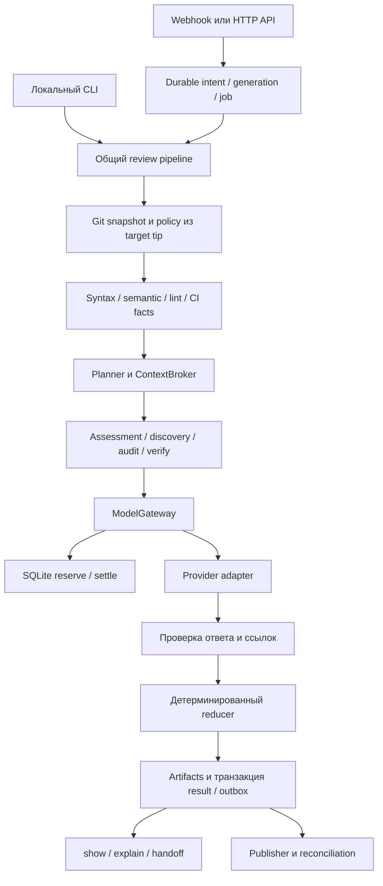

# Roadmap Sych

Дата: 2026-10-28. Базовый commit: `c0d258efd1d8c3df80d37851b1490e1660793f44`.

**Статус:** все 12 задач раздела 2 открыты. Архитектурные решения, дополнительные рекомендации раздела 3, доказательства и ограничения проверки сохранены из ревью; перенос в roadmap не означает исправления дефектов.

**Порядок:** сначала P1 (пункты 1–6), затем P2 (пункты 7–12). Не расширять эксплуатацию до исправления P1.

**Критерий закрытия:** реализовано указанное минимальное исправление и проверен соответствующий сценарий на стыке реальных компонентов; regression-тест или наблюдаемый smoke подтверждает требуемое поведение на исправленном commit. Проверки раздела 4 относятся к исходному ревью, а не к выполнению этих задач.

## Вывод

Sych — модульный Rust-монолит для ревью изменений: детерминированное ядро управляет областью проверки, доказательствами и итоговым решением; модели предлагают оценки и гипотезы. Рассмотренная нагрузка — документированный personal/single-worker deployment и self-review `bondiano/sych`, а не гипотетический многопользовательский кластер.

**Архитектуру стоит сохранить; текущую реализацию нельзя считать безопасной для расширения эксплуатации без исправлений ниже.** Основные проблемы находятся на переходах между уже правильно выделенными подсистемами: данные становятся опциями процесса, часть prompt обходит redaction, промежуточное объединение теряет более серьёзный результат, счётчики и таймеры имеют несовместимые области действия. Замена SQLite, выделение микросервисов или новый orchestration framework эти ошибки не исправят.

Найдено 12 конкретных дефектов. Для восьми получено прямое локальное воспроизведение в реальных библиотеках или HTTP API; для двух дополнительно проверены временные границы storage/scheduler, но не полный медленный worker; два установлены статическим прослеживанием orchestration. Это выборочное архитектурное ревью, не утверждение об отсутствии других ошибок. Реализация в рамках работы не менялась.

## 1. Фактическое устройство

| Граница | Оценка решения |
|---|---|
| `sych-core` | Доменные типы, planner, broker, validators, reducer, gateway contracts. В зависимостях нет HTTP, SQL или process runtime. Это полезная граница, а не слой ради слоя. |
| `sych-adapters` | Git, SCM, модели, LSP, линтеры и sandbox. Внешние эффекты отделены от доменной редукции; недоверенные данные требуют проверки именно на выходе к процессу/сети. |
| `sych-storage` | SQLite, immutable artifacts, fencing, ledger, outbox и retention. Одна connection на `Storage`, WAL/FULL и `BEGIN IMMEDIATE` соответствуют текущей нагрузке. Это не распределённое хранилище. |
| `sych-app` | Связывает CLI и сервер с общим review pipeline. Здесь обнаружены расхождения между локальными правилами стадий и общим контрактом: chunking, приоритет задач, heartbeat. |

Основания: [workspace dependencies](../Cargo.toml), [core dependencies](../crates/sych-core/Cargo.toml), [review pipeline](../crates/sych-app/src/review/mod.rs#L257-L387), [SQLite connection/write](../crates/sych-storage/src/connection.rs#L14-L76), [server loops](../crates/sych-app/src/server/engine.rs#L318-L382).

### Что сделано правильно

- **Разделены проверяемый код и управляющая policy.** Сервер берёт правила из target tip; HEAD policy показывается как изменение. Self-review проверяет commit доверенного build, а PR не подменяет исполняемый reviewer: [trusted_config](../crates/sych-app/src/review/mod.rs#L50-L89), [build pin](../crates/sych-app/src/server/build.rs#L21-L33).
- **Модель не определяет итоговый verdict напрямую.** Локальные IDs, проверка диапазонов и hash, допустимые виды evidence и отдельные coverage/recommendation уменьшают ущерб от неверного ответа. Это существенно полезнее простого prompt поверх diff: [context](../crates/sych-core/src/analysis/context.rs), [reducer](../crates/sych-core/src/reduce.rs).
- **Сбой и неопределённость представлены явно.** `UNKNOWN`, `PARTIAL`, неизвестная стоимость и неизвестный исход публикации не подменяются успехом или нулём. Локальный smoke подтвердил сохранение `UNKNOWN` через `review → show → explain`.
- **Durability устроена разумно.** Generation и fencing не дают старому worker опубликовать результат как актуальный. Result и outbox фиксируются совместно; reconciliation нужен для неизвестного исхода внешней записи, а не слепого повторного CREATE: [storage invariants](STORAGE.md#server-run-finalization-m24), [publisher](../crates/sych-app/src/server/publisher.rs).
- **Ограничены полномочия инструментов.** Git читает объекты, не делает обычный checkout; Rust build scripts/proc-macros отключены в semantic-профиле; execution требует доверенного профиля и контейнера. Это хорошие меры, но очистка environment не заменяет проверку argv или файловую изоляцию.
- **Единый gateway и ledger оправданы.** Различие `api_hard` и `subscription_observable` отражает реальные возможности провайдеров. Не нужно выдавать неизвестную upstream quota за гарантированный hard limit.

## 2. Открытые задачи

Приоритет P1 — безопасность, потеря значимого результата или нарушение центрального runtime-контракта; исправить прежде расширения эксплуатации. P2 — подтверждённая ошибка на более узком сценарии; не считать архитектурным пожеланием. `[INFERENCE]` обозначает последствие, не наблюдавшееся целиком в runtime.

### 1. P1 — Имя файла превращается в опцию несандбоксированного линтера

- **Участок:** `lint::collect` материализует HEAD и запускает pinned binary. [lint/mod.rs:313–327](../crates/sych-adapters/src/lint/mod.rs#L313-L327), [lint/run.rs:18–37](../crates/sych-adapters/src/lint/run.rs#L18-L37).
- **Проблема:** относительные repository paths добавляются к argv без `./` или разделителя опций. Путь вида `--output-file=/absolute/owned-canary.py` допустим в Git tree и выбирается как Python-файл. Ruff воспринимает его как параметр, а не как исходник. Empty HOME/PATH не ограничивает запись в файловую систему.
- **Проверка:** реальный `lint::collect` с Ruff **0.17.2**, совпадающим с pinned version, переписал специально созданный файл за пределами materialized workspace и поместил туда SARIF. Lint facts стали `FAILED`, потому что stdout больше не содержал отчёт. Использовались только временные файлы этого ревью; произвольное выполнение кода не проверялось и не заявляется.
- [x] **Минимальное исправление:** в общей сборке argv передавать все repository paths с `./` либо как абсолютные пути внутри workspace. Это не зависит от различий поддержки `--` у линтеров. Добавить regression с option-like filename и запретом изменения внешнего canary.
- **Если оставить:** автор PR сможет управлять опциями host tool; воспроизведённая операция позволяет перезаписывать доступный reviewer-процессу путь. Существующие [lint tests](../crates/sych-adapters/tests/lint.rs) используют обычные имена и этот сценарий не покрывают.

### 2. P1 — Redaction не обрабатывает заголовки DATA-блоков

- **Участок:** syntax detail становится `reason_selected`, затем `DataBlock.label`. [observations.rs:176–205](../crates/sych-core/src/broker/observations.rs#L176-L205), [context.rs:110–157](../crates/sych-core/src/analysis/context.rs#L110-L157), [contract.rs:102–115](../crates/sych-core/src/model/contract.rs#L102-L115).
- **Проблема:** `Prompt::messages` маскирует только `block.content`; label проходит лишь замену newline и `>`. Исходный литерал или diagnostic text в причине выбора fragment обходит единую точку очистки model egress.
- **Проверка:** в отдельном Git fixture выражение `std::env::var("<искусственный ghp-canary>").ok();` прошло настоящий syntax → broker → context. Built-in redactor распознал canary, но два label сохранили его, и итоговый `Prompt::messages` содержал исходную строку. Семантика была выключена; внешний provider не вызывался.
- [x] **Минимальное исправление:** применять тот же redactor к label в `Prompt::messages`, затем выполнять delimiter sanitization. Проверять полный исходящий message, а не только body каждого блока.
- **Если оставить:** распознаваемый секрет из проверяемого кода/диагностики может уйти внешней модели, хотя в самом source span он замаскирован. Это обход существующего правила, а не обычное ограничение эвристического secret detection; доступ к секретам окружения этим сценарием не доказан.

### 3. P1 — Раннее удаление дубликатов теряет более серьёзный finding

- **Участок:** [verify.rs:166–175,249–259](../crates/sych-core/src/analysis/verify.rs#L166-L175), [passes.rs:250–258](../crates/sych-app/src/analysis/passes.rs#L250-L258), [parts.rs:65–74](../crates/sych-app/src/analysis/parts.rs#L65-L74).
- **Проблема:** fingerprint зависит от категории и первого anchor, но не severity. Первый finding выигрывает до общего `merge_overlapping`, который как раз умеет выбирать наиболее серьёзный. Одинаковая first-wins политика продублирована в трёх местах.
- **Проверка:** на реальном pinned Git snapshot два admissible verdicts с одним первым anchor, `LOW → HIGH`, стали `[CONFIRMED, CONFIRMED]`; итоговый список после `merge_overlapping` содержал единственный `LOW`. Для `HIGH` были переданы два anchor и `STATIC_TRACE`.
- [ ] **Минимальное исправление:** убрать ранние first-wins фильтры и сводить findings существующим severity-aware merge либо централизовать в нём разрешение одинаковых fingerprints. Проверить оба порядка и объединение разных passes.
- **Если оставить:** `[INFERENCE]` при отсутствии отдельной `VIOLATED` obligation значимая проблема может исчезнуть из итоговой recommendation. [Текущий merge test](../crates/sych-core/tests/analysis/verify.rs#L146-L177) использует разные первые anchors и поэтому не ловит дефект.

### 4. P1 — Повторяющийся criterion ID скрывает противоречивую оценку

- **Участок:** [assess.rs:135–185,280–296](../crates/sych-core/src/analysis/assess.rs#L135-L185); аналогичный выбор первого assessment по `ob-N` есть в [passes.rs:109–127](../crates/sych-app/src/analysis/passes.rs#L109-L127).
- **Проблема:** для каждого `c-N` берётся первый элемент через `.find`. Проверка неизвестных IDs не проверяет уникальность известных. Второй ответ с `UNKNOWN`, `NOT_MET` или неверными references не участвует в решении.
- **Проверка:** схемно допустимый `SUPPORTED` с двумя `c-1`: `MET` с настоящим anchor, затем `NOT_MET`, был принят `validate_assessment` как `SUPPORTED`. Полный combined-review случай с повтором `ob-N` отдельно не исполнялся.
- [ ] **Минимальное исправление:** требовать ровно один результат для каждого ожидаемого criterion и obligation; неоднозначный ответ оставлять `UNKNOWN`. Уже есть подходящий образец проверки cardinality в [verifier](../crates/sych-core/src/analysis/verify.rs#L121-L130).
- **Если оставить:** противоречивый model output может закрыть обязательную проверку. Reducer уже не видит отброшенный второй ответ и не может восстановить неопределённость.

### 5. P1 — `RELEASED` освобождает не только деньги, но и лимит попыток

- **Участок:** [ledger.rs:65–108](../crates/sych-storage/src/ledger.rs#L65-L108), [gateway.rs:182–202](../crates/sych-core/src/model/gateway.rs#L182-L202).
- **Проблема:** production SQL считает `run_attempts` только для `state <> 'RELEASED'`. Отказ после Sych-initiated запроса, классифицированный как `dispatched=false`, освобождает денежный резерв и одновременно исчезает из счётчика попыток. Fallback использует тот же ledger.
- **Проверка:** на настоящем SQLite store при `max_attempts=1` выполнены reserve → `Settlement::Released` → второй reserve того же run. Второй получил `Ok(())`. Внешние HTTP вызовы для проверки не понадобились.
- [x] **Минимальное исправление:** не исключать released attempts из счётчика попыток; деньги освобождать по-прежнему. Перенести [существующий router cap scenario](../crates/sych-core/tests/router.rs#L208-L228) на реальный SQLite ledger: его in-memory реализация сейчас считает все rows и скрывает расхождение.
- **Если оставить:** `[INFERENCE]` цепочка отказов/fallback выполняет больше запросов, чем разрешает hard attempt cap. Превышение денежного tenant cap этим сценарием не доказано.

### 6. P1 — Lease обслуживается только на стадии analysis и не по настроенному интервалу

- **Участок:** [worker.rs:78–205](../crates/sych-app/src/server/worker.rs#L78-L205), [worker.rs:216–235](../crates/sych-app/src/server/worker.rs#L216-L235), [build.rs:79–96](../crates/sych-app/src/server/build.rs#L79-L96).
- **Проблема:** token, fetch, pin и CI collection идут после claim, но до первого heartbeat. Fetch разрешено ждать 120 секунд при default lease 60. Кроме того, validator принимает `0 < heartbeat_seconds < lease_seconds`, но runtime использует константу 15 секунд и не переносит configured heartbeat в Engine.
- **Проверка границ:** CLI принял `lease_seconds: 10`, `heartbeat_seconds: 2`. Реальный storage отказал в `prepare_run` на T+65 для lease60 и в heartbeat на T+15 для lease10. Это проверка фактического fencing с заданным временем, не полный сценарий медленного network fetch.
- [ ] **Минимальное исправление:** поддерживать claim от получения до release/terminal transition, включая PREPARE/CI, с настроенным интервалом. Не ослаблять fence, чтобы «починить» просроченный worker.
- **Если оставить:** `[INFERENCE]` успешная, но медленная подготовка теряет lease; reaper запускает её заново, расходуя attempts до отказа. Проблема достижима в одном процессе, без конкурирующего worker.

### 7. P2 — На границе UTC-месяца обнуляется lifetime budget run/session

- **Участок:** [ledger.rs:60–82](../crates/sych-storage/src/ledger.rs#L60-L82), [followup scoped ledger](../crates/sych-app/src/followup.rs#L309-L321).
- **Проблема:** общий `WHERE tenant_id = ? AND month = ?` ограничивает не только месячный pool, но и aggregates для run/purpose/scope: деньги, attempts и tokens. Долгоживущая follow-up session сохраняет identity между месяцами, её лимит при этом не должен начинаться заново.
- **Проверка:** один run и scope `followup:tour:actor`, cap 500 micro-USD. Два резерва по 400 внутри октября: второй отвергнут по run money. Такой же второй резерв на `2026-11-01T00:00:01Z`, после первого на `2026-10-31T23:59:59Z`: принят. Использован production SQLite ledger.
- [x] **Минимальное исправление:** считать lifetime run/purpose/scope отдельно от day/month aggregates в той же write transaction. Дополнить [per-session cap test](../crates/sych-storage/tests/ledger.rs#L310-L346) переходом календарного месяца.
- **Если оставить:** run/session получает повторный бюджет. Месячный tenant pool должен сбрасываться и сам по себе этим сценарием не обходится.

### 8. P2 — Job retry deadline короче разрешённого ожидания CI

- **Участок:** [engine.rs:24–25,168–176](../crates/sych-app/src/server/engine.rs#L24-L25), [requests.rs:102–104](../crates/sych-app/src/server/requests.rs#L102-L104), [worker.rs:143–180,249–265](../crates/sych-app/src/server/worker.rs#L143-L180), [.sych/config.yaml:5–13](../.sych/config.yaml#L5-L13).
- **Проблема:** job получает фиксированные 600 секунд: `300 + 180 + 120`. При этом собственная policy Sych разрешает ждать CI 900 секунд. После штатного ожидания retry/recovery уже ограничен истёкшим deadline.
- **Проверка границы:** настоящий `retry_at(Transient, attempt=1, now=T+901, deadline=T+600)` вернул `None`. Full wait900 → временный fetch failure не запускался; достижимость установлена через callers и реальную policy.
- [ ] **Минимальное исправление:** в PREPARE согласовать persisted job deadline с фактическим evidence deadline, active analysis budget и transport slack. Не оставлять вторую константу, предполагающую CI wait180.
- **Если оставить:** `[INFERENCE]` transient failure или crash после разрешённого ожидания превращается в `FAILED` вместо retry. **Это не означает остановку любого run на 600-й секунде:** queued job не отсекается по deadline в `claim`; успешное продолжение возможно.

### 9. P2 — Второй лимит контекста скрывает усечение полного ответа

- **Участок:** [discovery.rs:178–214](../crates/sych-core/src/analysis/discovery.rs#L178-L214), [ops.rs:222–232](../crates/sych-core/src/broker/ops.rs#L222-L232), [analysis MAX_REFS_PER_ANSWER](../crates/sych-app/src/analysis/mod.rs#L31-L32).
- **Проблема:** broker search может вернуть полный набор до десяти совпадений; `ContextAsk::answer` показывает только первые три, сохраняя исходный status и limitations. Для непустого ответа отдельный блок с полнотой операции вообще не добавляется.
- **Проверка:** реальный поиск по pinned Git tree вернул четыре refs. В model context попали три, `Answered.status` остался `COMPLETE_FOR_QUERY`, `limitations=[]`.
- [ ] **Минимальное исправление:** учитывать дополнительное усечение при формировании answer и всегда показывать status/limitations операции. Нельзя использовать неполный показанный набор как доказательство отсутствия; автоматически объявлять весь review partial при любом частичном lookup необязательно.
- **Если оставить:** `[INFERENCE]` скрытый четвёртый caller может менять вывод verifier. Артефакт также создаёт неверное впечатление полноты показанного ответа.

### 10. P2 — После chunking risk audit проверяет только первый verification packet

- **Участок:** [analysis/mod.rs:251–258,356–363](../crates/sych-app/src/analysis/mod.rs#L251-L258), [audit context](../crates/sych-app/src/analysis/mod.rs#L293-L315), [assessment all-chunks path](../crates/sych-app/src/analysis/passes.rs#L31-L38).
- **Проблема:** broker умеет делить verification context одной obligation на несколько packets. Assessment обходит все chunks, а risk audit вызывает helper с `.next()` и получает только первый. Это неполное обновление caller при изменении cardinality «один → несколько».
- **Доказательство:** статическая цепочка от `verification_packets` к `verification_packet` и единственному `audit(index)`. Runtime сценарий с несколькими audit chunks не исполнялся.
- [ ] **Минимальное исправление:** планировать audit всех verification chunks через существующий механизм; невозможность обработать chunk отражать явно. Нужен сценарий с дефектом только во втором chunk, а не ещё один тест discovery batching.
- **Если оставить:** `[INFERENCE]` часть HIGH/CRITICAL obligation не получает заявленный независимый поиск. Пропущенная задача не попадёт в gaps, поскольку вообще не создана.

### 11. P2 — Combined review выполняется раньше более важного standalone assessment

- **Участок:** [analysis/mod.rs:194–244](../crates/sych-app/src/analysis/mod.rs#L194-L244), [combined call budget](../crates/sych-app/src/analysis/passes.rs#L97-L102), [documented priority](ANALYSIS.md#passes).
- **Проблема:** obligations сортируются required-first, но фактическая очередь сначала получает все combined-review tasks в порядке batches и лишь затем standalone assessments. Combined task имеет доступ к полному assessment budget.
- **Сценарий:** optional local obligation помещается в combined packet; required HIGH obligation на несколько units требует standalone assessment; `max_attempts=1`, `max_parallel_calls=1`. `[INFERENCE]` единственная попытка уходит optional task, required становится `UNKNOWN/BUDGET_EXHAUSTED`.
- **Доказательство:** порядок построения и исполнения tasks прослежен по исходникам. Такой mixed-task runtime сценарий не запускался. UNKNOWN здесь не теряется: нарушается заявленный приоритет расходования бюджета.
- [ ] **Минимальное исправление:** сортировать общую очередь assessment-bearing tasks, combined и standalone вместе, по required/risk относящихся к ним obligations.
- **Если оставить:** при тесном бюджете система проверяет менее важную часть раньше обязательной; корректный механизм reserve не компенсирует неверный порядок задач.

### 12. P2 — API idempotency не включает идентификатор целевого ресурса

- **Участок:** [api.rs:149–188](../crates/sych-app/src/server/api.rs#L149-L188), [cancel handler](../crates/sych-app/src/server/api.rs#L324-L355), [storage replay](../crates/sych-storage/src/api.rs#L89-L126).
- **Проблема:** identity состоит из tenant, actor, шаблона endpoint и key; digest считается только от body. `/v1/runs/A/cancel` и `/v1/runs/B/cancel` с одинаковым key и `{}` оказываются одной операцией.
- **Проверка:** запущен настоящий `sych api` на loopback с временной SQLite и искусственной writer identity. Cancel A вернул 200/CANCELLED. Cancel B с тем же key вернул 200, `reused: true` и **run_id A**; отдельный GET B показал `QUEUED`. Сервер остановлен через SIGINT, exit0.
- [ ] **Минимальное исправление:** включить конкретный URI/ресурс в fingerprint запроса либо в idempotency scope; применить ко всем parameterized mutating routes, включая rerun, feedback и tour actions/questions. Повтор для другого ресурса должен быть отдельной операцией или конфликтом, не replay чужого результата.
- **Если оставить:** клиент получает успешный ответ не о запрошенном действии, а второй run продолжает работу. Authorization проверяется до replay; обход доступа этим сценарием не выявлен.

## 3. Оценка решения и пределы гарантий

### Модульный монолит и SQLite — оставить

Для документированной personal-нагрузки транзакционный SQLite и один worker проще отдельной очереди, брокера сообщений и распределённой БД. Fencing/outbox нужны даже в одном процессе: они защищают от restart, supersede и неизвестного исхода HTTP-записи. Это не избыточные абстракции.

`api` и `worker` не следует воспринимать как готовый multi-host deployment с локальной SQLite: документация уже требует другого storage для разных машин. Поле `workers.concurrency` сейчас валидируется как положительное, но рабочий цикл остаётся одним; безопаснее явно отвергать неподдерживаемые значения, чем обещать масштабирование настройкой. CLI принял `concurrency: 8`; восемь workers runtime не создаёт ([config](../crates/sych-core/src/config/server.rs#L254-L266), [engine loop](../crates/sych-app/src/server/engine.rs#L355-L382)).

### Детерминизм — только при одинаковых полных входах

Детерминированы планирование, проверка структурированных ответов и редукция при одинаковых facts, assessments и времени оценки waivers. Один Git diff не гарантирует одинаковый новый review: модели недетерминированы, IDs и timestamps создаются заново, внешняя evidence меняется. README-формулировку «the same inputs give the same result» следует читать в этих границах; [ANALYSIS.md](ANALYSIS.md#limitations) уже оговаривает недетерминизм модели.

Полнота scope и истинность вывода — разные свойства. `CONFIRMED` означает принятие по локальной verification policy, не доказательство поведения всей программы. `COMPLETE_FOR_SCOPE` не даёт права закрыть PR при известной неоднозначности, потерянной до reducer.

### Качество — измерено на development suite, не принято на holdout

Архивный [dev-cheap_api-c-m3.json](examples/quality/dev-cheap_api-c-m3.json), variant C:

| Метрика | Записанное значение |
|---|---:|
| Выполненные runs | 123 |
| Найденные размеченные дефекты | 42 / 48 |
| Correctness findings на размеченных locations | 58 / 88 |
| Safe runs с ложным finding | 16 / 66 |
| Сохранённые UNKNOWN cases | 4 / 9 |

Число runs взято из JSON; текст `ANALYSIS.md` рядом с этим артефактом называет 121. Эти измерения не повторялись в данном ревью и не относятся к свежему запуску базового commit.

Scoring сопоставляет координаты, не смысл причинной цепочки; `unknown_kept` также не доказывает сохранение именно размеченной неопределённости. В holdout нет размеченных YAML cases. Поэтому результаты полезны для разработки, но не подтверждают независимую quality acceptance текущих моделей и правил: [scoring](../crates/sych-app/src/quality/score.rs#L190-L308), [holdout contract](../eval/quality/holdout/README.md).

### Где уменьшать сложность

Не вводить новые общие слои. Удалять повторную реализацию уже существующего контракта: first-wins merge в трёх местах, отдельную трактовку cardinality в assessment/verifier, дублирующие представления deadline. Число потенциально удаляемых строк не оценивалось; выдуманная экономия здесь ничего не доказывает.

Большая часть нужных regression-сценариев должна проверять **стык настоящих компонентов**, а не ещё один удобный stand-in: SQLite ledger с router cap contract, syntax/broker с полным outgoing prompt, несколько chunks с audit scheduler, HTTP URI с persisted idempotency. Наличие зелёного suite не опровергает воспроизведённые расхождения.

## 4. Исходные проверки ревью

- `just check` — успешно: fmt, cargo-machete, Clippy, sych-style и workspace tests; **451 passed, 0 failed, 5 ignored**. Пропуски относятся к Docker/network-зависимым сценариям и не считались успешными проверками.
- `cargo build --locked -p sych-app --bin sych` — успешно; далее запускался собранный CLI.
- Изолированный временный Git repository и store: `db migrate`, затем `review --base target --models fake --semantic off --exit-policy strict --format json`. Получены exit11, `PLAN_EXECUTED`, `PARTIAL`, `NEEDS_EVIDENCE`, required `UNKNOWN/NOT_ASSESSED`, **0 model attempts**. `show` вернул идентичный JSON; `explain` сохранил UNKNOWN.
- Одноразовый Rust executable, связанный с реально собранными crates, воспроизвёл пункты 1–5, 7 и 9 через production library APIs. Ruff использовался установленный, версии 0.17.2; не подменялся stub. Model messages проверены локально, не отправлялись provider.
- Для пунктов 6 и 8 проверены принятие конфигурации и реальные функции storage/scheduler с заданными timestamps. Медленный fetch и crash после 900 секунд ожидания целиком не воспроизводились.
- Настоящий `sych api` на loopback воспроизвёл пункт 12; использовались только временные данные и искусственная identity, без SCM connections.
- Пункты 10 и 11 проверены статическим прослеживанием callers и прочитанными существующими тестами; runtime-воспроизведения для них нет.

Временные сценарии не являются новыми постоянными тестами проекта. В них не использовались production credentials, настоящие секреты или платные модели.

## 5. Границы ревью

Прочитаны архитектурные guides, зависимости crates, CI/image workflow, основной CLI/server flow и связанные участки core/adapters/storage; независимые read-only срезы проверяли trust boundaries, durability/budgets и review semantics. Это углублённая проверка критических потоков, не построчный аудит всего дерева.

Не проверялись live provider contracts и quota, качество текущих моделей, production Kubernetes/configuration, реальное восстановление из backup, контейнерная изоляция на Linux, нагрузочная ёмкость и все поддерживаемые языки. LSP для навигации оказался недоступен: официальный toolchain не содержит `rust-analyzer`; callers прослеживались поиском и чтением кода. Это не свидетельство отказа Sych semantic backend, который использует собственный pinned tool cache.

**Вердикт:** сохранить основные границы архитектуры, сначала устранить P1 на входах/выходах и при редукции, затем закрыть P2 сценариями на стыках компонентов. Не расширять обещания безопасности, полноты и бюджетных гарантий на основании одного зелёного suite или архивной development-метрики.
