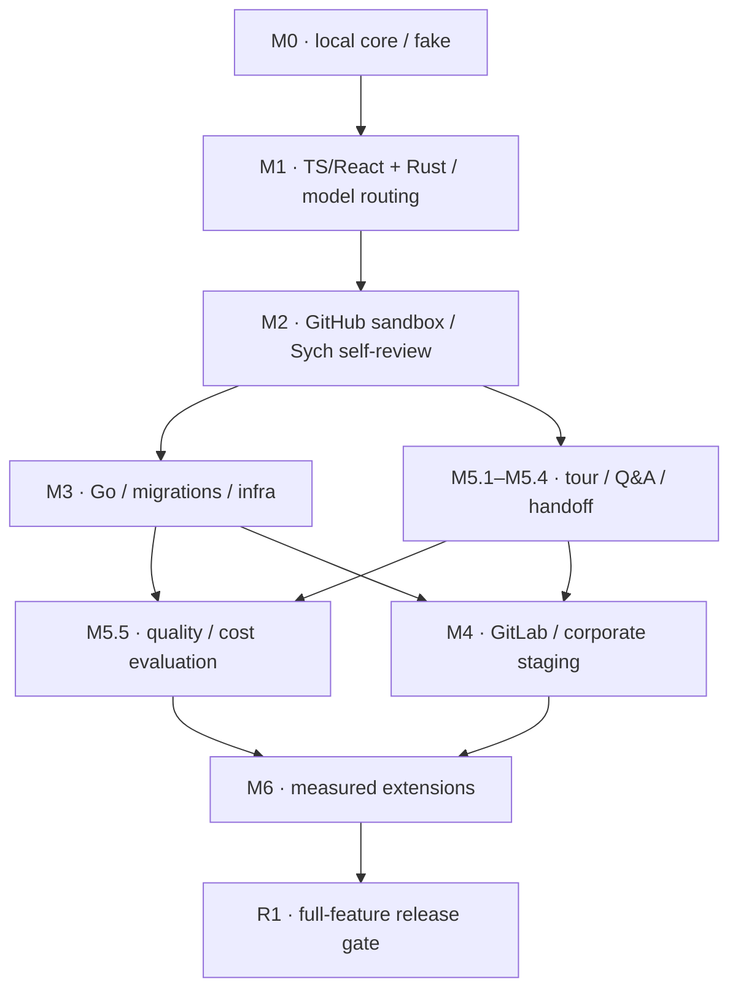

# Sych — implementation roadmap

**Basis:** [SYCH_SPEC.md v1.2](SYCH_SPEC.md), October 25, 2026. **Status:** an agreed plan, not a report of completed features.

The roadmap turns §28 of the specification into tasks with dependencies, verifiable **Acceptance Criteria (AC)** and a **Definition of Done (DoD)**. The original `AC-01…AC-47` keep their IDs; `AC-48…AC-60` were added in v1.2 for the agreed model/routing/Rust/self-review requirements. AC inside a task are local criteria, not a renumbering of the original cases.

## 1. Execution rules and release boundaries

### Full feature set before production

**No production before the full feature scope.** M0–M6 are development only, local runs and isolated test/staging environments. Real API/model/SCM checks run on sandbox repositories and synthetic/permitted non-production data with separate non-production credentials. Pet deployment, corporate shadow mode, connecting the bot for real and publishing comments in working PRs/MRs are not exceptions. A local read-only review of permitted real code is not a rollout by itself; trusted policy, access/retention and egress restrictions still apply to it.

The first production is possible only after **R1**. The release baseline is **M0–M6 in full**: CLI/API, both SCMs, high-quality TS/React and Rust paths, Go/infra/basic Python, OpenRouter and GPT/GLM/OpenCode subscription access, DeepSeek/fallback/Astra/Fable routing, safe GitHub self-review of Sych, security/ops and tour/Q&A/handoff. The conditional composition of M6 is explicitly approved by the owner in M6.1 (M6.6 Web UI/dashboard in Flick is already included by decision D12); new mandatory M1/M2 features cannot be moved there as optional. An unfinished included feature closes the release gate; reducing the baseline requires the owner's explicit consent.

Readiness of M0, M1, M2 or M4 means readiness of the corresponding dev/staging scenario, **not release permission**. In §28 terms, M2 "real pet repository" means a sandbox pet repository; M4 "shadow mode" means corporate test/staging. Passing R1 deploys nothing by itself: a production rollout requires a separate explicit action by the owner.

### Conventional Commits

We follow [Conventional Commits 1.0.0](https://www.conventionalcommits.org/en/v1.0.0/):

```text
<type>[optional scope][!]: <description>
```

- `feat` is a new feature, `fix` is a defect fix; `docs`, `test`, `refactor`, `perf`, `build`, `ci`, `chore` and other appropriate types are allowed. Scope is optional; the local convention is lowercase type/scope.
- A breaking change is marked with `!` before `:` and/or a footer `BREAKING CHANGE: <description>`; an incompatible change is described explicitly. Body/footer are separated by a blank line. This does not cancel the migration/compatibility DoD.
- On squash, the final message of the commit landing in the main branch is checked. Examples: `feat(snapshot): pin target and head separately`, `fix(publisher): reconcile uncertain writes`, `docs: add implementation roadmap`.

The rule applies to commit messages; installing commitlint, a release bot and automated publishing is neither required nor implied here.

### How tasks are accepted

- **AC:** observable behavior and boundaries, including errors/incomplete data. **DoD:** code/contracts/fixtures/documentation and evidence with which the result can be accepted. The common DoD below is mandatory **together with** each task's local DoD.
- A task is done only after all AC and DoD; a fake provider proves the harness, but not model quality and not that a real adapter works. An honest `PARTIAL/UNKNOWN` at a designed boundary is correct behavior, but the absence of a promised adapter does not count as a finished feature.
- A PR lists task IDs, the original §/AC/INV, the affected callers/config/schemas/fixtures and limitations; all changed contracts and user documentation are updated. An enum/schema change needs a compatible migration path and an old fixture.
- The existing `just check`/`just build`, meaningful deterministic checks and a real smoke of the changed path are used; for integrations, sandbox only. Evidence includes the exact command/scenario, versions/config and the observed output without secrets. A real model/SCM path cannot be replaced with a fake and the gate marked as passed.
- Repo content/tool stdout/model output are data. The reviewer does not edit sources, does not merge, deploy, run `terraform apply` or DDL in a real environment. Trust/access/secret filtering and budgets apply from the first stage that uses them, and are not postponed until M4.
- Selective tests prove behavior, not verbatim text. The harness suite and quality evaluation are independent. Successful CI by itself is not evidence of review completeness.
- No calendar promises and no estimates in days: the first repos and strategies are chosen, but real account entitlements, model/price/fee profiles, CI selectors and the corporate environment still require evidence. The sequence is set by dependencies/gates; initial caps do not turn into promises of price, quality or capacity.

## 2. Starting point and order of work

According to the current [README](../README.md), M0 is done on a fake adapter: the local path `review → JSON/Markdown → show/explain`, SQLite/artifacts and the fake eval suite; evidence is the workspace tests, CLI smoke and the [local review guide](LOCAL_REVIEW.md). Review quality on real models is not confirmed by this. Status is marked with checkboxes: `[x]` on a task means all its AC/DoD are closed; `[x]` on an individual AC/DoD means the item is confirmed by code and documentation (M1.1–M1.7, M1.9, M2.2 and M2.4 fully; M1.8, M1.10–M1.14 partially — subscriptions have no real smokes, the holdout is not labeled; M2.1, M2.3 and M2.5–M2.9 partially — implemented and verified on a loopback GitHub fake, the real sandbox connection is waiting for the owner's App; M3.1–M3.2 fully, M3.3 without the real domain evaluation of M3.8 — [SEMANTIC.md](SEMANTIC.md); model review — [ANALYSIS.md](ANALYSIS.md), server — [SERVER.md](SERVER.md)), `[ ]` means not closed or no evidence yet.

The M0–M6 numbering is kept from the specification; the execution order is refined by dependencies:



M3 and the local tour can evolve independently after M2. The tour contract and AC-34–36 are mandatory before the corporate connection: this resolves the conflict between the late M5 number in §28 and the early requirement of §29. The web reader does not block the CLI tour, but the web scope included in the release baseline blocks R1.

First we finish one local M0 scenario, then the high-quality TS/React and Rust paths of M1 and common model routing; M2 includes safe self-review of a sandbox mirror of Sych. The first local review does not wait for Kubernetes/GitLab/web UI. The owner enabled the live bot on `bondiano/sych` before R1 (2026-10-27) — advisory only and with a pinned build ([SERVER.md](SERVER.md#self-review-bondianosych)).

## 3. Tasks by stage

## M0. Deterministic local core

**Stage result:** a persisted local review of two commits through real Git/SQLite and a fake model adapter, with no external APIs. The existing bootstrap workspace/CLI/CI is reused; it does not count as completion of M0.

### [x] M0.1. Domain contracts and a reproducible workspace

**Dependencies:** none; the existing `Cargo.toml`, toolchain, lockfile and quality gates. **Source:** §4–5, §25.4, §32.

**Result:** the engine types and DTOs in use in `sych-core`, schemas and minimal adapter interfaces; other crates appear together with working code, without empty architecture.

**AC**
- [x] `sych-core` does not depend on HTTP, SQL or a model SDK; there are no cycles between crates. Dependency versions are pinned; there are no floating git dependencies.
- [x] IDs, UTC timestamps, micro-USD, Git OID with algorithm, canonical hashing and `schema_version` conform to §5.1; an unknown major version is rejected explicitly.
- [x] SourceSnapshot, PolicySnapshot, Evidence, Obligation, Candidate/Finding and ReviewResult keep the execution, coverage, recommendation, publication and relevance states distinct; extending a DTO does not break reading of agreed old fixtures.

**DoD**
- [x] DTOs and the JSON Schema generator use a single source of types; regeneration gives the same result. OpenAPI is extended when HTTP appears in M2, rather than created separately by hand.
- [x] Fixtures for serialization, an incompatible version and the canonical hash are saved; the existing `just check` and `just build` run on the pinned toolchain.

### [x] M0.2. Safe Git snapshot, diff manifest and CodeRef

**Dependencies:** M0.1. **Source:** §5.3, §6, §24.1; AC-01–03.

**Result:** immutable `target_tip`, `diff_base`, `head`, blobs and a complete manifest of changed files.

**AC**
- [x] `--base` means the target ref; merge-base is computed separately. An explicit `--diff-base` supports exact comparison; incompatible flags are rejected. No merge-base means an explicit comparison mode or `UNAVAILABLE`, not an arbitrary commit.
- [x] Renames, Unicode/encoding, deleted lines, binary/generated/excluded files, symlinks, submodules and LFS do not disappear from the manifest. CodeRef resolves to the correct side/blob/range/hash; UTF-8 offsets are not mixed with UTF-16 positions.
- [x] A truncated SCM diff yields a Git fallback or declared omissions and `PARTIAL/UNAVAILABLE`. An empty diff creates an explicit empty scope and spends no model budget.
- [x] Git does not run hooks, textconv, external diff/filter or submodules; reading does not escape the snapshot through a symlink. Sources, the working tree and the global Git config are not changed.

**DoD**
- [x] Fixture repositories cover diverging target/head, shallow history, rename/Unicode/deletion, no-op and unavailable history; a snapshot manifest with verifiable hashes is saved.
- [x] A real `sych review --repo ... --base ... --head ... --models fake` reads Git objects; it is verified that a malicious helper/symlink fixture is not executed and does not read a host file.

### [x] M0.3. Trusted policy, effective config and early trust boundaries

**Dependencies:** M0.1–M0.2; D10 before real user code. **Source:** §6.2, §11, §22–23, §24.1; AC-05, AC-33.

**Result:** a validated configuration and PolicySnapshot from the accepted ref, not from the head under review.

**AC**
- [x] The precedence engine → organization → accepted repository → path/domain → permitted preferences is preserved. A PR shows the policy diff, but does not weaken its own rules, budget, tools, credentials or endpoint allowlist.
- [x] `.sych/config.yaml`, `rules.yaml`, `effects.yaml`, `deploy.yaml`, contracts and `sych.yaml` are normalized and hashed. Unknown keys produce an error with the exact path, YAML/JSON enums are converted in a typed way; a conflict between mandatory rules is not silently resolved by the model.
- [x] `config init --personal` does not overwrite existing files; `config validate` checks schema/paths/roles/limits. `doctor` checks only availability and permissions, with no deploy, comment or paid call; the model is probed only with `--probe-model` after M1.
- [x] Repository text and model output remain data. Secrets do not end up in logs/debug payloads; path policy, redaction and the egress allowlist apply before any model call in M1. Execution is off by default.

**DoD**
- [x] Fixtures for policy weakening, conflicting rules, an erroneous config path and secrets pass without external requests; effective config and policy provenance are available for diagnostics without secrets.
- [x] There are working personal config examples and config/doctor instructions. Server auth/bind checks are added in M2, corporate restrictions in M4, on the same contract.

### [x] M0.4. Scope, review units, obligations and the local reducer

**Dependencies:** M0.1–M0.3. **Source:** §3, §5.4–5.7, §7–8.3, §11; AC-01, AC-05–08, AC-40, AC-44.

**Result:** a deterministic review plan and an honest ReviewResult regardless of whether there are candidates.

**AC**
- [x] Before discovery, review units, requested profiles, required obligations, minimal evidence, risk routing and exclusions with reasons are fixed. A related handler/wrapper/schema/consumer may be one unit; mandatory scope cannot be narrowed for the sake of a complete status.
- [x] Three-valued applicability is preserved: a required rule with unknown applicability creates `UNKNOWN` with a reason and next evidence; `NOT_APPLICABLE` requires a verifiable basis. Empty discovery does not close obligations.
- [x] The reducer distinguishes justified `SUPPORTED`, `VIOLATED`, `UNKNOWN` and `NOT_APPLICABLE`; a checked violation is not lost when findings are empty. With a significant violation the recommendation is `ATTENTION_REQUIRED`, otherwise with a mandatory gap it is `NEEDS_EVIDENCE`; coverage is shown separately.
- [x] A limit/excluded guard/unchecked files do not yield `COMPLETE_FOR_SCOPE`. An unavailable diff is `UNAVAILABLE`; a persistence failure is not `COMPLETED`. Freeze separates external inputs from the derived evidence of the pinned snapshot.

**DoD**
- [x] Deterministic SAFE/VIOLATED/no-evidence/no-op/overflow fixtures check the final obligations, recommendation and coverage, not the verbatim text of the explanation.
- [x] On a single fixture, ScopeManifest, PolicySnapshot, ExternalInputManifest and the final EvidenceManifest are saved; the path from the original criterion to the result is explainable. A concurrent fenced commit is implemented in M2, not simulated here.

### [x] M0.5. SQLite, immutable artifacts and local operations

**Dependencies:** M0.1, M0.4. **Source:** §8.2, §20, §24.4; AC-40.

**Result:** durable local runs/results/evidence with a tenant/access partition, migrations and controlled GC.

**AC**
- [x] SQLite uses WAL and one worker by default; nested domain objects are stored as versioned artifacts, without a separate SQL table for each field.
- [x] Bytes are saved before the pointer commit. The result pointer, usage and terminal state are committed atomically; a write failure does not leave a false `COMPLETED` or a reference to an unsaved artifact.
- [x] `db migrate` runs in a controlled way; `cache prune --dry-run` deletes no data. GC protects active pins, unresolved writes/charges and retention: raw/source 7 days, normalized results/evidence/tours 30, audit/usage 90 — until agreed overrides.
- [x] Re-reading a saved result does not start analysis; a lost source blob is explicitly unavailable and is not replaced with generated code.

**DoD**
- [x] Real DB reopen/artifact reads after restart, pointer commit rollback and orphan GC after the grace period are verified.
- [x] There are SQLite migrations and storage contract fixtures that later also run for PostgreSQL in M4; a documented local backup/retention is not presented as a verified corporate restore.

### [x] M0.6. Local CLI, renderers and the fake acceptance suite

**Dependencies:** M0.2–M0.5. **Source:** §24.1/24.4/24.5, §27.1, §28 M0, §32; AC-01, AC-05–06, AC-40.

**Result:** a finished path `review → persisted JSON/Markdown → show/explain`, suitable for the following stages.

**AC**
- [x] `review --models fake --fake-responses PATH` reproducibly saves a result; without a fixture, fake assessments honestly remain unchecked. `show --run` and `explain --obligation` read the saved evidence. A local review does not publish to the SCM.
- [x] Exit codes: 0 only for a completed operation with a saved review, 2 invalid input/config/schema, 3 no usable result, 4 credentials, 130 accepted cancellation. In strict mode, 10 significant violation takes precedence over 11 incomplete; operational mode does not fail the CLI because of an advisory finding.
- [x] JSON and Markdown preserve scope, snapshot/policy/provenance, coverage, obligations, findings, gaps and usage; repository Markdown/HTML and terminal control sequences are safely escaped.
- [x] `eval run --suite eval/smoke.yaml --models fake` does not call external APIs; the same fixture yields the same meaningful states, not necessarily the same runtime IDs/timestamps.

**DoD**
- [x] A real CLI smoke passes the happy path, empty diff, required UNKNOWN, checked violation, failed save and cancel; outputs and exit codes are attached to the PR.
- [x] JSON/Markdown examples and the local review guide are updated; M0 is accepted only after a working end-to-end scenario, not on a successful scaffold build.

**Stage AC:** M0.1–M0.6 and the original §28 M0 gate are met. **Stage DoD:** commands, artifacts and a deterministic fake suite report are saved; external API calls — zero.

## M1. First useful AI review for TS/React and Rust

**Stage result:** a reproducible local review of the Vkusori PWA/core and the Sych Rust workspace: real permitted model access, exact evidence, an independent obligation assessment/verifier, rules/nitpicks and a monetary/quota/enforcement report. OpenRouter, GPT/GLM/OpenCode subscriptions and controlled DeepSeek/subscription/premium routing are mandatory, not optional M6. Real smokes are local/sandbox only with permitted credentials/data; SCM publication and production are not part of M1.

**Normative basis:** `SYCH_SPEC.md` §28/M1; detailed requirements are given in the tasks. AC-xx below are the original §29 cases; a task's own AC spell out its behavior, the DoD lists the necessary artifacts and evidence of readiness. A dependency on M0.1–M0.6 means reuse of the common contracts, source reader, trusted policy, frozen inputs, scope, reducer and result persistence, not a second implementation of them.

### [x] M1.1. One compatible TS/React semantic backend

**Result and boundary:** the backend for the first chosen repository returns local semantic facts for base/head and the original constructs. Support for all TypeScript versions and a full Python language server are not included here.

**Dependencies:** M0.1–M0.6; D01 and the real toolchain/lockfiles of the first repository. The local path uses source/semantic evidence and does not wait for server-side CI ingestion.

**Sources:** §5.3–5.4, §9.4, §10.1–10.2, §10.6, §22.4, §28/M1, §30. **Original cases:** AC-04, AC-17; source-anchor regression also AC-02.

**AC:**
- [x] tsconfig/project references, real package/lockfile boundaries and the TypeScript version are detected; the backend is compatible with the project and does not require updating the project for the reviewer's sake. Base and head are served by separate workspace states.
- [x] Imports, aliases, definitions and references are resolved; enclosing functions, JSX components, hooks and call sites are available; production/test/generated paths are distinguished, dependency/config changes are included in the analysis.
- [x] Each response contains the query scope, pinned snapshot, tool version, build configuration, completeness and unresolved edges. An unavailable capability returns `UNSUPPORTED`, and an empty successful response does not prove the global absence of callers or dynamic dependencies. LSP call hierarchy uses prepare/incoming/outgoing according to capabilities.
- [x] Source locations are converted from the negotiated LSP encoding into a correct `CodeRef` with exact side/blob/range/hash; Unicode, renames and deleted lines are not mistakenly bound to a neighboring or head blob.
- [x] Initial React facts cover mutation/invalidation/refetch, setup/cleanup, subscriptions/listeners/timers, stale async responses, error/loading/optimistic state and controlled/uncontrolled/form submit. A function name does not prove an effect: a project wrapper is linked to its current implementation. CSS/HTML uses the component structure and available browser/accessibility/visual reports; TS types are not declared evidence of visual behavior.
- [x] Installed pinned tools are used. If the backend can execute plugins/build scripts/dependency hooks, an isolated tooling profile is required before running it; the absence of such a profile or dependencies yields an explicit limitation, not a hidden less complete success.

**DoD:**
- [x] An adapter and a version/capability mapping for the chosen repository are provided; supported configurations and known limitations are described in the existing documentation.
- [x] Fixtures for separate base/head workspaces, Unicode/rename/deleted anchors, unsupported/empty/dynamic responses and React stale-response/preserved guard are saved; results of the corresponding checks are attached.
- [x] There is a sample semantic EvidenceManifest with producer/config/version, query completeness and resolvable `CodeRef`s, without secret payloads.

### [x] M1.2. ContextBroker: bounded, addressable and verifiable context

**Result and boundary:** a question receives an evidence packet with provenance and gaps, not an opaque string. Embeddings and a separate graph database are not dependencies.

**Dependencies:** M0.1–M0.6, M1.1; normalized CI evidence is consumed when present via the common Evidence contract, without mandatory external ingestion.

**Sources:** §5.3–5.4, §6.5, §7.4, §8.3, §9.1–9.6, §22.3, §22.5. **Original cases:** AC-04, AC-07, AC-08, AC-44; cache isolation — AC-37.

**AC:**
- [x] A request is bound to run/snapshot/policy/unit/obligation/access scope and purpose; the packet returns evidence IDs, fragments, links, the completeness of each query, `reason_selected`, gaps, usage and `SATISFIED | PARTIAL | UNAVAILABLE`. Packet resolution does not substitute for the truth of an obligation.
- [x] Collection starts from the diff and the enclosing construct of both versions, adds the accepted rule/independent contract, imports/types/wrappers, bounded callers/callees/readers/writers, relevant tests and available normalized CI facts. Overlapping spans of one blob are merged; mandatory evidence and evidence refuting the hypothesis take priority over auxiliary evidence. (rule contracts — as trusted text under the obligation; readers/writers — `documentHighlight`, writers `REFUTING` with gap `REFUTING_OVER_BUDGET` — [SEMANTIC.md](SEMANTIC.md))
- [x] Typed operations of §9.4 are resolved only after schema/access validation and return `COMPLETE_FOR_QUERY | PARTIAL | UNSUPPORTED | FAILED` with specific limitations. The model has no arbitrary shell/URL/infrastructure DB query/credentials; search is bounded in time and syntax.
- [x] The §9.3 limits apply to the content actually read/sent, with §17 priority. A mandatory guard that does not fit is not silently truncated: the work is split while preserving links, or the corresponding obligation stays `UNKNOWN`; `COMPLETE_FOR_SCOPE` is not allowed in that case. The limit on files read does not shrink the diff inventory.
- [x] Any shown source fragment opens via the exact snapshot/side/blob/path/range with the original hash and transformation/redaction policy. A summary is separated from raw source and by itself does not confirm specific behavior without suitable source/tool evidence.
- [x] A definition/semantic fact from pinned inputs found after input freeze is added as derived evidence of the current run. A new external CI/policy/deployment observation is not appended to a historical result: a successor via the common lifecycle is required.
- [x] Blob/syntax/semantic caches are separated by the §9.6 keys and the access partition; access is rechecked on a cache hit. Reuse of a negative assertion also depends on the search area and completeness, not only on the files found.

**DoD:**
- [x] The ContextBroker and a complete mapping of typed operations into the existing Evidence contract are provided; examples of packets/manifests with included and excluded sources are saved.
- [x] There are fixtures for a mandatory guard beyond the limit, a partial provider, a pinned definition after freeze, access denial on a cache hit and a change of search scope; check results are attached.
- [x] The existing documentation records the applied §9.3 defaults, cache keys/invalidation and how to open saved source evidence. A model-response cache is not added: per §9.6 it is opt-in after MVP.

### [x] M1.3. ModelGateway, structured output and cost ledger

**Result and boundary:** a common typed ModelGateway/ModelProvider, schema validation and one monetary/quota ledger; the concrete transports of M1.9–M1.12 and the router of M1.13 plug into it without a second engine. Caps are limits, not a promise of quality or PR price.

**Dependencies:** M0.1–M0.6; before the first paid call — explicitly chosen endpoints/model IDs/tariffs/billing semantics and an agreed retention/egress policy (§30). Unknown values are not filled in with assumptions.

**Sources:** §4.3–4.4, §16.4–16.7, §17, §20.2, §22.1/22.3, §23.1, §28/M1. **Cases:** AC-30–33, AC-44, AC-48–55.

**AC:**
- [x] An adapter declares transport/auth/billing/allowed_modes, entitlement, tools/structured output, context/output limits, usage/quota/reset/cancellation and enforcement. Unsupported does not become an empty success; the requested/resolved model, account reference and a separate route/cost record are saved.
- [x] Provider structured output is used when available; otherwise strict JSON parse and schema validation. At most one schema repair per response is allowed within the common attempt budget. A failed repair leaves the corresponding task failed/unresolved; arbitrary prose is not extracted by regex and is not published as validated output. New assertions from a repair are checked by normal evidence validation.
- [x] The prompt is assembled from the trusted layers of §16.5; repository/evidence data are explicitly separated. Templates/schemas/parameters/reasoning settings and the actual model ID/fingerprints are versioned. `ignore rules` from output/source does not change policy, tools, access or budget; a full chain-of-thought is neither required nor stored.
- [x] Before a metered API request, the actual payload and the maximum billable output/reasoning are counted, a conservative price upper bound is accepted and an atomic run/tenant/day/month reservation is made. Subscriptions separately account for fixed fee/period/allocation, quota and a possible charge; unknown is not counted as zero. Only then is dispatch allowed.
- [x] The §17.1 defaults and the §9.3 retrieval limits are preserved: hard money, Sych dispatch attempts/deadline and the verification reserve are shared by retry/repair/fallback. `api_hard` and accepted `subscription_observable` are distinguished explicitly: unobservable upstream calls/output/quota are soft/unknown, not a false hard cap. Cache discounts are not assumed; money is integer micro-USD.
- [x] Settlement is idempotent by attempt/period ID: spent + active monetary reservations + unknown charges respect the cap of the accepted upper-bound model; the fixed fee is not charged per request. Timeout/cancel does not automatically return money/quota: UNKNOWN_USAGE and the applicable UNKNOWN_CHARGE are saved without double counting.
- [x] Without a reliable monetary upper bound, a hard USD cap is not claimed; a corporate profile is not allowed until billing semantics are accepted. Subscription soft tokens do not permit soft money, hidden overage or an endless gateway loop. Cap/deadline/no eligible route yield an honest PARTIAL with gaps, not an empty review.
- [x] The usage summary distinguishes actual money/fee/period, reference estimate, tokens, allowance/quota/reset/completeness and hard/soft/unknown enforcement; reasoning inside output is not double counted. Analysis/tour/follow-up are separated; the $60/month personal model pool is shared, compute/storage are separate with explicit consent.

**DoD:**
- [x] Common gateway/typed provider contracts, validated model/price/fee/enforcement profiles, ledger persistence and idempotent settlement/reconciliation are provided. Documentation and fixtures distinguish API charge, included quota, fixed fee, unknown and the prohibition of automatic paid overflow.
- [x] Deterministic concurrent-reservation, settlement, timeout/cancel/unknown usage, unsupported, JSON/repair, budget exhaustion and hard-vs-soft fixtures are saved; the $60 monthly boundary is not bypassed by switching provider/profile.
- [x] There is a sanitized accounting artifact of the real sandbox API path; concrete subscription evidence is completed in M1.10–M1.12. Secrets and raw prompts are not logged; a fake does not prove real access.

### [x] M1.4. Trusted rules, applicability, exceptions and useful nitpicks

**Result and boundary:** a common rule mechanism activates obligations and preferences; domain-specific Go/migration/infra checkers plug in in M3 and are not simulated in M1.

**Dependencies:** M0.1–M0.6; M1.1 for semantic applicability. The accepted policy revision and role/owner references must be defined.

**Sources:** §5.5–5.6, §7.2–7.3, §11.1–11.6, §15.4, §22.1, §23.1, §28/M1. **Original cases:** AC-05, AC-12, AC-33, AC-39.

**AC:**
- [x] `.sych/config.yaml`, rules/effects/deploy/contracts are read as a project format, but the directory name grants no trust. The accepted repository revision and §11.2 precedence apply; repository/PR policy does not weaken server/engine restrictions, AGENTS.md/CLAUDE.md does not become policy automatically.
- [x] A rule has a stable ID/version, owner-role, scope, acceptance/evidence kinds and exceptions; a change of meaning increments the version. Applicability takes into account the diff, semantic links and moved logic: a move across a path boundary does not automatically lift an invariant.
- [x] For each potentially affected required rule, `APPLIES | DOES_NOT_APPLY | UNKNOWN` is obtained. UNKNOWN keeps the obligation with a specific gap; an unsupported provider does not allow a rule to be excluded. `NOT_APPLICABLE` requires a verifiable justification.
- [x] The initial §11.4 set is provided without requiring all rules to apply to every PR. A change to assertions/skips/fixtures/CI gates triggers a TEST-INTEGRITY check; a new test/PR description does not substitute for an accepted requirement. An ambiguous conflict of mandatory rules yields a configuration error or a localized UNKNOWN, not a model's choice.
- [x] A preference/nitpick points to a specific place and benefit, does not duplicate a linter finding with the same cause and is checked for an obvious change of behavior. A useful NIT without `rule_id` is allowed and optional; it does not become a correctness defect/REQUEST_CHANGES. Zero nitpicks is a correct result.
- [x] A scoped exception stores rule/scope/reason/owner/author/expiry or an end condition; a waiver does not rewrite the original `VIOLATED/UNKNOWN`. Proposed policy in a PR is shown as a diff; applying a new trusted revision is possible only through a separate authorized run with provenance.

**DoD:**
- [x] Rule/preference/exception schemas, a validator and an initial generic rule pack are provided; domain-specific providers have one common extension point, not separate duplicate rule engines.
- [x] There are fixtures for accepted-vs-proposed policy, move/out-of-path, unknown applicability, conflicting rules, waiver and a useful NIT without rule_id; check results are attached.
- [x] The existing `.sych/` examples and the documentation on trusted policy revisions, rule versioning and the optional nature of preferences are updated.

### [x] M1.5. Discovery and risk-dependent additional search

**Result and boundary:** model discovery creates verifiable hypotheses and bounded context requests, but not final obligation statuses or SCM actions.

**Dependencies:** M1.1–M1.4; M0.1–M0.6 with the scope/review units/obligations and verification reserve created in advance.

**Sources:** §7.1–7.4, §9.1–9.4, §16.1–16.2, §16.5, §17.1, §28/M1. **Original cases:** AC-06, AC-07, AC-33, AC-44.

**AC:**
- [x] Discovery receives the fixed review units/obligations and permitted evidence IDs; the response conforms to §16.2: claim, conditions, consequence, evidence/code refs, obligation links, proposed severity and disproof question, as well as context requests/unresolved questions.
- [x] The model uses only the issued IDs, does not declare arbitrary tests executed, does not create trusted evidence, does not change required and does not choose an SCM action. Invalid refs/requests are rejected before use.
- [x] Context expansion answers a specific new question and goes through the common broker/budget. Incomplete context, including an excluded significant guard, remains reflected in scope/gaps.
- [x] High-risk obligations get an additional search with an independent framing/context, even if the general discovery is empty; the first output is not necessarily shown to this pass. This is not declared statistical independence of errors. If the pass does not fit in the cap, it is explicitly not performed and full coverage is not claimed.
- [x] For an ordinary small PR, the planner uses the cheap path discovery + batch verification/assessment when that matches the scope; the number of calls is not fixed at the cost of losing required checks. Candidate overflow keeps significant gaps and `PARTIAL`, not a silently truncated complete result.

**DoD:**
- [x] Versioned discovery/risk-auditor prompts and output schemas, integration of typed context requests and the verification reserve planner are provided.
- [x] Fixtures for empty discovery, high-risk empty discovery, fabricated evidence ID, context expansion and candidate overflow are saved; deterministic validation results are attached.
- [x] Run artifacts show the chosen route, performed/not performed passes, prompt/model versions and accounting attempt IDs, without chain-of-thought.

### [x] M1.6. Separate assessment of each required obligation

**Result and boundary:** obligations are assessed regardless of whether there are candidates. A candidate verdict and an obligation assessment are different entities; one batch call may return both, but cannot replace one with the other.

**Dependencies:** M0.1–M0.6; M1.2–M1.4.

**Sources:** §5.5, §5.7, §7.2, §16.1, §16.3, §28/M1. **Original cases:** AC-05–07, AC-12, AC-44.

**AC:**
- [x] Each required obligation gets a separate `ObligationAssessment` or a final UNKNOWN, including with empty discovery, no candidate link, model timeout and budget exhaustion.
- [x] An assessment contains obligation/applicability/status, each criterion with `MET | NOT_MET | UNKNOWN`, evidence refs, rationale, limitations and missing inputs. A deterministic checker may produce an assessment without a model.
- [x] The engine checks allowed evidence kinds, existence and anchors, criteria completeness and contradictions. `SUPPORTED` is allowed only when criteria are met, `VIOLATED` only with a checked violation; a missing assessment and a lack of a significant fact do not become SUPPORTED.
- [x] UNKNOWN contains a reason code and the specific next evidence needed; a justified DOES_NOT_APPLY is saved as NOT_APPLICABLE. An unrelated unsupported capability does not automatically turn all obligations into UNKNOWN.
- [x] An accepted requirement is separated from an author assertion/test oracle. An assessment does not close a criterion just because a new author test passes or the model found no defect.
- [x] Validated assessments are passed to the existing M0 reducer: a mandatory UNKNOWN affects recommendation/coverage, VIOLATED is not lost with an empty findings array. Model text does not override the deterministic outcome.

**DoD:**
- [x] An assessment schema, a criterion/evidence validator and a mandatory finalization path for unassessed obligations are provided; the result reducer is reused, not duplicated.
- [x] There are fixtures for safe change + empty candidates, missing assessment, missing criterion, contradictory evidence, unknown applicability and an untrusted test oracle; results of checking the final artifacts are attached.
- [x] In a sample result one can trace required obligation → criteria → evidence/limitations or a concrete missing input; a performed assessment is not mixed with task execution status.

### [x] M1.7. Candidate verifier, novelty and the confirmation boundary

**Result and boundary:** only verified candidates turn into findings with exact support and scope; lack of sufficient grounds is kept as UNRESOLVED or REJECTED.

**Dependencies:** M1.2–M1.6; M0.1–M0.6. Until a comparable CI baseline is available, the absence of a diagnostic is not considered evidence of novelty or of a fix.

**Sources:** §5.3–5.7, §11.5, §15.3–15.4, §16.3–16.4, §28/M1. **Original cases:** AC-04, AC-12–14, AC-17, AC-32, AC-39; lifecycle — AC-41.

**AC:**
- [x] Schema, existence/side/blob/snapshot anchors, the causal chain, conditions, consequence and severity are checked. A fabricated or stale CodeRef does not become a confirmed finding.
- [x] Before confirmation, the wrapper/policy/guard/recovery path/intentional change and the accepted requirement/baseline are investigated. Moving invalidation into a wrapper or a preserved stale-response guard is not declared a loss of behavior from the diff alone.
- [x] Each candidate gets `CONFIRMED | REJECTED | UNRESOLVED`. High risk requires a reproducible scenario or a concrete verifiable static/semantic trace; agreement of several models does not replace evidence.
- [x] Severity, support and verification status are not mixed. A finding keeps triggering conditions, consequence, exact scope/limitations and the category of grounds; CONFIRMED is not described as a formal proof of the whole program.
- [x] Novelty and deduplication are checked, including against a linter finding with the same cause. An existing diagnostic does not become new without grounds; an incomplete/incomparable/disabled producer does not prove a defect disappeared and does not yield RESOLVED.
- [x] An improvement/preference may go through a cheaper check of concreteness, rule fit and behavior preservation. An unjustified nit is removed, not promoted to a defect; the absence of rule_id by itself does not forbid a useful preference.

**DoD:**
- [x] A verifier contract/prompts and a validator for the candidate → finding transition with support, provenance and rejected/unresolved artifacts are provided.
- [x] Pairs of unsafe/safe fixtures for wrapper transfer, stale async protection, a false new diagnostic and an invalid anchor, as well as high-risk without a trace, are saved; check results are attached.
- [x] The documentation explains the kinds of verification basis and the interaction with the common M2 baseline/revalidation, without a second diagnostic lifecycle.

### [ ] M1.8. Real local E2E and usefulness measurement

**Result and boundary:** the first complete local path is verified with a real model and labeled changes; the deterministic harness and detection quality are evaluated separately. Production deployment, SCM publication and invented quality thresholds are excluded.

**Dependencies:** M1.1–M1.7, M1.9–M1.14; M0.1–M0.6; accepted D01/D07/D08/D10. Permitted account/model/price/fee/egress inputs and an owner-approved pilot policy are needed before the corresponding real runs.

**Sources:** §2.1–2.2, §10.7, §16–17, §24.1/24.5, §27–30. **Cases:** AC-04–08, AC-12, AC-17, AC-30–33, AC-39, AC-44, AC-48–57; CI transport stays in M2.

**AC:**
- [ ] Real Vkusori TS/React and Sych Rust snapshots go through facts → context → discovery → assessment/verifier → persisted JSON/Markdown; anchors open pinned blobs, not a new working tree. The DeepSeek, subscription and permitted premium routes are verified separately and are not mixed into one unconfirmed score.
- [x] Harness checks use deterministic fake providers; real-model evaluation is not replaced by fake responses or verbatim snapshot matching. Invalid JSON/repair failure, timeout, unsupported, budget/overflow and empty discovery observably keep the established statuses/gaps and the accounting of all attempts.
- [x] The development suite of at least 24 §27.2 cases is extended with Rust and routing/billing/privacy safe/unsafe/UNKNOWN pairs. M1 measures the TS/React/Rust/preferences paths; Go/migration/infra cases not yet connected before M3 are explicitly not counted as success.
- [ ] The holdout is separated by whole PRs/scenarios and is not used to tune prompts/rules. Baseline A, B and risk variant C are compared on the same whole PRs and budgets, including empty discovery; for selected contentious nondeterministic cases, several runs and the variation are saved. (A/B/C and repeats on the development suite — [ANALYSIS.md](ANALYSIS.md); the holdout is waiting for the owner's labeling)
- [x] The report distinguishes precision/recall of known defects, clean-case false positives, rule/nit usefulness, UNKNOWN/coverage, sufficiency/gaps and verifier errors; the cost of the full review is accounted for, not only of published successful findings. Numerical results are measured, while acceptance criteria are set by the owner — the roadmap does not invent values.

**DoD:**
- [ ] Case manifests, labels, the development/holdout split and deterministic regression results for the original AC relevant to M1 are saved; the suite is reused in M3 and later.
- [ ] Real sandbox API and permitted local subscription artifacts are attached: snapshots, model/auth/runtime/profile/enforcement, schemas/evidence and a full monetary/token/quota/attempt report with anonymization; an unconfirmed account path is not closed by a fake.
- [ ] A reproducible evaluation report with baseline comparison, the supported scope, actual misses and the owner's decision on usefulness is prepared; long-term pilot/human/delivery metrics move to M2/M5 and are not declared as already measured.

### [x] M1.9. OpenRouter as a controlled personal API backend

**Dependencies:** M0.3, M1.3; accepted personal egress D10 and OpenRouter account/model/price inputs D07. **Source:** §16–17, §22–23; [OpenRouter API](https://openrouter.ai/docs/quickstart), [provider routing](https://openrouter.ai/docs/guides/routing/provider-selection), [structured outputs](https://openrouter.ai/docs/guides/features/structured-outputs).

**Result:** one HTTP adapter of the common ModelGateway; a new agent SDK or a standalone agent loop is not needed.

**AC**
- [x] The allowlisted OpenRouter endpoint, a server-side credential reference, the chosen model slug, schema/streaming and the available reasoning/usage fields are supported. Compatibility is checked for the specific endpoint; the whole OpenAI protocol is not declared supported by name.
- [x] The harness chooses and pins the model and the permitted upstream provider. Implicit model/latest routers and hidden provider fallbacks are off by default; additional upstreams are allowed only as a pre-permitted route with sufficient provenance and a known conservative price. `require_parameters` is enabled for mandatory parameters; provider/model/access/retention policy is not changed by OpenRouter itself.
- [x] Each submission gets its own reservation/attempt ID; the generation ID, resolved model/provider and actual usage/cost are linked to the result. A disconnect after dispatch keeps an unknown charge until reconciliation; credits/allowance are not considered the final price of a request.
- [x] For personal, the chosen DeepSeek V4.1 Flash, Astra and Fable are available given confirmed catalog/account availability. The presence of a model in another provider/subscription does not prove its availability here. A corporate fallback cannot use public OpenRouter, even if it has a regional/private endpoint product: a separate D10 exception has not been accepted.

**DoD**
- [x] There are deterministic capability/schema/partial-stream/unknown-charge/provider-selection fixtures and a real permitted sandbox API smoke with the resolved model/provider, pricing revision and a sanitized accounting artifact.
- [x] Model slugs, upstream/data policy and credential setup are documented without secrets; an unsupported parameter is not silently dropped, a paid probe runs only with explicit permission.

### [ ] M1.10. GPT/ChatGPT subscription via the official permitted transport

**Dependencies:** M0.3, M1.3; D07/D08/D10, account/client entitlement and permitted local use. **Source:** §16.6–16.7, §17, §22; [Codex auth](https://developers.openai.com/codex/auth), [SIWC inference](https://developers.openai.com/siwc/token-sharing-open-source/models-and-inference), [preview limitations](https://developers.openai.com/siwc/token-sharing-open-source/preview-limitations), [official DevKit](https://github.com/openai/sign-in-with-chatgpt-devkit).

**Result:** a real personal-local GPT subscription adapter of the common ModelGateway; a regular OpenAI API key does not count as a subscription implementation. One admitted official text-only transport is chosen, preferably SIWC Responses without an agent tool loop; the availability of client registration/admission and the permissibility of the SDK/license are confirmed before connecting. Codex app-server is an alternative transport only with a proven preventive no-exec/no-tools boundary, not a mandatory second implementation.

**AC**
- [x] Authorization uses the official login/refresh and an isolated connection/account/workspace; Sych does not copy browser cookies or someone else's `auth.json`/OAuth tokens and does not implement the undocumented ChatGPT backend. Credentials are not logged and are not inherited by model/publisher/tooling processes unless necessary.
- [x] The text-only route sends only the redacted ContextBroker packet; tools are disabled, there is no local executor. When a coding-agent runtime is chosen, read-only by itself does not count as a prohibition of shell/edit/MCP: a preventive documented mechanism and negative injection evidence are required, otherwise the route is not admitted.
- [ ] Route-specific fields (`store:false`, `stream:true`, instructions/developer input for SIWC) are respected; structured output is confirmed on the given route and passes the common JSON/schema/evidence validation. A partial stream, refusal, failed turn or repair is not declared a successful review; at most one repair, and it is accounted for.
- [x] An explicit `subscription_observable` profile is accepted: money, Sych-initiated attempts and local deadlines are hard-limited, while unsupported upstream output/internal-call/quota caps are declared soft/unknown. `max_output_tokens` is not sent on a route where it is forbidden. Unobservable calls/usage are not equal to zero; standard API prices are not turned into the cost of included quota.
- [x] Hidden SDK retries/compaction are disabled, or their completeness is explicitly reflected in enforcement/usage. Quota/reset/credits and real tokens are normalized only when present; cancel/pipe loss does not mean a refund or a stop of upstream spending. Paid overage/API fallback is not enabled by itself and does not reset previous unknowns.
- [x] `allowed_modes` defaults to local owner-only. A managed app-server login is not carried over to a commercial/hosted service; SIWC hosted use requires separate admission. Local success does not permit using this login in the GitHub self-review runner; corporate mode additionally requires an approved VPC/egress contract.

**DoD**
- [x] One official subscription path is implemented with account/session isolation, common schema/ledger/cancellation and a capability/enforcement report; the no-tools boundary is verified before inference, not by a prompt promise. An unestablished right of use or security blocks the profile; the paid API does not replace it.
- [x] Fixtures cover auth-mode mismatch/revocation, unavailable entitlement, schema/repair/stream failure, tool/credential injection, unknown usage/quota, cancellation and a forbidden hosted/paid fallback; soft limits are shown separately from hard ones.
- [ ] There is an explicitly permitted real local sandbox review with this subscription: a validated result, actual model/auth/runtime provenance, usage/quota completeness, fixed-fee classification and a limits report without secrets. Authorization alone or a fake result does not close M1.10/R1.

### [ ] M1.11. GLM Coding Plan via a permitted supported-tool workflow

**Dependencies:** M0.3, M1.3; D07/D08/D10 and a confirmed personal plan/key/intended use. **Source:** §16.6–16.7, §17, §22; [GLM Usage Rules §4](https://docs.z.ai/legal-agreement/subscription-terms), [supported Pi integration](https://docs.z.ai/devpack/tool/pi), [key classification](https://docs.z.ai/devpack/notice/api-key-management), [quotas](https://docs.z.ai/devpack/overview), [Pi CLI](https://pi.dev/docs/latest/cli).

**Result:** a genuine owner-only local review via a supported personal coding tool, not an imitation of its User-Agent or the regular paid GLM API. The minimal transport is the pinned Pi CLI with model tools disabled; the suitability of this particular supported-tool workflow is confirmed before the account smoke. A custom HTTP/Sych bot requires separate written permission from Z.ai; a CLI wrapper does not lift the prohibitions on proxying/repackaging/third-party services.

**AC**
- [ ] allowed_modes/license and the credential type are checked: a Personal Coding Plan/documented legacy Compatible key is not mixed with Standard API billing. A `/coding` URL alone is not enough for classification; the regular paid `/api/paas/v4` is not used as an unnoticed continuation of the subscription.
- [x] The genuine supported client is launched without shell interpolation, with validated args, a pinned provider/model, isolated HOME/settings/working directory and only a bounded redacted packet. Tools/extensions/MCP/context-file loading and repository execution are disabled by documented means of the chosen version; SCM/deploy/other people's auth files are inaccessible.
- [x] JSON/JSONL output is reduced to one final answer and checked by the common parse/schema/evidence validators. JSON mode is not presented as a native JSON-Schema guarantee; invalid/truncated/tool output yields failed/unresolved. Internal retries/compaction/cache warming are disabled, or their unobservability is explicitly reflected by the permitted subscription enforcement profile.
- [ ] The requested/reported model and known provider remaps, tool/settings/version, usage completeness, the actual plan edition, 5-hour/weekly or its own quota windows/reset are saved. Catalog `usage.cost` cannot be treated as an invoice charge, and the current plan's calculation cannot be carried over to legacy without evidence.
- [ ] Fixed fee, included quota/credits, actual money and estimates are separated. Exhaustion/expiry/rate-limit/fair-use/auth are distinguished; they do not trigger a key/endpoint switch, top-up or limit bypass. Only M1.13 can choose a pre-permitted separate paid route after a new reservation; otherwise an honest PARTIAL.
- [x] A personal subscription is not provided to third parties and does not become a hosted GitHub/corporate credential. `doctor` reports entitlement/limits gaps without inference; a real probe requires consent. An unsupported/unpermitted local path remains a blocker of the task, not a "finished integration via API".

**DoD**
- [ ] There is a real permissible local adapter, a pinned supported-tool configuration and schema/auth/enforcement docs; no second router/ledger and no auth scraping are added. The exact endpoint, key type and permitted use are confirmed by evidence, not by protocol similarity.
- [ ] Fixtures for key/endpoint mismatch, remap, quota/reset/expiry, no-tools injection, malformed output, cancellation/unknown usage, billing mismatch and a forbidden server/paid fallback are saved.
- [ ] A permitted end-to-end personal Coding Plan review is performed with a validated result, model/tool provenance and a separate token/quota/fee report. The paid GLM API or only an interactive chat does not close M1.11/R1.

### [ ] M1.12. OpenCode Go / Go Plus as an HTTP subscription backend

**Dependencies:** M0.3, M1.3; D07/D08/D10 and confirmed workspace/plan/privacy/overage settings. **Source:** §16.6–16.7, §17, §22; [Go](https://opencode.ai/v2/docs/console/go/), [inference contract](https://opencode.ai/v2/docs/console/api/inference/), [provider budgets](https://opencode.ai/v2/docs/console/budgets/).

**Result:** our own read-only coding-review agent uses the documented Go HTTP; an OpenCode CLI wrapper is not needed. The Go/Go Plus subscription is separate from Console/former Zen PAYG; the baseline is a real owner-only local path, hosted eligibility is checked separately.

**AC**
- [x] A restricted workspace credential reference, our own `User-Agent: sych/<version>` and a stable opaque `x-opencode-session` per conversation, including retry/repair, are used; new conversations are isolated. A single-member Go workspace is not declared a shared multi-user account; raw auth files are not read.
- [x] For the chosen OpenAI-compatible Go path, the allowlist includes `https://opencode.ai/inference/go/openai/v1/chat/completions`; discovery is `/inference/go/v1/models`. Dropping `/go`, another API family/host and credential redirection are not allowed automatically. The model catalog does not prove entitlement or structured-output capabilities.
- [x] DeepSeek V4.1 Flash is used via the confirmed `deepseek-v4.1-flash` and account policy; the actual/reported model, service provider, IDs and an unknown upstream are recorded honestly. Native schema capability is not invented: local parse/schema validation and at most one repair are mandatory.
- [x] Before inference, `Extra Usage` off is confirmed; Sych does not enable overage/auto-recharge and does not buy credits. If needed, a provider-side spend guard complements, but does not replace, atomic local reservations. Subscription quota exhaustion does not switch the request to the paid Console balance.
- [x] `cost` is the reported balance charge, `billing_source` is the access type, `allowance` is subscription quota consumption, `list_cost` is a reference estimate. A zero incremental charge inside Go is allowed only as an actually reported fact, not as "the subscription is free"; the fixed fee is accounted separately once per period. Reasoning already included in output is not summed a second time.
- [x] Quota windows/remaining/reset are saved only from real provider data with completeness; estimates of request counts do not become a hard quota. An unexpected balance/byok charge is recorded as a billing mismatch and blocks subsequent subscription-only calls without erasing the incurred spending. Cancel/lost usage does not mean the allowance is returned.
- [ ] DeepSeek Go requires an accepted Global-region/privacy profile; region/training/retention policy is not automatically weakened by a fallback. Dated ZDR terms are rechecked before real code. Astra/Fable are not considered models included in Go: premium goes only through the separately permitted access/budget of M1.13.

**DoD**
- [x] There is a Go/Go Plus HTTP adapter on the common gateway, a personal config with the exact model/path/session/privacy and overage disabled; shared/hosted eligibility is not inferred from the existence of a personal key.
- [ ] Fixtures check session/access isolation, the `/go` boundary, schema/stream/usage failures, billing_source/zero-charge+nonzero-allowance, quota unknown, the Extra Usage guard, region/premium/paid fallback rejection and idempotent settlement.
- [ ] A real permitted sandbox coding review of the chosen Go or Go Plus produced validated output and sanitized usage/quota/fee evidence; both plan variants are covered by contract fixtures without an obligation to buy both. PAYG or a model-list GET does not replace the subscription smoke.

### [ ] M1.13. Role routing, bounded fallback loop and premium escalation

**Dependencies:** M1.3, M1.9–M1.12; M0.3. **Source:** §7.3, §16.6–16.7, §17, §23; accepted D07/D08/D10. The structural model is the user's OMP `modelRoles` and `retry.fallbackChains`; OMP values and secrets are not imported automatically.

**Result:** one deterministic routing/retry loop inside ModelGateway: cheap models, subscription routes and expensive analysis without a separate orchestrator.

**AC**
- [x] Trusted config defines named provider/model/account profiles, roles, ordered fallback chains for an exact profile/model selector, a role and a provider; the precedence exact selector → role → provider default is unambiguous. The validator rejects missing profiles, ambiguous references and cyclic/infinite chains. The actual model ID, effort/settings, the chosen chain revision and the reasons for transitions are saved. (account — via the provider's credentials; ambiguity — selector names `fake`/`roles`; chains are flat — [MODELS.md](MODELS.md))
- [x] The first cheap discovery/explainer/follow-up path is DeepSeek V4.1 Flash via a permissible OpenCode Go or OpenRouter profile. GLM/GPT/OpenCode subscriptions are used where capabilities, quota, license and runtime mode fit. This is not a GPT-only pipeline; having a role does not bind it permanently to one model.
- [x] High-risk routing and a specific unresolved hypothesis with sufficient context may assign premium Astra/Fable. High-risk search is required even after an empty cheap discovery. A more expensive model does not replace missing source/environment facts: the corresponding obligations stay UNKNOWN. Premium cannot be spent on the whole PR without a declared plan/budget.
- [x] Before each hop, schema/capabilities, role requirements, auth/license/runtime eligibility, egress/access, quota and money/call/token/time caps are rechecked. Switching does not change scope/accepted policy, does not carry ChatGPT/GLM personal credentials into the hosted bot and does not move corporate code to external endpoints. (re-resolve and route reconciliation before a hop, structured output is the only role requirement; caps — gateway; `tests/router.rs`)
- [x] Retryable network/429/quota/capability failures are handled in the configured order and with cooldown/reset semantics. An ordinary 401/403 error, a forbidden endpoint, a wrong schema/config or an exhausted common budget is not "cured" by a blind retry. Another route is allowed only by an explicitly accepted policy for the corresponding error class; repair is at most one per response and is still a separate accounted attempt.
- [x] Retries, repairs and fallback calls use one remaining run/tenant/day/month budget and verification reserve; switching backends does not reset the counters. The unknown charge of a previous route stays reserved. Retries, route visits and the overall deadline are bounded; waiting for a reset does not hold the job forever. After cooldown, the primary returns according to config rather than being disabled forever after one failure.
- [x] No eligible route — PARTIAL/UNKNOWN with the exhausted routes and a specific reason, not a fake success. For metered APIs, hidden retries/fallbacks are disabled or fully observable and fall within the same limits; for a permitted subscription_observable, upstream internal calls/output/quota are explicitly soft/unknown, while Sych dispatches and money remain hard. Subscription quota exhaustion does not enable paid overage/API without a separately permitted metered route.

**DoD**
- [x] There is a validated personal routing example and a separate corporate deny-external example; deterministic traces of cheap → subscription → premium, quota/reset/cooldown/revert, cyclic config, unknown charge, cancel, cap exhaustion and a rejected cross-boundary hop are saved.
- [ ] A real sandbox smoke shows the chosen DeepSeek path, an available subscription backend and a separately permitted Astra/Fable route; all attempts and usage are linked to one task. A missing paid subscription/permission is not replaced by a fake and remains an explicit prerequisite for accepting the corresponding adapter.
- [ ] The eval compares cheapest-only, subscriptions and selective premium on the same Rust/TS PRs, budgets and labels; the expensive path is accepted based on observed misses/usefulness, not on brand or model agreement.

### [ ] M1.14. High-quality Rust review for Sych and other Rust workspaces

**Dependencies:** M0.2–M0.4, M1.2–M1.7, M1.9. **Source:** the owner's addendum on Rust/self-review; §5.3–5.7, §9–12, §15–17, §27. This is a mandatory M1 path alongside TS/React, not a textual M6 fallback.

**Result:** Rust AST/rust-analyzer facts, Cargo/build configuration and a labeled model evaluation; the first Rust target is Sych's own repository.

**AC**
- [ ] Cargo workspace/package boundaries, Cargo.lock, rust-toolchain, edition, target and features/cfg are taken into account; base/head have separate workspace states. Definitions/references/impl/trait links, signatures, callers and diagnostics contain provenance/query completeness; unknown dynamic dispatch or macro expansion does not turn into an empty proven set.
- [x] Build scripts/proc-macros/plugins are not run privileged for the sake of semantic facts. Dangerous execution is off by default; a permitted run happens only in an admin sandbox without host/SCM/model/deploy secrets. An impossible macro/build expansion yields a localized gap; compilation by itself does not prove runtime correctness.
- [ ] The review covers Result/error propagation, resource/drop/RAII/transaction boundaries, Tokio async cancellation/select/task lifetime, blocking/locks across await, public APIs/traits, feature-dependent contracts and data/serialization changes. Findings require concrete conditions/consequence/evidence; a safe Rust idiom is not considered a defect merely because the text changed.
- [x] Cargo check/test/Clippy and other ready CI facts are imported with the real features/target/toolchain/binding. For test outcomes, an actually supported report/manifest is used; the unstable JSON test runner does not become a mandatory dependency of the stable toolchain. A disabled lint/test does not mean a fix.
- [ ] On paired unsafe/safe/UNKNOWN cases, error propagation, async cancellation/lifetime, lock/blocking, trait/API and cfg/macro limits are measured separately; a real model profile on Sych PRs/fixtures demonstrates found defects and no false confirmations of safe cases. A fake or cargo build is not evidence that "it reviews Rust well". (v2 fixtures and engine, two runs — [ANALYSIS.md](ANALYSIS.md): 35/36 defects, a false comment in 4 of 48 safe runs, `UNKNOWN` kept in 8 of 10; misses — cfg feature in one run, cfg target loses `UNKNOWN` on an unlabeled comment; holdout not labeled; not closed)

**DoD**
- [ ] There are Rust provider/config fixtures, exact anchors, safe/unsafe/gap Rust cases in the common development/holdout suite and a reproducible real-model quality/cost report for the first permitted profile. The comparison of DeepSeek/subscription/premium paths is completed in M1.8/M1.13 without blocking the early Rust semantic implementation.
- [x] A real local review of a Sych snapshot opens findings/obligations/evidence and keeps honest limitations; target-specific support and how to repeat the run are described without claiming that all of Rust or all macro/runtime paths are proven.

**Stage AC:** M1.1–M1.14 and §28 M1 are met. **Stage DoD:** real local TS/React and Rust results, four permitted access paths, bounded fallback/premium traces, a truthful hard/soft/unknown ledger and separate harness/quality reports are saved.

## M2. Autonomous GitHub

**Stage result:** the chosen non-production pet repository goes through an autonomous advisory flow via a GitHub App: durable admission → scheduler → CI/evidence → persisted result → recoverable publication, with rerun/feedback and an operational interface. A persisted result does not require paying for analysis again when the publisher restarts.

### [ ] M2.1. GitHub App adapter, secure admission and tenant identity

**Result and boundary:** authenticated GitHub ingress and a tenant-scoped connection/repository binding; the webhook only accepts a durable signal and does not run the model synchronously.

**Dependencies:** M0 — typed config/trusted policy, safe snapshots, SQLite and the tenant/access storage context; M1 — model/execution boundaries. Before the real sandbox connection, the pet repository and the GitHub App credentials are chosen.

**Specification:** [§19.1](SYCH_SPEC.md#191-common-contract), [§19.2](SYCH_SPEC.md#192-webhook-admission), [§19.5](SYCH_SPEC.md#195-credentials), [§19.6](SYCH_SPEC.md#196-forks), [§20.1–20.2](SYCH_SPEC.md#20-storage-and-transactions), [§22.5](SYCH_SPEC.md#225-authorization-of-artifacts-and-commands). **Source AC:** AC-22, AC-37, AC-42, AC-47.

**AC**
1. `POST /hooks/github/:connection` verifies `X-Hub-Signature-256` over the raw body before processing, in constant time; exceeding the default 2 MiB, disallowed content/event types and an invalid signature are rejected. A signed timestamp/replay policy is supported where the timestamp is actually signed.
2. Delivery identity is `provider_instance + connection_id + X-GitHub-Delivery`; the inbox insert and the scheduling request are atomic. 2xx means a durable inbox or a recognized saved duplicate; a persistence error is not masked by an ACK. There are no model calls in the handler. Admission <1 s in the normal state is an implementation target, not a promised SLA.
3. The normalized adapter resolves change/refs, the full diff/blobs, CI runs/jobs/artifacts, reading its own comments, summary/inline write, actor permissions and reconciliation. `ProviderCapabilities` is recorded on connection/update; a missing capability yields a supported fallback or an explicit limitation. 403 is not treated as unsupported, 422 is not treated as automatically retryable.
4. The GitHub App is restricted to the chosen repositories. Permissions of the endpoints used are verified: Contents read, Pull requests write, Actions read for CI; Checks write only when checks are enabled. Installation-token expiry is handled separately from the run; API and webhook secrets are different. The API address/CA/proxy/credential are set by trusted config; the webhook URL does not choose the recipient of the secret.
5. One physical repo in two tenants/connections has separate generations, policy, credentials and mutable publication state; another tenant's cached artifact is not read even with a matching hash. A fork is analyzed read-only at the requested pinned commit if access is available; lack of access yields a limitation, not a substitution with the default branch. Fork code is not executed with publisher credentials.

**DoD**
- [ ] The GitHub App capability/permission matrix and the protocol of the real sandbox connection ([SERVER.md](SERVER.md): the matrix and connection steps are ready; the real connection is waiting for the owner's App) are saved, with the endpoints used, installation scope and safe token references, without secret values.
- [x] The acceptance corpus has raw-body signature/body-limit cases, duplicate delivery and two tenant/connection bindings of one repo; receipts and scheduling records show the atomic admission boundary and isolation.
- [x] The adapter error mapping is versioned: `UNAUTHORIZED | UNSUPPORTED_CAPABILITY | NOT_FOUND | RATE_LIMITED | TRANSIENT | INCOMPLETE_DIFF | INVALID_ANCHOR | PUBLICATION_UNKNOWN`; the endpoint/credential trust agreement is included in the operational configuration.

### [x] M2.2. Scheduler, durable jobs, input freeze and successor reuse

**Result and boundary:** events turn into a bounded number of durable analysis generations; inputs and checkpoints are reused only with proven dependencies.

**Dependencies:** M2.1; M0 — SourceSnapshot/PolicySnapshot/ExternalInputManifest, SQLite jobs and execution states; M1 — provenance-aware checkpoint/cache reuse and ModelGateway accounting.

**Specification:** [§5.1–5.2](SYCH_SPEC.md#5-data-model), [§6.5](SYCH_SPEC.md#65-freshness), [§8.1–8.5](SYCH_SPEC.md#8-states-and-recovery), [§9.6](SYCH_SPEC.md#96-cache-and-invalidation), [§19.3](SYCH_SPEC.md#193-events). **Source AC:** AC-08, AC-09, AC-22, AC-23.

**AC**
1. Open/reopen/ready schedules a review on the current SCM state; a source push supersedes the old active run; a target/base change updates the integration context even with the same head. A draft does not start expensive analysis by default; a permitted manual run is available. Close/merge stops new analysis/model calls and not-yet-sent publication intents. Bot comments do not trigger a self-reaction loop; commands require actor/project permission.
2. Repeated events coalesce within 5 s, CI completions within 10 s; the maximum delay is finite and is not extended by an endless stream. A saved repeat of significant inputs does not increase the generation and does not create a new inference; an authorized manual rerun increases the generation.
3. `WAITING_EVIDENCE` contains specific expected sources and a fixed deadline; the default CI wait is 180 s. At the deadline, the run continues with explicit gaps. Before input freeze, expected evidence of the same snapshot/config can be accepted; freeze saves an immutable SourceSnapshot, PolicySnapshot and ExternalInputManifest.
4. After freeze, a new significant external CI/policy/deployment input creates a successor with a parent and dependency-checked checkpoints; a completed result is not reopened. A derived definition/semantic query/planned tool output on pinned inputs stays in the current run. A progress-only CI event, a repeated digest and an irrelevant job do not create a successor; the significance decision goes into the event log. For negative conclusions, reuse takes into account the search scope and completeness, not only the files found.
5. Queue/job uniqueness, claim and recovery survive a restart; default one SQLite worker, lease 60 s, heartbeat 15 s, reaper 15 s, `lease_epoch` grows on claim. Retryable reads/analysis default to up to two retries with exponential backoff/jitter and a deadline; 429 respects Retry-After. 401/403, invalid policy/schema/refs, budget exhaustion and a forbidden endpoint are not retryable without a change of inputs. Each model retry is a new potentially paid attempt, and an uncertain SCM write is handed to the reconciler, not to the general retry.
6. After downtime and periodically, registered open PRs are reconciled via the API; a lost webhook event does not leave the system forever on the old change state. GitHub failed deliveries are not considered automatically redelivered.

**DoD**
- [x] There is a durable event→intent→generation/job trace for a duplicate, a continuous stream of events, a target-only change, draft/manual, close and a bot comment; a finite debounce bound is set without an invented spec default.
- [x] Scenarios of freeze before/after CI, duplicate/irrelevant artifact and derived evidence are saved with manifest/checkpoint dependency records and immutable parent/result linkage. (freeze before/after CI, CI of an old head, successor with parent and `parent_result_id`, checkpoints with dependency records and reuse only on an exact match, end-to-end successor on a loopback model route, repeated and unexpected CI → `CI_NOT_SIGNIFICANT` without a new run, derived evidence `DERIVED_LOCAL` outside the external manifest and the parent's manifest unchanged on a late-CI successor — [SERVER.md](SERVER.md))
- [x] There are restart/reaper and missed-webhook reconciliation scenarios; the retry classifier and queue state transitions are tied to the deadline, budget attempt IDs and cancellation/supersede records.

### [ ] M2.3. CI discovery, safe import, parsing and evidence binding

**Result and boundary:** existing CI is imported as bounded evidence with established provenance/binding/completeness, not as a green verdict by job name.

**Dependencies:** M2.1–M2.2; M1 for typed Evidence, expected obligations and trust classes; D06 for provider selectors, trusted runner/checkout policy and artifact paths.

**Specification:** [§5.4](SYCH_SPEC.md#54-evidence), [§15.1–15.4](SYCH_SPEC.md#15-ci-evidence), [§23.3](SYCH_SPEC.md#233-repository-config--example), [§22.3–22.4](SYCH_SPEC.md#22-trust-and-access-boundaries). **Source AC:** AC-09, AC-10, AC-11, AC-12, AC-13, AC-43; AC-21 is the subsequent M3 parser/redaction integration.

**AC**
1. JUnit XML, SARIF, GitLab Code Quality, LCOV/Cobertura and a small project JSON manifest of command/test outcomes are parsed. Import bounds size, number of records and depth; XML external entities are disabled. Archives are bounded by decompressed size/entry count and do not write outside the staging directory; path traversal/zip bombs are rejected without changing the host FS.
2. `expected_reports` is linked by a trusted server mapping to specific provider selectors/runner/checkout policy/artifact path, and does not pick an arbitrary job by a similar name. Reports are downloaded by exact run/attempt/job/artifact IDs, not via "the latest successful pipeline of the branch"; URLs go through the endpoint/credential policy.
3. `CiBinding` saves the provider instance/repo, run/pipeline+attempt+job, event/source/status/allow_failure, execution/source-head/target-tip SHAs, binding kind, checkout manifest digest, tool/version/config, artifact ID/digest and timestamps. `SOURCE_HEAD` requires a proven requested head; `MERGE_RESULT` requires the tested commit and a confirmed source/target pair; an unverified actual checkout stays `UNVERIFIED` for a strict obligation.
4. A skipped/cancelled/missing mandatory job, a malformed report, an expired artifact and an unavailable child pipeline yield a specific gap, not passed/an empty findings array. The JUnit outcome and the job exit status are considered separately; allow_failure does not hide a failure. An old snapshot is only a baseline, not proof for head.
5. `AUTHENTICATED_CI` establishes origin, not the independence of the test oracle. Coverage proves execution, not assertion correctness; a race detector covers only executed paths. Changed tests/assertions/skips/fixtures/CI conditions are investigated, and a requirement is not replaced by an author assertion. Incomparable producer/version/rules/config/build target/completeness yield `UNDETERMINED`, not a false disappearance of a diagnostic.

**DoD**
- [x] A corpus of valid/corrupted reports and hostile archives is saved, with the listed parser resource bounds, XXE/traversal/bomb cases and evidence validity/completeness records.
- [ ] There is a mapping of real reports of the chosen sandbox repo and a protocol of their import: exact job/artifact IDs, binding/checkout provenance and normalized outcomes; a fake payload does not replace this smoke. (the mapping format and import are ready — [SERVER.md](SERVER.md); the real smoke is waiting for the owner's App)
- [x] Verifiable examples of false-green/malformed/skipped, source/merge binding and changed-test oracle provenance are saved; the importer produces specific gap reason codes usable for the renderer and successor decisions.

### [x] M2.4. Fenced finalization, transactional storage and retention

**Result and boundary:** the authoritative result commit happens exactly at a permissible generation/fence and only after artifact bytes are saved; local atomicity is not presented as SCM HTTP atomicity.

**Dependencies:** M2.2–M2.3; M0.1, M0.4–M0.5 for DTO/reducer/SQLite/artifacts; M1.3 for the usage/budget ledger.

**Specification:** [§8.1–8.4](SYCH_SPEC.md#8-states-and-recovery), [§20.1–20.4](SYCH_SPEC.md#20-storage-and-transactions), [§25.3–25.4](SYCH_SPEC.md#25-http-api). **Source AC:** AC-23, AC-24, AC-25, AC-37, AC-40, AC-47.

**AC**
1. A checkpoint/result write requires a match of `job_id + owner + lease_epoch`, a valid lease, a permissible active state and `run.generation == change.desired_generation`; cancel/supersede revokes the lease/fence. A late worker cannot make an authoritative commit. External HTTP/LSP/model calls do not hold an SQL transaction.
2. Finalization in one transaction rechecks generation/fence/active state/frozen-input version and saves the result pointer, terminal run state/usage and outbox intents. A push between the preliminary read and the commit does not turn an old run into the current result. `EvidenceManifest` is frozen at finalization, historical evidence/results are immutable, STALE relevance is stored separately.
3. Artifact bytes are saved before the pointer commit; a bytes/DB failure does not yield a false `COMPLETED`. A crash after a successful result/outbox commit does not repeat analysis/model calls: the publisher continues the durable intents. Orphan bytes after a failed pointer commit become available to GC only after the grace period.
4. The schema enforces unique/tenant constraints of all minimal logical tables of §20.1; nested domain objects remain versioned JSON artifacts without a mandatory table per object. Change→Run→Publication reference a tenant-scoped Repository binding; API/artifact/cache reads do not bypass the access context.
5. Retention defaults: raw CI artifacts 7 days; source cache 7 days since last use; normalized evidence/results/tours 30 days; audit/usage 90 days. Active pinned runs and open reconciliation are protected from GC; unresolved publication/model charges are not deleted without permission or a separate retention policy. Deleted source is not restored by model generation; the consumer gets "source unavailable".

**DoD**
- [x] There are controlled SQLite migrations/constraints and storage contract cases with durable snapshots before/after finalization, cancellation and generation races; the authoritative commit predicate is recorded, not only a preflight check.
- [x] A crash/fault matrix is saved: lease expiry, push at commit, bytes failure, DB failure, result/outbox commit followed by process death; evidence includes result/usage/outbox pointers and the absence of a new model attempt after a committed result.
- [x] There is a retention/GC inventory with active pins, the orphan grace policy, unknown-charge/publication exclusions and a dry-run deletion plan; schema changes have a compatibility/migration record and an old-version fixture.

### [ ] M2.5. Durable outbox, uncertain delivery and remote reconciliation

**Result and boundary:** bot-owned publication objects are delivered and reconciled; an unknown outcome is not masked as success, does not trigger a blind CREATE and does not promise external exactly-once.

**Dependencies:** M2.1, M2.4; M0.1–M0.3 for PublicationOperation, exact anchors and the configured identity/audit context.

**Specification:** [§18.3–18.6](SYCH_SPEC.md#18-publishing-results), [§20.1–20.2](SYCH_SPEC.md#20-storage-and-transactions), [§26.3–26.5](SYCH_SPEC.md#26-operations-and-observability). **Source AC:** AC-25, AC-26, AC-27, AC-28, AC-29, AC-45, AC-46.

**AC**
1. Before each network SCM write, `PUBLISHING`, the attempt ID, an immutable request digest and the fence are saved transactionally. An operation contains the connection/change/object slot, kind, result revision/desired generation/body digest, exact anchors/finding IDs, a stable marker, state/attempt/remote IDs, lease/fence, last response/error, reconciliation deadline/next action. For one object slot, operations are serialized locally; the delivery ACK and observed IDs/revision are written atomically after the response/reconciliation.
2. A crash/lease loss in `PUBLISHING`, including the window after dispatch before ACK/UNCERTAIN, is recovered as `UNCERTAIN`; the general reaper does not move it to PENDING. A timeout/lost ACK does not prove non-delivery. A bounded ordinary retry is allowed when non-delivery is reliably established or with a classified reliable rejection, not with an unknown POST outcome.
3. Reconciliation searches by the saved remote ID or the stable marker with the full necessary pagination and verifies authenticated bot ownership. A found object saves the remote ID/delivery fact; someone else's copied marker grants no edit rights. One empty GET does not permit a repeated CREATE.
4. When the bounded reconciliation window is exhausted, the unknown stays `UNCERTAIN` and is visible to the operator. An operator's permission for a new CREATE, if applied, is a separate auditable decision with a known risk of a duplicate, not an automatic recovery path. For a known remote ID, reconciliation/restoration of the desired body/revision per API semantics is allowed.
5. Before a write, an up-to-date SCM API gate checks the open state, desired generation, absence of cancel/supersede and the saved write permission; head equality is not enough, so a lost-close event blocks publication. Not-yet-sent intents of a closed change are cancelled; UNCERTAIN remains only for read-only reconciliation without new CREATEs. Additional system messages after close are allowed only by a separate explicitly permitted policy.
6. After a write, relevance is rechecked; a delivered old comment remains a historical fact and gets STALE. A local fence does not cancel an already sent HTTP request: a late old UPDATE is detected and the reconciler restores the latest desired remote revision. Delivery state and relevance are not mixed.

**DoD**
- [x] Outbox state-transition/operation records and fault-injection traces for a lost POST response, dispatch crash, lease loss, pagination, a copied marker, lost close and late UPDATE are saved; the number of CREATEs and remote ownership are verifiable.
- [ ] There is a sandbox provider smoke of creating/updating/reconciling its own object, with remote IDs/markers/revisions and subsequent readback; deterministic transport faults complement, but do not replace, the real GitHub integration.
- [x] An operator reconciliation runbook is prepared: recognizing unresolved outcomes, the bounded window/next action, audit of a new CREATE under separate permission and the known duplicate risk; outbox lag/uncertain age/repair metrics and an alert are wired in. ([SERVER.md](SERVER.md), alerts — `docs/examples/server/alerts.yaml`)

### [ ] M2.6. Advisory summary, verified inline comments and exact anchors

**Result and boundary:** one updatable summary and bounded inline comments on validated findings, without approve/request-changes/merge or a required gate.

**Dependencies:** M0 — exact CodeRef/snapshot/diff completeness and the JSON/Markdown reducer; M1 — verified findings, obligations/UNKNOWN, nitpicks; M2.1, M2.3–M2.5.

**Specification:** [§5.3](SYCH_SPEC.md#53-source-coordinates), [§5.7](SYCH_SPEC.md#57-reviewresult), [§18.1–18.2](SYCH_SPEC.md#18-publishing-results), [§18.7](SYCH_SPEC.md#187-mapping-checksstatuses), [§19.4](SYCH_SPEC.md#194-diff-and-anchors). **Source AC:** AC-02, AC-03, AC-32, AC-39, AC-42, AC-44.

**AC**
1. One updated summary is maintained per change: exact source snapshot/relevance; coverage and performed/not performed profiles; confirmed problems; specific UNKNOWN/missing checks; improvements/nitpicks; cost/duration; a link to the full result and the tour, only if created. A partial result is not declared "no errors"; all significant gaps remain visible.
2. Default — at most 8 new inline comments per revision; the remaining findings are available in the summary/full artifact. All HIGH/CRITICAL and mandatory UNKNOWN are visible in the summary regardless of the limit. Nitpicks are explicitly optional and available even when collapsed; a useful preference without rule_id is kept as a NIT, but does not yield REQUEST_CHANGES.
3. Inline publishes a specific verified finding with explicit `commit_id`, `path`, `line`, `side` and start fields for a range; it does not use the deprecated `position`. Renames, Unicode and deleted lines keep the correct side/blob/old-new path; an invalid inline position is moved to the summary with an exact reference rather than approximated to a neighboring line.
4. Provider diff completeness is checked, including the GitHub Files API limit of 3000 files; a local Git fallback or explicit omissions/PARTIAL/UNAVAILABLE, not a silently full scope. Unverified/invalid model prose does not become a published validated finding.
5. Checks are off by default; summary/comments are advisory. If a GitHub Check Run is enabled, it is pinned to an explicit head SHA, a completed advisory analysis has a neutral conclusion and its own result; a service failure is distinguishable. Nitpicks and tour completion do not yield approval; success is not used as a promise of correctness. A required check/merge gate is not enabled automatically.

**DoD**
- [x] There are renderer golden artifacts with full/partial/unavailable scope, defect+UNKNOWN, HIGH/CRITICAL beyond the inline limit, a NIT without rule_id, cost and links; the summary contract is traceable to an immutable result, not to a free-form model verdict.
- [ ] An anchor corpus of rename/Unicode/deleted/range/non-inline and a truncated diff with expected exact coordinates/omissions is saved; a sandbox remote readback confirms the provider mapping. (corpus — `fixtures/publication`, `sych-core --test publication`; readback is waiting for the real App)
- [x] The advisory publication policy and the optional Check Run mapping are recorded, including the required additional Checks write permission; the absence of automatic approve/request-changes/merge/required-gate operations is confirmed.

### [ ] M2.7. Finding lineage/lifecycle, structured feedback and authorized rerun

**Result and boundary:** findings are matched across revisions without false auto-resolve; feedback/waivers do not substitute for technical evidence, a rerun creates an explicit new analysis intent.

**Dependencies:** M0 for the identity/access context; M1 for the finding/obligation/rule/waiver model; M2.1 for SCM actor/project permissions; M2.2–M2.3, M2.6.

**Specification:** [§5.2](SYCH_SPEC.md#52-core-entities), [§5.6](SYCH_SPEC.md#56-candidate-and-finding), [§11.6](SYCH_SPEC.md#116-exceptions-and-policy-changes), [§15.4](SYCH_SPEC.md#154-baseline-and-changed-tests), [§18.4](SYCH_SPEC.md#184-identity-and-deduplication), [§22.5](SYCH_SPEC.md#225-authorization-of-artifacts-and-commands). **Source AC:** AC-13, AC-22, AC-29, AC-41.

**AC**
1. The fingerprint includes rule/category, semantic target, violation type and a stable structural anchor, not only model text/line number; predecessor linkage is preserved. Rename/move ambiguity does not close a problem automatically.
2. The lifecycle `OPEN | RESOLVED | DISMISSED | OBSOLETE` keeps history. `RESOLVED` requires a new check of the corresponding criterion on the new snapshot with a comparable method or a full revalidation. An incomplete scope, a skipped job, a parser error, a disabled analyzer/rule or the absence of a diagnostic by themselves do not resolve a finding. `DISMISSED` keeps the author and the reason.
3. Structured feedback keeps the actor judgement, scope and rationale; actor/repo authorization is checked. A scoped waiver contains rule ID/scope/reason/owner/author/expiry or a completion condition, affects the risk decision, but does not change the original VIOLATED/UNKNOWN and does not delete evidence.
4. Rerun/deep/stop from SCM comments are accepted only from a permitted actor with project permission. An authorized rerun creates a new generation with profile/provenance; a repeated delivery does not start another paid review. Free PR text does not edit policy/budget/credentials; the bot does not respond to its own command/comment.

**DoD**
- [x] A lineage/lifecycle corpus is saved: rename/move, ambiguous match, partial next scope, analyzer removed, comparable revalidation, dismissal; persistent records contain predecessor, actor/reason and evidence refs.
- [x] Feedback/waiver records and audit are linked to tenant/repository/finding/policy revision; there is a role/permission matrix for API and SCM commands, including denial without permissions.
- [ ] A sandbox flow "published finding → feedback → authorized rerun → new revision" is recorded with unchanged history and accounting of all new model attempts.

### [ ] M2.8. Minimal HTTP/CLI contracts and operating the personal sandbox server

**Result and boundary:** one `serve` with SQLite/local ArtifactStore/GitHub App/configured model API is operated in non-production advisory mode; the same engine can run as `api + worker`, without requiring Kubernetes for personal mode.

**Dependencies:** M2.1–M2.7; M0 for local CLI/config/schema generation; M1 for the configured ModelGateway; D01/D06/D07/D08/D10 for the real sandbox E2E.

**Specification:** [§4.1](SYCH_SPEC.md#41-modes), [§23.4](SYCH_SPEC.md#234-validation-and-doctor), [§24](SYCH_SPEC.md#24-cli), [§25](SYCH_SPEC.md#25-http-api), [§26.1](SYCH_SPEC.md#261-personal), [§26.3–26.6](SYCH_SPEC.md#26-operations-and-observability), [§28 M2](SYCH_SPEC.md#m2-autonomous-github). **Source AC:** AC-22–31, AC-37, AC-40, AC-44–47 — end-to-end confirmation of the contracts of the corresponding M2 tasks, not new ownership of M1 algorithms.

**AC**
1. The exact M2 HTTP/CLI groups from the tables below are implemented; `/v1/*` requires identity and repository authorization, webhooks have separate authentication, health does not disclose config/secrets, metrics is available to the permitted monitoring network. The personal default bind is `127.0.0.1:8080`; a corporate config without auth or an external bind without adequate protection is rejected, not "temporarily allowed".
2. `POST /v1/reviews` accepts a versioned change connection/repository/external_number/profile and default `publish:false`; `202` contains request_id, run_id when assigned, status_url, reused, and means durable admission, not a completed review. All mutating API requests, except a webhook with its own delivery ID, require an Idempotency-Key scoped to tenant+actor+endpoint; the same key with a different body digest yields 409. The default TTL of 24 h does not cancel durable run/publication uniqueness after it expires.
3. The error envelope contains `error.code/message/retryable/correlation_id/details`, without access tokens/raw prompts/source fragments/internal stack traces. HTTP: 400 input, 401/403 auth, 404 not-found/no-access per policy, 409 key/generation conflict, 413 size, 429 quota/rate limit, 503 dependency. A cancellation accepted before commit keeps CANCELLED and gives CLI 130; an already committed result stays in its previous terminal state, COMPLETED is not rewritten.
4. The CLI keeps exit codes 0/2/3/4/10/11/130 and the default operational advisory semantics; a strict confirmed violation gives 10, a mandatory incomplete scope gives 11, with both 10 takes precedence, coverage is still visible. `review` itself does not publish to the SCM; local `publish/rerun/cancel` require a configured authorized identity, autonomous publication is enabled by trusted repository policy. `config init` does not overwrite an existing file without a separate explicit action; `doctor` does not deploy/comment/make a paid model call without `--probe-model`.
5. Liveness checks the process/event loop and does not fail because of an unavailable model; readiness takes into account role-specific DB/artifact/config. Shutdown stops admission/claim of its role, saves checkpoints and releases leases or lets them expire, and does not declare uncertain writes delivered; restart resumes the scheduler/reconciler. Memory/disk caches and analyzer indices are bounded; SQLite is not used on a shared network FS for replicas.
6. The mandatory §26.4 metrics exist for the components already introduced: outcomes/stage/queue age, coverage/UNKNOWN/obligations, attempts/tokens/cost/reservations/unknown charges, cache/retrieval, provider failures, webhook duplicates/rejections, outbox lag/uncertain age/repairs, stale/superseded cost, feedback and artifact storage/GC. Tour/session producers are added by M5. Unbounded paths/finding IDs/source text do not become metric labels. Alerts cover save failure, queue age, unknown writes/charges, credentials, mass completeness degradation and isolation/budget violations.
7. The real chosen non-production pet repository goes through an advisory review with the configured model API and CI, force-push during analysis/publication, durable result/outbox restart recovery, rerun/feedback and no bot loop. Lost-response/crash races are also confirmed by deterministic transport faults. The targets p95 admission <1 s, a small PR <5 min of active analysis and publication usually <30 s with an available SCM are measured as pilot goals, not declared an SLA or production approval.

**DoD**
- [x] Rust DTOs/serializer generate reproducible JSON Schema/OpenAPI; API/CLI contract fixtures for payload/identity/idempotency/TTL/conflict/error/cancel/exit codes and compatibility of an old enum/status fixture are saved.
- [x] There is a personal sandbox setup/runbook with App permissions/secret references, controlled `db migrate`, `cache prune --dry-run`, graceful stop/start, credential failure, incomplete CI and reconciliation actions; the generated help/schema match the API/CLI tables.
- [ ] A real non-production end-to-end protocol with run/result IDs, SCM remote links, binding, the full usage/cost ledger and dashboard/alert evidence is saved. The fake eval remains a separate harness gate and does not replace the real SCM/model smoke. The protocol contains no production deployment approval.

### [ ] M2.9. GitHub self-review of Sych on a trusted reviewer build

**Dependencies:** M1.14, M1.8, M2.1–M2.8; D07/D08/D10. **Source:** the owner's addendum on GitHub dogfooding; §6–8, §11, §18–20, §22, §26–29.

**Result:** one complete GitHub flow: Sych PR → pinned source/Rust facts/CI → configured model route → persisted result → advisory summary/inline → re-review of a new head. Before R1 it runs only on a sandbox mirror of Sych; the live connection of `bondiano/sych` comes after the full-feature gate and a separate explicit permission.

**AC**
- [ ] The GitHub App/existing event pipeline receives open/reopen/synchronize/ready and suitable CI completions, establishes current refs via the API and coalesces duplicates. The existing Rust CI remains a separate source of evidence; the review does not start a rebuild without a permitted execution profile.
- [ ] The reviewer binary/image/config/prompts and the active policy are taken from a trusted accepted revision/pinned release digest, not from the PR under review. A PR cannot substitute the reviewer, change its own model/egress/budget policy or weaken rules. The first trusted version is accepted by a human; self-review is not used as evidence of its own initial correctness.
- [ ] Untrusted fork/PR code, Cargo build.rs/proc-macros and changed workflow files are not executed next to publisher/model secrets. `pull_request_target` with checkout/execute of head and write credentials is forbidden. Secret jobs do not trust an arbitrary workflow_run artifact without an established producer/revision/checkout binding.
- [ ] The result is bound to the exact PR head/diff_base/target and the trusted reviewer version; incomplete CI or Rust semantics are visible as gaps. HIGH/CRITICAL/mandatory UNKNOWN are not lost from the summary. The DeepSeek/subscription/premium route is chosen per M1.13 with mode/license eligibility; a personal subscription is not enabled in the hosted runner just because a local login exists.
- [ ] Force-push, late CI, duplicate webhook, self-comment, timeout/lost-ACK and restart do not create extra inference/CREATEs; a stale result is marked STALE and reassessment does not assign RESOLVED without a check. The bot does not approve/request-changes/merge; D11 remains advisory.
- [ ] The production connection `bondiano/sych` is active only with a pin of the trusted build (`self_review` + `reviewer_commit`); the owner's decision to enable it before R1 is dated 2026-10-27. Until a real `sych review` is implemented, a help/fake run does not count as self-review.

**DoD**
- [x] There is a versioned flow/configuration and a setup/runbook with GitHub App permissions, the trusted reviewer pin, events, CI selectors, model credentials references, budget and the production activation guard; one common M2 engine/publisher is chosen, not a second bot.
- [ ] In the sandbox mirror, real Rust PR → review → comments/readback → fix/new head traces, a separate safe PR and policy/reviewer-tampering/fork/force-push/late-CI/lost-ACK cases are saved; usage/remote IDs and immutable artifacts are available without secrets.
- [x] The R1 checklist contains this dogfooding gate; after R1, a separate owner-approved connection of `bondiano/sych` uses the already verified flow. At the roadmap preparation stage, no production workflow is enabled.

**Stage AC:** M2.1–M2.9 and §28 M2 are met in sandbox. **Stage DoD:** a real GitHub/CI/Rust self-review E2E, the trusted reviewer pin, duplicate/force-push/crash/lost-ACK evidence and an operator runbook are ready; production is forbidden.

## M3. Go, effects, migrations, infra evidence

**Stage outcome:** the shared review pipeline is extended with Go, a basic Python fallback, an effect ledger, deployment/compatibility/recovery reasoning and normalized Terraform/Kubernetes evidence. Targeted execution is allowed only under a permitted profile; execution is off by default. Work, infrastructure evidence and real smoke runs happen only in local/isolated test/staging with non-production data/credentials. The reviewer does not deploy; completing M3 grants no permission for production.

**Normative basis:** `SYCH_SPEC.md` §10.3–10.6, §12–§14 and §28/M3. The missing DB/framework/controller/initial versions from §30 remain explicit dependencies of the corresponding profile. They do not block unrelated checks and are not filled in with assumptions.

### [x] M3.1. Go semantic facts and build configuration

**Outcome and boundary:** the gopls/AST adapter returns Go facts through the existing SemanticResponse. It does not promise a complete dynamic call graph.

**Dependencies:** M0.1–M0.6; M1.1 shared semantic contract; M1.2; M2.3 for ready-made go test/vet/race/coverage reports.

**Sources:** §5.3–5.4, §9.6, §10.1, §10.3, §10.6, §15.3, §28/M3. **Source cases:** AC-04, AC-15–16.

**AC:**
- [x] The workspace accounts for go.mod/go.work, module replacements, GOOS/GOARCH and build tags; base/head are isolated, the active build configuration and toolchain are recorded in evidence/cache dependencies.
- [x] Definitions, references, implementations and supported call hierarchy are available; receivers, context parameters, return errors, defer, goroutines/channels and transaction boundaries are extracted.
- [x] `sql.DB`, `sql.Tx` and project wrappers are distinguished by receiver/implementation, not by SQL text. These facts are available to the shared M3.3 effect ledger and the M1.7 verifier.
- [x] Interface dispatch/reflection and gopls call hierarchy limits are reflected in unresolved edges/query completeness. References of the active build configuration are not declared to be the complete set across all possible builds.
- [x] Go reports are consumed through the shared CI Evidence contract; race/coverage confirm only executed paths, and unavailable dependencies or an incomplete build environment yield specific limitations.

**DoD:**
- [x] An adapter with a runtime capability/version/config manifest is provided; supported build profiles are described in the existing documentation.
- [x] Fixtures for build tags/replacement, Tx→DB, interface/reflection and incomplete environment are kept; check results and resolvable Go anchors are attached.
- [x] Go report consumption is integrated without a second CI downloader/parser/binding implementation.

### [x] M3.2. Basic Python fallback without requiring a language server

**Outcome and boundary:** Python in a mixed repository gets minimal verifiable support instead of being ignored until M6. A full Python semantic adapter is a separate M6 extension, only if measured need justifies it.

**Dependencies:** M0.1–M0.6; M1.1–M1.2 shared provider/context contract; M2.3 for existing typecheck/lint/test reports.

**Sources:** §9.4–9.5, §10.1, §10.4, §10.6, §12.4, §28/M6. **Source cases for the shared context boundary:** AC-07–08, AC-44; §29 has no separate Python-specific case, so lifetime/dynamic fixtures are taken from §10.4/§12.4 rather than passed off as a nonexistent AC.

**AC:**
- [x] AST/imports/enclosing functions/classes and targeted definitions/project wrappers are returned with pinned anchors and query completeness through the shared provider interface.
- [x] with/finally, async tasks, writes and exception paths needed by the shared lifetime/effect analysis are extracted; moving code out of with/finally is not automatically considered equivalent.
- [x] Dynamic dispatch, monkey patching, runtime registration and unknown import side effects create specific gaps. An empty AST/search result does not prove the absence of dynamic dependencies.
- [x] Ready-made typecheck/lint/test reports are used via M2; unknown imports/dependencies or forbidden analyzer execution are not hidden and are not replaced by automatically running project code.

**DoD:**
- [x] The fallback adapter and AST/targeted-definition fixtures with correct Evidence/CodeRef are provided.
- [x] Paired resource-lifetime/preserved with/finally cases and dynamic-unknown cases exist in the shared suite, with results of the corresponding checks.
- [x] The existing documentation explicitly separates the basic M3 fallback from the language-server capabilities not included until a separate M6 decision.

### [ ] M3.3. Unified effect ledger and verifiable wrapper registry

**Outcome and boundary:** a bounded base/head model of observable effects; not full-program dataflow and not a second React-specific analysis engine.

**Dependencies:** M1.1, M1.2, M1.4, M1.6–M1.7; M3.1–M3.2. M1 React facts and the new Go/Python facts use one ledger/registry.

**Sources:** §10.2–10.4, §11.4, §12.1–12.5, §28/M3. **Source cases:** AC-14–17.

**AC:**
- [x] For the selected changed path, the ledger stores kind/target/key/payload, guard, cardinality, required ordering, transaction/lifetime/cancellation scope, failure/retry behavior, source/contract refs, resolution and the base/head semantic match.
- [x] The algorithm extracts changed calls/control flow/receivers/guards, resolves direct definitions and the nearest wrappers, and matches effects by role/object/contract. A disappeared call is first checked for a move or an alternative mechanism; matching SQL/names does not prove the effect is preserved.
- [x] A registry guarantee is bound to the accepted configuration and the current implementation refs/hash. A changed implementation requires re-verification; an old `durable_with_transaction` is not carried over automatically.
- [x] The ledger distinguishes Tx→DB loss of atomicity, outbox→goroutine with a crash after commit, a safe wrapper move, and a mutation with relocated invalidation. Outbox loss is not asserted without evidence before recovery/alternative delivery has been investigated.
- [x] React cleanup on dependencies/unmount and protection against stale async results are checked as different scenarios; a Python move out of with/finally accounts for the lifetime/error path. M1 detectors are reused, not reimplemented.
- [x] The accepted observable contract is compared, not literal equality of execution traces; tenant keys, multiplicity and ordering are not normalized for the sake of equality. Partial/dynamic resolution yields a concrete UNKNOWN or a bounded static/semantic argument with the basis category displayed.

**DoD:**
- [x] A versioned ledger artifact/schema, wrapper registry binding and re-verification dependencies are provided; the ledger is linked to the shared obligations/assessments/verifier.
- [ ] The paired unsafe/safe scenarios of §12.4 and regressions for wrapper implementation hash changes are kept; results of deterministic ledger/assessment checks and real domain evaluation via M3.8 are attached. Current state: pairs and the hash regression are in `crates/sych-adapters/tests/effect_ledger.rs`, Go/Python pairs in `eval/quality/dev` pass `sych eval validate`; there is no real model domain evaluation yet (M3.8).
- [x] The existing documentation describes effect boundaries, match/resolution and how to view the ledger/evidence; no new full-program analysis or runtime test generator is added as a mandatory condition.

### [ ] M3.4. DeploymentModel and reachable compatibility matrix

**Outcome and boundary:** review relies on a pinned initial deployment state and confirmed rollout constraints, not on merge-base or assumptions about the environment.

**Dependencies:** M0.1–M0.6; M1.2, M1.4, M1.6–M1.7; M2.3; concrete initial versions, image/build→source provenance, environment owner/controller/order from §30 — for the corresponding environment-specific assessment.

**Sources:** §10.5, §13.1–13.3, §28/M3, §30. **Source cases:** AC-18–19.

**AC:**
- [ ] DeploymentModel contains environment/owner, pinned initial app/build/image/source refs, schema/data phase, supported client versions, schema/app/frontend/jobs ordering, mixed-version/downtime constraints, compatibility window, backfill/retry, contract/removal and recovery strategy, with a source for each claim.
- [ ] `diff_base` and `target_tip` are not used as the deployed version by default. An unknown initial version or build→source mapping leaves dependent obligations UNKNOWN and does not block unrelated static review.
- [ ] A schema/migration change is linked to Go readers/writers/serializers/workers, TS/JS consumers, events/external consumers, API schemas, deployment config, backfill/checkpoints and available compatibility tests.
- [ ] The matrix includes the reachable states of §13.2: old app + expanded schema, mixed apps, old open frontend + new backend, partial backfill + current writes, repeated backfill, contract phase and recovery after new writes. Excluding a combination requires a confirmed deploy constraint; a missing description does not yield NOT_APPLICABLE.
- [ ] The old frontend is assessed within the accepted compatibility window. Unknown external consumers are named as a specific gap; searching only the monorepo does not prove that removing a field is safe.

**DoD:**
- [ ] Versioned DeploymentModel/matrix artifacts with provenance and links to the shared obligations/evidence are provided.
- [ ] Fixtures are kept for production-version≠merge-base as a data scenario (execution only in test/staging), old frontend, missing image→source mapping and an unproven matrix state exclusion; check results are attached.
- [ ] The existing documentation describes which inputs the environment owner must provide; unspecified DB/controller specifics are kept as prerequisites, not as values chosen by the developer.

### [ ] M3.5. Migration compatibility, backfill and recovery

**Outcome and boundary:** verification of the accepted migration/recovery path across reachable states. Reverse migration/down and a rollback image are not automatic proof of recoverability.

**Dependencies:** M3.3–M3.4; M1.6–M1.7; M2.3. The DB/migration framework and their execution semantics (§30) are needed only for DB-specific confirmation; general contract checks are available before they are chosen.

**Sources:** §11.4, §13.1–13.4, §28/M3, §30. **Source cases:** AC-18–20.

**AC:**
- [ ] MIG-COMPAT/MIG-RESTART/MIG-CONTRACT/MIG-RECOVERY check mixed readers/writers/API/events, partial/repeated backfill with concurrent fresh writes, checkpoint/resume and the justification of contract/removal within the accepted compatibility window.
- [ ] Every migration obligation explicitly has `PLAN_REVIEW | OBSERVED_TRANSITION`. PLAN_REVIEW checks the ordering and the mechanisms enforcing preconditions, including an enforced backfill gate; SUPPORTED means the plan is conditionally justified, not that backfill/drain has been performed.
- [ ] OBSERVED_TRANSITION requires actual evidence from the corresponding environment and initial deployed state; a plan does not substitute for observation. A future rollout report is not required to check a plan alone.
- [ ] Recovery is checked against the actual shape of data after new writes: compatible rollback, roll-forward repair, restore/replay or another accepted path. An old image/reverse migration and Kubernetes Pod-template rollback do not by themselves confirm data recovery; the system does not require a mandatory down migration.
- [ ] Unknown DB locks/transaction semantics/framework/controller are not invented. The dependent criterion gets a concrete UNKNOWN, and general and unrelated checks complete with their real scope.

**DoD:**
- [ ] Obligation criteria/assessment artifacts are provided for the four migration rules with evaluation mode, transition state and evidence/missing inputs.
- [ ] Paired expand/contract, missing contract gate, repeat/backfill+concurrent write and recovery-after-new-writes cases are kept; separate PLAN_REVIEW/OBSERVED_TRANSITION fixtures exist with check results.
- [ ] A DB-specific profile is documented only for an explicitly chosen DB/framework; without a choice, readiness is limited to the general checker and explicit gaps, with no claim of a ready, unconfirmed profile.

### [ ] M3.6. Terraform: safe domain normalizer for an existing plan

**Outcome and boundary:** the HCL diff and plan are turned into allowlisted evidence. Artifact delivery and the shared report envelope belong to M2, not to a second CI ingestion.

**Dependencies:** M0.1–M0.6; M1.2, M1.4, M1.6–M1.7; M2.3; an existing non-production plan with the required workspace/environment/source revision and provenance.

**Sources:** §10.5, §11.4, §14.1, §15.1–15.2, §22.3, §28/M3. **Source cases:** AC-21, AC-44.

**AC:**
- [ ] The plan's environment/workspace/source revision ownership is verified, and versions/config/variables digest/provider lock/timing are stored. Without environment evidence, local questions are allowed, but not confirmation of rollout applicability or safety.
- [ ] The parser extracts resource address, action list, replacement order, allowlisted before/after fields, after_unknown, sensitive masks, replace_paths, dependencies and supported move metadata; delete/create is distinguished from create/delete.
- [ ] Raw state/plan is not sent to the model. Local filtering/field allowlist/redaction run before egress and diagnostic capture, including sensitive values exposed in JSON.
- [ ] Unknown/sensitive remain data in their own right. A material unknown makes the corresponding criterion UNKNOWN, but a random generated ID does not turn the whole result UNKNOWN without a dependency.
- [ ] An unsupported major JSON version is rejected; unsupported constructs/partial parse explicitly limit completeness. Size/count/depth limits of the shared ingestion also apply to domain normalization; a parser error does not become an empty complete plan.

**DoD:**
- [ ] A normalizer/schema and an allowlisted output artifact with binding/provenance are provided, with no raw sensitive payload in the model/log artifact.
- [ ] Fixtures for both replacement orders, secret/unknown, unsupported major/partial parse and environment/source mismatch are kept; parser/egress check results are attached.
- [ ] TF-CHANGE is connected to the shared assessment/verifier and development suite; the documentation records supported format versions and excluded fields.

### [ ] M3.7. Kubernetes: manifests, deploy order and evidence boundaries

**Outcome and boundary:** structural review of rendered manifests bound to an environment. The reviewer does not run a deploy and does not receive production credentials.

**Dependencies:** M1.2, M1.4, M1.6–M1.7; M2.3; M3.4 for deployment context. Controller/order/inventory from §30 are needed only for the corresponding environment-specific conclusion.

**Sources:** §10.5, §11.4, §13.4, §14.2, §15.1–15.2, §22.3–22.4, §27.2, §28/M3, §30. **Source cases for the shared evidence boundary:** AC-07, AC-44; §29 has no separate Kubernetes-specific case, domain acceptance is defined by §14.2/§27.2/§28/M3.

**AC:**
- [ ] Rendered manifests are linked to environment values/config digest, known inventory, controller/deploy order and reports; raw secrets/values are not disclosed. Without these inputs, the local structure is checked, but rollout safety is not confirmed.
- [ ] Normalized: selectors/labels; readiness/startup/liveness; replicas/strategy/termination; volumes/persistent state/deletion/prune; secrets/config references; migrations/jobs/hooks and dependency ordering.
- [ ] Schema/admission/dry-run/runtime-rollout evidence are distinguished. A dry-run does not confirm a successful runtime rollout; Pod-template rollback is not passed off as data recovery.
- [ ] An unknown controller-specific ordering or a material environment assumption remains a specific gap. CRD conversion/StatefulSet/controller-specific behavior is not considered supported without a separate justified profile.
- [ ] The analysis uses existing non-production evidence; deploy commands/production credentials are not requested. Unknown deploy specifics do not block independent source/effect checks.

**DoD:**
- [ ] A versioned Kubernetes normalized artifact/schema and K8S-ROLLOUT integration through the shared evidence/assessment contract are provided.
- [ ] Fixtures for selector mismatch, probes/termination, deletion/prune and migration hook/order, as well as dry-run without runtime proof, are kept; check results and domain evaluation via M3.8 are attached.
- [ ] The existing documentation lists supported profiles/evidence kinds and the required controller/inventory context, without a production deployment runbook as a completed M3 result.

### [ ] M3.8. Permitted targeted checks and extension of the shared evaluation

**Outcome and boundary:** with an explicitly permitted execution profile, the pipeline can obtain targeted tool evidence. By default the existing CI is used; generating/running new tests remains a MAY, not an MVP obligation, and is never performed by the tour reader.

**Dependencies:** M1.3, M1.6–M1.8; M3.1–M3.7 for domain acceptance; M2.3. Before any execution — an accepted admin runner profile and an isolated tooling worker (§10.6, §22.4); the absence of a profile does not permit a workaround shell.

**Sources:** §8.3, §10.6, §12.5, §15.3–15.4, §22.4, §27.1–27.5, §28/M3. **Source cases:** AC-14–21; result limitations — AC-07, AC-08, AC-44.

**AC:**
- [ ] With execution off, ready-made evidence is imported. When permitted, an admin profile `executable + validated arguments` is used with pinned inputs, deadline/resource/network/filesystem limits, and no SCM write/model/deploy secrets. Arbitrary repository install commands, model-written shell and unpermitted plugin execution are forbidden.
- [ ] Targeted failure/retry/cancel/unmount checks may use base/head, controlled scheduling and event assertions; comparing a return value alone is not enough to conclude that effects are preserved. If the profile is enabled, its integration is verified by real sandbox execution, not fake output.
- [ ] Planned tool output on pinned inputs is stored as derived evidence of the current run with command/tool/config/source binding, outcomes, limitations and usage. A new external observation follows the shared successor lifecycle rather than rewriting frozen inputs.
- [ ] If runtime verification is unavailable, the verifier may keep a bounded static/semantic argument with the basis category shown explicitly, or a concrete UNKNOWN; the system does not invent an executed test and does not treat its absence as a pass.
- [ ] The unified M1.8 suite is extended with real model profiles on Go/effect/migration/infra cases: safe wrapper transfer, Tx→DB, outbox crash/recovery, React cleanup/stale response, Python lifetime, old frontend, backfill/recovery, Terraform unknown/replacement and Kubernetes rollout/order. For unsafe and safe cases, labels define the accepted requirement and forbidden claims, not an exact model response string.
- [ ] The report keeps separate deterministic harness results and real-model quality/cost/variation, including unknown/limitations and clean cases. No new numeric quality gates are chosen, and readiness of an unconnected DB/deploy-specific profile is not claimed.

**DoD:**
- [ ] A safe targeted-check invocation path, runner profile configuration and normalized output integration are provided; no duplicate CI/parser/model ledger is created.
- [ ] Audit artifacts of a permitted sandbox profile smoke, or an explicit execution-off configuration with a confirmed refusal of an unpermitted run, are kept; when runtime checks are in the chosen scope, the actual real execution artifact is attached.
- [ ] An updated shared evaluation report with M3 domain run artifacts, open profile prerequisites and actual limitations is attached; existing docs describe the execution-off/static fallback and the optional nature of test generation.

**Stage AC:** M3.1–M3.8 and the original §28 M3 gate are complete. **Stage DoD:** a single domain evaluation report shows safe/unsafe/UNKNOWN effects, migration modes and infra evidence without falsely confirming unknown environment specifics.

## M5. Guided tour, Q&A, handoff and usefulness check

**Stage outcome:** a single saved ReviewResult can be safely walked through, a targeted question can be asked, and a fix package can be handed off without launching the author. The local part is done after M1/M2, before the M4 corporate connection: §29 requires AC-34–36 by that point. M5 does not delay completion of the main M2 review path.

### [ ] M5.1. Deterministic TourPlan and immutable TourArtifact

**Dependencies:** M1.2–M1.3, M1.6–M1.8; M0.2/M0.5. **Source:** §21.1–21.5, §17; AC-34, AC-36.

**Outcome:** a versioned artifact of one result/revision, not a repeated review.

**AC**
- [ ] The plan contains the goal and the requirement's source, important behavior changes, related files, usually 3–6 stops, an overview of all serious findings/important UNKNOWNs and separate improvements/nitpicks. Route length does not truncate material findings.
- [ ] All IDs and CodeRefs belong to the permitted result and the exact snapshot/blob/range. The renderer extracts real code; illustrative snippets are labeled `Example`; an invented CodeRef is rejected or goes through the single permitted repair.
- [ ] Severity, support, coverage and obligation statuses are inherited from the typed result and are not strengthened by the explainer. A new material hypothesis goes to the verifier or stays explicitly a hypothesis/is removed; structural validation is not declared semantic proof.
- [ ] The states `NOT_REQUESTED → GENERATING → VALIDATING → READY/FAILED` account for up to two attempts including one repair, and a separate tour cap. A new head/revision marks relevance `STALE`; regeneration creates a new ID, the old artifact is not mutated.

**DoD**
- [ ] Schema, planner/generator/renderer versions and generation provenance are stored; deterministic fixtures check fake CodeRef, hidden UNKNOWN, state transitions and stale artifact.
- [ ] A real sandbox tour over an M1 result displays lines from the Git blob, not from the model response; a separate usage report reflects generation/repair.

### [ ] M5.2. CLI reader, personal sessions and access

**Dependencies:** M5.1; M2.8 for remote mode. **Source:** §21.5/21.8, §22.5, §24.3, §25.1; AC-35–37.

**Outcome:** `tour`, `--brief`, `tour show/reveal`, artifact reading and private progress through the shared CLI/API contract.

**AC**
- [ ] Reading/revealing a ready tour does not call the model. `IN_PROGRESS → COMPLETED/DISMISSED` changes only the personal session, not the recommendation, obligations, approval or the shared artifact.
- [ ] A new head does not replace the code of an open session: the old material remains available with an explicit `STALE`. After the source is GC'd, "source unavailable" is shown.
- [ ] The create/get tour and create session APIs check tenant/repository/access on every request, including cache hits; knowing the URL/hash of someone else's artifact grants no access. Progress and Q&A are not published to the MR automatically.

**DoD**
- [ ] A CLI/API smoke demonstrates show/reveal, completion, stale and unavailable blob; a fixture checks cross-tenant cache deny and access revocation.
- [ ] The user guide explains the boundary between tour completion and approval, and privacy; a complex TUI/web reader is not a hidden dependency of the CLI.

### [ ] M5.3. Bounded follow-up and scoped risk decisions

**Dependencies:** M5.2; M1.3/M1.7; M2.7–M2.8. **Source:** §21.6, §22, §24.3, §25.1.

**Outcome:** `ask` and the session questions API with a separate budget and explicit answer semantics.

**AC**
- [ ] A follow-up receives the current stop, brief shared context and targeted ContextBroker queries; not the whole repository and not other users' conversations. New inference requires session budget; reading a saved answer does not.
- [ ] COMPREHENSION does not create technical evidence; FACT_REQUEST is stored as a human statement with actor/time and does not rewrite the accepted requirement. RISK_DECISION creates a separate scoped waiver only with sufficient permissions, preserving `UNKNOWN/VIOLATED`.
- [ ] A new defect hypothesis goes through the regular verifier rather than being published as validated from Q&A; the original ReviewResult/TourArtifact are not rewritten.

**DoD**
- [ ] Bounded context, exhausted session cap, forbidden waiver and handing a new hypothesis to the verifier are tested; real sandbox model attempts are reported separately from analysis/tour.
- [ ] Private session storage/API contracts and audit metadata are kept without raw secrets/a public transcript.

### [ ] M5.4. Fix handoff without autofix

**Dependencies:** M5.2; M2.7–M2.8. **Source:** UC-08, §21.7, §24.3, §25.1.

**Outcome:** CLI/API export of selected findings for a separate author workflow.

**AC**
- [ ] `handoff --run ... --finding ... --output ...` and the handoff API include the snapshot, selected IDs, violated requirements, conditions/evidence, fix criteria and material gaps.
- [ ] The package explicitly requires first proposing a plan and the affected files, waiting for the user's consent, and only then changing and verifying the code. The command does not launch the author model, does not edit sources and does not merge.
- [ ] A foreign finding ID or a mismatched snapshot is rejected; a fixed head creates a new review with dependent checks re-run, rather than a manual `RESOLVED` of the old issue.

**DoD**
- [ ] A CLI/API smoke exports a reproducible package and confirms the absence of mutation/author calls; negative fixtures check access and finding ownership.
- [ ] The handoff format and an example of author approval are described; reviewer/author credentials and budgets are not mixed.

### [ ] M5.5. Usefulness check of the full-feature review in the sandbox

**Dependencies:** M1.8; M2.9; M3.8; M5.3–M5.4; D01/D07/D08/D10. **Source:** §27, §28 M5.

**Outcome:** a reproducible quality/cost report and a decision on readiness to continue, not permission for production.

**AC**
- [ ] The development suite of at least 24 cases from §27.2 includes Rust/TS defects, clean changes, effects/migrations/infra/test weakening, nitpicks/UNKNOWN and model-routing/privacy/billing boundaries. The holdout is split by whole PRs/scenarios and is not used for tuning.
- [ ] `eval run`/`eval compare` compare A (minimal context/reviewer), B (broker+obligations+verifier), C (B+risk search) on the same PRs and budgets, including zero discovery; for disputed nondeterministic cases, repetitions and variation are kept.
- [ ] Measured separately: correctness precision/recall, clean false positives, rules/nitpicks, UNKNOWN/coverage, context sufficiency, verifier errors, anchors/delivery, full cost and active human time. Tour completion/resolved threads do not stand in for usefulness/fixes.
- [ ] Before the study, the owner fixes the policy, selected repos, spend and **at least 30 manually reviewed changes**; this is the accepted pilot sample size, not a statistical guarantee of quality percentages. Critical invariants/budget/honest partial/recoverable delivery/no author comment damage are unconditional gates.

**DoD**
- [ ] The manifest/labels contain the accepted requirement, evidence and rationale; eval inputs/config/model versions, usage reports, human judgements and the comparison with the baseline are kept.
- [ ] Tour/follow-up cost and reading time are reported separately; conclusions do not claim quality beyond the sample. Actual results are accepted by the owner; production stays closed until R1.

**Stage AC:** M5.1–M5.5 and the original §28 M5 gate are complete. **Stage DoD:** an immutable tour, CLI/API smoke, private Q&A/handoff proofs and a sandbox quality report are available; AC-34–36 pass before M4.

## M4. GitLab and corporate Kubernetes

**Stage outcome:** a capability-aware GitLab and multi-worker PostgreSQL path, role-aware corporate access/egress/secrets and reproducible operation in an isolated test/staging Kubernetes. The initial topology is one API replica and one worker; concurrency is tested deliberately, not assumed from the number of replicas. Corporate production/shadow rollout is forbidden until the shared full-feature release gate.

### [ ] M4.1. GitLab capabilities, explicit webhook mode, credentials and anchors

**Outcome and boundary:** the GitLab adapter is verified on two specific versions — the current one and the next planned one for the target GitLab instance; numbers/permissions/capabilities are established per D05, not by assumptions about the product.

**Dependencies:** M2 for ScmProvider/ingress/outbox/summary; M0/M1 for trusted endpoints and model/execution boundaries; M5.1–M5.2 and M4.4 before the corporate connection; D05 and minimal scopes/principal role for the real instance.

**Specification:** [§18.7](SYCH_SPEC.md#187-mapping-checksstatuses), [§19.1–19.6](SYCH_SPEC.md#19-github-and-gitlab-adapters), [§28 M4](SYCH_SPEC.md#m4-gitlab-and-corporate-kubernetes). **Source AC:** AC-02, AC-03, AC-38, AC-42; again AC-22, AC-26–29, AC-45–47 for the second provider.

**AC**
1. For the current and the next selected version, separate capability/permission/diff/CI/webhook matrices and regression evidence are kept. An unsupported endpoint yields an explicit fallback/limitation; 403 does not mean unsupported, 422 does not mean automatic retry. One version does not count for both.
2. `POST /hooks/gitlab/:connection` uses an explicitly selected signed mode if the instance provides one, or an explicitly configured legacy `X-Gitlab-Token` over TLS. Signed mode verifies the required ID/timestamp/signature and raw body according to the specific version's format; a missing signature is rejected without automatic legacy fallback. The shared M2.1 body/content/event/replay/durable ACK bounds are kept; when no suitable legacy delivery ID exists, a documented bounded compatibility key event type+object+payload digest is used, separate from run dedup.
3. The runtime principal is a dedicated bot/project principal with the minimal working scopes/role for the endpoints in use. `read_api` is not treated as an arbitrary write scope; bootstrap administrator rights do not remain on the runtime credential, `CI_JOB_TOKEN` is not used as a long-lived token. API base URL/CA/proxy/secrets come from trusted config.
4. Instance-specific diff limits and asynchronous appearance of diff refs are accounted for: local fallback or an explicit gap. An inline anchor uses the SHAs of the corresponding diff version and old/new paths/lines; an abstract merge-base is not substituted without checking version semantics. For an invalid anchor, an exact summary fallback is used.
5. Available status APIs and the explicit advisory mapping are verified. If there is no suitable neutral status, summary-only mode is used; success worded as proven correctness is not published, and no required merge gate appears. Fork/read-only/credential isolation and bot-owned reconciliation preserve the M2 contracts.

**DoD**
- [ ] Two versioned capability/endpoint/permission matrices, explicit webhook mode and a signed/legacy/replay/missing-signature corpus with version differences are kept.
- [ ] Real sandbox integration protocols exist for both selected versions: ingress → refs/diff → summary/inline → readback/reconcile; remote IDs/diff SHAs confirm the mapping. A fake version string does not replace this gate.
- [ ] The operational connection guide describes runtime scopes/role, trusted CA/proxy/secret references, diff/status limitations and the bounded legacy delivery key; it contains no bootstrap/admin runtime token.

### [ ] M4.2. GitLab MR/merged-results CI and verification of the actual tree

**Outcome and boundary:** CI results are linked to the actually tested source/target/tested state, including merged-results pipelines and child artifacts.

**Dependencies:** M4.1, M2.2–M2.3; concrete real CI reports/runner/job selectors/checkout policy from §30; M3 — infra report parsers, if the corresponding profile is selected.

**Specification:** [§15.1–15.4](SYCH_SPEC.md#15-ci-evidence), [§8.3](SYCH_SPEC.md#83-freeze-and-late-events), [§23.3](SYCH_SPEC.md#233-repository-config--example), [§28 M4](SYCH_SPEC.md#m4-gitlab-and-corporate-kubernetes). **Source AC:** AC-08–13, AC-43; AC-21 with M3 infra integration.

**AC**
1. MR pipelines and merged-results pipelines are distinguished. The tested commit may differ from head: `MERGE_RESULT` is accepted based on a confirmed source_head/target_tip pair and tested commit, no false SHA mismatch is reported; a different source or target is not considered evidence of the current integration context.
2. Reports are selected by specific pipeline/attempt/job/artifact IDs; a job script that checks out a different ref requires a trusted manifest of the actual tree. Without it, strict binding stays `UNVERIFIED`, even with plausible pipeline metadata.
3. Expired artifacts, an unavailable child pipeline, skipped/cancelled/missing jobs and malformed reports are kept as specific gaps. JUnit result and exit status are independent; allow_failure does not turn a failed test into passed. The M2.3 safe ingestion/parser limits also apply to GitLab artifacts.
4. Before freeze, an expected suitable input is included in the current manifest; a late relevant report creates a successor with parent/reuse by dependencies. The old result is unchanged; a duplicate digest/progress does not spawn generations. Authenticated CI does not substitute for checking the accepted requirement and baseline/head comparability.

**DoD**
- [ ] A real sandbox MR/merged-results pipeline evidence chain is kept: source/target/tested SHAs, checkout manifest, exact job/artifact IDs, tool/config/digests and normalized binding.
- [ ] The contract corpus includes a valid merge-result, a genuinely wrong pair, custom checkout, child/expired/malformed/skipped reports and late CI; the event log and manifests show significance/freeze/successor decisions.
- [ ] Report selectors and trust assumptions are documented for the specific instance/repo; the absence of real reports remains an open dependency and is not replaced by job names from the example config.

### [ ] M4.3. PostgreSQL storage contract, atomic budgets and multi-worker concurrency

**Outcome and boundary:** PostgreSQL implements the same domain invariants as SQLite with multiple workers; replica count does not create competing authoritative results or double budget spending.

**Dependencies:** M2.2, M2.4–M2.5; M1 — cost ledger/reservation/UNKNOWN_CHARGE contract; M4.4 — tenant/access enforcement. Artifact storage is chosen explicitly, without a hidden shared FS between replicas.

**Specification:** [§8.4](SYCH_SPEC.md#84-lease-and-fencing), [§17.2](SYCH_SPEC.md#172-accounting), [§20.1–20.4](SYCH_SPEC.md#20-storage-and-transactions), [§26.2–26.3](SYCH_SPEC.md#26-operations-and-observability). **Source AC:** AC-23–31, AC-37, AC-40, AC-45, AC-47.

**AC**
1. PostgreSQL has its own migrations and claim/CAS implementation: a short claim transaction with row locks/`SKIP LOCKED` and a new fence. M2 domain uniqueness and predicates hold with simultaneous workers; an expired/stale owner does not write an authoritative checkpoint/result. External calls do not hold an SQL transaction.
2. Atomic boundaries are respected: inbox+scheduling, claim+fence, run+tenant budget reservation, result+terminal state+outbox, remote ACK+observed IDs/revision. Two parallel calls do not exceed the permitted cap on spent+active reservations+unknown charges; settlement is idempotent by attempt ID, retry/repair are accounted as billable, a timeout without usage does not turn into zero.
3. Crash/restart/reclaim does not repeat committed analysis; `PUBLISHING` is recovered as UNCERTAIN and goes through reconciliation without a blind CREATE. A failed result save does not yield COMPLETED. An old SCM HTTP request may still complete and is corrected by remote reconciliation, not by a promise of DB fencing.
4. SQLite/PostgreSQL confirm the same domain behavior through shared contract scenarios, not by requiring identical SQL. Personal SQLite stays a local WAL with one worker by default and is not moved to a shared network volume for multi-replica mode.
5. The corporate ArtifactStore is compatible object storage when available; without it, the sandbox pilot allows only an explicitly designed single-writer persistent volume. Artifact bytes/pointers/access partitions/retention/active pins are consistent; unknown writes/charges are not lost during GC.

**DoD**
- [ ] PostgreSQL migrations and adapter contract evidence exist alongside SQLite for claim/fence/generation/tenancy/finalization/outbox/GC; transactional histories of concurrent workers are kept, not only the single-worker happy path.
- [ ] A concurrent-reservation/unknown-charge/repeated-settlement ledger with attempt IDs and cap arithmetic is kept; a crash matrix shows result/outbox recovery and the authoritative winner.
- [ ] Artifact topology and persistence boundaries are reflected in the deployment configuration; the storage review rules out shared SQLite and an undeclared cross-replica FS.

### [ ] M4.4. Corporate identity/authorization, egress/secrets and execution isolation

**Outcome and boundary:** corporate user actions have personal identity and limited repository access; the early M0/M1 trust boundaries get real corporate SSO/SCM mapping and policy rather than being implemented here for the first time.

**Dependencies:** M0/M1 — secure config/model/execution/access boundaries; M2 — authenticated API/commands/audit; §30 decisions "Corporate SSO/access mapping", "Retention/egress policy", approved model endpoints and budget. M5.1–M5.2 and the full §29 critical gate are ready before connecting the corporate environment.

**Specification:** [§22.1–22.5](SYCH_SPEC.md#22-trust-and-access-boundaries), [§23.1–23.4](SYCH_SPEC.md#23-configuration), [§25.1–25.3](SYCH_SPEC.md#25-http-api), [§19.5–19.6](SYCH_SPEC.md#19-github-and-gitlab-adapters). **Source AC:** AC-21 as a check of M3 secret-bearing evidence; AC-33, AC-37, AC-47; pre-connection gate AC-34–36.

**AC**
1. Identity uses the accepted SSO/SCM mapping; a shared anonymous API key is not the identity of user actions. Reader reads permitted results/their own tour; Contributor requests review/tour and feedback in a permitted repo; Repository owner manages allowed rules/profiles and scoped waivers; Operator — connections/service budgets/retries/reconciliation; Policy administrator — organization trust/egress/execution restrictions. Pilot developer permissions are mapped to these roles, not to admin-by-default.
2. Every read of result/evidence/tour and every cache hit checks tenant/repository/access scope; access revocation also applies to cached content. Two tenants/connections of the same SCM repo do not share generations/credentials/policy/publication state. `/v1/*` and local/SCM commands do not bypass these checks; free-form PR text does not change policy/budget/credentials.
3. Trusted config defines the endpoint allowlist, model/API base URL, CA, proxy and secret references. Before sending to the model, path policy/value redaction/allowlist apply, with default deny for private keys, real env/secrets/state/credentials/sensitive fields. A permitted example config still goes through content filtering; the owner approves classes of code and endpoints. The filter is not declared a mathematical guarantee that no secret is present.
4. Secrets do not end up in regular logs/traces/errors; raw prompt/response capture is off by default, debug capture is a separate opt-in policy with limited retention/access. A corporate API without auth or acceptable protection of an external bind does not start; metrics are restricted to the monitoring network.
5. The model/publisher do not execute repository code. Execution is off by default; permitted tooling runs separately under pinned admin profiles, without privileged/host namespaces, Docker socket, production/deploy/publisher secrets; CPU/RAM/disk/time are limited, network is deny-by-default with the necessary exceptions, the workspace is temporary, dependency caches are controlled. An analyzer with plugins/imports/build scripts is subject to the same rules; the model does not write shell and does not create privileged jobs.

**DoD**
- [ ] The SSO/SCM role/access matrix and the owner's egress/retention/execution policy are agreed; positive/negative authorization traces for HTTP/CLI/SCM commands, cache revocation and two tenants of the same repo are kept.
- [ ] Threat-boundary evidence exists: forbidden endpoint/webhook URL, prompt injection, secret-bearing source/artifact/example config and sanitized log/error capture; records contain no live secrets.
- [ ] Runtime/pod/tooling configuration contains verifiable secret references, separate identities/environments, deny-by-default network and resource/workspace restrictions; missing corporate choices remain a blocking dependency of the corresponding path.

### [ ] M4.5. Non-root image, Helm and role-specific Kubernetes topology

**Outcome and boundary:** the reviewer installs reproducibly into test/staging Kubernetes with an explicit durability/network/security topology; neither the chart nor a paid smoke permits production.

**Dependencies:** M4.1–M4.4; M2.8 health/shutdown/metrics. Owner decisions on CA/proxy/auth/ArtifactStore/persistence; the §30 deployment controller is needed for the corresponding deployment model, and its choice is not substituted by the existence of the reviewer's Helm chart.

**Specification:** [§24.4](SYCH_SPEC.md#244-maintenance-and-evaluation), [§26.2–26.3](SYCH_SPEC.md#26-operations-and-observability), [§26.6](SYCH_SPEC.md#266-updates-and-rollback-of-the-reviewer-itself). **Source AC:** AC-23–31, AC-37, AC-40, AC-45, AC-47 — a deployment exercise of the corresponding contracts, not new algorithms.

**AC**
1. There is a container image with pinned dependencies/non-root runtime and a Helm chart: API deployment, worker deployment, controlled migration job, PostgreSQL/ArtifactStore config, secret references, corporate CA/proxy, readiness/liveness, requests/limits, network policies, graceful shutdown.
2. The initial topology is one API replica and one worker; PostgreSQL provides durability independently of replicas. Scaling uses the same leases/fences, not process-local locks. No worker runs a schema migration on its own at startup.
3. The initial measurable resource profile is kept: API request 100m/128 MiB, limit 1 CPU/512 MiB; worker request 500m/512 MiB, limit 2 CPU/4 GiB, accounting for co-located semantic tools. Real sandbox repos provide data for adjustment; no universal capacity is claimed. A separate tooling pool is allowed for heavy analyzers only with predefined execution profiles.
4. A model provider outage leads to degradation/retry/a metric, not endless liveness restarts; readiness accounts for the DB/artifact/config of its role. Graceful stop halts role-specific admission/claim, saves checkpoints and does not present unconfirmed external writes as completed; after a pod restart, the scheduler/reconciler continue durable work.

**DoD**
- [ ] Image metadata and Helm values/templates/rendered non-production manifests with all mandatory §26.2 deliverables are prepared, without embedded secrets; the deployment guide shows the API/worker/migration roles and persistence/network boundaries.
- [ ] A real staging install/migrate/start/stop/pod-restart protocol with readiness/liveness/leases and model-outage degradation is kept; correctness is based on observed persisted state/metrics, not only on a successful chart render.
- [ ] Resource measurements of the selected non-production repositories and an explicitly marked initial profile exist; the controlling process has no mechanism to create arbitrary privileged tooling jobs.

### [ ] M4.6. Backup/restore, compatible upgrade/rollback and sandbox shadow pilot

**Outcome and boundary:** the corporate test/staging path has passed recovery of data/queues/publication and a shadow pilot on selected non-production repos; this is not a corporate live rollout.

**Dependencies:** M4.1–M4.5; M3 for the selected domain/infra profiles; M5.1–M5.2 for the early tour gate; owner-approved `eval/pilot-policy.yaml` and D01–D10 for the profile in use.

**Specification:** [§26.3–26.6](SYCH_SPEC.md#26-operations-and-observability), [§27.1](SYCH_SPEC.md#271-two-independent-levels), [§27.6](SYCH_SPEC.md#276-conditions-for-expanding-the-pilot), [§28 M4](SYCH_SPEC.md#m4-gitlab-and-corporate-kubernetes), [§29](SYCH_SPEC.md#29-mandatory-acceptance-cases), [§30](SYCH_SPEC.md#30-open-decisions). **Source AC:** pre-connection critical set AC-05/06/23–31/33–38/40/48–56/58–60; additionally AC-42/43/45–47 and lifecycle AC-41.

**AC**
1. The DB was actually restored together with artifact references: result/evidence/manifests are available in the correct tenant/access context, queue/job/fence state and unresolved publication/model charges have not disappeared. The existence of a backup alone is not considered a proven restore. Pod restart and DB restore bring back the scheduler/publisher/reconciler without competing authoritative results, repeat payment for committed analysis or blind CREATEs.
2. Upgrade/rollback accounts for stored queued payloads: compatible schema stages allow old jobs to finish or to be explicitly stopped/drained; a new version does not start on top of an unreadable queue without migration. Engine/config/model changes alter provenance and, when needed, the generation, but do not rewrite historical outputs.
3. Before the corporate connection, the full §29 critical set has been executed deterministically: AC-05/06/23–31/33–38/40/48–56/58–60, including the tour contract AC-34–36 from the early M5. Runtime/model quality is additionally verified with real model profiles and labeled scenarios; a fake response/fixture does not replace this confirmation.
4. Shadow is enabled only on non-production repos in test/staging. The owner-approved pilot policy defines repos, spend, at least 30 manually reviewed changes and criteria; a small sample is not declared a reliable quality percentage. Developer/reader/operator permissions are separated, UNKNOWN/partial are visible, author comments are not damaged.
5. Runbooks and alerts are available for queue age/save failure, credential problems, completeness degradation, unknown writes/charges, budget/isolation invariants, stale summary repair and restore/rollback. Pilot goals for admission/result/publication are measured and marked as goals, not SLAs. Neither a good metric nor a completed M4 enables a merge gate/autofix or production deployment.

**DoD**
- [ ] A restore drill report is kept with the selected DB backup/artifact set, verification of references/access scopes, restored jobs/outbox/ledger and pod restart/DB restore scenarios; the downgrade/rollback report contains queued payload/schema compatibility and drainage/migration evidence.
- [ ] An approved pilot-policy and a sandbox shadow protocol exist with real GitLab/model/CI integrations, cost ledger, role/access evidence, labeled observations/limitations and a list of open policy dependencies; shadow mode is not treated as a live connection.
- [ ] The critical-case matrix has reproducible deterministic evidence before the corporate connection; operational runbooks cover uncertain delivery without blind retry, unknown cost, backup/restore/upgrade/rollback. A separate release record after the full scope is mandatory and is not replaced by this DoD.

**Stage AC:** M4.1–M4.6 and the original §28 M4 gate are complete, in staging only; critical §29 cases are passed before the corporate connection. **Stage DoD:** the real GitLab/SSO/PostgreSQL/Helm path, concurrent-worker ledger, restore/rollback drill and sandbox shadow report are available for acceptance; this is not production approval.

## M6. Extension based on measured gaps

**Stage outcome:** a finished, bounded release scope of extensions from §28 M6, chosen based on observed gaps/bottlenecks. This is not an endless backlog and not a way to silently move promised functionality past the production gate.

### [ ] M6.1. Fix the final full-feature release baseline

**Dependencies:** M3, M4, M5.5. **Source:** §28 M6; owner's decision on production.

**Outcome:** the roadmap/ADR records the specific repositories, capabilities and M6.2–M6.7 scenarios for the first full release.

**AC**
- [ ] Each extension has an observed class of gaps or an operational bottleneck, the required capability, the expected effect and a verification set; "might come in handy" is not a reason to implement.
- [ ] M0–M5 remain mandatory; for the conditional M6 scope, the owner explicitly accepts either implementation or a reasoned non-applicability, rather than the developer marking unfinished work as optional. A missing decision blocks R1.
- [ ] Included M6 features have finite AC/DoD from the tasks below, selected provider/tool/environment inputs and compatibility with stored artifacts; there is no fictitious promise to support all languages/DBs/CRDs.

**DoD**
- [ ] There is an owner-accepted decision with feature IDs, rationale, coverage/eval targets and links to measurements; an open included task cannot be hidden in the release checklist.
- [ ] The roadmap and dependencies are updated without retroactively changing the original requirements; agreed deviations are recorded as ADRs.

### [ ] M6.2. Python semantic adapter

**Dependencies:** M6.1, M3.2. **Source:** §10.4, §28 M6.

**Outcome:** the selected Python semantic backend improves specific gaps of the basic AST/report path.

**AC**
- [ ] The selected repository configuration, targeted definitions/references and project wrappers are supported; capabilities and limitations are declared explicitly, base/head states are not mixed.
- [ ] Dynamic dispatch, monkey patching, runtime registration and import side effects without sufficient evidence remain gaps; an empty response does not prove the absence of calls.
- [ ] On the selected annotated cases, the adapter eliminates the target gap without regressing clean/UNKNOWN and without breaking the budget; the specific threshold is accepted in M6.1.

**DoD**
- [ ] Deterministic capability/degradation fixtures, a real local/staging smoke and a comparison of the basic and new paths on the selected cases exist.
- [ ] Tool/version/config provenance and setup instructions are kept; the extension uses the shared SemanticProvider/ContextBroker and does not create a second pipeline.

### [ ] M6.3. Additional contract checkers

**Dependencies:** M6.1, M1.6, M3.3–M3.7. **Source:** §7, §11, §16.3, §28 M6.

**Outcome:** only selected checkers for specific accepted contracts and observed defects.

**AC**
- [ ] A checker emits typed criterion results with evidence/provenance; `SUPPORTED/VIOLATED/UNKNOWN` is decided by the shared engine, not by checker free text.
- [ ] A safe counterexample, a real violation and a missing significant input yield different expected states; an incomplete checker does not close the whole obligation.
- [ ] Author tests/PR text do not become the accepted requirement; new checks do not weaken mandatory rules and do not require arbitrary shell.

**DoD**
- [ ] Each included checker has a labeled positive/negative/gap fixture and a real smoke on the target repository.
- [ ] The eval report shows the change in the target class of gaps and in cost; contract/schema/rule version and setup docs are updated.

### [ ] M6.4. SCIP/imported indexes and dependency invalidation

**Dependencies:** M6.1, M1.2, M2.2. **Source:** §9.6, §10.1, §28 M6; INV-20.

**Outcome:** the selected imported index speeds up/extends resolved semantics; reuse does not carry over stale conclusions.

**AC**
- [ ] The index is bound to source/workspace, tool/version, lockfiles and build configuration; a missing/incompatible index yields a declared fallback or gap, not a fabricated complete response.
- [ ] A change in policy, wrapper implementation, build tags/dependencies, external evidence or the scope of a negative search invalidates dependent checkpoints/obligations even with the same diff.
- [ ] A cache hit re-checks tenant/access scope; a matching hash does not permit cross-tenant reuse. Improvement is measured on the selected bottleneck without degrading correctness.

**DoD**
- [ ] Real import/query and stale-index fallback are tested; fixtures cover changed dependency and negative search completeness.
- [ ] A baseline/new latency/context/cost report, an index schema version and rebuild/invalidation documentation exist; a full graph/vector DB is not added without a separate justification.

### [ ] M6.5. Complex migration/deployment profiles

**Dependencies:** M6.1, M3.4–M3.7, D02–D04. **Source:** §13–14, §28 M6.

**Outcome:** selected DB/framework/controller-specific checks beyond the general M3 contracts.

**AC**
- [ ] The profile accounts for actual DB semantics, locks/transaction boundaries, controller order and the pinned initial deployed version; an unknown parameter is not replaced by a convenient assumption.
- [ ] The included complex transitions are checked: mixed versions, concurrent writes/backfill/restart, contract gate, recovery after new writes; an unreachable state is excluded only with deploy evidence.
- [ ] `PLAN_REVIEW` remains a conditional plan check, `OBSERVED_TRANSITION` requires observations from the corresponding staging environment. The reviewer does not perform production DDL/deploy and does not receive production secrets.

**DoD**
- [ ] A permitted staging transition/recovery smoke and safe/unsafe/gap fixtures for the selected profile exist.
- [ ] Environment inputs, runbooks and evidence are recorded for each included transition; the quality report does not generalize the result to unsupported DBs/controllers.

### [ ] M6.6. Web UI and dashboard in Flick

**Dependencies:** D12; HTTP API M2.8 (§25) and M4.4; M5.1–M5.4 for the tour; M1.3 cost ledger for usage/cost. **Source:** §21.8, §22.5, §25, §28 M6; owner decision D12.

**Outcome:** an owner-enabled web UI in the owner's own language Flick: a result/tour reader and a dashboard (run history, recommendation/coverage, obligations/UNKNOWN, findings, usage/cost/quota). There is no second review engine; the presentation layer does not change statuses.

**AC**
- [ ] The UI gets data only through versioned contracts: the §25 HTTP API and JSON with `schema_version`, for which generated JSON Schemas exist in `schemas/` (including the full review report and API responses). The CLI's Rust rendering is not a UI contract; changing the contract before R1 is allowed, but schema and UI are updated together.
- [ ] The reader shows the exact snapshot, overview/steps, findings/UNKNOWN, stale and source unavailable; reveal/Q&A/handoff use the already existing contracts and budgets. The dashboard aggregates stored results and the ledger, does not run analysis on view and does not present unknown cost as zero.
- [ ] Repository/tenant authorization applies to pages, API and cache; private progress/Q&A are not accessible to other users. Markdown/HTML is escaped; key scenarios are keyboard-accessible and have meaningful labels/focus.
- [ ] Tour completion does not become approval, unsafe content does not raise permissions, displaying a line of code is not passed off as semantic proof; no UI action launches reviewer autofix/merge.

**DoD**
- [ ] A real browser smoke in test/staging confirms the main reader and dashboard route, denied access, stale/unavailable, keyboard navigation and safe rendering; visual evidence is attached.
- [ ] Contract tests verify that API responses are valid against the published JSON Schemas; reader/dashboard docs and access rules are updated. Flick toolchain limitations (build, deploy, browser support) are recorded explicitly.

### [ ] M6.7. Other conditional extensions only by explicit choice

**Dependencies:** M6.1; the corresponding snapshot/model/tour contracts. **Source:** §6.3, §9.6, §16.6, §21.8.

**Outcome:** a finite list of the selected `--worktree`, opt-in model response cache or complex TUI. OpenRouter/GPT/GLM/OpenCode and bounded model routing are already mandatory in M1.9–M1.13 and are not among these MAY extensions.

**AC**
- [ ] The selected `--worktree` records content hashes of tracked changes, untracked only opt-in; the result is marked `WORKTREE`, files are not changed and commit provenance is not invented.
- [ ] The selected model cache uses a full input/prompt/model/settings/policy/scope/access digest; a cache hit re-checks access, and unknown cost/usage does not become free. The cache does not change the mode/license/billing eligibility of a subscription profile.
- [ ] For the selected TUI, all CLI read/access/status/budget boundaries are preserved; the absence of a concrete request/measured reason means an owner-accepted "not included", not a promise of future implementation.

**DoD**
- [ ] Each included capability has its own observable smoke and boundary fixture; each non-included one has a rationale/decision in M6.1 without a false implementation status.
- [ ] Provenance/cache/usage limitations of the selected paths are documented; no extension blocks the existing local path without corporate credentials.

**Stage AC:** M6.1 is accepted, all included M6.2–M6.7 are complete or their non-applicability is explicitly agreed by the owner under the rules of the original specification. **Stage DoD:** the full release baseline is matched against evidence; there is no unstated move of feature scope past R1.

## [ ] R1. Final full-feature release gate

**Dependencies:** M0–M6 and accepted D01–D12 with confirmed inputs for the environment actually in use. **Source:** §3, §27–30; no production until the full feature scope.

**Outcome:** proven readiness of the complete product and a separate owner decision on whether the first production rollout is acceptable; the gate itself is not a deploy command.

**AC**
- [ ] No included feature is unfinished: CLI/API/worker, both SCMs, high-quality TS/React/Rust and Go/infra/basic Python, OpenRouter and real GPT/GLM/OpenCode subscription paths in permitted modes, DeepSeek/fallback/Astra/Fable routing, Sych self-review in the sandbox, budgets/security/ops and tour/Q&A/handoff.
- [ ] The M2.9 dogfooding gate is passed on a sandbox mirror of Sych: real PRs → review → comments/readback → new head, safe PR, tampering/fork/force-push/late-CI/lost-ACK cases; the owner enabled the `bondiano/sych` connection earlier, before this gate.
- [ ] All AC-01–AC-60 and INV-01–INV-22 have evidence; critical deterministic cases pass before corporate staging, real provider/runtime cases are complemented by smoke and quality evaluation. An honest mandatory UNKNOWN stays visible; soft subscription limits are not declared hard. Full feature scope does not mean proof of the absence of errors in any PR.
- [ ] In staging, the following are verified: API/worker restart, DB+artifact restore, graceful shutdown, upgrade/rollback, multi-worker fencing, concurrent budget reservations, lost-ACK SCM reconciliation, access/secret isolation. Production credentials/data were not used for these checks.
- [ ] The owner has accepted the eval/pilot policy and the actual quality/cost results; dashboards/alerts/runbooks are ready. Success does not enable automatically blocking checks, autofix or merge: the default remains advisory.
- [ ] Until the decision is made, production environments, production publication/shadow and deployments stay closed; there is no automatic staging → production transition on merge/tag/green CI. Changing the release baseline cannot be used to bypass open AC/DoD without the owner's explicit consent.

**DoD**
- [ ] A single release checklist links feature IDs, AC/DoD evidence, source/reviewer/model/config versions, provider allowed_modes/license, fixed fees/quota/enforcement and honest limitations with owner sign-off; first-run/rollback instructions are verified in staging.
- [ ] Conventional Commits–compatible messages, changelog/release notes, schema/queue compatibility and migration order are recorded; there is no raw source/secrets in evidence.
- [ ] A separate written owner decision authorizes a specific production rollout. Without it, work stops at a ready staging; publication/deploy is not performed automatically.

## 4. Accepted decisions and not-yet-established inputs

The owner has chosen all twelve strategies below; this is not a claim that accounts, CI, SSO or GitLab are already configured. AC defines the implementation of the accepted decision, DoD the confirming evidence. Concrete versions/credential references/entitlements/prices/fees/permissions remain inputs until the corresponding real gate; fake/core are not blocked by a missing corporate environment.

| ID | Decision / owner | Needed before | AC | DoD |
|---|---|---|---|---|
| D01 | Accepted: Vkusori apps/pwa + packages/core; Rust target — Sych. Project/repo owner | M1 tuning/eval, M2.9 | Permitted revisions/paths/cases are pinned, Elixir/native-specific parts are not declared supported | Repo/access bindings and annotated TS/React/Rust manifests; sandbox mirror without a live connection |
| D02 | Accepted: PostgreSQL + Drizzle on BatSchool fixtures. Backend/data owner | DB-specific M3/M6.5 | Versions/SQL/transaction semantics are established; this does not replace the actual corporate DB/framework | Accepted profile and safe/unsafe/gap migration fixtures; concurrency is not proven by a single PGlite fixture |
| D03 | Accepted: one actual CI/deploy flow, no new GitOps. Platform owner | M3 DeploymentModel | For the first project, build/delivery/Ansible/migration/rollout constraints from the current petinfra workflow are recorded; docs are not passed off as live observation | Pinned deploy/config evidence and an accepted DeploymentModel, reproduced in staging |
| D04 | Accepted: trusted deploy manifest + read-only inventory. Environment owner | Environment compatibility M3 | Image/build/source/schema/client versions are linked to a specific environment/time; equality with merge-base is not assumed | Manifest + observation provenance; an unknown version yields a localized UNKNOWN |
| D05 | Accepted: current and next planned GitLab version. GitLab operator | M4.1 | Two specific version numbers and separate capability/permissions/auth/diff/CI matrices, no blanket latest support | Two sandbox integration reports and version regression fixtures; one instance/fake string is not enough |
| D06 | Accepted: current CI jobs + machine-readable export. CI/repo owner | M2 GitHub, M4 GitLab | Exact pipeline/job/attempt/artifact selectors, report formats and checkout provenance; no second full CI is run for the reviewer | Real sandbox import and valid/malformed/skipped/mismatched fixtures with specific bindings |
| D07 | Accepted: OpenRouter + GPT/GLM/OpenCode subscriptions; DeepSeek V4.1 Flash, role/risk-dependent fallback and Astra/Fable. Project owner/operator | M1.9–M1.13 real gates | Exact profiles/accounts/price/fee/quota/capabilities and allowed_modes are configured; subscription_observable is accepted explicitly, security/money are not soft | Versioned routing/enforcement/eligibility policy, no-tools/legal evidence and real API/local subscription smoke without API/fake substitution |
| D08 | Accepted: $60/calendar month UTC for models; compute/storage separate. Project owner | Model spend/pilot | Analysis/tour/Q&A are shared; run/day caps are kept, fixed subscription fee/period/allocation and approved paid routes are defined; pilot of at least 30 manually reviewed changes | Accepted pilot-policy, monetary/quota ledger and alerts; fixed fees are not counted as zero, usefulness percentages are not invented before measurement |
| D09 | Accepted: existing SSO + SCM membership mapping. Security/IAM owner | Corporate API/web M4 | The real IdP/issuer, roles and repository access/offboarding/revocation mapping are established; no new IAM is introduced without reason | Accepted role/access matrix, positive/denied/revoked cache and tenant-isolation evidence |
| D10 | Accepted: personal external allowlisted APIs; corporate only approved VPC. Code owner/security | Real code/egress | Secrets deny, raw prompts off, retention 7/30/90 per §20; region/training/ZDR terms, including DeepSeek Go Global, are accepted separately and are not changed by fallback | Policy revision and negative secret/egress/cache tests; proxy/subscription do not bypass VPC policy |
| D11 | Accepted: advisory only. Project owner | All stages and R1 | Summary/verified comments without automatic APPROVE/REQUEST_CHANGES/required merge gate; a tour is not approval | Published-action mapping and real sandbox evidence; blocking requires a separate future ADR and is not enabled by a good pilot score |
| D12 | Accepted: the entire web UI and dashboard in the owner's own language Flick. Project owner | M6.6 | The UI depends only on the §25 HTTP API and JSON Schema from `schemas/`; the core does not introduce a JS/Rust frontend stack and does not tie data to Rust rendering | API contract tests against the schema and browser smoke of the Flick UI in test/staging |

## 5. Coverage map of the original specification

### 5.1. Sections and user scenarios

| Requirement | Main tasks | Readiness boundary |
|---|---|---|
| §1–2, UC-01: useful local review, no mutation | M0.2–M0.6, M1.8, R1 | JSON/Markdown, evidence and limitations; the reviewer is not the author of the fix |
| §2, UC-02/03: autonomous PR/MR and repeated review | M2.1–M2.9, M4.1–M4.2 | Sandbox GitHub/GitLab, trusted Sych self-review, immutable history and revalidation of a new head |
| §2, UC-04: late CI | M2.2–M2.4, M4.2 | Successor with dependency-checked reuse, not a change to the historical result |
| §2, UC-05/06: guided tour and questions | M5.1–M5.3 | Same snapshot, private session, bounded follow-up/verifier |
| §2, UC-07/08: feedback and handoff | M2.7, M5.3–M5.4 | Scoped actor judgement/waiver and a package to the author without auto-execution |
| §3–5: invariants, architecture, DTO/domain schemas | M0.1, all domain tasks, R1 | Independent statuses and provenance; gate of all INVs below |
| §6: Git positions, manifests and safe reading | M0.2; M6.7 only for the selected worktree | Commit path is the baseline; worktree is not disguised as a commit |
| §7–8: planner/scope/states/freeze/leases/retry | M0.4, M2.2/M2.4–M2.5, M4.3 | Mandatory scope is not narrowed, a stale worker is not authoritative |
| §9: context/tools/cache/invalidation | M1.2, M2.2–M2.3, M5.1, M6.4/M6.7 | Query completeness, access partition and dependency-aware reuse |
| §10: Rust, TS/React/CSS/HTML, Go, basic Python | M1.1/M1.14, M3.1–M3.2, M6.2 | High-quality Rust/TS paths, shared provider contract and an honest fallback for unsupported semantics |
| §10.5–10.7, §12.5: infra/Rust facts and analyzer execution | M1.1/M1.14, M3.6–M3.8, M4.4 | Safe tool boundary from the first run; proc-macros/build scripts do not get host execution |
| §11: rules, preferences, exceptions, policy diff | M0.3–M0.4, M1.4/M1.6, M2.7 | Accepted rule version and three-valued applicability |
| §12: effect ledger/wrappers | M3.3, TS facts M1.1/M1.7, evaluation M3.8 | A safe move is checked before a confirmed loss; the registry is not a permanent guarantee |
| §13: compatibility/restart/contract/recovery | M3.4–M3.5, selected M6.5 | Pinned initial deployment state; PLAN_REVIEW ≠ OBSERVED_TRANSITION |
| §14–15: TF/K8s/CI parsing, binding and baseline | M2.3/M2.7, M3.6–M3.7, M4.2 | Bounded import, secret filtering, source/target/checkout provenance |
| §16–17: discovery/assessment/verifier, model access/routing and budgets | M1.3/M1.5–M1.13, M4.3, M5.1/M5.3 | All access paths, quota/fee/enforcement, bounded fallback/premium; a required criterion is assessed or UNKNOWN |
| §18–19: publication/adapters and Sych dogfooding | M2.1/M2.5–M2.6/M2.9, M4.1 | Advisory, trusted reviewer pin, exact anchors, bot ownership and no blind CREATE |
| §20: SQLite/Postgres/artifacts/atomicity/GC | M0.5, M2.4, M4.3/M4.6 | Bytes before pointer commit, protected unresolved records, verified restore |
| §21–22: tour/trust/access | M0.3, M1.2–M1.3, M4.4, M5.1–M5.4 | Raw source from the blob; trust/authorization do not depend on how confident the text sounds |
| §23–25: config/doctor/CLI/HTTP/schema ownership | M0.1/M0.3/M0.6, M2.8, M4.1, M5.1–M5.4 | Exact command/endpoint groups in §5.4–5.5 below, a shared DTO source |
| §26–27: ops/observability/evaluation/pilot | M1.8/M1.13/M1.14, M2.8–M2.9, M3.8, M4.5–M4.6, M5.5 | Harness separate from Rust/TS/model quality, measured cost/latency and staging restore |
| §28–29: stages and mandatory cases | All stages, §5.2 below, R1 | A gate is not considered passed on a scaffold/fake instead of a real provider |
| §30: unknown environment inputs | D01–D12 | The corresponding real path is blocked, not the whole fake/core |
| §31–32: architectural sources and implementation order | M0.1/M0.6, shared DoD | Own engine without buying a managed service; the local path without corporate credentials is preserved |
| Owner additions v1.2 | M1.9–M1.14, M2.9, §1, D01–D11, R1 | Conventional Commits, no early production, subscriptions/DeepSeek/fallback/premium, Rust and safe self-review are mandatory |
| UC-09: GitHub self-review of its own Rust reviewer | M1.14, M2.9, R1 | Trusted reviewer build/policy, sandbox before R1 and separate permission for a live connection |

### 5.2. All mandatory acceptance cases of §29

Each case has a primary owner; integration/regression is also performed by consumers. The table is a plan of evidence, not a list of tests already passed.

| Case | Boundary checked | Tasks |
|---|---|---|
| AC-01 | Empty diff → empty scope, no model call | M0.2/M0.4/M0.6 |
| AC-02 | Rename/Unicode/deleted line → exact side/blob | M0.2, M1.1, M2.6, M4.1 |
| AC-03 | Truncated diff → local fallback or omissions | M0.2, M2.6, M4.1 |
| AC-04 | Empty LSP/dynamic calls ≠ global absence of callers | M1.1–M1.2, M3.1 |
| AC-05 | Unknown applicability of a required rule → UNKNOWN | M0.4, M1.4/M1.6 |
| AC-06 | Empty discovery → separate assessment or UNKNOWN | M0.4, M1.5–M1.6 |
| AC-07 | Missing mandatory guard forbids complete coverage | M0.4, M1.2/M1.6 |
| AC-08 | Definition pinned blob after freeze → derived current evidence | M1.2, M2.2, M3.8 |
| AC-09 | Late relevant external CI → successor, immutable history | M2.2–M2.3, M4.2 |
| AC-10 | Green job + malformed/skipped report ≠ passed obligation | M2.3, M4.2 |
| AC-11 | Merge-result binding by source/target/tested pair | M2.3, M4.2 |
| AC-12 | Author test assertion does not replace the accepted requirement | M1.4/M1.6–M1.7, M2.3 |
| AC-13 | A disabled analyzer/rule does not prove a fix | M2.3/M2.7, M1.7 |
| AC-14 | Effect moved to wrapper ≠ confirmed loss | M1.7, M3.3/M3.8 |
| AC-15 | Tx → DB is investigated for atomicity, not only SQL | M3.1/M3.3/M3.8 |
| AC-16 | Outbox → goroutine: crash/recovery gap is checked | M3.3/M3.5/M3.8 |
| AC-17 | Async B→A: stale-state guard is checked separately from cleanup | M1.1/M1.7–M1.8, M3.3 |
| AC-18 | Old frontend + new backend: compatibility window | M3.4–M3.5 |
| AC-19 | Initial deployed version is not replaced by merge-base | M3.4 |
| AC-20 | Backfill plan does not become an observed transition | M3.5 |
| AC-21 | Terraform secret is not sent to the model, relevant unknown remains | M1.3, M3.6, M4.4 |
| AC-22 | Durable webhook dedup does not create extra inference | M2.1–M2.2, M4.1 |
| AC-23 | Expired lease/stale worker is not authoritative | M2.2/M2.4, M4.3 |
| AC-24 | A push before commit is caught inside the finalization transaction | M2.4, M4.3 |
| AC-25 | A crash after result/outbox commit does not repeat analysis | M2.4–M2.5, M4.3/M4.6 |
| AC-26 | Lost POST response → ownership-aware reconcile without a new CREATE | M2.5, M4.1/M4.6 |
| AC-27 | Unknown CREATE outcome stays UNCERTAIN | M2.5, M4.3 |
| AC-28 | A late old UPDATE is corrected to the desired remote revision | M2.5, M4.1/M4.3 |
| AC-29 | A copied marker grants no right to change someone else's comment | M2.5, M4.1 |
| AC-30 | Concurrent reservations atomically respect the cap | M1.3, M4.3 |
| AC-31 | Timeout without usage → conservative UNKNOWN_CHARGE | M1.3, M4.3 |
| AC-32 | Failed JSON repair → unresolved, not validated prose | M1.3/M1.7, M2.6 |
| AC-33 | Prompt/model injection does not change policy/tools/budget | M0.3, M1.3–M1.5, M4.4 |
| AC-34 | Invented tour CodeRef → reject/repair, not generated real code | M5.1 |
| AC-35 | Tour completion does not change obligations/approval | M5.2 |
| AC-36 | New head → immutable stale tour and a separate new version | M5.1–M5.2 |
| AC-37 | Cross-tenant cache read is forbidden even with a matching hash | M1.2, M2.1, M4.4, M5.2 |
| AC-38 | GitLab signed mode without a signature does not fall back to legacy | M4.1 |
| AC-39 | A useful NIT without rule_id is optional, not REQUEST_CHANGES | M1.4/M1.7, M2.6 |
| AC-40 | Save failure does not yield COMPLETED | M0.5–M0.6, M2.4, M4.3 |
| AC-41 | Incomplete scope does not permit RESOLVED | M2.7 |
| AC-42 | Missing SCM capability → explicit fallback/limitation | M2.1/M2.6, M4.1 |
| AC-43 | Traversal/zip bomb are rejected, host FS is not changed | M2.3, M4.2 |
| AC-44 | Budget/candidate overflow → PARTIAL with gaps and a complete inventory | M0.4, M1.2/M1.3/M1.5, M2.6 |
| AC-45 | Dispatch crash PUBLISHING → UNCERTAIN, no blind CREATE | M2.5, M4.3 |
| AC-46 | A lost close with the same head is caught by the current SCM API gate | M2.5, M4.1 |
| AC-47 | One SCM repo, two tenants: separate mutable state/credentials | M2.1/M2.4, M4.3–M4.4 |
| AC-48 | OpenRouter upstream/parameter preserve data/capability/price policy | M1.9/M1.13 |
| AC-49 | Subscription output/internal-call caps are honestly soft/unknown | M1.3/M1.10/M1.13 |
| AC-50 | GLM key/license/runtime mismatch does not substitute paid API for the subscription | M1.11/M1.13 |
| AC-51 | Go quota/fee/charge are distinguished, Extra Usage is not enabled | M1.12/M1.13 |
| AC-52 | Fallback cycles/attempt/deadline exhaustion are finite and visible | M1.13 |
| AC-53 | Corporate fallback to an external provider is rejected before dispatch | M1.13, M4.4 |
| AC-54 | High-risk after empty cheap discovery gets premium or an explicit gap | M1.5/M1.13 |
| AC-55 | A route hop after timeout preserves unknown charge/usage | M1.3/M1.9–M1.13 |
| AC-56 | Rust build.rs/proc-macro are not executed on the host without a sandbox | M1.14 |
| AC-57 | Rust safe/unsafe/UNKNOWN pairs are confirmed by real quality evaluation | M1.8/M1.14 |
| AC-58 | A PR does not substitute the trusted reviewer/policy of its own review | M2.9 |
| AC-59 | Self-review repeats/push/lost ACK/bot events do not create blind loops | M2.9 |
| AC-60 | No production activation before R1; wrong-checkout CI is not proof | M2.9, R1 |

**Before any corporate staging connection**, AC-05/06/23–31/33–38/40/48–56/58–60 pass deterministically. AC-38 is checked on GitLab adapter fixtures before the connection is enabled. AC-34–36 are closed by the early M5.1–M5.2. Before R1, all remaining original cases and real provider/runtime/quality gates are additionally completed; fake does not substitute for review quality.

### 5.3. All invariants of §3

| Invariant | What it guarantees | Main tasks |
|---|---|---|
| INV-01 | Immutable source/policy provenance | M0.1–M0.3, M2.4 |
| INV-02 | Independent execution/coverage/obligation/publication/relevance | M0.1/M0.4, M2.5 |
| INV-03 | Missing data/empty query/candidates ≠ successful check | M0.4, M1.1/M1.6 |
| INV-04 | Mandatory scope is not narrowed | M0.4, M1.2/M1.5 |
| INV-05 | A defect has evidence/conditions/consequence | M1.7 |
| INV-06 | Anchors are resolved by the harness, not the model | M0.2, M2.6, M4.1 |
| INV-07 | Duplicate/crash/timeout does not create blind publication | M2.1–M2.2/M2.5 |
| INV-08 | Fencing is checked before an authoritative write | M2.4, M4.3 |
| INV-09 | An unknown SCM write goes to reconciliation first | M2.5 |
| INV-10 | Head/target/policy changes make old relevance STALE | M0.2–M0.3, M2.2/M2.5 |
| INV-11 | Repo/PR/CI text is data, not instructions | M0.3, M1.3/M1.5, M4.4 |
| INV-12 | A PR does not weaken its own accepted policy | M0.3, M1.4 |
| INV-13 | All attempts are accounted for, unknown cost ≠ zero | M1.3, M4.3 |
| INV-14 | Nitpicks on, no mandatory quota | M1.4/M1.7, M2.6 |
| INV-15 | Tour real code matches the blob | M5.1 |
| INV-16 | A completed tour is not approval and does not raise the check level | M5.2 |
| INV-17 | Reviewer model without publish/deploy/repo-write credentials | M0.3, M1.1/M1.3, M4.4 |
| INV-18 | Secrets/access are filtered before egress and diagnostic storage | M0.3, M1.2–M1.3, M3.6, M4.4 |
| INV-19 | Author tests/description do not establish a new requirement | M1.4/M1.6–M1.7, M2.3 |
| INV-20 | Reuse checks all dependencies, not only the diff | M1.2, M2.2, M3.3, M6.4 |
| INV-21 | Fallback preserves eligibility/egress/budget and hard-vs-soft honesty | M1.3/M1.9–M1.13, M4.4 |
| INV-22 | A PR does not choose the executable/policy reviewer of its own self-review | M2.9 |

### 5.4. HTTP endpoints and implementation owners

| Exact endpoints | Owner/boundary |
|---|---|
| `POST /hooks/github/:connection` | M2.1; own webhook authentication/delivery identity |
| `POST /hooks/gitlab/:connection` | M4.1; explicit signed/legacy mode |
| `GET /health/live`, `GET /health/ready`, `GET /metrics` | M2.8; role-specific deployment M4.5; monitoring access without leaking config |
| `POST /v1/reviews`, `GET /v1/runs/:id`, `GET /v1/runs/:id/result`, `POST /v1/runs/:id/cancel`, `POST /v1/changes/:id/reruns` | M2.8 with engine/scheduler M2.2/M2.4; immutable result, durable 202/idempotency/cancel semantics |
| `POST /v1/findings/:id/feedback` | M2.7/M2.8; structured feedback and actor/repo authorization |
| `POST /v1/waivers` | M2.8 transport/auth; M1 rule/waiver semantics, Repository owner policy; the original VIOLATED/UNKNOWN are preserved |
| `GET /v1/publications/:id` | M2.5/M2.8; delivery/relevance/reconciliation are distinguishable |
| `POST /v1/runs/:id/tours`, `GET /v1/tours/:id`, `POST /v1/tours/:id/sessions`, `POST /v1/tour-sessions/:id/questions` | M5 component, not a stub in M2; the same identity/repo/access/idempotency contracts; early critical harness before M4 |
| `POST /v1/runs/:id/handoff` | M5 component; export of selected findings, not autofix |

SSE/WebSocket and ETag polling are not a mandatory dependency of the first release (§25.3). Additional admin endpoints/force-retry flags are not invented to bypass UNCERTAIN.

### 5.5. CLI commands and implementation owners

| Exact commands/flags | Owner/boundary |
|---|---|
| `sych config init --personal`; `sych config validate --config sych.yaml`; `sych doctor --config sych.yaml` | Typed config M0; provider/SCM doctor is extended in M1/M2/M4. `--probe-model` is the only described opt-in paid doctor probe; not a deploy and not a test comment |
| `sych review --repo . --base origin/main --head HEAD --format json --output .sych-output/review.json`; likewise `--format markdown --output .sych-output/review.md` | Local core M0/M1, `review` does not publish to SCM; `--base` is the target ref, a separate `--diff-base` is an exact two-dot comparison; incompatible flags are rejected |
| `sych show --run RUN_ID --format markdown`; `sych explain --run RUN_ID --obligation OBLIGATION_ID` | Stored result/obligation from M0/M1; server identity/access wiring M2 |
| `sych serve --config sych.yaml`; `sych api --config sych.yaml`; `sych worker --config sych.yaml` | M2.8 and M4.5, one engine; serve is the personal sandbox without Kubernetes, api+worker is the split deployment |
| `sych review --change github:CONNECTION:OWNER/REPO:42` | M2.8/M2.1, current provider state and trusted repository binding |
| `sych review --change gitlab:CONNECTION:PROJECT_ID:17` | M4.1 on the same review engine |
| `sych publish --run RUN_ID`; `sych rerun --change CHANGE_ID --profile economical`; `sych cancel --run RUN_ID`; `sych reconcile --change CHANGE_ID` | M2.5/M2.7/M2.8; authorized configured identity, operator reconciliation, no blind CREATE |
| `sych tour --run RUN_ID`; `sych tour --run RUN_ID --brief`; `sych tour show --tour TOUR_ID --step STEP_ID`; `sych tour reveal --tour TOUR_ID --step STEP_ID`; `sych ask --tour TOUR_ID --step STEP_ID --question "What happens on a retry?"`; `sych handoff --run RUN_ID --finding FINDING_ID --output fix-handoff.md` | M5 component, separate generation/session budgets; saved read without a model call, handoff without code modification |
| `sych db migrate --config sych.yaml`; `sych cache prune --dry-run` | M0 storage/M2 maintenance; controlled deployment migration M4.5, not auto-migrate by every worker |
| `sych eval run --suite eval/smoke.yaml --models fake`; `sych eval run --suite eval/holdout.yaml --profile economical`; `sych eval compare --baseline REPORT_A --candidate REPORT_B` | Evaluation components of M0/M1/M5 and measured expansion; real evaluation is not replaced by fake |
| `review --models fake`, `--fake-responses PATH`, `--models configured`, `--exit-policy operational`, `--exit-policy strict` | Shared M0/M1 CLI contracts are preserved on the server path. Fake disables external model calls and, without a fixture, yields explicitly unverified assessments, not an invented confirmation |


## 6. What we do not add to this plan

An own model/training, marketplace/billing/public SaaS, embeddings/vector DB/full knowledge graph, a microservice per step, arbitrary model shell, automatic code edits/merge, execution of production DDL/deploy/Terraform apply are not needed per §1–2 and are not added. Optional capabilities of §6.3/9.6/16.6/21.8 do not become a "mandatory platform": their final composition is decided in M6.1/M6.7.

Exact dates, quality percentages, actual cost and production capacity are not yet known. The initial caps/resources/SLOs from the specification are settings and measurement targets, not promises. Production before R1 is forbidden regardless of the readiness of an intermediate stage.
