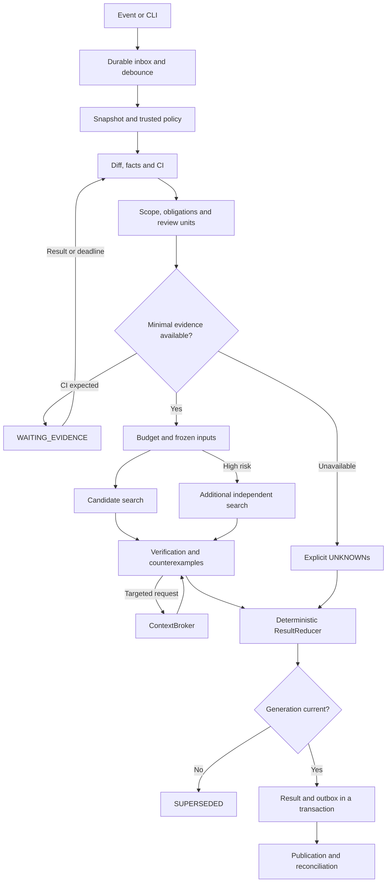
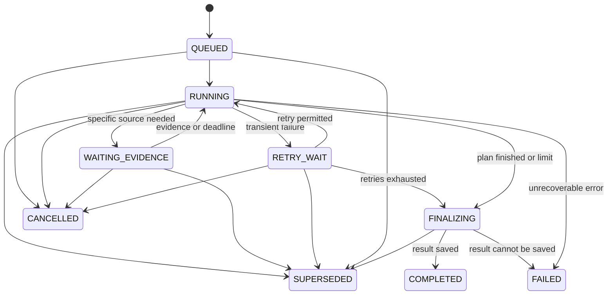
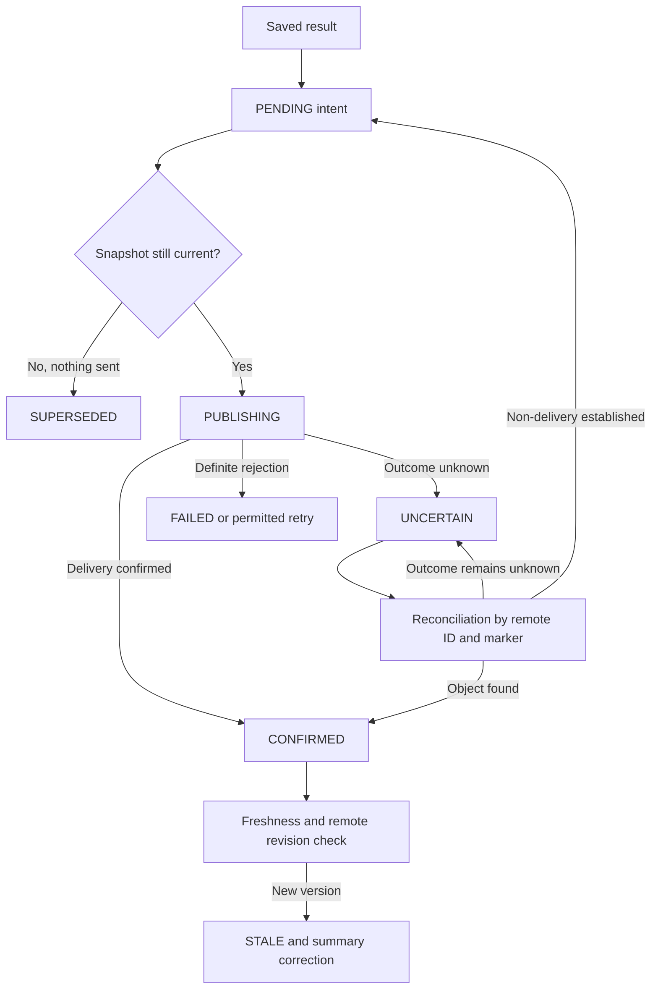
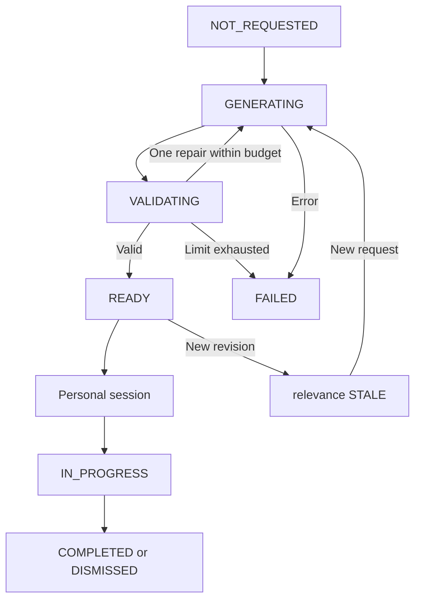

# Sych — implementation specification

Version: **1.2**  
Date: **October 25, 2026**  
Status: **implementation plan; owner decisions and environment parameters not yet established are listed in section 30**
Project name: **Sych**; the bot's Russian name is **Сыч**. The binary and CLI command name is `sych`. The name has been chosen and is used across all project interfaces and materials.

## How to use this document

This is the specification of Sych, an in-house review tool for personal projects and team development. It defines system behavior, MVP boundaries, data, states, integrations and acceptance criteria. It does not claim that the application is already implemented or that its quality has been measured.

**MUST** — a mandatory requirement of the stage in which the feature appears. **SHOULD** — allows a justified deviation recorded in an ADR. **MAY** — an extension. Stages are listed in section 28.

All limits and resource values below are **initial project settings**, not measured figures, provider prices or performance promises.

Precedence of requirement sources: this document → accepted ADRs → versioned API contracts and schemas → implementation. When a contradiction is found, the development agent must name it explicitly and propose a resolution. Unilaterally weakening mandatory requirements to make tests pass is not allowed.

### Navigation

1. [Goal and accepted decisions](#1-goal-and-accepted-decisions)
2. [Scenarios and product boundaries](#2-scenarios-and-product-boundaries)
3. [Invariants](#3-invariants)
4. [Rust application architecture](#4-rust-application-architecture)
5. [Data model](#5-data-model)
6. [Snapshot and diff boundaries](#6-snapshot-and-diff-boundaries)
7. [Pipeline and review plan](#7-pipeline-and-review-plan)
8. [States and recovery](#8-states-and-recovery)
9. [Context and semantic providers](#9-context-broker)
10. [Rules and obligations](#11-project-rules-and-obligations)
11. [Model loop and cost](#16-model-loop)
12. [Publishing and integrations](#18-publishing-results)
13. [Walkthrough mode](#21-optional-guided-tour)
14. [Configuration, CLI and API](#23-configuration)
15. [Operations, evaluation and stages](#26-operations-and-observability)
16. [Open decisions and sources](#30-open-decisions)

## 1. Goal and accepted decisions

### 1.1. Problem

Code and tests are often written by another AI agent. A human may review the changes only superficially. The system must find significant defects and rule violations, provide useful nitpicks and show **on what grounds a conclusion was reached and what remained unverified**.

Main risks:

- loss or alteration of side effects during refactoring;
- incompatibility of migrations, APIs and data during rollout;
- a false sense of safety from a green CI, confident model text or agreement between two models.

### 1.2. Fixed decisions

| Area | Decision |
|---|---|
| Name | Sych; Russian name Сыч; CLI `sych` |
| Implementation | Rust; deterministic core and bounded model calls |
| Users | A single developer, then teams |
| First connection | Personal GitHub; the local CLI arrives before the integration |
| Corporate environment | GitLab, application in an isolated Kubernetes environment |
| Models | A single ModelGateway: OpenRouter, GPT/ChatGPT subscription, GLM Coding Plan, OpenCode Go/Go Plus; cheap DeepSeek V4.1 Flash, subscription routes and selective Astra/Fable with managed fallback |
| Cost | Local facts, existing CI artifacts, selective expensive analysis, hard budgets |
| Reviewed stack | Rust and JS/TS/React/CSS/HTML, then Go, Terraform/Kubernetes/YAML and basic Python support |
| Feedback | Defects, rules, improvements and nitpicks; nitpicks are enabled by default |
| Additional mode | Guided tour over a completed review result; enabled on request |
| Project mutations | The reviewer does not edit sources and does not merge |
| Handing off fixes | Export a package to the author: first the plan and affected files, then user consent |
| Storage | SQLite in local mode; PostgreSQL in server mode |
| MVP architecture | One workspace, one binary with several modes, a queue in the DB |
| Commercialization | Not a requirement; billing, marketplace and public SaaS are outside the initial plan |

The first production deployment is forbidden until the full M0–M6 feature scope and the final R1 gate: intermediate integration/shadow/dogfood checks run only in an isolated test/staging environment. M2 or M4 readiness does not permit connecting the bot to live repositories. Local read-only review of permitted code is not a deployment. All commits follow [Conventional Commits 1.0.0](https://www.conventionalcommits.org/en/v1.0.0/).

### 1.3. What counts as a useful result

The result contains:

1. Concrete verified findings with conditions and consequences.
2. Applicable requirements and their verification status.
3. Missing information, with an explanation of which conclusion it prevents.
4. Useful optional remarks, honestly labeled as preferences.
5. Scope, source versions, cost and limitations.
6. When a tour is requested, a reading route over the same snapshot.

`COMPLETE_FOR_SCOPE` means the declared review plan has been executed. It is not proof that the program is free of all errors.

## 2. Scenarios and product boundaries

### 2.1. Main user scenarios

**UC-01. Local review.** The developer specifies the repository, base and head. The application creates a snapshot, collects facts and returns JSON and Markdown without publishing to the SCM.

**UC-02. Autonomous PR/MR review.** An SCM event creates or refreshes a request. Repeated events do not create additional publications. A new push invalidates the current freshness of the old result.

**UC-03. Re-review after a fix.** A new head creates a new analysis. Previously found problems are matched against the new code and re-assessed; history is preserved.

**UC-04. Late CI.** A usable report that arrives after finalization starts a successor run for the same source snapshot. Only valid facts and checkpoints are reused.

**UC-05. Guided tour.** The user opens the change's goal, reading route, questions, findings, limitations and nitpicks. Code is taken from the snapshot.

**UC-06. Clarification.** A question at a tour stop is answered using a bounded context. A new defect hypothesis goes to the verifier.

**UC-07. Feedback.** The user marks usefulness, an error, a duplicate or a preference. Feedback does not change global rules automatically.

**UC-08. Handing off a fix.** The user exports finding IDs, evidence and acceptance criteria. Changes are applied by a separate author agent after the prescribed approval.

**UC-09. Sych self-review.** A PR to Sych's own Rust workspace is reviewed by a trusted accepted build of Sych; the PR does not choose its own reviewer executable/policy. Before R1 the flow is tested on a sandbox mirror; after R1, connecting the live GitHub repo requires separate permission.

### 2.2. First version boundaries

The first working vertical scenario includes local Git snapshots, high-quality TS/React and Rust paths, JSON/Markdown result, trusted rules, a bounded ContextBroker, a fake adapter and a real ModelGateway. The TS/React target is Vkusori `apps/pwa` and `packages/core`; the Rust target is Sych itself. OpenRouter and the three subscription accesses are mandatory before the full release, with honest permitted-use restrictions and enforcement. Then autonomous GitHub/self-review, Go and infrastructure evidence are added. A task being in the plan does not mean the integration is ready.

The MVP does not require:

- its own model or training;
- a vector DB, embeddings or a full knowledge graph;
- a universal interprocedural behavior prover;
- arbitrary shell access for the model;
- generating and applying fixes;
- executing Terraform apply, Kubernetes deploy or DDL in a real environment;
- a separate agent platform, message broker or microservice per stage;
- a full web panel before the core result is stable;
- support for every language through a dedicated expert analyzer.

A basic text fallback for an unsupported language is acceptable but must explicitly reduce the declared coverage.

## 3. Invariants

These requirements are verified before the corporate pilot.

| ID | Invariant |
|---|---|
| INV-01 | Every conclusion refers to an immutable source snapshot and policy version |
| INV-02 | Execution, coverage, obligation verification, publication and freshness statuses are independent |
| INV-03 | Absence of data, query results or model candidates is not equal to a successful check |
| INV-04 | An open mandatory item cannot be removed from scope to obtain a complete result |
| INV-05 | A defect is accompanied by evidence, conditions and the expected consequence |
| INV-06 | Code coordinates are resolved by the harness; the model does not create arbitrary SCM comments |
| INV-07 | Event repetition, crash and timeout must not lead to blind re-publication |
| INV-08 | Before writing a result, the worker checks the fencing token; a stale worker does not change current data |
| INV-09 | After an uncertain SCM write outcome, reconciliation runs first |
| INV-10 | A new head or a material change of target/policy makes the old result STALE |
| INV-11 | Repository content, PR description, comments and CI logs are data, not control instructions |
| INV-12 | Active rules are taken from the accepted version; a PR cannot weaken its own review |
| INV-13 | All model requests, retries and repairs count against the budget; unknown cost is not recorded as zero |
| INV-14 | Nitpicks are enabled, but there is no mandatory quota of findings |
| INV-15 | Real code lines in a tour match the pinned blob |
| INV-16 | A completed tour is not an approval and does not raise the verification status |
| INV-17 | The reviewer model does not receive credentials for publishing, deploying or changing the repository |
| INV-18 | Secret filtering and access policy are applied before model egress and before writing diagnostic payloads |
| INV-19 | Author-written tests and the PR description do not by themselves establish the correctness of a new requirement |
| INV-20 | Reuse accounts for all dependencies; a diff match is not enough to carry a conclusion over |
| INV-21 | Every retry/fallback/escalation preserves egress, license/runtime eligibility, verification reserve and overall budget; soft/unknown limits are not presented as hard |
| INV-22 | Self-review uses a trusted accepted reviewer/policy build, not the executable/config from the PR under review |

## 4. Rust application architecture

### 4.1. Modes

A single `sych` binary:

- `review` — local analysis; the process exits after the result;
- `serve` — webhook/API, scheduler and built-in workers for a personal server;
- `api` — ingress/API/scheduler only;
- `worker` — background tasks; corporate workers scale separately;
- `tour`, `ask`, `handoff` — reading the result and additional operations;
- `config`, `doctor`, `db`, `eval` — maintenance.

`serve` and `api + worker` use the same engine. The only difference is process placement.

### 4.2. Workspace

The overall project name is `Sych`; identifiers use `sych`. Rust packages and container components use the `sych-` prefix, Rust crate imports use `sych_`, and the project's own environment variables use `SYCH_`. The bot's public display name is `Sych` (in the Russian-language interface «Сыч» is acceptable).

```text
crates/
  sych-core/       domain types, IDs, policy, pure reducers, schemas
  sych-engine/     planner, pipeline, budgets, verifier orchestration
  sych-adapters/   Git/GitHub/GitLab, models, semantic tools, CI parsers
  sych-storage/    SQLite/Postgres, artifact store, queue, outbox
  sych-app/        CLI, HTTP, composition root, renderer
prompts/             versioned templates and output contracts
schemas/             generated JSON Schema and API definitions
migrations/
  sqlite/
  postgres/
fixtures/            small source repos, reports, provider responses
eval/                manifests, labels, scripts and reports
deploy/              Helm chart, example values, operational docs
docs/adr/            decisions and changes to this specification
```

Cyclic dependencies must not be created. `sych-core` does not depend on HTTP, SQL or a specific LLM SDK. External dependencies are injected through small interfaces.

Initial library set: Tokio, Axum/Tower, Serde, Reqwest, SQLx, Clap, tracing. Concrete compatible stable versions are chosen at bootstrap and pinned in `Cargo.lock` and `rust-toolchain.toml`. Do not use floating git dependencies. Axum and SQLx are chosen as ordinary infrastructure libraries; a custom agent framework is not required. [S01], [S02], [S03]

### 4.3. Component boundaries

| Component | Responsibility |
|---|---|
| Ingress | Event, size and authenticity validation; durable inbox |
| Scheduler | Debounce, current desired generation, coalescing repeats |
| SnapshotService | Git refs, merge-base, diff, blobs and source manifest |
| PolicyResolver | Trusted configuration, rules, hash and restrictions |
| FactCollector | AST/diff/CI facts without model interpretation |
| SemanticProvider | Definitions, references, implementations, diagnostics |
| ObligationPlanner | Scope, review units, risks and obligations |
| ContextBroker | Question-specific context, retrieval budget, provenance |
| ModelGateway | Provider/subscription transports, role routing/fallback, structured output, usage/quota/enforcement, deadline and cost reservation |
| CandidateFinder | Search for hypotheses and suggestions |
| Verifier | Verification of candidates and counterexamples; bounded inference |
| ResultReducer | Deterministic computation of coverage, recommendations and result |
| Publisher | Only permitted SCM operations, coordinates and reconciliation |
| TourService | Route and explanation of a stored result |
| Evaluation | Reproducible scenarios, quality, cost, regression |

### 4.4. Interfaces

Below are logical signatures. Missing request/response types are defined in `sych-core`; this is not a ready-to-compile fragment.

```rust
pub trait SnapshotReader {
    fn read_span(&self, reference: &CodeRef) -> Result<SourceSpan, ReadError>;
    fn diff(&self, snapshot: &SnapshotId) -> Result<DiffManifest, ReadError>;
}

#[async_trait::async_trait]
pub trait SemanticProvider: Send + Sync {
    async fn capabilities(&self, workspace: &WorkspaceKey) -> Capabilities;
    async fn query(&self, request: SemanticRequest) -> SemanticResponse;
}

#[async_trait::async_trait]
pub trait ModelProvider: Send + Sync {
    async fn invoke(&self, request: ModelRequest) -> Result<ModelResponse, ModelError>;
}

#[async_trait::async_trait]
pub trait ScmProvider: Send + Sync {
    async fn resolve_change(&self, key: &ChangeKey) -> Result<ChangeState, ScmError>;
    async fn publish(&self, operation: &PublicationOperation) -> WriteOutcome;
    async fn reconcile(&self, operation: &PublicationOperation) -> ReconcileOutcome;
}
```

For dynamically selected async adapters, use `async-trait` or an explicit boxed future. Do not assume dyn compatibility of an arbitrary native async trait. [S04]

## 5. Data model

### 5.1. Identifiers and formats

- External GitHub/GitLab IDs are stored as opaque strings.
- Internal entity IDs are UUIDs; UUIDv7 is allowed for new records.
- All timestamps are UTC RFC 3339; the local timezone is applied only for display.
- Monetary values are integer micro-USD, not `f64`. Display in USD is separate.
- Hashes of artifacts and canonical manifests are SHA-256.
- A Git object ID is stored together with its algorithm; do not assume exactly 40 characters.
- Sets are sorted by a defined key before hashing; ordinary JSON field order is not used as identity.
- Every external JSON contains `schema_version`. An unknown major version is rejected explicitly.
- `generation` increases monotonically within a Change when a new analysis intent is accepted. Repeating the same material inputs does not increase it; a permitted manual rerun does. The `review_revision` of a stored result equals the generation of its run; the immutable result_id additionally identifies the artifact.
- Unknown fields in model output are rejected. In provider API parsers, unknown non-decisive fields may be preserved/ignored according to the adapter version.

### 5.2. Core entities

| Entity | Mandatory fields and meaning |
|---|---|
| Repository | tenant-scoped binding: id, tenant_id, connection_id, provider_instance_id, external_id, clone_origin, access_scope_id |
| Change | repo_id, external_number/local_key, target_ref, desired_generation, current_source_snapshot_id |
| SourceSnapshot | repo, target_tip, diff_base, head, source_manifest_hash, diff_manifest_hash |
| PolicySnapshot | trusted_ref/source, rules_hash, config_hash, authorization_policy_version |
| AnalysisRun | id, change_id, generation, source_snapshot_id, policy_snapshot_id, parent_run_id, trigger_reason |
| ScopeManifest | units, required obligations, requested profiles, excluded paths with reasons, scope revisions |
| Evidence | immutable producer/result/source record with provenance and completeness |
| ExternalInputManifest | pinned external CI/contract/environment inputs for a run; frozen before analysis |
| EvidenceManifest | all used inputs and derived evidence; frozen at finalization |
| ReviewUnit | related changes around one contract, symbol group or behavior |
| Obligation | concrete question, applicable rule, required flag, acceptance criterion, scope |
| Candidate | model/static hypothesis; not yet a published finding |
| Finding | validated result, category, severity, support, anchors, remediation and lineage |
| ReviewResult | immutable run output with coverage, obligations, findings, usage and limitations |
| PublicationOperation | durable intent for one external object/action |
| TourArtifact | immutable route tied to one ReviewResult |
| TourSession | private progress and bounded Q&A |
| Waiver | explicit scoped decision to accept a risk; does not change evidence |
| Feedback | actor judgement with scope and rationale |
| ModelAttempt | request/attempt identity, role/route revision, requested/resolved provider/model/account reference, auth/billing/enforcement kind, limits, monetary reservation, tokens/quota completeness and outcome |

### 5.3. Source coordinates

```rust
pub struct CodeRef {
    pub snapshot_id: SnapshotId,
    pub side: SourceSide,           // DiffBase | Head | TargetTip
    pub path: RepoPath,
    pub blob_oid: GitObjectId,
    pub start_line: u32,            // 1-based, inclusive
    pub end_line: u32,              // 1-based, inclusive
    pub content_sha256: String,
}
```

`RepoPath` is a path inside the snapshot, not an absolute host path. Internal spans may store byte offsets. For LSP requests, offsets are converted to the negotiated encoding; UTF-8 bytes and UTF-16 character positions must not be mixed.

A rename stores the old/new path. A deleted line belongs to base. If a line is not a valid SCM inline position, the finding is published in the summary with an exact reference. Coordinates are not "approximated" to an arbitrary neighboring line.

A file with an unsupported path/content encoding gets an explicit limitation; it does not disappear from scope. Binary, submodule, symlink and LFS pointer are marked as separate types.

### 5.4. Evidence

Minimal contract:

```json
{
  "schema_version": 1,
  "id": "ev-opaque",
  "kind": "semantic",
  "source_snapshot_id": "snapshot-opaque",
  "producer": {
    "name": "gopls",
    "version": "resolved-at-runtime",
    "config_hash": "sha256:..."
  },
  "binding": {
    "kind": "source",
    "head_oid": "git:...",
    "target_tip_oid": "git:...",
    "tested_oid": null,
    "environment_id": null
  },
  "validity": "VALID",
  "completeness": "PARTIAL",
  "trust_class": "DERIVED_LOCAL",
  "artifact_sha256": "sha256:...",
  "code_refs": [],
  "limitations": ["dynamic implementation unresolved"],
  "observed_at": "2026-10-23T00:00:00Z"
}
```

This is an illustration of the fields, not a fixture with real SHAs. `kind`: `source | semantic | static | test | coverage | contract | infrastructure | human`.

`validity`: `VALID | STALE | UNAVAILABLE | MALFORMED | FAILED`.  
`completeness`: `COMPLETE_FOR_QUERY | PARTIAL | UNKNOWN`.  
`trust_class`: `TRUSTED_POLICY | SOURCE_OBSERVATION | DERIVED_LOCAL | AUTHENTICATED_CI | AUTHOR_CLAIM | HUMAN_ATTESTATION`.

`AUTHENTICATED_CI` means the established provenance of a result, not that the test oracle is independent of the PR author.

### 5.5. Obligation

Mandatory fields:

- `id`, `rule_id`, `rule_version`;
- `question`, `required`, `risk_level`;
- `review_unit_ids`, `code_refs`;
- `applicability: APPLIES | DOES_NOT_APPLY | UNKNOWN`;
- `acceptance_criterion` and `acceptable_evidence_kinds`;
- `status`, `evidence_ids`, `limitations`;
- for `UNKNOWN` — `reason_code` and `next_evidence_needed`;
- for `NOT_APPLICABLE` — a verifiable justification of non-applicability.

Statuses: `SUPPORTED | VIOLATED | UNKNOWN | NOT_APPLICABLE`. Pending is stored as an execution task state and is not disguised as one of the final answers.

`SUPPORTED` means sufficient grounds for the stated criterion within the specified scope. A confidence number produced by the model is not such grounds.

### 5.6. Candidate and Finding

A Candidate contains a verifiable claim, the presumed causal chain, anchors, consequences, conditions and the desired way to refute it.

Candidate `verification_status`: `PENDING | CONFIRMED | REJECTED | UNRESOLVED`.

A Finding contains:

- category: `DEFECT | RULE_VIOLATION | IMPROVEMENT | NIT`;
- severity: `CRITICAL | HIGH | MEDIUM | LOW | INFO`;
- title, explanation, triggering_conditions, consequence;
- anchors and evidence_ids;
- rule_id/obligation_ids, if applicable;
- support: `EXECUTED_COUNTEREXAMPLE | STATIC_TRACE | SEMANTIC_ARGUMENT | EXPLICIT_RULE | PREFERENCE`;
- suggested_action and validation_expectation;
- fingerprint, predecessor_finding_id, lifecycle;
- exact scope and limitations.

Severity and support are different dimensions. A critical hypothesis may remain unresolved. A preference does not become a mandatory defect because of confident text.

Lifecycle: `OPEN | RESOLVED | DISMISSED | OBSOLETE`. The `RESOLVED` status requires re-verification on a new snapshot. `DISMISSED` preserves the author and the reason; it is not deletion of history.

### 5.7. ReviewResult

Mandatory fields:

```text
schema_version
result_id, run_id, review_revision, parent_result_id
source_snapshot_id, policy_snapshot_id, evidence_manifest_id
scope_manifest
execution_outcome
coverage
recommendation
findings[]
obligations[]
unresolved_questions[]
excluded_or_unreviewed[]
rejected_candidates[]       // internal by default; selected items available to tour
usage_summary
created_at
provenance
```

`coverage`: `COMPLETE_FOR_SCOPE | PARTIAL | UNAVAILABLE`.

`recommendation`: `ATTENTION_REQUIRED | NEEDS_EVIDENCE | NO_BLOCKING_FINDINGS_IN_SCOPE`. This is a computed field, not a textual model verdict and not an SCM approval.

Reducer order:

1. If there is a confirmed finding or a verified VIOLATED obligation that meets the configured significance threshold — `ATTENTION_REQUIRED`.
2. Otherwise, with mandatory UNKNOWNs or unavailable substantive analysis — `NEEDS_EVIDENCE`.
3. Otherwise — `NO_BLOCKING_FINDINGS_IN_SCOPE`.
4. Regardless of the recommendation, show the actual coverage and all material UNKNOWNs.

If there is both a defect meeting the significance threshold and an UNKNOWN, the recommendation stays `ATTENTION_REQUIRED`, and the incompleteness is shown alongside. A non-blocking finding does not hide a mandatory UNKNOWN: in that case the result is `NEEDS_EVIDENCE`. The significance threshold determines the content of the recommendation; advisory publication does not turn it into an SCM merge gate.

Every VIOLATED invariant has a corresponding confirmed finding or an explicit violation of the internal finalization contract. ResultReducer does not lose a violation because of a missing entry in the findings array; when possible, it creates a RULE_VIOLATION from the verified assessment and its evidence.

## 6. Snapshot and diff boundaries

### 6.1. Three mandatory Git positions

Store separately:

- `target_tip` — the current tip of the target branch at the time of pinning;
- `diff_base` — the base of the selected diff, usually merge-base(target_tip, head);
- `head` — the tip of the source branch under review.

Do not name both the target tip and the merge-base with a single `base` field. Provider-specific diff versions are stored next to the normalized snapshot.

`source_snapshot_id` depends on repo identity, these positions, the diff acquisition method, the source manifest and the file handling policy. Rules, model version and CI are not part of the source identity; they are part of AnalysisInput.

### 6.2. Preparation algorithm

1. Obtain the permitted repository and change through the configured provider.
2. Re-read the current refs; the webhook payload is treated as a pointer to the event.
3. Fetch the minimum required objects; if depth is insufficient, deepen history in a bounded way.
4. Compute the merge-base or obtain the provider's confirmed diff version.
5. Obtain the diff with statuses, renames, old/new blob IDs.
6. Make sure the diff is not truncated by the provider API. If truncated, use local Git or mark the unverified part.
7. Build a manifest of all changed files, including excluded/binary/generated.
8. Read the trusted policy from the target tip or a pinned policy ref.
9. Materialize separate read-only base/head views for tools that require a workspace.
10. Pin the snapshot and check that the desired generation has not changed.

If no merge-base is found, use an explicitly specified comparison mode or return `UNAVAILABLE` with a reason. Silent comparison against an arbitrary commit is forbidden.

### 6.3. Working tree

In the MVP, review is bound to commits. `--worktree` arrives as a separate extension:

- the content of tracked changes is pinned in its own content snapshot;
- untracked files are included only by explicit setting;
- the result is labeled `WORKTREE`, not commit;
- files are not modified;
- the cache uses content hashes;
- the claim "all code is from a git commit" is not allowed for this mode.

### 6.4. Safe reading

Git operations run without checkout hooks, automatic submodule handling, external diff/textconv helpers or arbitrary filters from the repository. The working directory must not affect the global Git configuration.

Do not follow symlinks outside the snapshot. Do not pass raw user input as a shell command. Model URL, artifact URL and clone origin are resolved by endpoint policy, not by PR text.

### 6.5. Freshness

- Head changed — a new source snapshot.
- Target tip changed — a new assessment of the integration context, even with the same head.
- Accepted policy/config changed — a new analysis generation.
- A new material external input arrived after the input freeze — a successor run; derived facts from pinned inputs stay in the current run.
- Repeating the same data with the same digest does not create a new revision.

A historical result remains immutable. Its `relevance` changes to `STALE` in an external freshness record, not by rewriting the evidence.

## 7. Pipeline and review plan

### 7.1. Main flow



The wait deadline is set once. Another pass through the collector does not extend it. If CI is already known to be unavailable, the transition to UNKNOWN happens without pointless waiting.

### 7.2. Planner responsibilities

Before model search, the planner must:

- classify change types;
- determine applicable rules;
- create obligations for important risks;
- group related changes into review units;
- determine the minimal evidence;
- reserve the verification budget;
- record deferred/infeasible checks.

Mandatory checks do not depend on whether the cheap model found suspicious code.

A review unit may span several files: handler, repository wrapper, schema and frontend consumer. Strict per-file partitioning is not mandatory.

### 7.3. Risk routing

Initial risk signals:

- DDL, migrations, backfill, serialization and versioned API;
- changes to writes, transactions, outbox, acknowledgements;
- changes to errors, retry, cancellation and lifetime;
- auth/tenant checks;
- dependency/build/deploy configuration;
- removal of assertions, more skips, weakened lint/CI;
- broad movement of logic between layers;
- replacement/deletion of infrastructure resources.

Signals are routing hints, not proof of a defect.

High risk assigns an additional independent search over the corresponding obligations, even if the general pass returned an empty list. When the budget is insufficient, such a pass stays explicitly unexecuted; the system does not report full coverage.

### 7.4. Scope

Scope is pinned before model analysis. Only explicit expansion with a new scope revision is allowed. Narrowing the mandatory scope within a run is forbidden.

Excluded paths are included in the manifest with a reason. If a generated file contains a significant change of a public contract, excluding it from reading does not cancel the obligation to verify that contract.

If a large PR does not fit the limit, the available part must be executed and the rest listed, or a split proposed. Silently analyzing the first N files and marking the whole PR as reviewed is not allowed.

## 8. States and recovery

### 8.1. Execution state



Cancellation, supersede and unrecoverable failure are allowed from all active states as long as the result is not yet committed. The diagram shows the main transitions; the table below defines the mandatory conditions.

| Transition | Condition |
|---|---|
| QUEUED → RUNNING | Lease and fencing token acquired atomically |
| RUNNING → WAITING_EVIDENCE | There are specific expected sources and a fixed deadline |
| WAITING_EVIDENCE → RUNNING | The source arrived or the deadline expired; in the latter case gaps are created |
| RUNNING → RETRY_WAIT | The error is classified as retryable and overall budget remains |
| RETRY_WAIT → FINALIZING | Retry is impossible, but an honest partial result can be saved |
| RUNNING → FINALIZING | The plan is executed or a limit is reached; tasks and gaps are listed |
| FINALIZING → COMPLETED | Result, usage and publication intents saved atomically |
| Active → SUPERSEDED | Desired generation changed |
| Active → CANCELLED | Explicit cancellation accepted; no new external operations are started |
| Active → FAILED | Could not obtain/save even a correct execution result |

`stage` is stored separately: `SNAPSHOT | COLLECT | PLAN | DISCOVER | VERIFY | REDUCE`. Final publication has its own queue and does not hold the analysis lease.

### 8.2. Partial execution

If LSP is unavailable, part of the review can finish with `PARTIAL`. If the diff was not obtained, no substantive review was performed: a saved result with `UNAVAILABLE` is allowed.

If the DB is unavailable and the result cannot be reliably saved, the run does not get `COMPLETED`. Having text in memory does not count as completion.

### 8.3. Freeze and late events

Before the AnalysisInput freeze, the runner may accept expected external CI evidence for the same source snapshot and configuration. At input freeze, SourceSnapshot, PolicySnapshot and an immutable ExternalInputManifest are saved.

After input freeze, new material external inputs — CI artifact, policy, deployment observation — schedule a successor generation. An old active analysis may be superseded; a completed one is not reopened. The new run references its parent and reuses only checkpoints whose dependencies match.

Reading a new definition from the pinned Git snapshot, a semantic query and plan-provided tool output on pinned inputs are derived evidence of the current run. They do not change the frozen external inputs and do not by themselves start a successor. The full EvidenceManifest with inputs and derived outputs is frozen at finalization.

A simple CI progress update, a duplicate artifact digest or a change to an irrelevant job does not create a successor run. The significance decision is recorded in the event log.

### 8.4. Lease and fencing

Initial settings: lease 60 s, heartbeat 15 s, reaper every 15 s. They are configurable.

Each task assignment increments `lease_epoch`. Writing a checkpoint/result is allowed only when `job_id + owner + lease_epoch` match, the lease is valid, the active state is allowed and `run.generation == change.desired_generation`. Cancel/supersede revokes the lease/fence.

Finalization repeats the check of generation, fence, active state and frozen input versions inside the same transaction that saves the result and outbox. A preliminary check before the transaction is not sufficient.

- PostgreSQL: a short claim transaction, row locking and `SKIP LOCKED`. [S29]
- SQLite: one worker by default, a short claim transaction and compare-and-swap.
- External HTTP/LSP/model calls run outside the SQL transaction.
- An expired lease makes the previous worker unable to save a result.
- Cancellation is propagated through a cancellation token, but an already sent external request may complete later.
- DB fencing does not prevent delivery of an already sent SCM request: that is the job of publication reconciliation.

### 8.5. Retry

By default, up to two retries of retryable read/analysis operations with exponential backoff and jitter. The maximum wait is bounded by the task deadline.

Retryable: transient network errors, 429 honoring Retry-After, transient 5xx, a local provider crash when restart is permitted.

Not retryable without changing the input: 401/403, invalid policy, unsupported schema, exceeded budget, wrong refs, forbidden endpoint.

A model retry counts as a new potentially paid attempt. An SCM write with an uncertain outcome does not go through general retry: reconciliation first.

## 9. Context Broker

### 9.1. Request contract

Each context request contains:

```text
run_id, snapshot_id, policy_snapshot_id
review_unit_id, obligation_id
question
purpose: DISCOVERY | VERIFICATION | TOUR_FOLLOWUP
seed_refs[]
requested_operations[]
remaining_budget
access_scope_id
```

The response contains `evidence_ids`, fragments, relations, the completeness of each request, gaps, selection reasons and usage. It does not just return a "context string".

`packet_resolution: SATISFIED | PARTIAL | UNAVAILABLE` describes the sufficiency of the requested set of sources, not the truth of the obligation. A provider limitation makes UNKNOWN only those obligations that lack a significant fact; an unrelated unsupported capability need not degrade the whole result.

### 9.2. Algorithm

1. Start with the diff and the enclosing construct before/after: function, component, schema declaration, resource.
2. Add the relevant rule and the independent contract.
3. Add imports, definitions of the needed types and called wrappers.
4. Select a bounded set of callers/callees/readers/writers that affect the question.
5. Find relevant tests and normalized CI facts.
6. Merge overlapping spans of the same blob.
7. Prioritize mandatory evidence, then evidence refuting the hypothesis, then supporting evidence.
8. Check access and secret policy.
9. Count tokens and return the packet with a list of what was excluded.
10. For a specific new question, expand the needed branch of the graph within the limit.

At the start, use Git, path/symbol search, AST and the semantic provider. Embeddings are not a dependency. Semantic relations may be stored in memory/DB as small records without a separate graph database.

### 9.3. Initial limits

| Parameter | Default |
|---|---:|
| Initial context per unit | 6 000 input tokens |
| Maximum context of a single model request | 14 000 input tokens, including instructions and schema |
| Initial relation depth | 1 |
| Maximum depth on a justified request | 3 |
| Semantic requests per unit / run | 24 / 160 |
| Additional retrieval rounds per unit | 2 |
| Distinct source files read per run | 80 |
| Standard span | Up to 160 lines; expanding to a whole small construct is allowed |
| Maximum single source blob for text reading | 512 KiB |
| Total model input budget per run | 128 000 tokens including re-sent context |

The overall limits of section 17 take precedence. A source required for a conclusion must not be truncated without notice to arbitrary first lines. If a mandatory packet does not fit, the work must be split while preserving relations, or an UNKNOWN created.

`max_files` limits content reading, not the diff inventory: the list of all affected files stays complete.

### 9.4. Tools available to the model

The model requests typed operations:

- `read_span(code_ref)`;
- `read_symbol(symbol_ref, side)`;
- `find_definition(symbol_ref)`;
- `find_references(symbol_ref, purpose, limit)`;
- `find_implementations(symbol_ref, limit)`;
- `find_callers/callees(symbol_ref, limit)`;
- `search_source(query, paths, side, limit)`;
- `read_evidence(evidence_id)`.

The model does not specify a shell, an arbitrary URL, a database query against infrastructure or new credentials. Arguments are validated by schema and access policy. Search has a timeout and a restricted syntax; regex must not cause unbounded CPU load.

Each operation returns `COMPLETE_FOR_QUERY | PARTIAL | UNSUPPORTED | FAILED` and concrete limitations. A successful empty response does not mean there are no dynamic or external dependencies.

### 9.5. Context representation

Each fragment has:

- ID, snapshot/side/blob/path/range;
- hash of the original content;
- source kind, producer/config;
- `reason_selected`;
- completeness and limitations;
- transformation/redaction policy.

Raw source and summaries are different evidence types. A summary helps with orientation, but a finding about specific behavior must have an available source fragment or suitable tool evidence.

### 9.6. Cache and invalidation

Separate:

1. **Blob cache:** content address + tenant/access partition.
2. **Syntax cache:** blob + parser/version/config.
3. **Semantic cache:** workspace snapshot + toolchain + lockfiles + build tags/target + provider version.
4. **CI cache:** exact run/job/attempt/artifact digest.
5. **Model response cache:** opt-in after MVP; the whole prompt/input digest, model/settings, policy, scope and access partition.
6. **Tour cache:** result revision + planner/prompt/renderer + language + access partition.

When reading the cache, re-check access rights. A content hash alone does not permit cross-tenant reuse. Revoking access makes cached content unavailable even under the same key.

Reusing an obligation requires its dependencies to match. For a negative claim such as "there are no other callers", the dependency includes the search scope and its completeness, not just the files found.

## 10. Semantic providers and local facts

### 10.1. Common contract

`SemanticResponse` contains results, query scope, source snapshot, tool version, build configuration, completeness and unresolved edges.

Capabilities are discovered on connection. An adapter must not return an empty list instead of `UNSUPPORTED`.

Base and head language servers use different workspace states. Head must not be opened over base, nor old locations applied to a new blob.

LSP is the source of navigation, types and diagnostics. Call hierarchy uses the designated prepare/incoming/outgoing operations. Capabilities depend on server capabilities and document synchronization. [S05]

### 10.2. JS/TS/React

The first area with high-quality support.

Mandatory:

- determine tsconfig/project references and the real package/lockfile boundaries;
- select the semantic backend according to the project's TypeScript version;
- resolve imports, aliases, definitions and references;
- distinguish production/test/generated paths;
- extract enclosing functions, JSX components, hooks and call sites;
- account for changes in dependencies/config;
- import typecheck, lint and component/integration reports.

The TypeScript backend may use a compatible legacy semantic service or the LSP native compiler; do not force a project upgrade for the sake of the reviewer. [S06]

Initial effect detectors:

- mutation and subsequent invalidation/refetch;
- effect setup/cleanup;
- subscriptions/listeners/timers;
- request and state write after an asynchronous response;
- error/loading/optimistic state;
- changes in controlled/uncontrolled/form submit behavior.

A function name alone does not prove an effect. Project wrappers are described in a registry and verified against their implementation.

CSS/HTML analysis uses the AST/structure of related components and existing browser/accessibility/visual reports. TS types are not proof of visual behavior.

### 10.3. Go

Mandatory:

- account for go.mod/go.work, module replacements, GOOS/GOARCH and build tags;
- obtain definitions, references, implementations and the available call hierarchy;
- extract receiver, context parameters, return errors, defer, goroutine, channel and transaction boundaries;
- import go test/vet/race/coverage;
- distinguish sql.DB, sql.Tx and project wrappers;
- flag ambiguous interface dispatch and reflection.

gopls call hierarchy does not cover all dynamic calls; references relate to the active build configuration. These limitations must be reflected in query completeness. [S07]

### 10.4. Python

First stage:

- AST, imports and enclosing functions/classes;
- existing typecheck/lint/test reports;
- targeted definitions and project wrappers;
- with/finally, async tasks, writes and exception paths.

Dynamic dispatch, monkey patching, runtime registration and unknown import side effects produce gaps. A full Python language server is an extension after the need has been measured.

### 10.5. Terraform and Kubernetes

The semantic provider here is a normalizer of structure and reports. It does not have to work through LSP.

Terraform: HCL diff + plan JSON + workspace/environment/provider locks.  
Kubernetes: rendered manifests + values/config digests + inventory + controller/deploy metadata.

Without the corresponding environment evidence, analysis may find local changes and ask questions, but cannot confirm applicability or rollout safety.

### 10.6. Running analyzers

Default: use already installed pinned tools and ready CI artifacts.

If an analyzer can execute plugins, build scripts, dependency hooks or project code, it runs in a separate sandbox without SCM write/model secrets. Dependencies are not installed via an arbitrary command from the repository; a permitted runner profile is used.

Unavailable dependencies, disabled plugins and an incomplete build environment reduce completeness. The system does not hide such a mode.

### 10.7. Rust

Rust is a mandatory high-quality M1 path, not a text fallback. The first target is Sych's own Cargo workspace; simultaneous TS/React support is retained.

- Discover Cargo workspace/packages, lockfile/toolchain/edition, target, features and `cfg`; base/head AST/rust-analyzer states are isolated.
- Obtain the available definitions/references/implementations/trait links, enclosing constructs and diagnostics with query scope, build configuration, provenance and completeness. Unknown dynamic dispatch/macro expansion is not proven absence of relations.
- Check Result/error propagation, RAII/drop/resource/transaction boundaries, async cancellation/select/task lifetime, blocking/locks across await, public API/trait/serialization and feature-dependent contracts. Compilation/ownership checks do not prove runtime correctness.
- Import existing Cargo check/test/Clippy outcomes with exact target/features/toolchain/checkout. A stable toolchain does not require the unstable JSON test runner: the actually available report or a project outcomes manifest is used.
- Build scripts, proc-macros and plugins are subject to §10.6/§22.4; execution is off by default, and permitted execution happens only in a separate admin sandbox. An impossible expansion is reflected as a specific gap.
- Quality is demonstrated by paired unsafe/safe/UNKNOWN Rust cases and real model review of Sych snapshots: error propagation, async/lifetime, lock/blocking, API/trait and cfg/macro boundaries. A fake, a successful build or an exact text match does not replace quality evaluation.

## 11. Project rules and obligations

### 11.1. Structure

Accepted repository structure:

```text
.sych/
  config.yaml
  rules.yaml
  effects.yaml
  deploy.yaml
  contracts/           # small accepted requirements and scenarios
```

This is our tool's project format. The folder does not receive automatic trust just because of its name.

Server policy holds the upper limits on access, budget, models and runners. Repository policy may tighten limits and select permitted profiles. Weakening server policy via a PR is forbidden.

### 11.2. Rule precedence

1. Immutable engine requirements: isolation, provenance, budgets, status semantics.
2. Server/organization policy.
3. Accepted repository policy from a trusted ref.
4. Rules for specific paths/domains.
5. Personal preferences permitted in personal mode.

An ambiguous conflict between mandatory rules is a configuration error or an UNKNOWN of the corresponding obligation with an explanation; the model does not silently pick a convenient rule.

AGENTS.md/CLAUDE.md and similar documents may be imported as context. They become controlling policy only after a trusted version is explicitly connected and normalized.

### 11.3. Rule contract

```yaml
schema_version: 1
rules:
  - id: EFFECT-01
    version: 1
    title: Preservation of mandatory operation effects
    kind: invariant
    required: true
    severity_on_violation: high
    owner: backend
    applies_to:
      paths: ["backend/orders/**"]
      change_kinds: ["call_change", "control_flow_change", "move"]
    statement: >
      A successful order write preserves the mandatory event publication
      according to the accepted operation contract.
    rationale: "Consumers must receive an event about the saved order."
    contract_refs: [".sych/contracts/order-created.md"]
    acceptance:
      evidence_kinds: ["source", "semantic", "test"]
      criteria:
        - "The commit boundary and delivery mechanism are identified."
        - "Failure, retry and a stop between write and delivery are checked."
    exceptions: []
```

`owner` is a team/role from the configuration, not an arbitrary mentioned person. The rule ID is stable; a change of meaning bumps the version.

Applicability is determined from the diff, semantic relations and movement of logic. Moving a function outside its original path must not automatically cancel the associated invariant.

### 11.4. Initial set

| ID | Activation | Obligation |
|---|---|---|
| EFFECT-01 | Change to a path with mandatory effects | Target, condition, multiplicity and required order are preserved |
| EFFECT-02 | Errors/cancellation/lifetime | The agreed behavior on failure and shutdown is preserved |
| MIG-COMPAT | Schema/API/event migration | Reachable rollout states are compatible |
| MIG-RESTART | Backfill/batch | Retry and resumption do not lose data |
| MIG-CONTRACT | Removal of an old contract | Cessation of required usage is confirmed |
| MIG-RECOVERY | New form of persistent data | A working recovery path is known |
| TF-CHANGE | Infrastructure resource change | Replacement/deletion matches the accepted intent |
| K8S-ROLLOUT | Workload/deploy change | Rollout order and dependency availability are consistent |
| TEST-INTEGRITY | Change to assertions/skips/CI gates | An important check was not silently weakened |

A generic rule being shipped does not mean it is mandatory for every PR. Applicability is three-valued: APPLIES, DOES_NOT_APPLY, UNKNOWN. For a required rule in a potentially affected area, UNKNOWN creates an obligation with a specific gap; an unavailable provider does not allow the rule to be excluded. A justified DOES_NOT_APPLY is stored as NOT_APPLICABLE.

### 11.5. Preferences and nitpicks

Rules with `kind: preference` are used for naming, readability, local simplifications and accepted conventions.

A nitpick must point to a specific place and benefit. If there is a linter finding with the same cause, the model does not create a duplicate. A simplification suggestion is checked for an obvious change in behavior.

The system may return zero nitpicks. It must not invent advice to fill the section.

### 11.6. Exceptions and policy changes

An exception has a rule ID, scope, reason, owner, author, expiry/termination condition. A separate waiver affects the risk decision but preserves the original `VIOLATED/UNKNOWN`.

A rule proposed in a PR is shown as a policy diff. The accepted version applies to the current run. A trusted administrator may explicitly start a review with a new policy revision; this is a separate run with provenance.

## 12. Side-effect preservation

### 12.1. Effect ledger

For a selected changed path, a base/head effect table is built:

```text
effect_id
kind: db_write | event | network | cache | filesystem | subscription | ui | other
target / key / payload summary
trigger / guard
cardinality
required_order_edges[]
transaction_scope
lifetime / cancellation_scope
failure_and_retry_behavior
source_refs[]
resolution: resolved | partial | dynamic_unknown
match: preserved | moved | changed | removed | added | unresolved
contract_refs[]
```

This is a bounded behavior model, not a full dataflow of the whole program.

### 12.2. Algorithm

1. Extract changed calls/control flow/receivers/guards.
2. Resolve direct definitions and the nearest wrappers.
3. Apply the registry of known project effects.
4. Match effects by semantic role, object and contract.
5. Compare conditions, multiplicity, order and failure semantics.
6. For a vanished effect, check for relocation and an alternative mechanism.
7. Produce candidates or a concrete UNKNOWN.
8. Find evidence for confirmation/refutation.
9. Save the ledger and dependencies as an artifact.

The observable behavior contract is compared. Literal equality of all execution traces is not required. Normalizing random IDs/timestamps is allowed only where they are immaterial; tenant key, multiplicity and ordering constraints must not be erased for the sake of equality.

### 12.3. Wrapper registry

```yaml
schema_version: 1
effects:
  - id: order-outbox
    match:
      language: go
      symbol: "example.internal/orders.Store.AppendEvent"
    effect_kind: event
    guarantees:
      durable_with_transaction: true
    implementation_refs: ["backend/orders/store.go"]
    contract_refs: [".sych/contracts/order-created.md"]
```

This is a claim of the accepted configuration that must be tied to the current implementation. If the implementation hash changed, the registry does not confirm the guarantee automatically: the obligation is investigated anew.

### 12.4. Mandatory scenarios

**Go transaction extraction.** The SQL stayed the same, but a helper uses `sql.DB` instead of `sql.Tx`. Check the receiver and operation boundaries. The Go documentation warns about DB calls outside a Tx; the mere fact that the SQL is preserved is not sufficient. [S08]

**Outbox → goroutine.** Check delivery when stopping after commit. Do not declare the event guaranteed lost before investigating an alternative recovery path.

**React cleanup.** Check dependency changes and unmount; cleanup and protection from stale async results are separate scenarios. [S09]

**Cache invalidation.** The mutation remained, the invalidation disappeared. Check whether it was moved into a mutation wrapper, transport middleware or subscription.

**Python resource lifetime.** Moving code outside with/finally must not automatically be considered equivalent.

### 12.5. Behavior checks

With a permitted execution profile, a targeted failure/retry/cancel/unmount test may be requested. Generating and executing a new test is not mandatory for the MVP and is not performed in the tour reader.

Tests of both versions, controlled scheduling and event assertions can provide strong evidence. A single return value comparison is often insufficient.

If runtime verification is unavailable, the verifier may keep a bounded static/semantic argument or UNKNOWN. The support category is shown to the user.

## 13. Migration compatibility and recovery

### 13.1. Deployment model

`DeploymentModel` contains:

- environment and owner;
- `initial_versions`: pinned app image/build/source refs, schema/data phase and supported client versions with provenance;
- schema/app/frontend/jobs order;
- whether mixed versions and downtime are acceptable;
- the compatibility window for clients and consumers;
- backfill/retry strategy;
- contract/removal conditions;
- recovery strategy;
- the source of each claim.

Unknown DBs/frameworks/controllers are not filled in with assumptions. Until a DB-specific provider is configured, general contract checks run, and DDL locks/transaction semantics remain outside the confirmed scope.

`diff_base` and `target_tip` are not automatically considered the deployed version. DeploymentModel must explicitly specify the initial version and the build/image → source link. If it is unknown, the dependent compatibility obligations stay UNKNOWN.

### 13.2. Transition matrix

| State | Obligation |
|---|---|
| Old app + expanded schema | Old readers/writers keep working |
| Old and new app together | Data, API and events are compatible |
| New backend + old open tab | The declared contract of the old client is supported |
| Partial backfill + concurrent writes | Fresher data is not lost; both forms are handled |
| Backfill retry | Idempotency or correct resumption |
| Contract phase | The old path is no longer needed within the accepted compatibility window |
| Recovery after new writes | The restored version handles the actual data state |

Unreachable combinations need not be supported. Excluding a state requires a confirmed deploy constraint; the absence of a description is not grounds for `NOT_APPLICABLE`.

### 13.3. Context collection

Link the migration/schema diff to:

- Go serializers, readers/writers and background workers;
- TS/JS consumers;
- events and external consumers;
- API schemas;
- deployment configuration;
- backfill code and checkpoint strategy;
- available migration/compatibility tests.

If external consumers are unknown, the reviewer must name exactly that gap. It cannot prove that removing a field is safe merely by searching the current monorepo.

### 13.4. Recovery

Each migration obligation contains `evaluation_mode: PLAN_REVIEW | OBSERVED_TRANSITION`.

In `PLAN_REVIEW`, the proposed order and the mechanisms enforcing preconditions are checked. For example, dropping a column is allowed only after an enforced gate on backfill completion. `SUPPORTED` means the plan is conditionally sound, not that the backfill has been executed.

In `OBSERVED_TRANSITION`, evidence of the actual state of the corresponding environment is required. A plan does not confirm a completed drain, and a future rollout report is not required to review the plan alone. The initial deployed state may differ from the Git diff base and is stored separately.

The presence of a reverse migration or an old image does not confirm that data is recoverable. Kubernetes Deployment rollback applies to the Pod template; restoring the data state requires a separate plan. [S10]

Supported options: compatible rollback, roll-forward repair, restore/replay or another accepted process. The rule requires the chosen path to work for the specific state, not the mandatory presence of a down migration.

## 14. Infrastructure checks

### 14.1. Terraform

Input: an existing plan for the required environment/workspace and source revision; versions/config/variables digest; provider lock; timing.

The local parser extracts:

- resource address, action list, replacement order;
- before/after for permitted important fields;
- after_unknown;
- sensitive masks;
- replace_paths, dependencies and move metadata where the format supports it;
- unverified or unknown constructs.

Terraform JSON distinguishes delete/create and create/delete; unknown and sensitive are data in their own right. [S11]

Raw state/plan is not sent to the model. `terraform show -json` may contain sensitive values in plain text, so local filtering and a field allowlist are applied before egress. [S12]

An unknown generated ID alone does not make all obligations UNKNOWN. UNKNOWN applies to the specific criterion that needs the value.

An unsupported major version of the JSON format is rejected. A partially parsed plan is not labeled complete.

### 14.2. Kubernetes

Input: rendered manifests, environment values/config digest, known inventory, deploy controller/order and reports.

Priority:

- selectors and labels;
- readiness/startup/liveness;
- replicas/strategy and termination behavior;
- volumes, persistent state and deletion/prune;
- secrets/config references without revealing values;
- migrations/jobs/hooks and their order.

Schema/admission/dry-run are separate kinds of evidence. A dry-run does not confirm a successful runtime rollout. [S13]

The reviewer does not run deploys and does not receive production credentials. CRD conversion, StatefulSet and controller-specific behavior are added as separate profiles when actually needed.

## 15. CI evidence

### 15.1. Supported formats

First parsers:

1. JUnit XML.
2. SARIF and GitLab Code Quality.
3. LCOV/Cobertura coverage.
4. A small project JSON manifest for command/test outcomes.
5. Terraform plan JSON.
6. Rendered Kubernetes YAML + provenance manifest.

Parsers operate with limits on size, record count and depth. XML external entities are disabled. Archives cannot write outside their staging directory; decompressed size and entry count are limited.

### 15.2. Binding

`CiBinding`:

```text
provider_instance, repo_id
run_or_pipeline_id, attempt, job_id
event/source, status, allow_failure
execution_sha
source_head_sha
target_tip_sha
binding_kind: SOURCE_HEAD | MERGE_RESULT | UNVERIFIED
checkout_manifest_digest
tool/version/config
artifact_id/digest
started_at, completed_at
```

`SOURCE_HEAD` is acceptable when it is established that the required head was analyzed. `MERGE_RESULT` stores the tested commit and the confirmed source/target pair. A single Git SHA from an arbitrary webhook field does not replace the binding.

If the job script checks out a different ref, pipeline metadata is not sufficient: a trusted manifest of the tree actually tested is required. For a strict obligation, an unverified checkout stays `UNVERIFIED`.

GitLab MR and merged-results pipelines test different states. Reports are fetched by specific job/artifact IDs, not via "the latest successful pipeline of the branch". [S14], [S15]

### 15.3. Interpretation

- A skipped/cancelled/missing mandatory job is not considered passed.
- A report parser failure does not turn into an empty list of findings.
- `allow_failure` is kept as metadata and does not hide a test failure.
- JUnit and job exit status are checked separately: a GitLab JUnit report by itself does not change the job status. [S16]
- Coverage confirms execution, not assertion correctness.
- The race detector checks only executed paths. [S17]
- A report from an old snapshot may be used as a baseline, but not as head proof.

### 15.4. Baseline and changed tests

Static diagnostics are compared base/head by rule, semantic location and message category. An existing finding is not published as new without grounds that the PR changed its reachability/significance.

Before comparison, comparability of producer/version, rule set, configuration, build target and completeness is checked. The comparison result is `COMPARABLE | UNDETERMINED`. Unknown comparability, a disabled rule or an incomplete head report does not mean the defect has disappeared.

`RESOLVED` requires re-checking the corresponding criterion with a comparable method or a separate full revalidation. A missing diagnostic, a skipped job or a parser error does not close a finding.

Changes to tests/assertions/skips/fixtures/CI conditions are investigated as part of the PR. New tests are useful, but the source of expected behavior is stated separately: accepted contract, a prior regression scenario, author claim or other.

An expired artifact or an unavailable child pipeline creates a specific gap. The system may complete the remaining checks.

## 16. Model loop

### 16.1. Roles

| Role | Input | Output |
|---|---|---|
| reviewer | Review units, obligations, source/evidence | Candidates and context requests |
| verifier | Candidates and/or obligations, evidence, acceptance criteria | Candidate verdicts and ObligationAssessments |
| risk_auditor | Selected high-risk obligations | Additional candidates or specific gaps |
| explainer | Stored ReviewResult and TourPlan | Text of stops and questions |
| followup | Current stop, question and permitted context | An answer or a new candidate hypothesis |

The same model may perform different roles. The additional search is independent in framing and context: it need not first be shown the first pass's conclusion. This does not promise statistical independence of errors.

For a typical small PR, the target cheap path is one discovery request and one batch verification/assessment. Deterministically closed checks may not require a model. Even with an empty discovery, every required obligation must receive an assessment; the absence of candidates does not close it. The actual number of calls is determined by scope and budget.

### 16.2. Discovery output

```json
{
  "schema_version": 1,
  "candidates": [
    {
      "local_id": "candidate-1",
      "category": "DEFECT",
      "claim": "A short verifiable claim",
      "conditions": ["Triggering condition"],
      "consequence": "Observable consequence",
      "evidence_ids": ["ev-1"],
      "code_ref_ids": ["ref-1"],
      "obligation_ids": ["ob-1"],
      "proposed_severity": "HIGH",
      "disproof_question": "What mechanism could have preserved the required behavior?"
    }
  ],
  "context_requests": [],
  "unresolved_questions": []
}
```

The model uses only the IDs it was given. It cannot declare an arbitrary test executed, change `required`, create trusted evidence or choose an SCM action.

### 16.3. Verifier

The verifier has two tasks: verifying a candidate and assessing an obligation. `ObligationAssessment` contains obligation_id, applicability, proposed_status, criterion_results, evidence_ids, rationale, limitations and missing_inputs. Each criterion_result contains criterion_id, `MET | NOT_MET | UNKNOWN` and evidence refs.

The model may propose an assessment; the engine checks permitted evidence kinds, anchors, criteria completeness and contradictions. A deterministic checker may also produce an assessment. SUPPORTED is allowed only when the criteria are met; VIOLATED only with a verified violation. If no assessment is obtained, the obligation is finalized as UNKNOWN.

A batch verifier may assess several candidates and obligations at once. An obligation → candidate link is not mandatory; therefore a safe change with an empty candidate list can still receive a justified SUPPORTED.

For each candidate:

1. Check schema, anchors, existence and correspondence to the snapshot.
2. Check the causal chain and triggering conditions.
3. Look for an alternative explanation: wrapper, policy, guard, recovery path, intentional change.
4. Compare against the accepted requirement and baseline.
5. Check that the evidence is sufficient for the claimed consequence and severity.
6. Check novelty and deduplication.
7. Return `CONFIRMED | REJECTED | UNRESOLVED`.

For high risks, a reproducible scenario or a concrete verifiable static/semantic trace is requested. Agreement between models without evidence is not sufficient.

`CONFIRMED` means passing the accepted verification policy with the stated kind of support; it is not a formal proof. The finding text must preserve this boundary.

Improvements and preferences may go through a cheaper check of specificity, rule compliance and behavior preservation. An unjustified nit is removed, not escalated into a defect.

### 16.4. Structured output and repair

- Prefer the provider's supported structured-output API.
- Without one — strict JSON parse + schema validation.
- At most one schema-repair attempt per response within the overall call budget.
- Repair receives the schema errors and the original response; it does not receive a new unbounded scope.
- A schema error after repair ends the corresponding task as failed/unresolved.
- New conclusions from repair go through the normal evidence check.
- Do not extract comments with a regular expression from arbitrary prose.

### 16.5. Prompt composition

Layers: trusted role prompt → output contract → applicable trusted rules → task → explicitly delimited repository/evidence data.

The request must demand a short explanation of the causal link and verifiable grounds. There is no need to store the model's hidden reasoning or demand a full chain-of-thought.

Prompt templates, schemas, model parameters and reasoning settings are versioned. The actual model ID and available provider fingerprints are stored.

### 16.6. Capabilities and provider errors

Mandatory access methods before R1: OpenRouter API, GPT/ChatGPT subscription, GLM Coding Plan and OpenCode Go/Go Plus. They use one typed ModelProvider/ModelGateway, schemas and ledger; subscription support is not substituted by an ordinary API key or a fake adapter.

An adapter declares transport/auth/billing kind, allowed runtime modes and account entitlement, supported tools/structured output, context/output limits, usage completeness, quota/rate/reset and cancellation semantics, and available runtime/provider/model versions. The requested alias and the actual model are distinguished; unknown upstream/version/usage is not invented.

| Access | Minimal permitted path | Material boundary |
|---|---|---|
| OpenRouter | HTTP API through the common gateway; selected model/upstream/data policy and observed cost | Implicit provider/model fallback and latest routers are off by default; each permitted transition is accounted for separately |
| GPT/ChatGPT subscription | A single official approved text-only transport, preferably SIWC Responses; official authorization, tools off | Local acceptance does not permit hosted/commercial use. Admission/license and real capabilities are confirmed; API billing is a different route |
| GLM Coding Plan | A real supported-tool owner-only local workflow, e.g. pinned Pi CLI, with tools/execution disabled | A custom HTTP/bot/proxy is not permitted without a separate written agreement with Z.ai; a wrapper does not lift the personal-use restriction |
| OpenCode Go/Go Plus | Documented HTTP coding-agent contract, own User-Agent and a stable `x-opencode-session` | Go quota, Console/Zen PAYG and the fixed fee are distinct; Extra Usage is off by default, a single-member entitlement does not imply a shared-service right |

Sources: [OpenRouter](https://openrouter.ai/docs/quickstart), [provider routing](https://openrouter.ai/docs/guides/routing/provider-selection), [GPT subscription auth](https://developers.openai.com/codex/auth), [SIWC inference](https://developers.openai.com/siwc/token-sharing-open-source/models-and-inference), [SIWC limitations](https://developers.openai.com/siwc/token-sharing-open-source/preview-limitations), [GLM usage restrictions](https://docs.z.ai/legal-agreement/subscription-terms), [supported Pi](https://docs.z.ai/devpack/tool/pi), [OpenCode Go](https://opencode.ai/v2/docs/console/go/), [Go billing fields](https://opencode.ai/v2/docs/console/api/inference/). Provider terms/capabilities are re-checked for the selected account/version before a real smoke.

The coding-agent backend is an isolated process without repository/host credentials, plugins/MCP/tools or arbitrary execution. A read-only sandbox is not a shell ban. A text-only transport without an agent loop is preferred; otherwise a preventive no-exec/no-tools boundary must be proven with the documented means of the pinned runtime. An unknown safety guarantee blocks the profile; it cannot be replaced by a prompt instruction.

For subscriptions, the owner has explicitly permitted `subscription_observable` enforcement: applicable monetary reservations, Sych-initiated requests and local deadlines remain hard; unsupported upstream output/internal-call/quota bounds are marked soft/unknown. Unobservable calls/usage are not equal to zero. Ordinary metered API keeps the `api_hard` profile with a conservative monetary upper bound. Secret/access/egress, licenses and the ban on hidden overage are not relaxed by any enforcement profile.

An unsupported error is not disguised as a successful response. Auth/account mismatch, quota exhaustion, rate limit, transient network, schema failure and billing mismatch are distinguished. SDK/provider retries, compaction and hidden fallback are disabled, or their observability and limits are honestly included in the enforcement report. A mandatory local subscription path that is not admitted remains a blocker of its task/R1, not "ready via API".

### 16.7. Routing, fallback and escalation

Trusted config defines named provider/model/account profiles, role assignments and finite ordered fallback chains. The structural template is the user's OMP `modelRoles`/`retry.fallbackChains`, not an automatic import of its credentials or all defaults. Chain precedence: exact profile → role → provider default. The chosen order is pinned on the logical task; a fallback does not start a new recursive chain with reset counters.

The cheap discovery/explainer/follow-up path is **DeepSeek V4.1 Flash** through a permitted OpenCode Go or OpenRouter profile. GPT/GLM/OpenCode subscriptions are used where role, quota, license and runtime mode fit. High-risk obligations and justified additional verification may use **Astra/Fable**, even if the cheap discovery is empty. An expensive model does not replace missing source/environment evidence; such a criterion stays UNKNOWN.

Before each hop, the gateway re-checks capabilities/role requirements, auth/license/runtime eligibility, egress/access/retention, quota and remaining limits. Corporate profiles use only an approved VPC endpoint; a local proxy to an external SaaS does not create an exception. Having a personal subscription login does not permit its use in hosted self-review.

The loop bounds retry count, route visits and the overall deadline, honors Retry-After/reset/cooldown and returns to the primary after cooldown according to policy. A cyclic/unresolvable configuration is rejected. Waiting for a reset does not hold a job indefinitely. Each actually initiated Sych retry/repair/fallback is a separate attempt in one budget; the unknown spend of a previous route is not released on switching.

Premium escalation does not raise the budget automatically and does not spend the verification reserve on discovery. Cap exhausted/no eligible route — an honest PARTIAL/UNKNOWN with a reason. Config/schema/egress failures are not bypassed by fallback. For other auth/entitlement failures, a transition is allowed only under an explicitly accepted error policy, without credential scraping, account rotation to bypass quota, hidden paid overage or a change of privacy region.

## 17. Budgets and cost model

### 17.1. Initial economical profile

| Limit | Default |
|---|---:|
| Sych-initiated model attempts per analysis run, including retry/repair/fallback | 12 |
| Total input / output tokens (`api_hard`; for subscription see the enforcement report) | 128 000 / 24 000 |
| Output per request (`api_hard`; the subscription upstream cap may be soft/unknown) | 2 000 tokens |
| Concurrent model requests per run | 2 |
| Model request timeout | 90 s |
| Active analysis deadline | 300 s excluding queue time and CI wait |
| CI wait deadline | 180 s |
| Monetary limit per analysis run | 600 000 micro-USD = $0.60 |
| Monetary limit per personal tenant per day | 3 000 000 micro-USD = $3 |
| Personal tenant model spend per UTC calendar month | 60 000 000 micro-USD = $60; compute/storage separate |
| Candidate buffer | 50; overflow means incomplete discovery |
| Tour generation attempts | 2, including at most one repair |
| Tour budget | $0.10, separate from the analysis run |
| Follow-up budget per personal session | $0.15, separate from tour generation |

These are protective caps of the chosen configuration. They do not mean that any PR will be reviewed well for these amounts. Corporate values are set by the owner. If the mandatory plan cannot be completed within the cap, the system returns PARTIAL.

Within the analysis cap the planner reserves room for verifying findings. Discovery must not spend the whole budget and leave candidates automatically "confirmed".

### 17.2. Accounting

Before each request:

1. Compute the actual input payload; record the available token categories and the completeness of the estimate explicitly.
2. For api_hard, determine a supported billable output/reasoning bound; for subscription_observable, mark unsupported upstream limits as soft/unknown and do not send forbidden fields.
3. Accept the applicable monetary upper bound and billing kind; do not convert included quota/list estimate into a real charge.
4. Atomically reserve the applicable monetary charges in the run/day/month accounts and account for subscription quota separately with its real completeness.
5. Check hard Sych dispatch/deadline limits, the verification reserve, account/runtime/license/data eligibility and observed provider quota/reset.
6. Only then send the request.

After the response, record actual usage, provider cost if available, and the deviation from the estimate. Do not assume a prompt cache discount until it is confirmed by the API/pricing plan in use.

Budget invariant: spent + active reservations + unknown charges does not exceed the allowed cap under the upper-bound model in use. Settlement is idempotent by attempt ID; the reservation → spent/unknown transition does not double the amount.

On timeout/lost response, the reservation is not released automatically: the applicable UNKNOWN_CHARGE is kept, and separately UNKNOWN_USAGE for tokens/quota. Cancellation does not guarantee that upstream compute stops, nor a refund or return of allowance.

Without a reliable monetary upper bound, a hard USD cap is not claimed; the chosen personal/corporate metered profiles are not allowed until billing semantics are configured. Subscription soft token/internal-call limits are allowed only in an explicitly accepted profile with confirmed fee/overage semantics and unchanged hard monetary/Sych-dispatch limits.

A fixed subscription fee is counted once per accepted billing period; actual money, quota/credits/allowance, reference API/list cost and tokens are separate ledger fields. The $60 personal monthly model budget includes permitted API charges and the owner-agreed share of fixed subscription expenses; before paid runs, the amount/period/allocation is recorded, and an unknown share is not equal to zero. Per-run/day caps limit variable charges; the fixed fee is not charged to each run/day. Compute/storage require separate consent.

For a subscription-only profile, overage/top-up/auto-recharge are disabled until explicitly allowed. A reported zero incremental charge within the plan is acceptable as an observed fact, but does not mean the subscription is free. A nominal dollar-denominated allowance is not USD debt. Unknown internal calls/tokens/quota are explicitly marked in `subscription_observable`; hard token/call bounds are not claimed for them. A soft token quota does not permit a soft monetary cap or unlimited Sych dispatches.

On a dropped connection, `UNKNOWN_USAGE` and, where a monetary charge is possible, `UNKNOWN_CHARGE`/reservation are stored separately. A no-usage response is not a refund. Reasoning tokens already included by the provider in the output total are not added a second time.

### 17.3. Cost of a complete result

The report distinguishes:

- the actual model API charge, the fixed subscription fee/period/allocation and the reference estimate, separately;
- input/output/cached/reasoning tokens, quota consumption/remaining/reset and their completeness, when available;
- the number of Sych attempts/retries/repairs/fallbacks, internal unobservable calls and hard/soft/unknown enforcement;
- CPU/wall time of collectors;
- volume of downloaded artifacts;
- analysis, tour and follow-ups.

Savings are evaluated over the full run, including cases where cheap discovery missed a known defect. Counting only the cost of successfully published comments is not sufficient.

## 18. Publishing results

### 18.1. MVP policy

Publication is advisory:

- one updatable summary per change request;
- inline comments for specific verified findings;
- nitpicks are enabled and labeled separately;
- no automatic `APPROVE`, `REQUEST_CHANGES` or merge;
- commit status/check integration is optional and does not automatically become a required gate.

By default, up to 8 new inline comments per revision. Remaining findings stay in the summary/full artifact. All HIGH/CRITICAL and mandatory UNKNOWN items are visible in the summary regardless of the inline limit. Nitpicks may be collapsed, but they remain accessible.

### 18.2. Summary format

1. Exact source snapshot and freshness.
2. Coverage and completed/uncompleted profiles.
3. Confirmed problems.
4. Specific UNKNOWN items and missing checks.
5. Improvements and nitpicks.
6. Cost and duration.
7. Links to the full result and to the tour, if one was created.

The phrase "no errors" is not used for a partial result. Acceptable: "No blocking issues were found in the checked scope; X remained unchecked".

### 18.3. Outbox



`PublicationOperation` includes:

- operation ID, connection/change/object slot;
- kind: create/update summary, create/update inline, update check;
- result revision, desired generation, body digest;
- exact anchors and finding IDs;
- stable marker;
- state, attempt, remote IDs;
- lease/fencing token;
- last response/error, reconciliation deadline and next action.

### 18.4. Identity and deduplication

Before each network SCM write, PUBLISHING, attempt_id, an immutable request digest and the fence are stored transactionally. If a worker lost its lease or terminated while in PUBLISHING, recovery moves the operation to UNCERTAIN. The general job reaper does not return such an operation to PENDING without established non-delivery. The absence of an ACK does not prove that the write did not happen.

Publication eligibility is checked against the current SCM state: the change is open, the operation is not cancelled/superseded, the desired generation matches and write permission is still held. A matching head is not sufficient for a closed PR/MR. After close, intents not yet sent are cancelled; UNCERTAIN ones are kept for read-only reconciliation without new CREATEs. New system annotations on a closed change are allowed only as a separate permitted policy.

Three levels:

1. Delivery identity — webhook repeat.
2. Analysis generation — repeated analysis of the same inputs.
3. Publication object identity — summary or finding thread.

A finding fingerprint is not built only from model text or a line number. It uses rule/category, semantic target, violation type and a stable structural anchor. Matching after rename/move allows for uncertainty; a doubtful match does not close the problem automatically.

A marker, for example `<!-- sych:object=<opaque-id>;revision=<n> -->`, must be in a message from our authenticated bot. A marker copied by another user does not grant the right to edit someone else's message.

### 18.5. Uncertain delivery

After a timeout, the POST may have been executed. Mandatory default:

1. Record `UNCERTAIN`.
2. Search for the object by the stored remote ID or bot marker, with all the required pagination.
3. If found, store the remote ID and the delivery fact.
4. If the outcome is unknown, continue bounded reconciliation.
5. Do not send a repeat CREATE merely because the first GET found nothing.

After the window is exhausted, the uncertainty remains and becomes an operational signal. Operator authorization of a new CREATE is a separate audited action with a known risk of a duplicate. If the transport has reliably established that the request was not sent, an ordinary bounded retry is allowed.

For a known remote object ID, the desired body/revision may be reconciled and the current version restored, taking API semantics into account.

### 18.6. Race with a push and a stale worker

The API read of the current head and the publish are not atomic. Recheck freshness after writing. An old completed comment remains a historical delivery fact and is marked STALE.

Lease/fencing protect local writes but do not cancel an HTTP request already sent. Therefore reconciliation must be able to detect that a late update from an old worker has overwritten the summary, and restore the latest desired revision.

All operations on a single summary/object slot are serialized locally. External exactly-once is not a promise of the system.

### 18.7. Mapping checks/statuses

Default: summary and comments without a required check.

If a GitHub Check Run is enabled, it is bound to an explicit head SHA. A completed advisory analysis is shown with a neutral conclusion and a clear result of its own; a service failure is indicated separately. Neither nitpicks nor tour completion grant an approve.

For GitLab, the adapter checks the available status APIs and describes the mapping explicitly. If there is no suitable neutral status, use summary-only. Do not send success with text that could be taken as proven correctness of the PR.

A blocking policy may be designed after the pilot; it is a separate ADR with quality criteria, UNKNOWN handling and a bypass process.

## 19. GitHub and GitLab adapters

### 19.1. Common contract

Normalized operations:

- resolve the change and current refs;
- obtain full diff metadata;
- read blobs;
- discover CI runs/jobs/artifacts;
- read its own comments/discussions;
- create/update the summary and permitted anchors;
- check the permissions of the command author;
- reconcile publication.

Errors: `UNAUTHORIZED | UNSUPPORTED_CAPABILITY | NOT_FOUND | RATE_LIMITED | TRANSIENT | INCOMPLETE_DIFF | INVALID_ANCHOR | PUBLICATION_UNKNOWN`.

ProviderCapabilities is recorded at connection time and on update. The presence of a new field is not assumed from the product name. 403 is not treated as unsupported, and 422 is not automatically treated as retryable.

### 19.2. Webhook admission

**GitHub:** verify `X-Hub-Signature-256` against the raw body before processing. Constant-time comparison. `X-GitHub-Delivery` is used as the delivery identity. [S18], [S19]

**GitLab:** support an explicitly chosen signed-webhooks mode if the instance provides it, or legacy `X-Gitlab-Token` over TLS. In signed mode, verify the required ID/timestamp/signature and the raw body according to the version's format. A missing signature does not automatically enable the legacy fallback. [S20]

Common:

- body limit 2 MiB by default;
- allowed content types and event types;
- timestamp/replay policy where the timestamp is signed;
- 2xx only after a durable inbox write or recognition of a stored repeat;
- no model in the webhook handler;
- target admission latency <1 s under normal conditions; this is an implementation goal;
- webhook and API secrets are separate.

Delivery key: `provider_instance + connection_id + stable_delivery_id`. If a legacy event has no suitable ID, use a documented bounded compatibility key by event type, object and payload digest; run dedup remains separate.

### 19.3. Events

| Normalized event | Reaction |
|---|---|
| Open/reopen/ready | Obtain change state and schedule a review |
| Source push | New snapshot, supersede the previous active run |
| Target/base change | Recompute integration context |
| Draft | By default do not start expensive analysis; manual start is allowed |
| Close/merge | Stop new analysis/model calls and pending publication |
| CI completion | Check binding, significance and the need for a successor |
| Permitted command | Check actor/project permission, then perform the action |
| Bot comment | Do not start a self-reaction loop |

A webhook serves as a signal; current refs are established via the API. Repeated events coalesce within 5 s, CI completions within 10 s. Debounce is bounded by a maximum delay and is not extended indefinitely by a continuous stream.

After downtime, and periodically, reconcile registered open PRs/MRs with the provider. GitHub does not automatically redeliver failed deliveries; a durable receipt does not replace this reconciliation. [S18], [S30]

### 19.4. Diff and anchors

The provider API may limit the diff. The GitHub Files API has a limit of 3000 files; GitLab has instance-specific diff limits and asynchronous population of diff refs. The system checks completeness and applies a local Git fallback or records a gap. [S21], [S22]

| Provider | Anchor |
|---|---|
| GitHub | Explicit commit_id, path, line, side; start fields for a range |
| GitLab | SHAs of the corresponding diff version and old/new paths/lines |

For GitHub, do not build a new implementation on the deprecated `position` field. For GitLab, do not substitute an abstract merge-base into fields without checking the semantics of the specific diff version. [S23], [S24]

### 19.5. Credentials

GitHub personal server: a GitHub App on selected repositories. Sufficient minimal permissions are verified for the endpoints in use: Contents read, Pull requests write, Actions read for CI; Checks write only when checks are enabled. The installation token's lifetime is tracked separately from the run. [S25]

GitLab: a dedicated bot/project principal with permitted scopes and the minimal working role. `read_api` does not grant arbitrary write operations. The runtime credential does not retain bootstrap administrator rights. [S26] `CI_JOB_TOKEN` is not a long-lived service token.

Corporate API base URLs, CA, proxy and credentials are set by trusted config. A URL from a webhook does not determine where a secret is sent.

### 19.6. Forks

Read-only analysis of the pinned source commit is allowed when access is available. Lack of access results in a limitation, not in analysis of the default branch instead of the requested head.

Fork code, dependency scripts and plugins are not executed with publisher credentials. In privileged CI contexts, reading external code, executing it and write secrets must not be mixed.

## 20. Storage and transactions

### 20.1. Minimal schema

Below are logical tables. In the MVP, nested domain objects are stored in versioned JSON artifacts; a separate table per entity is not needed.

| Table | Key fields and constraints |
|---|---|
| repositories | tenant-scoped binding; unique tenant_id + connection_id + provider_instance_id + external_id |
| changes | repo + external change key, desired_generation, current snapshot; unique repo + change key |
| inbox_events | connection + delivery key unique, payload digest, received/processed timestamps |
| runs | change + generation unique, snapshot/policy/input manifest refs, parent, state/stage, lease/fence |
| jobs | run/task kind/task key unique, state, owner, lease_epoch, deadline, attempts |
| artifacts | tenant/access partition + content hash, kind/schema, store key, retention, size |
| model_attempts | unique attempt ID, run/role/request hash, reservation, usage, outcome |
| budget_accounts | tenant/period and run accounts; reserved/spent/unknown counters |
| budget_reservations | attempt + account unique, amount/status and reconciliation fields |
| publication_objects | connection/change/object slot unique, remote IDs, desired/observed revision |
| publication_operations | object/revision/action key unique, state, request digest, attempts, fence |
| audit_events | actor/action/target/time/correlation, sanitized metadata |

Later: `tour_sessions`, `feedback`, `waivers`. TourArtifact, ReviewResult, SourceSnapshot, PolicySnapshot and EvidenceManifest may be stored as typed artifacts with pointers from runs.

Every server storage request runs in a tenant/access context. The API does not provide a global artifact search without authorization.

Change → Run → Publication reference a tenant-scoped Repository binding. A single physical SCM repository connected by two tenants/connections does not share generations, rules, credentials or mutable publication state. A shared read cache is possible only with a separately proven access partition; the default is separate.

### 20.2. Atomic boundaries

- Inbox insert + scheduling request — one transaction.
- Claim job + new fencing token — one transaction.
- Budget reservation in run and tenant accounts — one transaction.
- Result pointer + final run state + outbox intents — one transaction.
- Remote delivery acknowledgement + observed IDs/revision — one transaction after the response/reconciliation.

Artifact bytes are written before the pointer commit transaction. If the commit did not happen, the orphan artifact is removed by GC after a grace period. A result cannot reference bytes that are not yet stored.

### 20.3. Storage adapters

SQLite: local file, WAL, a limited number of writers; one worker by default. Do not use SQLite on a shared network volume for multi-replica mode. [S28]

PostgreSQL: separate migrations and claim/CAS implementation. Identical domain behavior is confirmed by storage adapter contract scenarios; the SQL does not have to be identical.

ArtifactStore: a local directory for personal; corporate compatible object storage when available. If object storage is absent, the pilot allows an explicitly designed single-writer persistent volume, but not an undeclared shared FS between replicas.

### 20.4. Retention and GC

Starting defaults:

- raw downloaded CI artifacts: 7 days;
- source cache: 7 days since last use;
- normalized evidence/results/tours: 30 days;
- audit/usage metadata: 90 days;
- unknown publication/model charges are not deleted until resolved or until a separate retention policy applies.

Pinned active runs and open publication reconciliation are protected from GC. After a source blob is deleted, a historical tour shows "source unavailable" and does not restore the code through model generation.

## 21. Optional guided tour

### 21.1. Purpose

A tour explains a saved review revision. It uses the same snapshot, findings, obligations and evidence; a full repeat review is not started by default.

The diff-tour reference is useful for its structured route and for displaying code from Git. In our contract, truth/support labels are inherited from ReviewResult; checking references is not equated with checking the meaning of the explanation. [S27]

### 21.2. TourPlan

The plan is built deterministically:

1. Goal and source of the requirement.
2. The most important behavior changes.
3. Related changed and unchanged files.
4. 3–6 stops for an ordinary PR.
5. All serious findings and important UNKNOWN items in the overview.
6. A separate improvements/nitpicks section.
7. Selected rejected hypotheses that are useful for explaining "why this is acceptable here".

Route length is a UX setting, not a limit on storing serious findings.

### 21.3. TourArtifact

```text
schema_version
tour_id
result_id, review_revision
source_snapshot_id, policy_snapshot_id
language
planner_version, prompt_version, renderer_version
generation_provenance
overview:
  intent, intent_source
  coverage
  critical_findings[]
  important_unknowns[]
steps[]:
  id, title, purpose
  finding_ids[], obligation_ids[], evidence_ids[]
  code_refs[]
  explanation
  question:
    kind: COMPREHENSION | FACT_REQUEST | RISK_DECISION
    text
    reveal
  example_snippets[]     // always labeled Example
limitations[]
```

### 21.4. Validation and display

- All IDs exist and belong to the permitted result.
- A CodeRef resolves to an exact blob/range.
- The renderer extracts the real code.
- A generated illustrative snippet is marked as an example.
- Text cannot raise severity/support or turn UNKNOWN into supported.
- Key statuses and findings are rendered from the typed result, not re-composed.
- A new substantive claim by the generator is sent to the verifier or removed/labeled as a hypothesis.
- Free-form explanation can be wrong; structural validation is not called semantic proof.
- Markdown/HTML and terminal controls from the repository are safely escaped.

### 21.5. States



On STALE, the old artifact is not mutated; GENERATING creates a new artifact ID. A current reader may finish reading the old material with an explicit label.

Session completion does not change the review recommendation, obligations or merge approval.

### 21.6. Questions and Q&A

COMPREHENSION: a behavior prediction; the user's answer is not technical evidence.

FACT_REQUEST: requests a missing fact. The answer is stored as a human statement with author and time. Changing an accepted requirement requires the corresponding workflow policy.

RISK_DECISION: leads to a separate scoped waiver given sufficient permissions; UNKNOWN/VIOLATED is preserved.

A follow-up uses the current stop, a brief shared context and targeted ContextBroker requests. The whole repository and the full transcript of all users are not attached automatically.

The shared TourArtifact is immutable. Personal conversation and progress are not published to the MR without a separate action.

### 21.7. Fix handoff

The export contains:

- snapshot and selected finding IDs;
- violated requirements;
- reproduction conditions and evidence;
- expected fix criteria;
- gaps and limitations;
- a requirement to first propose a plan and files, wait for consent, then make the changes and verify them.

The handoff command does not start the author's agent automatically. The author's specific model is chosen separately. After the fixes, the new head goes through a repeat of the dependent checks.

### 21.8. First interface

In the first stage: CLI commands for viewing steps, reveal and ask on top of TourArtifact. A complex TUI and an internal web reader are allowed later. The API/renderer must reuse a single contract.

The internal web reader of the corporate stage requires the same repository authorization as the review result; knowing the URL does not grant access.

## 22. Trust and access boundaries

### 22.1. Trusted and untrusted inputs

Trusted control: server config, authorized commands, accepted policy, pinned tool profiles.

Untrusted data: sources, comments, PR description, branch/file names, artifacts, tool stdout, model output.

Text such as "ignore the rules", even if located in the repository, does not change instructions. The model cannot raise the budget, attach a tool or permit a secret path.

### 22.2. Roles

| Role | Permissions |
|---|---|
| Reader | Read permitted results and their own tour |
| Contributor | Request review/tour in a permitted repo, give feedback |
| Repository owner | Configure permissible rules/profiles, accept scoped waivers |
| Operator | Manage connections, service budgets, retries/reconciliation |
| Policy administrator | Change organizational trust/egress/execution restrictions |

In personal local mode, the roles belong to the process owner. In corporate mode, identity is bound to the accepted SSO/SCM mapping; a shared anonymous API key is not suitable for user actions.

### 22.3. Secrets and egress

Before sending to the model, path policy, value redaction and an allowlist are applied. Default deny covers private keys, real env/secrets files, state, credentials and sensitive artifact fields. Permitting an example configuration does not waive inspection of its contents.

Secrets are not written to ordinary logs and traces. Raw prompts/responses are not logged by default. Debug capture is a separate opt-in policy with limited retention and access.

Filtering is not considered a mathematical guarantee that secrets are absent; the corporate owner chooses permissible code classes and model endpoints.

### 22.4. Execution boundary

The model and publisher processes do not execute repository code. The tooling worker has separate environment, filesystem, network and resource limits.

Default execution off: import existing CI. Permitted commands are defined by the admin profile as executable + validated arguments; the model does not write shell.

For the corporate sandbox:

- no privileged/host namespaces and no Docker socket;
- no production/deploy/publisher secrets;
- limited CPU/RAM/disk/time;
- network deny-by-default with the necessary exceptions;
- a temporary workspace and controlled dependency caches.

This also applies to an analyzer if it is able to run plugins/imports/build scripts.

### 22.5. Authorization of artifacts and commands

Every read of result/evidence/tour checks tenant, repository and access scope. The check is performed on a cache hit as well.

Rerun/deep/stop commands in SCM comments are accepted only from permitted users. Editing policy, budget and credentials via free-form PR text is forbidden.

## 23. Configuration

### 23.1. Separation

- Server config `sych.yaml`: storage, credentials references, endpoint allowlist, budgets, runners and auth.
- Repository config `.sych/config.yaml`: profiles, paths, rules and permissible preferences; related rule files are located in `.sych/` following the structure of section 11.1.
- Secrets: environment/secret store; values do not end up in the repository config.
- The effective config is normalized, validated and given a hash.

Unknown keys in our configurations are an error with the exact path. Enum values in YAML are lowercase snake_case; domain/JSON enums use the values specified in the contracts. Conversion is typed.

### 23.2. Server config — example

The example defines the expected shape of the configuration. The env/model/prices values must be filled in at connection time; the file is not a ready-to-use production configuration.

```yaml
schema_version: 1
mode: personal

storage:
  database_url_env: SYCH_DATABASE_URL
  artifact_store:
    kind: local
    path: "./.sych-data/artifacts"

http:
  bind: "127.0.0.1:8080"
  public_base_url: null

workers:
  concurrency: 1
  lease_seconds: 60
  heartbeat_seconds: 15

models:
  providers:
    openrouter:
      adapter: openrouter
      endpoint: "https://openrouter.ai/api/v1"
      api_key_env: SYCH_OPENROUTER_API_KEY
      allowed_modes: [personal_local, personal_service]
    gpt_subscription:
      adapter: chatgpt_subscription
      transport: siwc_text
      connection_ref_env: SYCH_CHATGPT_CONNECTION
      allowed_modes: [personal_local]
    glm_subscription:
      adapter: glm_coding_plan
      transport: supported_pi_cli
      executable_env: SYCH_PI_BINARY
      api_key_env: SYCH_GLM_CODING_PLAN_KEY
      allowed_modes: [personal_local]
    opencode_go:
      adapter: opencode_go
      endpoint: "https://opencode.ai/inference/go/openai/v1"
      api_key_env: SYCH_OPENCODE_GO_KEY
      allowed_modes: [personal_local]
  profiles:
    cheap_go:
      provider: opencode_go
      model: deepseek-v4.1-flash
      billing_kind: subscription_quota
      enforcement: subscription_observable
    cheap_api:
      provider: openrouter
      model: deepseek/deepseek-v4.1-flash
      billing_kind: api_usage
      enforcement: api_hard
    gpt_subscription:
      provider: gpt_subscription
      model_env: SYCH_GPT_SUBSCRIPTION_MODEL
      billing_kind: subscription_quota
      enforcement: subscription_observable
    glm_subscription:
      provider: glm_subscription
      model_env: SYCH_GLM_SUBSCRIPTION_MODEL
      billing_kind: subscription_quota
      enforcement: subscription_observable
    premium_astra:
      provider: openrouter
      model: openai/gpt-6-astra
      billing_kind: api_usage
      enforcement: api_hard
    premium_fable:
      provider: openrouter
      model: anthropic/claude-fable-5.1
      billing_kind: api_usage
      enforcement: api_hard
  roles:
    reviewer: cheap_go
    verifier: gpt_subscription
    risk_auditor: premium_astra
    explainer: cheap_go
    followup: cheap_go
  fallback:
    on: [quota_exhausted, rate_limited, transient, timeout, unsupported_capability]
    chains:
      profiles:
        gpt_subscription: [glm_subscription, cheap_api]
        premium_astra: [premium_fable]
      roles:
        reviewer: [glm_subscription, gpt_subscription, cheap_api]
        explainer: [gpt_subscription, cheap_api]
        followup: [glm_subscription, gpt_subscription, cheap_api]
      providers:
        opencode_go: [cheap_api]
    cooldown_seconds: 30
    revert_policy: cooldown_expiry
    wait_for_usage_reset: false
  price_catalog_file: "config/prices.json"

budgets:
  analysis:
    max_cost_micro_usd: 600000
    max_attempts: 12
    max_input_tokens: 128000
    max_output_tokens: 24000
    max_parallel_calls: 2
    active_deadline_seconds: 300
  tour:
    max_cost_micro_usd: 100000
    max_attempts: 2
  followup_session:
    max_cost_micro_usd: 150000
  tenant_daily:
    max_cost_micro_usd: 3000000
  tenant_monthly:
    max_cost_micro_usd: 60000000

execution:
  enabled: false
  allowed_profiles: []

publication:
  mode: advisory
  max_new_inline_comments: 8
  publish_check: false

logging:
  raw_prompts: false
  raw_responses: false
```

`openai_compatible` is the name of our adapter, not a promise of identical capabilities across all endpoints. Its wire contract and supported features are verified by adapter tests. If the chosen provider is not compatible, a separate adapter is implemented.

`prices.json` contains version, effective_at, currency, provider/model/tariff key, rates for all billable categories and billing semantics. Specific tariffs are taken from a permitted source during setup. If a price is missing, the server does not start calls with a declared hard monetary cap.

The models example defines the shape of personal routing, not ready-made authorization and not a promise that all models are available. Exact model IDs, account entitlements, official client admission/license, Go Global-region/privacy approval, fixed fees and disabled overage are verified before inference. Missing or non-admitted profiles are excluded from eligibility with a reason and are not substituted by paid usage. The 30 s cooldown is an initial value; provider Retry-After/reset takes precedence. Native hidden fallback is off by default. The corporate configuration separately contains only approved VPC providers and does not inherit this external personal pool.

### 23.3. Repository config — example

```yaml
schema_version: 1
review:
  language: en   # en | ru (default en): prose of models and published comments
  profiles:
    - correctness
    - project_rules
    - side_effects
    - migration_compatibility
    - infrastructure
    - nitpicks
  draft_policy: manual_only

policy:
  source: target_tip
  rules_file: ".sych/rules.yaml"
  effects_file: ".sych/effects.yaml"
  deployment_file: ".sych/deploy.yaml"

context:
  initial_tokens_per_unit: 6000
  max_tokens_per_request: 14000
  max_source_files: 80
  graph_depth_initial: 1
  graph_depth_max: 3
  expansion_rounds: 2

ci:
  wait_seconds: 180
  expected_reports:
    - id: frontend-tests
      applies_to: ["frontend/**"]
      format: junit
      required_for: ["frontend_regression"]
    - id: backend-tests
      applies_to: ["backend/**"]
      format: junit
      required_for: ["backend_regression"]

nitpicks:
  enabled: true
  presentation: collapsed_summary

tour:
  enabled: true
  generate: on_request
  target_steps: 5
```

`expected_reports` does not select an arbitrary job by name: the server mapping binds a report ID to specific provider job selectors, a trusted runner/checkout policy and an artifact path.

Budget/context overrides from the repository cannot exceed server ceilings. Defaults are applied uniformly from the typed config; different values must not be duplicated across several modules.

### 23.4. Validation and doctor

`config validate` checks the local schema, paths, role references and limit compatibility.

`doctor` additionally checks available capabilities, Git, the database, the artifact store, providers and SCM permissions. It does not deploy, does not publish a test comment without the explicit `--scm-smoke` flag and does not start a paid model request without the explicit `--probe-model` flag.

If a corporate config contains no auth or enables an external bind without a permissible protection method, API startup is rejected. The personal API is available only via loopback by default.

## 24. CLI

The commands below are the contract of the CLI to be implemented, not a claim that a ready-made binary exists.

### 24.1. MVP commands

```bash
sych config init --personal
sych config validate --config sych.yaml
sych doctor --config sych.yaml

sych review \
  --repo . \
  --base origin/main \
  --head HEAD \
  --format json \
  --output .sych-output/review.json

sych review \
  --repo . \
  --base origin/main \
  --head HEAD \
  --format markdown \
  --output .sych-output/review.md

sych show --run RUN_ID --format markdown
sych explain --run RUN_ID --obligation OBLIGATION_ID
```

`config init` does not overwrite existing files without a separate explicit action. `review` does not publish to the SCM.

`--base` denotes the target ref from which diff_base is computed. For an exact two-dot comparison there is a separate `--diff-base`; a simultaneous incompatible combination of flags is rejected.

### 24.2. Server and integrations

```bash
sych serve --config sych.yaml
sych api --config sych.yaml
sych worker --config sych.yaml

sych review --change github:CONNECTION:OWNER/REPO:42
sych review --change gitlab:CONNECTION:PROJECT_ID:17
sych publish --run RUN_ID
sych rerun --change CHANGE_ID --profile economical
sych cancel --run RUN_ID
sych reconcile --change CHANGE_ID
```

The local `publish/rerun/cancel` commands require a permitted configured identity. Autonomous server publication is enabled by a trusted repository policy after connection.

### 24.3. Tour and handoff

```bash
sych tour --run RUN_ID
sych tour --run RUN_ID --brief
sych tour show --tour TOUR_ID --step STEP_ID
sych tour reveal --tour TOUR_ID --step STEP_ID
sych ask --tour TOUR_ID --step STEP_ID --question "What happens on a retry?"
sych handoff --run RUN_ID --finding FINDING_ID --output fix-handoff.md
```

`ask` with new inference requires an available separate session budget. Simply reading a saved tour does not call the model.

### 24.4. Maintenance and evaluation

```bash
sych db migrate --config sych.yaml
sych cache prune --dry-run
sych eval run --suite eval/smoke.yaml --models fake
sych eval run --suite eval/holdout.yaml --profile economical
sych eval compare --baseline REPORT_A --candidate REPORT_B
```

DB migration is run in a controlled way at deploy; each worker does not independently try to change the schema at startup.

### 24.5. Exit codes

| Code | Meaning |
|---:|---|
| 0 | Operation completed; for review, the result is durably stored |
| 2 | Invalid arguments/config/schema |
| 3 | Execution error without a usable stored result |
| 4 | Required permissions/credentials are missing |
| 10 | With `--exit-policy strict`, there is a significant confirmed violation |
| 11 | With `--exit-policy strict`, the mandatory scope is incomplete/unavailable |
| 130 | Explicit cancellation by the user |

The default `--exit-policy operational` does not turn advisory findings into a failed CLI. The JSON always contains recommendation and coverage. In strict mode, a violation takes precedence with code 10, but partial coverage remains visible in the result.

`review --models fake` uses a deterministic adapter and disables external model calls. For acceptance fixtures it accepts `--fake-responses PATH` with predefined responses; without a fixture it produces explicit unverified assessments rather than invented confirmations. `--models configured` is the default after ModelGateway is configured.

## 25. HTTP API

### 25.1. Endpoints

| Method / path | Purpose |
|---|---|
| POST /hooks/github/:connection | Receive an authenticated GitHub event |
| POST /hooks/gitlab/:connection | Receive an authenticated GitLab event |
| GET /health/live | Whether the process is alive |
| GET /health/ready | Whether the instance can serve its role |
| GET /metrics | Metrics for the permitted monitoring network |
| POST /v1/reviews | Create an analysis request |
| GET /v1/runs/:id | State, stage, usage and links |
| GET /v1/runs/:id/result | Immutable ReviewResult |
| POST /v1/runs/:id/cancel | Cancel an active run |
| POST /v1/changes/:id/reruns | Explicit new generation |
| POST /v1/runs/:id/tours | Create a tour from a saved result |
| GET /v1/tours/:id | TourArtifact |
| POST /v1/tours/:id/sessions | Personal session |
| POST /v1/tour-sessions/:id/questions | Bounded follow-up |
| POST /v1/findings/:id/feedback | Structured feedback |
| POST /v1/waivers | Scoped risk decision subject to permissions |
| POST /v1/runs/:id/handoff | Export selected findings |
| GET /v1/publications/:id | Delivery/relevance/reconciliation state |

`/v1/*` requires identity and repository authorization. Webhooks have their own authentication; health does not disclose secrets/config.

### 25.2. Creating a review

```json
{
  "schema_version": 1,
  "change": {
    "connection_id": "conn-1",
    "repository_id": "repo-1",
    "external_number": "42"
  },
  "profile": "economical",
  "publish": false
}
```

Response `202 Accepted`: request_id, run_id when assigned, status_url and a reused flag. Receiving 202 means durable admission, not a completed review.

An Idempotency-Key is mandatory for mutating API requests, except for webhooks with their own delivery ID. The key is scoped by tenant + actor + endpoint; repeating the same key with a different body digest returns 409.

By default, the request key is stored for 24 h, after which it is not used as a guarantee for a repeated operation. Durable run/publication uniqueness is preserved independently of the API key TTL.

### 25.3. Errors

Structure:

```json
{
  "error": {
    "code": "BUDGET_EXHAUSTED",
    "message": "Insufficient budget for a new model attempt.",
    "retryable": false,
    "correlation_id": "opaque-id",
    "details": {
      "scope": "analysis_run"
    }
  }
}
```

Do not include access tokens, raw prompts, arbitrary source fragments or internal stack traces in a public error.

Terminal cancellation contract: CLI 130 and persisted CANCELLED if the cancellation was accepted before commit. If the result is already committed, the API returns its terminal state and does not overwrite COMPLETED.

Main HTTP codes: 400 invalid input, 401/403 auth, 404 not found/no access according to policy, 409 idempotency/generation conflict, 413 input too large, 429 quota/rate limit, 503 temporarily unavailable service dependency.

Polling supports ETag/conditional requests after the MVP, if needed. SSE/WebSocket is not a mandatory dependency of the first release.

### 25.4. Schema ownership

Rust DTO and serializer definitions are the single source of truth for JSON schemas and OpenAPI. Generation must be reproducible in CI. An enum/status change requires a migration/compatibility scheme and a test of an old fixture.

The examples in this document define the meaning; the implementation must not silently change it for the convenience of a generator. An agreed change is recorded in an ADR and a new spec version.

## 26. Operations and observability

### 26.1. Personal

A single `serve` process, SQLite, a local artifact directory, a GitHub App and a configured model API. Kubernetes is not required for pet mode.

Internal indices, analyzer state and caches are bounded by disk/RAM budgets. Rust reduces orchestration overhead, but the cost of models and language tooling is measured separately; the choice of language is not proof of a low overall cost.

### 26.2. Corporate Kubernetes

Mandatory deliverables of the stage:

- container image with pinned dependencies and a non-root runtime;
- Helm chart;
- API deployment, worker deployment and migration job;
- PostgreSQL configuration;
- artifact store configuration;
- secret references, corporate CA and proxy;
- readiness/liveness, requests/limits;
- network policies;
- graceful shutdown;
- backup/restore and upgrade/rollback procedure.

Initial topology: one API replica and one worker; scaling is added through the same leases. PostgreSQL provides durability regardless of the number of replicas.

Initial resources for measurement: API request 100m/128 MiB, limit 1 CPU/512 MiB; worker request 500m/512 MiB, limit 2 CPU/4 GiB. The worker limit includes semantic tools running alongside. This is a starting profile that is adjusted against real repositories; no universal capacity is claimed.

For heavy analyzers, a separate tooling worker pool with predefined execution profiles is allowed. The orchestrator does not get the right to create arbitrary privileged jobs.

### 26.3. Health and shutdown

Liveness checks the process/event loop and does not fail merely because a model provider is unavailable.

Readiness takes into account DB/artifact/config for the instance's role. A temporary failure of an external model leads to degradation/retry and a metric, not to endless pod restarts.

On shutdown: stop admission/claim in the corresponding role, finish short operations, save checkpoints, release leases or let them expire, and do not present unconfirmed writes as completed. After a restart, the scheduler/reconciler resume the work.

### 26.4. Metrics

Mandatory:

- runs by outcome, stage duration, queue age;
- coverage distribution and UNKNOWN reasons;
- required obligations by status/profile;
- model attempts/tokens/cost/reservations/unknown charges;
- cache hit/miss and retrieved tokens/files;
- provider timeout/unsupported/incomplete;
- webhook duplicates/rejections;
- outbox lag, uncertain publication age, repairs;
- stale result rate and superseded work cost;
- feedback by category/severity;
- artifact storage/GC;
- tour requests/read completion and follow-up cost.

Do not use path/finding_id/source text as unbounded metric labels. Details belong in structured audit records.

### 26.5. SLOs and alerts

Initial pilot goals, not promises:

- durable webhook admission p95 <1 s when the DB is available;
- first result for a small PR p95 <5 min of active analysis time;
- publication after the result is saved usually <30 s when the SCM is available;
- a stuck UNCERTAIN publication is visible to the operator;
- the budget is not exceeded due to concurrent reservations;
- no mandatory UNKNOWN is hidden by the final renderer.

Alerts: growing queue age, inability to save a result, long-running unknown writes/charges, credential failures, mass completeness degradation, violations of isolation/budget invariants.

### 26.6. Updates and rollback of the reviewer itself

The DB schema changes in compatible stages that allow old jobs to finish or be stopped explicitly. A new version that cannot read a stored queued payload must not be rolled out without a migration/queue drain.

Engine/config/model updates change provenance and, if necessary, the generation. A model update does not rewrite historical outputs.

In the pilot, restoring the DB together with artifact references must be verified. Do not start a corporate rollout on the unverified assumption that backups are usable.

## 27. Evaluation and testing strategy

### 27.1. Two independent levels

**Harness correctness:** deterministic fixtures and fake providers. Statuses, atomicity, retries, anchors, budgets, isolation and degradation are verified.

**Review quality:** labeled real changes and artificially injected defects, real model profiles, full cost accounting. This measures the ability to find useful problems.

Do not use a live model to test a deterministic reducer. Do not treat a response matching a snapshot fixture as proof of defect detection quality.

### 27.2. Case set

To start, assemble a development suite of at least 24 small cases, including:

- loss of an effect and a safe move of an effect into a wrapper;
- a Tx → DB change;
- outbox → non-durable publication;
- React cleanup, a stale async response and a preserved guard;
- API removal with an old frontend;
- a safe expand/contract and a skipped contract gate;
- a backfill repeat and a concurrent write;
- a Terraform replacement and a significant unknown;
- a Kubernetes rollout/order change;
- weakening of tests/CI;
- correct changes without defects;
- useful nitpicks without artificial correctness findings;
- unsupported semantics with an honest UNKNOWN.
- Rust Result/RAII, async cancellation/task lifetime, lock/blocking, trait/API and cfg/macro safe/unsafe/UNKNOWN pairs;
- DeepSeek/subscription/premium routing, unknown quota/charge, bounded fallback and a forbidden egress/runtime hop;
- Sych self-review with a substituted reviewer/policy, force-push and an untrusted CI checkout.

A separate holdout is not used for tuning prompts/rules. Split by PR/scenario, not by random fragments of one diff.

### 27.3. Labeling

Case manifest:

```yaml
schema_version: 1
id: go-outbox-loss-001
repository_fixture: fixtures/go-outbox
base_ref: baseline
head_ref: refactor
profiles: [correctness, side_effects]
expected:
  obligations:
    - rule_id: EFFECT-01
      expected_status: violated
  findings:
    - category: defect
      semantic_target: order-created-delivery
      required_condition: process_stop_after_commit
  forbidden_claims:
    - "All behavior is preserved."
```

Real labeling must contain the accepted requirement, significant evidence locations and a rationale, rather than requiring a verbatim match of the comment text.

### 27.4. Quality metrics

Count separately:

- precision of useful correctness findings;
- recall of known labeled defects;
- false-positive rate on clean cases;
- rule violation quality;
- nitpick usefulness and repeatability;
- correctness of UNKNOWN/coverage;
- context sufficiency and causes of misses;
- verifier false rejection/false confirmation;
- cost of a full review and cost per useful finding;
- active human time spent on review;
- anchor accuracy and delivery completeness.

A resolved thread, a line change after a comment and viewing a tour are not automatically counted as acceptance of the advice or as a defect fix.

### 27.5. Comparing configurations

Baseline A: diff + minimal context + one reviewer.  
Baseline B: main context broker + obligations + verifier.  
Variant C: B + risk-dependent additional search.

Compare on the same whole PRs and budgets; include PRs on which the cheap reviewer found nothing. For nondeterministic models, keep several runs of selected contested cases and the variation.

Proving superiority over the entire market is not required. Usefulness must be established on our own repositories.

### 27.6. Conditions for expanding the pilot

Before the pilot starts, the owner records `eval/pilot-policy.yaml`: the list of repos, the maximum permissible spend, the minimum volume of labeled cases and the usefulness criteria.

For the agreed pilot, a minimum of 30 manually reviewed changes and separate accounting of correctness/nitpicks has been accepted. Specific labels, acceptance criteria and the owner decision are recorded before evaluation; a small sample is not presented as a reliable quality percentage.

Unconditional gates: no violation of critical harness invariants, the budget is controlled, partial is displayed honestly, publication recovers, existing author comments are not damaged.

An automatic merge gate and autofix are not enabled on the basis of a single good pilot metric.

## 28. Implementation stages

### M0. Deterministic local core

**Result:** workspace, DTO/schemas, SQLite, snapshots, diff, trusted policy, scope/obligations, reducer, JSON/Markdown, fake providers.

**Done when:**

- the CLI compares two commits and reproducibly stores the result;
- base/head/target are not mixed up;
- a SAFE fixture and a VIOLATED fixture produce different correct states;
- missing evidence yields UNKNOWN;
- all mandatory obligations are present with empty discovery;
- a no-op diff has an explicit empty scope and spends no model budget;
- zero calls to external APIs in fake eval.

### M1. First useful AI review for TS/React and Rust

**Result:** TS/React and Rust semantic backends, ContextBroker, ModelGateway with OpenRouter/GPT/GLM/OpenCode access, bounded role-based fallback and selective Astra/Fable, discovery/assessment/verifier, monetary/quota/enforcement ledger, rules and nitpicks.

**Done when:**

- there is a real end-to-end local review of Vkusori TS/React and Sych Rust snapshots;
- found snippets and evidence can be opened by snapshot;
- limit, invalid JSON, timeout and unsupported capability produce a correct result;
- empty discovery does not close obligations without assessment;
- the usefulness of the Rust/TS paths and of the cheap/subscription/premium routes is verified with a labeled development/holdout suite;
- all Sych attempts are accounted for; internal calls/usage and upstream caps are honestly marked hard/soft/unknown;
- each mandatory local subscription adapter has passed a permitted real smoke; API/fake does not substitute for a subscription, license/no-tools restrictions are met.

### M2. Autonomous GitHub

**Result:** App adapter, webhook inbox, scheduler, CI ingestion, durable jobs/outbox, summary/inline comments, rerun/feedback and GitHub self-review of Sych on a trusted reviewer build.

**Done when:**

- a duplicate delivery does not start a duplicate paid review;
- a force-push during analysis and publication is handled;
- a lost POST response goes through reconciliation;
- a crash after result commit does not require paying for the analysis again;
- the bot does not reply to itself;
- a sandbox mirror of Sych passes a real Rust PR → review → advisory publication → new-head revalidation; a live connection of `bondiano/sych` before R1 is forbidden.

### M3. Go, effects, migrations, infra evidence

**Result:** gopls/AST, effect ledger, deployment model, Terraform/Kubernetes parsers, targeted checks.

**Done when:**

- Tx/DB and outbox scenarios are distinguished;
- moving an effect into a wrapper does not produce a false loss;
- the old frontend is taken into account when the API changes;
- PLAN_REVIEW is not presented as OBSERVED_TRANSITION;
- a critical unknown from plan/context remains visible;
- unresolved DB/deploy specifics do not block unrelated checks.

### M4. GitLab and corporate Kubernetes

**Result:** capability-aware GitLab adapter, PostgreSQL, corporate auth/egress/secrets, Helm, operational runbooks.

**Done when:**

- the capabilities/permissions of two specific GitLab versions are verified: the current one and the next planned one;
- merged CI results are bound correctly;
- multiple workers do not create competing authoritative results; budget reservations are atomic, repeated calls are accounted for, publications are recovered through reconciliation without blind CREATEs;
- recovery after a pod restart and a DB restore is verified;
- developer/reader/operator permissions are separated;
- shadow mode is verified only on selected non-production repos in an isolated test/staging environment; this is not permission for a live connection;

### M5. Guided tour and usefulness validation

**Result:** immutable TourArtifact, CLI reader/reveal/ask, handoff, pilot metrics; an internal web reader if needed.

**Done when:**

- the code matches the blob;
- UNKNOWN and severity are not raised by the generator;
- a new hypothesis is returned to the verifier;
- private Q&A does not change the shared artifact;
- a completed tour does not mean approval;
- the additional cost and reading time are measured.

A local tour may be implemented after M1/M2, ahead of corporate M4, if ReviewResult is already stable. It must not delay the main review.

### M6. Expansion based on measured misses

Python semantic adapter, additional contract checkers, SCIP/imported indexes, more precise dependency invalidation, complex migration profiles, web UX. Each feature must address an observed class of misses or an operational bottleneck.

### R1. Full-feature release gate

Before production, the mandatory M0–M6 are complete, including Rust review, four ways of model access, bounded fallback/premium routing and GitHub self-review in a sandbox. The conditional composition of M6 is explicitly approved by the owner; the developer does not move unfinished work past the release gate on their own. The acceptance/invariant, real provider/quality and restore/upgrade/rollback gates are passed; there is owner sign-off. Personal subscription access is not considered permission for hosted/corporate use. Passing the gate does not deploy automatically: a separate explicit launch by the owner is required.

## 29. Mandatory acceptance cases

These are implementation criteria, not a list of tests already performed.

| ID | Scenario | Expected behavior |
|---|---|---|
| AC-01 | Empty diff | Explicit empty scope; no pointless model call |
| AC-02 | Rename + Unicode + deleted lines | Anchors refer to the correct side/blob |
| AC-03 | Provider returned a truncated diff | Local fallback or PARTIAL/UNAVAILABLE with omissions |
| AC-04 | LSP empty response, dynamic calls unknown | No conclusion about the global absence of callers |
| AC-05 | Required rule applicability is unknown | Obligation kept as UNKNOWN |
| AC-06 | Discovery empty, required obligation exists | Assessment is performed separately, or UNKNOWN |
| AC-07 | A mandatory guard is excluded from context | COMPLETE_FOR_SCOPE cannot be claimed |
| AC-08 | After input freeze, a definition is found in a pinned blob | Derived evidence is added to the current run |
| AC-09 | Late relevant external CI | Successor generation; historical result unchanged |
| AC-10 | Job green, report malformed/skipped | Mandatory check is not counted as passed |
| AC-11 | Merge-result test SHA differs from head | Source/target binding is checked, not a false mismatch |
| AC-12 | A new test locked in a wrong expectation | Requirement is not replaced by the author's assertion |
| AC-13 | Analyzer/rules disabled in head | Absence of a diagnostic does not close the finding |
| AC-14 | Effect disappeared from the diff but moved into a wrapper | No false confirmed loss |
| AC-15 | SQL preserved, receiver Tx → DB | Loss of atomicity is checked |
| AC-16 | Outbox replaced by a goroutine | Crash/recovery gap is checked; no unfounded conclusion |
| AC-17 | React responses arrived B, then A | Protection against stale state is checked |
| AC-18 | Old frontend + new backend | Compatibility window is checked |
| AC-19 | Production version differs from merge-base | Pinned initial deployment version is used |
| AC-20 | Backfill plan exists, not yet executed | PLAN_REVIEW does not become OBSERVED_TRANSITION |
| AC-21 | Terraform plan contains secret/unknown | Secret is not sent to the model; relevant unknown is kept |
| AC-22 | Webhook repeat | Durable dedup, no new inference for the same generation |
| AC-23 | Lease expired, old worker came back | Fence/generation/state forbid an authoritative commit |
| AC-24 | Push between check and finalization | Transactional check does not publish the old current result |
| AC-25 | Crash after result/outbox commit | Analysis is not restarted; the publisher continues |
| AC-26 | POST delivered, response lost | Reconcile finds the bot-owned object; no new CREATE |
| AC-27 | CREATE outcome not established after timeout | UNCERTAIN is kept; no blind retry |
| AC-28 | Old UPDATE arrived after the new one | Reconciliation restores the desired remote revision |
| AC-29 | Marker copied by another user | The other user's message is not edited |
| AC-30 | Two model calls reserve the cap simultaneously | Shared limit checked atomically |
| AC-31 | Model timeout without usage | Unknown charge accounted conservatively, not as zero |
| AC-32 | Invalid JSON and failed repair | Corresponding tasks unresolved; prose is not published as validated |
| AC-33 | Model output says "ignore rules" | Policy/tools/budget do not change |
| AC-34 | Tour with an invented CodeRef | Validation reject/repair; code is not generated by the renderer |
| AC-35 | User completed the tour | Obligation status and approval do not change |
| AC-36 | New head during a tour | Artifact STALE; a new version is created separately |
| AC-37 | One tenant requests another tenant's cached artifact | Access denied regardless of a matching content hash |
| AC-38 | GitLab signed mode without signature | Rejected, no automatic legacy fallback |
| AC-39 | Nitpick without rule_id, but a useful preference | Kept as an optional NIT; no REQUEST_CHANGES |
| AC-40 | Result cannot be saved | No false COMPLETED |
| AC-41 | Old finding not found due to incomplete scope | RESOLVED is not set |
| AC-42 | GitLab/GitHub API capability is missing | Explicit supported fallback or limitation |
| AC-43 | CI artifact with path traversal/zip bomb | Import rejected, host FS unchanged |
| AC-44 | Budget/candidate count exceeded | PARTIAL declared, scope and significant gaps not hidden |
| AC-45 | Crash after SCM dispatch before ACK/UNCERTAIN | Recovery PUBLISHING → UNCERTAIN, no repeat CREATE |
| AC-46 | Close event lost, head unchanged | Publication API gate detects the closed change |
| AC-47 | One SCM repo connected by two tenants | State/generations/credentials are isolated |
| AC-48 | OpenRouter chose an unsuitable upstream/parameter | Route/data/capability policy is not weakened; fallback and price are observable |
| AC-49 | GPT subscription without output cap/with unknown internal calls | Only accepted subscription_observable; soft/unknown not declared hard or zero |
| AC-50 | GLM Standard key or unconfirmed bot use | Not treated as Coding Plan; forbidden billing/runtime path rejected |
| AC-51 | Go quota exhausted, Extra Usage available | No hidden balance charge/billing route change; quota, fee and invoice kept separate |
| AC-52 | Fallback chain cycle/deadline/attempt exhaustion | Finite execution, unified counters and honest PARTIAL |
| AC-53 | Corporate fallback leads to an external provider | Rejected before dispatch; model/region/credentials do not bypass VPC policy |
| AC-54 | Cheap DeepSeek discovery empty, obligation high-risk | Additional Astra/Fable route assigned within the permitted budget, or the gap is explicitly kept |
| AC-55 | Route changed after timeout | UNKNOWN_USAGE/CHARGE not zeroed; the new attempt is accounted separately |
| AC-56 | Rust build.rs/proc-macro requires execution | Only a permitted sandbox or a specific semantic gap, not host execution |
| AC-57 | Rust error/async/trait/cfg unsafe and safe pairs | Real model quality evidence, correct anchors and no fake proof from the build |
| AC-58 | Sych PR changes reviewer/policy/workflow | The trusted pinned reviewer runs, not the head executable/config |
| AC-59 | Self-review duplicate/push/lost ACK/bot comment | Shared dedup/fencing/outbox preserves history without loops or blind CREATE |
| AC-60 | Self-review before R1 or CI of a different checkout | Production activation forbidden; CI mismatch does not become proof for the current head |

Critical cases AC-05/06/23–31/33–38/40/48–56/58–60 pass deterministically before the corporate connection. Runtime/model quality, including Rust AC-57 and subscription entitlement, is additionally confirmed by real permitted scenarios; fake does not substitute for such evidence.

## 30. Open decisions

The strategic options below were accepted by the owner during the roadmap discussion. What remains unknown is specific account/environment/version/permission data; it is not filled in from convenient examples. Fake/core can be developed without it, but the corresponding real path is not accepted without evidence.

| Decision | Accepted option | What remains to be established | When needed |
|---|---|---|---|
| First repositories | Vkusori `apps/pwa` + `packages/core` for TS/React; Sych for high-quality Rust and dogfooding | Pinned revisions/cases and permitted data/access scopes; Go/infra fixtures | Before M1 tuning/eval |
| DB and migration framework | First DB-specific profile: PostgreSQL + Drizzle on BatSchool fixtures | Real versions and SQL/transaction semantics; the corporate stack is not changed by this choice | Before DB-specific M3 |
| Deployment controller | One actual CI/deploy flow of the chosen application, without introducing new GitOps for the sake of Sych | Pinned CI/Ansible/controller/order/mixed-version constraints; the original petinfra docs are not a live-state observation | Before M3 DeploymentModel |
| Initial deployed versions | Trusted deploy manifest + read-only environment inventory | Image/build/source/schema/client mapping and observation time, not merge-base | Before environment compatibility |
| GitLab version/capabilities | Verify the current and a specific next planned version | Names of the two versions, capability/permissions/diff/CI/webhook matrix | Before the M4 real adapter gate |
| CI reports | Existing jobs + machine-readable report export, without a full CI rerun | Exact run/job/attempt/artifact selectors and trusted checkout provenance | Before M2/M4 real ingestion |
| Model access/routing | OpenRouter + GPT/GLM/OpenCode subscriptions; cheap DeepSeek V4.1 Flash, role/risk-dependent chains and Astra/Fable; subscription_observable explicitly permitted | Exact provider/model/account/price/fee/quota/enforcement/license/privacy inputs; hosted eligibility is not inherited from a local login | Before the corresponding real smoke |
| Personal model budget | $60 per UTC calendar month; analysis/tour/Q&A combined, compute/storage separately with explicit consent; the original run/day caps are kept | Fixed subscription fee/period/allocation and approved paid routes; at least 30 manually reviewed pilot changes and an owner quality decision | Before model spend/pilot |
| Corporate identity | Existing SSO + SCM repository membership mapping | Specific IdP/issuer/role mapping/offboarding/access-revocation evidence | Before corporate API/web |
| Data/egress | Personal: allowlisted external APIs; corporate: only an approved VPC endpoint; secrets deny, raw prompts off, retention §20 | Endpoint/privacy/region/retention revisions, especially DeepSeek Go Global and changeable ZDR terms | Before real code/egress |
| Merge policy | Advisory only | No automatic approve/request-changes/required merge gate; a new decision only via a separate ADR after quality evidence | At all stages and at R1 |

## 31. Architectural references and primary sources

### 31.1. What is adapted

- **Claude Code Review:** several search passes and verification of findings. In our design, additional search is bounded by risk and budget. The public description of the service is not considered the source code of its internal harness. [S31]
- **BitsAI-CR:** context preparation, RuleChecker, ReviewFilter and aggregation. Our version uses API models and our own rules; the paper's results do not automatically carry over to it. Fine-tuning and reproducing the training pipeline are outside the MVP. [S32]
- **diff-tour:** reading route, questions and extraction of displayed code from Git. Our design adds binding to a verified ReviewResult and a separate reader state. [S27]

This is our own architecture. It does not require purchasing a managed review service or having the sources of the research system.

### 31.2. Sources

The links confirm external APIs and limitations. The project's own limits, states and decisions are normatively defined above. Compatibility is verified against the versions actually in use.

- **S01:** [Axum](https://docs.rs/axum/latest/axum/).
- **S02:** [SQLx](https://docs.rs/sqlx/latest/sqlx/).
- **S03:** [Cargo.toml and Cargo.lock](https://doc.rust-lang.org/cargo/guide/cargo-toml-vs-cargo-lock.html).
- **S04:** [async-trait and dyn-compatible async interfaces](https://docs.rs/async-trait/latest/async_trait/).
- **S05:** [Language Server Protocol 3.17](https://microsoft.github.io/language-server-protocol/specifications/lsp/3.17/specification/).
- **S06:** [TypeScript 7.0 / native compiler](https://devblogs.microsoft.com/typescript/announcing-typescript-7-0/).
- **S07:** [gopls navigation](https://go.dev/gopls/features/navigation).
- **S08:** [Go database transactions](https://go.dev/doc/database/execute-transactions).
- **S09:** [React: Synchronizing with Effects](https://react.dev/learn/synchronizing-with-effects).
- **S10:** [Kubernetes Deployments](https://kubernetes.io/docs/concepts/workloads/controllers/deployment/).
- **S11:** [Terraform JSON format](https://developer.hashicorp.com/terraform/internals/json-format).
- **S12:** [Terraform show](https://developer.hashicorp.com/terraform/cli/commands/show).
- **S13:** [Kubernetes API dry-run](https://kubernetes.io/docs/reference/using-api/api-concepts/#dry-run).
- **S14:** [GitLab merged results pipelines](https://docs.gitlab.com/ci/pipelines/merged_results_pipelines/).
- **S15:** [GitLab Job Artifacts API](https://docs.gitlab.com/api/job_artifacts/).
- **S16:** [GitLab unit test reports](https://docs.gitlab.com/ci/testing/unit_test_reports/).
- **S17:** [Go race detector](https://go.dev/doc/articles/race_detector).
- **S18:** [GitHub webhook best practices](https://docs.github.com/en/webhooks/using-webhooks/best-practices-for-using-webhooks).
- **S19:** [GitHub webhook validation](https://docs.github.com/en/webhooks/using-webhooks/validating-webhook-deliveries).
- **S20:** [GitLab webhooks](https://docs.gitlab.com/user/project/integrations/webhooks/).
- **S21:** [GitHub Pull Requests API](https://docs.github.com/en/rest/pulls/pulls).
- **S22:** [GitLab Merge Requests API](https://docs.gitlab.com/api/merge_requests/).
- **S23:** [GitHub review comments](https://docs.github.com/en/rest/pulls/comments).
- **S24:** [GitLab Discussions API](https://docs.gitlab.com/api/discussions/).
- **S25:** [GitHub App installation authentication](https://docs.github.com/en/apps/creating-github-apps/authenticating-with-a-github-app/authenticating-as-a-github-app-installation).
- **S26:** [GitLab project access tokens](https://docs.gitlab.com/user/project/settings/project_access_tokens/).
- **S27:** [diff-tour pinned source](https://github.com/init-co-jp/diff-tour/tree/eeaf897ce18e37018540d6b425accbed4945389c).
- **S28:** [SQLite WAL](https://www.sqlite.org/wal.html).
- **S29:** [PostgreSQL SELECT / locking](https://www.postgresql.org/docs/current/sql-select.html).
- **S30:** [GitHub redelivering webhooks](https://docs.github.com/en/webhooks/testing-and-troubleshooting-webhooks/redelivering-webhooks).
- **S31:** [Claude Code Review](https://code.claude.com/docs/en/code-review).
- **S32:** [BitsAI-CR paper](https://arxiv.org/html/2501.15134v1).

## 32. Implementation agent workflow

Start with M0 and one vertical scenario, then expand capabilities step by step.

For each change:

1. State the requirements being implemented and the invariants affected.
2. Change the minimal necessary set of modules.
3. Add meaningful tests for the new behavior, the failure path and the mandatory gates.
4. Check that there are no contradictions between schemas, config and runtime.
5. Run the checks relevant to the change.
6. Record limitations and the next dependency.
7. Do not claim a stage is complete if a real provider path has been replaced by a fake adapter without an explicit note.

The first M0 implementation PR is expected to contain core DTOs, schema generation, snapshot fixtures, SQLite storage and a working `sych review --models fake` on top of the already existing workspace/toolchain/CLI bootstrap. Complex semantic providers, Kubernetes and web UI are not part of this PR; the initial bootstrap is not considered a completed M0.

At every stage, preserve the ability to run locally without corporate credentials. This allows the project to be developed on pet repositories and the verified engine to be used in a team environment without a separate rewrite.


<!-- Reference definitions for source citations. -->
[S01]: https://docs.rs/axum/latest/axum/
[S02]: https://docs.rs/sqlx/latest/sqlx/
[S03]: https://doc.rust-lang.org/cargo/guide/cargo-toml-vs-cargo-lock.html
[S04]: https://docs.rs/async-trait/latest/async_trait/
[S05]: https://microsoft.github.io/language-server-protocol/specifications/lsp/3.17/specification/
[S06]: https://devblogs.microsoft.com/typescript/announcing-typescript-7-0/
[S07]: https://go.dev/gopls/features/navigation
[S08]: https://go.dev/doc/database/execute-transactions
[S09]: https://react.dev/learn/synchronizing-with-effects
[S10]: https://kubernetes.io/docs/concepts/workloads/controllers/deployment/
[S11]: https://developer.hashicorp.com/terraform/internals/json-format
[S12]: https://developer.hashicorp.com/terraform/cli/commands/show
[S13]: https://kubernetes.io/docs/reference/using-api/api-concepts/#dry-run
[S14]: https://docs.gitlab.com/ci/pipelines/merged_results_pipelines/
[S15]: https://docs.gitlab.com/api/job_artifacts/
[S16]: https://docs.gitlab.com/ci/testing/unit_test_reports/
[S17]: https://go.dev/doc/articles/race_detector
[S18]: https://docs.github.com/en/webhooks/using-webhooks/best-practices-for-using-webhooks
[S19]: https://docs.github.com/en/webhooks/using-webhooks/validating-webhook-deliveries
[S20]: https://docs.gitlab.com/user/project/integrations/webhooks/
[S21]: https://docs.github.com/en/rest/pulls/pulls
[S22]: https://docs.gitlab.com/api/merge_requests/
[S23]: https://docs.github.com/en/rest/pulls/comments
[S24]: https://docs.gitlab.com/api/discussions/
[S25]: https://docs.github.com/en/apps/creating-github-apps/authenticating-with-a-github-app/authenticating-as-a-github-app-installation
[S26]: https://docs.gitlab.com/user/project/settings/project_access_tokens/
[S27]: https://github.com/init-co-jp/diff-tour/tree/eeaf897ce18e37018540d6b425accbed4945389c
[S28]: https://www.sqlite.org/wal.html
[S29]: https://www.postgresql.org/docs/current/sql-select.html
[S30]: https://docs.github.com/en/webhooks/testing-and-troubleshooting-webhooks/redelivering-webhooks
[S31]: https://code.claude.com/docs/en/code-review
[S32]: https://arxiv.org/html/2501.15134v1
