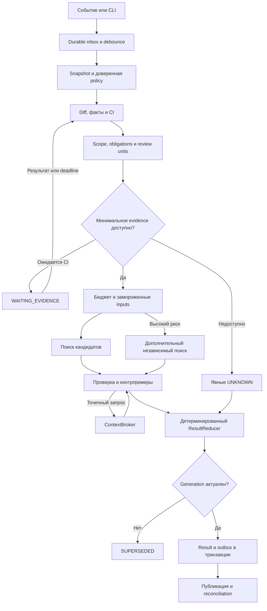
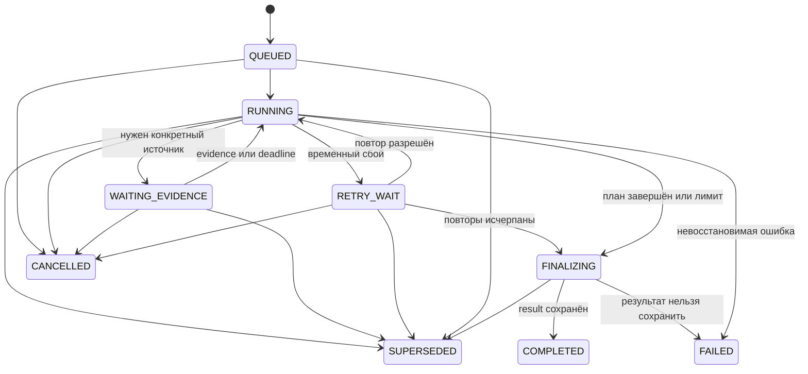
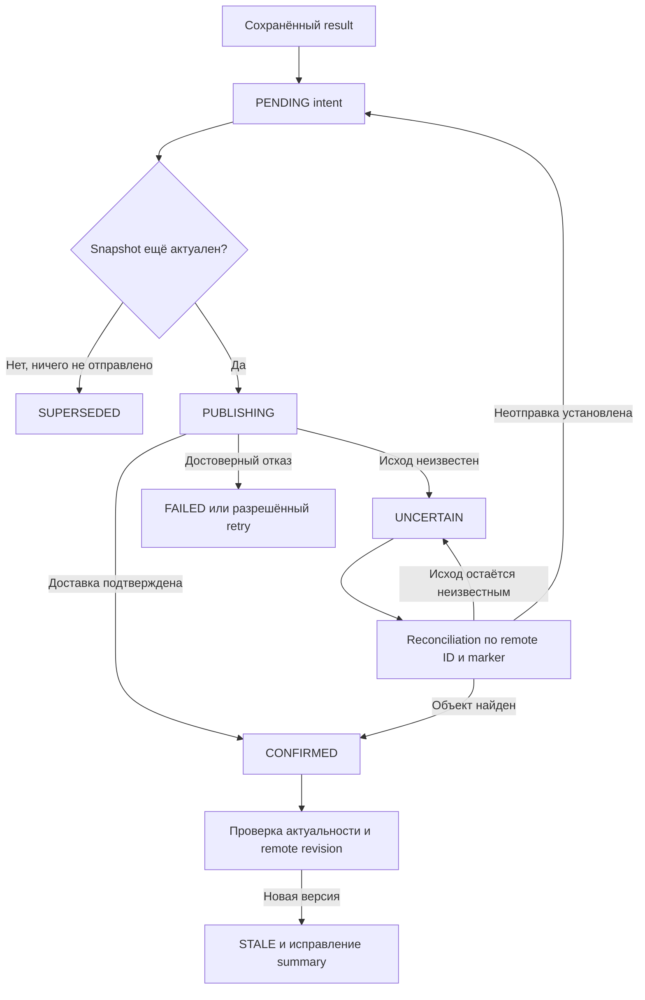
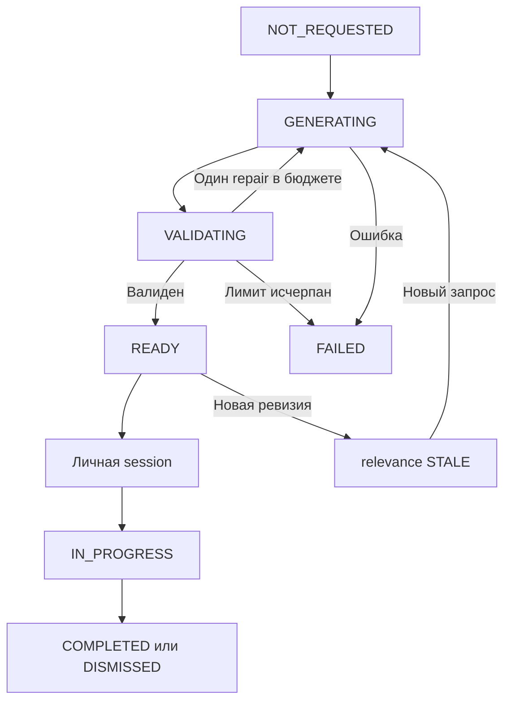

# Sych — спецификация реализации

Версия: **1.2**  
Дата: **25 октября 2026**  
Статус: **план реализации; решения владельца и ещё не установленные параметры окружения перечислены в разделе 30**
Название проекта: **Sych**; русское имя бота — **Сыч**. Имя бинарника и команд CLI — `sych`. Название выбрано и используется во всех интерфейсах и материалах проекта.

## Как пользоваться документом

Это спецификация Sych — собственного инструмента ревью для личных проектов и командной разработки. Она задаёт поведение системы, границы MVP, данные, состояния, интеграции и критерии приёмки. Она не утверждает, что приложение уже реализовано или что его качество измерено.

**MUST / должен** — обязательное требование этапа, в котором функция появляется. **SHOULD / рекомендуется** — допускает обоснованное отклонение с ADR. **MAY / можно** — расширение. Этапы перечислены в разделе 28.

Все лимиты и ресурсные значения ниже — **начальные настройки проекта**, а не измеренные показатели, цены провайдеров или обещания производительности.

Приоритет источников требований: этот документ → принятые ADR → версионированные контракты API и схемы → реализация. При обнаружении противоречия агент разработки обязан явно назвать его и предложить разрешение. Самовольно ослаблять обязательные требования для прохождения тестов нельзя.

### Навигация

1. [Цель и принятые решения](#1-цель-и-принятые-решения)
2. [Сценарии и границы продукта](#2-сценарии-и-границы-продукта)
3. [Инварианты](#3-инварианты)
4. [Архитектура Rust-приложения](#4-архитектура-rust-приложения)
5. [Модель данных](#5-модель-данных)
6. [Snapshot и границы diff](#6-snapshot-и-границы-diff)
7. [Pipeline и план проверки](#7-pipeline-и-план-проверки)
8. [Состояния и восстановление](#8-состояния-и-восстановление)
9. [Контекст и semantic providers](#9-context-broker)
10. [Правила и обязательства](#11-правила-проекта-и-обязательства)
11. [Модельный контур и стоимость](#16-модельный-контур)
12. [Публикация и интеграции](#18-публикация-результатов)
13. [Режим разбора](#21-опциональный-guided-tour)
14. [Конфигурация, CLI и API](#23-конфигурация)
15. [Эксплуатация, оценка и этапы](#26-эксплуатация-и-наблюдаемость)
16. [Открытые решения и источники](#30-открытые-решения)

## 1. Цель и принятые решения

### 1.1. Проблема

Код и тесты часто пишет другой AI-агент. Человек может просмотреть изменения поверхностно. Система должна находить значимые дефекты и нарушения правил, давать полезные nitpicks и показывать, **на каких основаниях сделан вывод и что осталось непроверенным**.

Главные риски:

- потеря или изменение побочных эффектов при рефакторинге;
- несовместимость миграций, API и данных во время выкладки;
- ложное ощущение безопасности из-за зелёного CI, уверенного текста модели или согласия двух моделей.

### 1.2. Зафиксированные решения

| Область | Решение |
|---|---|
| Название | Sych; русское имя Сыч; CLI `sych` |
| Реализация | Rust; детерминированное ядро и ограниченные модельные вызовы |
| Пользователи | Один разработчик, затем команды |
| Первое подключение | Личный GitHub; локальный CLI появляется раньше интеграции |
| Корпоративный контур | GitLab, приложение в изолированном Kubernetes-окружении |
| Модели | Единый ModelGateway: OpenRouter, GPT/ChatGPT subscription, GLM Coding Plan, OpenCode Go/Go Plus; дешёвый DeepSeek V4.1 Flash, подписочные routes и selective Astra/Fable с управляемым fallback |
| Стоимость | Локальные факты, существующие CI artifacts, выборочный дорогой анализ, жёсткие бюджеты |
| Проверяемый стек | Rust и JS/TS/React/CSS/HTML, затем Go, Terraform/Kubernetes/YAML и базовая поддержка Python |
| Обратная связь | Дефекты, правила, улучшения и nitpicks; nitpicks включены по умолчанию |
| Дополнительный режим | Guided tour по готовому результату ревью; включается по запросу |
| Мутации проекта | Reviewer не редактирует исходники и не выполняет merge |
| Передача исправлений | Экспорт пакета автору: сначала план и затрагиваемые файлы, затем согласие пользователя |
| Хранение | SQLite в локальном режиме; PostgreSQL в серверном |
| Архитектура MVP | Один workspace, один бинарник с несколькими режимами, очередь в БД |
| Коммерциализация | Не является требованием; billing, marketplace и публичный SaaS вне начального плана |

Первый production запрещён до полного feature scope M0–M6 и финального gate R1: промежуточные integration/shadow/dogfood проверки выполняются только в изолированном test/staging. Готовность M2 или M4 не разрешает боевое подключение бота. Локальное read-only review разрешённого кода не является выкладкой. Все коммиты оформляются по [Conventional Commits 1.0.0](https://www.conventionalcommits.org/en/v1.0.0/).

### 1.3. Что считается полезным результатом

Результат содержит:

1. Конкретные проверенные замечания с условиями и последствиями.
2. Применимые требования и статус их проверки.
3. Недостающие сведения с объяснением, какой вывод они мешают сделать.
4. Полезные необязательные замечания, честно обозначенные как предпочтения.
5. Scope, версии источников, стоимость и ограничения.
6. При запросе тура — маршрут чтения по тому же snapshot.

`COMPLETE_FOR_SCOPE` означает выполнение объявленного плана проверки. Это не доказательство отсутствия всех ошибок в программе.

## 2. Сценарии и границы продукта

### 2.1. Основные пользовательские сценарии

**UC-01. Локальное ревью.** Разработчик задаёт repository, base и head. Приложение создаёт snapshot, собирает факты и возвращает JSON и Markdown без публикации в SCM.

**UC-02. Автономное ревью PR/MR.** Событие SCM создаёт или актуализирует запрос. Повторы события не создают дополнительные публикации. Новый push инвалидирует текущую актуальность старого результата.

**UC-03. Повторное ревью после исправления.** Новый head создаёт новый анализ. Ранее найденные проблемы сопоставляются с новым кодом и получают новую оценку; история сохраняется.

**UC-04. Поздний CI.** Пригодный отчёт, поступивший после финализации, запускает successor run для того же source snapshot. Повторно используются только валидные факты и checkpoints.

**UC-05. Guided tour.** Пользователь открывает цель изменения, маршрут чтения, вопросы, findings, ограничения и nitpicks. Код берётся из snapshot.

**UC-06. Уточнение.** Вопрос по остановке тура получает ответ на ограниченном контексте. Новая гипотеза о дефекте поступает в verifier.

**UC-07. Feedback.** Пользователь отмечает полезность, ошибку, дубликат или предпочтение. Feedback не меняет глобальные правила автоматически.

**UC-08. Передача исправления.** Пользователь экспортирует finding IDs, evidence и критерии приёмки. Применение изменений выполняет отдельный авторский агент после предусмотренного согласования.

**UC-09. Self-review Sych.** PR собственного Rust workspace проходит review доверенной принятой сборкой Sych; PR не выбирает собственный reviewer executable/policy. До R1 flow проверяется на sandbox-зеркале, после R1 подключение рабочего GitHub repo требует отдельного разрешения.

### 2.2. Границы первой версии

Первый рабочий вертикальный сценарий включает локальные Git snapshots, качественные TS/React и Rust пути, JSON/Markdown result, trusted rules, ограниченный ContextBroker, fake adapter и реальный ModelGateway. TS/React target — Vkusori `apps/pwa` и `packages/core`; Rust target — сам Sych. OpenRouter и три подписочных доступа обязательны до полного релиза с честными ограничениями разрешённого использования и enforcement. Затем добавляются автономный GitHub/self-review, Go и инфраструктурное evidence. Наличие задачи в плане не означает готовой интеграции.

MVP не требует:

- собственной модели или обучения;
- векторной БД, embeddings и полного knowledge graph;
- универсального межпроцедурного доказателя поведения;
- произвольного shell у модели;
- генерации и выполнения исправлений;
- исполнения Terraform apply, Kubernetes deploy или DDL в реальном окружении;
- отдельной агентной платформы, message broker и микросервиса на каждый этап;
- полноценной web-панели до стабильности основного результата;
- поддержки каждого языка через отдельный экспертный анализатор.

Базовый текстовый fallback для неподдержанного языка допустим, но должен явно уменьшать заявленный охват.

## 3. Инварианты

Эти требования проверяются до корпоративного пилота.

| ID | Инвариант |
|---|---|
| INV-01 | Каждый вывод относится к неизменяемому source snapshot и версии политики |
| INV-02 | Статусы исполнения, охвата, проверки обязательств, публикации и актуальности независимы |
| INV-03 | Отсутствие данных, результатов запроса или кандидатов модели не равно успешной проверке |
| INV-04 | Незакрытый обязательный пункт нельзя удалить из scope для получения полного результата |
| INV-05 | Дефект сопровождается evidence, условиями и ожидаемым последствием |
| INV-06 | Координаты кода разрешает harness; модель не создаёт произвольные SCM-комментарии |
| INV-07 | Повтор события, crash и timeout не должны приводить к слепой повторной публикации |
| INV-08 | Перед записью результата worker проверяет fencing token; устаревший worker не меняет актуальные данные |
| INV-09 | После неопределённого исхода SCM write сначала выполняется reconciliation |
| INV-10 | Новый head или существенное изменение target/policy делают старый результат STALE |
| INV-11 | Repository content, PR description, комментарии и CI logs являются данными, не управляющими инструкциями |
| INV-12 | Активные правила берутся из принятой версии; PR не может сам ослабить собственную проверку |
| INV-13 | Все запросы модели, retries и repairs учитываются в бюджете; неизвестная стоимость не записывается как ноль |
| INV-14 | Nitpicks включены, но обязательной квоты замечаний нет |
| INV-15 | Строки реального кода в tour совпадают с зафиксированным blob |
| INV-16 | Пройденный tour не является approval и не повышает статус проверки |
| INV-17 | Модель reviewer не получает credentials публикации, деплоя и изменения repository |
| INV-18 | Secret filtering и access policy применяются до model egress и до записи диагностических payloads |
| INV-19 | Author-written tests и описание PR сами по себе не устанавливают правильность нового требования |
| INV-20 | Reuse учитывает все зависимости; совпадение diff недостаточно для переноса вывода |
| INV-21 | Каждый retry/fallback/escalation сохраняет egress, license/runtime eligibility, verification reserve и общий budget; soft/unknown limits не выдаются за hard |
| INV-22 | Self-review использует доверенную принятую сборку reviewer/policy, не executable/config из проверяемого PR |

## 4. Архитектура Rust-приложения

### 4.1. Режимы

Один бинарник `sych`:

- `review` — локальный анализ с завершением процесса после результата;
- `serve` — webhook/API, scheduler и встроенные workers для личного сервера;
- `api` — только ingress/API/scheduler;
- `worker` — фоновые задачи; corporate workers масштабируются отдельно;
- `tour`, `ask`, `handoff` — чтение результата и дополнительные операции;
- `config`, `doctor`, `db`, `eval` — обслуживание.

`serve` и `api + worker` используют один engine. Разница только в размещении процессов.

### 4.2. Workspace

Общее имя проекта — `Sych`; в идентификаторах используется `sych`. Rust packages и контейнерные компоненты используют префикс `sych-`, Rust crate imports — `sych_`, собственные переменные окружения — `SYCH_`. Публичное отображаемое имя бота — `Sych` (в русскоязычном интерфейсе допустимо «Сыч»).

```text
crates/
  sych-core/       domain types, IDs, policy, pure reducers, schemas
  sych-engine/     planner, pipeline, budgets, verifier orchestration
  sych-adapters/   Git/GitHub/GitLab, models, semantic tools, CI parsers
  sych-storage/    SQLite/Postgres, artifact store, queue, outbox
  sych-app/        CLI, HTTP, composition root, renderer
prompts/             versioned templates and output contracts
schemas/             generated JSON Schema and API definitions
migrations/
  sqlite/
  postgres/
fixtures/            small source repos, reports, provider responses
eval/                manifests, labels, scripts and reports
deploy/              Helm chart, example values, operational docs
docs/adr/            decisions and changes to this specification
```

Нельзя создавать циклические зависимости. `sych-core` не зависит от HTTP, SQL и конкретного LLM SDK. Внешние зависимости внедряются через небольшие интерфейсы.

Начальный набор библиотек: Tokio, Axum/Tower, Serde, Reqwest, SQLx, Clap, tracing. Конкретные совместимые стабильные версии выбираются при bootstrap, фиксируются в `Cargo.lock` и `rust-toolchain.toml`. Не использовать плавающие git dependencies. Axum и SQLx выбраны как обычные инфраструктурные библиотеки; собственный агентный framework не требуется. [S01], [S02], [S03]

### 4.3. Границы компонентов

| Компонент | Ответственность |
|---|---|
| Ingress | Проверка события, размера и подлинности; durable inbox |
| Scheduler | Debounce, актуальный desired generation, объединение повторов |
| SnapshotService | Git refs, merge-base, diff, blobs и source manifest |
| PolicyResolver | Доверенная конфигурация, правила, hash и ограничения |
| FactCollector | AST/diff/CI факты без модельной интерпретации |
| SemanticProvider | Определения, references, реализации, diagnostics |
| ObligationPlanner | Scope, review units, риски и обязательства |
| ContextBroker | Контекст под вопрос, retrieval budget, provenance |
| ModelGateway | Provider/subscription transports, role routing/fallback, structured output, usage/quota/enforcement, deadline и cost reservation |
| CandidateFinder | Поиск гипотез и предложений |
| Verifier | Проверка кандидатов и контрпримеров; ограниченный вывод |
| ResultReducer | Детерминированный расчёт охвата, рекомендаций и результата |
| Publisher | Только разрешённые SCM операции, координаты и reconciliation |
| TourService | Маршрут и объяснение сохранённого результата |
| Evaluation | Воспроизводимые сценарии, качество, стоимость, regression |

### 4.4. Интерфейсы

Ниже логические сигнатуры. Недостающие request/response типы определяются в `sych-core`; это не готовый компилируемый фрагмент.

```rust
pub trait SnapshotReader {
    fn read_span(&self, reference: &CodeRef) -> Result<SourceSpan, ReadError>;
    fn diff(&self, snapshot: &SnapshotId) -> Result<DiffManifest, ReadError>;
}

#[async_trait::async_trait]
pub trait SemanticProvider: Send + Sync {
    async fn capabilities(&self, workspace: &WorkspaceKey) -> Capabilities;
    async fn query(&self, request: SemanticRequest) -> SemanticResponse;
}

#[async_trait::async_trait]
pub trait ModelProvider: Send + Sync {
    async fn invoke(&self, request: ModelRequest) -> Result<ModelResponse, ModelError>;
}

#[async_trait::async_trait]
pub trait ScmProvider: Send + Sync {
    async fn resolve_change(&self, key: &ChangeKey) -> Result<ChangeState, ScmError>;
    async fn publish(&self, operation: &PublicationOperation) -> WriteOutcome;
    async fn reconcile(&self, operation: &PublicationOperation) -> ReconcileOutcome;
}
```

Для динамически выбираемых async adapters использовать `async-trait` либо явный boxed future. Не предполагать dyn-совместимость произвольного native async trait. [S04]

## 5. Модель данных

### 5.1. Идентификаторы и форматы

- Внешние IDs GitHub/GitLab хранятся как непрозрачные строки.
- Внутренние entity IDs — UUID; для новых записей допускается UUIDv7.
- Все timestamps — UTC RFC 3339; локальная timezone применяется только при отображении.
- Денежные значения — целые micro-USD, не `f64`. Отображение в USD отдельно.
- Hash артефактов и canonical manifests — SHA-256.
- Git object ID хранится вместе с алгоритмом; не предполагать ровно 40 символов.
- Наборы перед хешированием сортируются по определённому ключу; обычный порядок полей JSON не используется как идентичность.
- Каждый внешний JSON содержит `schema_version`. Неизвестная major version отклоняется явно.
- `generation` монотонно увеличивается внутри Change при принятом новом analysis intent. Повтор тех же существенных inputs не увеличивает её; разрешённый ручной rerun увеличивает. `review_revision` сохранённого результата равна generation его run; immutable result_id дополнительно идентифицирует artifact.
- В model output неизвестные поля отклоняются. В provider API parsers неизвестные нерешающие поля могут сохраняться/игнорироваться согласно версии адаптера.

### 5.2. Основные сущности

| Entity | Обязательные поля и смысл |
|---|---|
| Repository | tenant-scoped binding: id, tenant_id, connection_id, provider_instance_id, external_id, clone_origin, access_scope_id |
| Change | repo_id, external_number/local_key, target_ref, desired_generation, current_source_snapshot_id |
| SourceSnapshot | repo, target_tip, diff_base, head, source_manifest_hash, diff_manifest_hash |
| PolicySnapshot | trusted_ref/source, rules_hash, config_hash, authorization_policy_version |
| AnalysisRun | id, change_id, generation, source_snapshot_id, policy_snapshot_id, parent_run_id, trigger_reason |
| ScopeManifest | units, required obligations, requested profiles, excluded paths with reasons, scope revisions |
| Evidence | immutable producer/result/source record with provenance and completeness |
| ExternalInputManifest | pinned внешние CI/contract/environment inputs для run; frozen перед анализом |
| EvidenceManifest | все использованные inputs и derived evidence; frozen при finalization |
| ReviewUnit | related changes around one contract, symbol group or behavior |
| Obligation | concrete question, applicable rule, required flag, acceptance criterion, scope |
| Candidate | model/static hypothesis; not yet a published finding |
| Finding | validated result, category, severity, support, anchors, remediation and lineage |
| ReviewResult | immutable run output with coverage, obligations, findings, usage and limitations |
| PublicationOperation | durable intent for one external object/action |
| TourArtifact | immutable route tied to one ReviewResult |
| TourSession | private progress and bounded Q&A |
| Waiver | explicit scoped decision to accept a risk; does not change evidence |
| Feedback | actor judgement with scope and rationale |
| ModelAttempt | request/attempt identity, role/route revision, requested/resolved provider/model/account reference, auth/billing/enforcement kind, limits, monetary reservation, tokens/quota completeness и outcome |

### 5.3. Source coordinates

```rust
pub struct CodeRef {
    pub snapshot_id: SnapshotId,
    pub side: SourceSide,           // DiffBase | Head | TargetTip
    pub path: RepoPath,
    pub blob_oid: GitObjectId,
    pub start_line: u32,            // 1-based, inclusive
    pub end_line: u32,              // 1-based, inclusive
    pub content_sha256: String,
}
```

`RepoPath` — путь внутри snapshot, не абсолютный путь host. Внутренние spans могут хранить byte offsets. При запросе LSP offsets конвертируются в negotiated encoding; нельзя смешивать UTF-8 bytes и UTF-16 character positions.

Rename хранит old/new path. Удалённая строка относится к base. Если строка не является допустимой inline-позицией SCM, finding публикуется в summary с точной ссылкой. Координаты не «приближаются» к произвольной соседней строке.

Файл с неподдерживаемой кодировкой пути/содержимого получает явное ограничение; он не исчезает из scope. Binary, submodule, symlink и LFS pointer отмечаются отдельными типами.

### 5.4. Evidence

Минимальный контракт:

```json
{
  "schema_version": 1,
  "id": "ev-opaque",
  "kind": "semantic",
  "source_snapshot_id": "snapshot-opaque",
  "producer": {
    "name": "gopls",
    "version": "resolved-at-runtime",
    "config_hash": "sha256:..."
  },
  "binding": {
    "kind": "source",
    "head_oid": "git:...",
    "target_tip_oid": "git:...",
    "tested_oid": null,
    "environment_id": null
  },
  "validity": "VALID",
  "completeness": "PARTIAL",
  "trust_class": "DERIVED_LOCAL",
  "artifact_sha256": "sha256:...",
  "code_refs": [],
  "limitations": ["dynamic implementation unresolved"],
  "observed_at": "2026-10-23T00:00:00Z"
}
```

Это иллюстрация полей, не fixture с реальными SHA. `kind`: `source | semantic | static | test | coverage | contract | infrastructure | human`.

`validity`: `VALID | STALE | UNAVAILABLE | MALFORMED | FAILED`.  
`completeness`: `COMPLETE_FOR_QUERY | PARTIAL | UNKNOWN`.  
`trust_class`: `TRUSTED_POLICY | SOURCE_OBSERVATION | DERIVED_LOCAL | AUTHENTICATED_CI | AUTHOR_CLAIM | HUMAN_ATTESTATION`.

`AUTHENTICATED_CI` означает установленное происхождение результата, а не независимость тестового oracle от автора PR.

### 5.5. Obligation

Обязательные поля:

- `id`, `rule_id`, `rule_version`;
- `question`, `required`, `risk_level`;
- `review_unit_ids`, `code_refs`;
- `applicability: APPLIES | DOES_NOT_APPLY | UNKNOWN`;
- `acceptance_criterion` и `acceptable_evidence_kinds`;
- `status`, `evidence_ids`, `limitations`;
- для `UNKNOWN` — `reason_code` и `next_evidence_needed`;
- для `NOT_APPLICABLE` — проверяемое основание неприменимости.

Статусы: `SUPPORTED | VIOLATED | UNKNOWN | NOT_APPLICABLE`. Pending хранится как состояние задачи исполнения, не маскируется под один из финальных ответов.

`SUPPORTED` означает достаточное основание для сформулированного критерия в указанном scope. Число уверенности, выданное моделью, не является таким основанием.

### 5.6. Candidate и Finding

Candidate содержит проверяемое утверждение, предполагаемую причинную цепочку, anchors, последствия, условия и желаемый способ опровержения.

`verification_status` кандидата: `PENDING | CONFIRMED | REJECTED | UNRESOLVED`.

Finding содержит:

- category: `DEFECT | RULE_VIOLATION | IMPROVEMENT | NIT`;
- severity: `CRITICAL | HIGH | MEDIUM | LOW | INFO`;
- title, explanation, triggering_conditions, consequence;
- anchors и evidence_ids;
- rule_id/obligation_ids, если применимо;
- support: `EXECUTED_COUNTEREXAMPLE | STATIC_TRACE | SEMANTIC_ARGUMENT | EXPLICIT_RULE | PREFERENCE`;
- suggested_action и validation_expectation;
- fingerprint, predecessor_finding_id, lifecycle;
- exact scope и limitations.

Severity и support — разные измерения. Critical-гипотеза может остаться unresolved. Preference не становится обязательным defect из-за уверенного текста.

Lifecycle: `OPEN | RESOLVED | DISMISSED | OBSOLETE`. Статус `RESOLVED` требует новой проверки на новом snapshot. `DISMISSED` сохраняет автора и причину; это не удаление истории.

### 5.7. ReviewResult

Обязательные поля:

```text
schema_version
result_id, run_id, review_revision, parent_result_id
source_snapshot_id, policy_snapshot_id, evidence_manifest_id
scope_manifest
execution_outcome
coverage
recommendation
findings[]
obligations[]
unresolved_questions[]
excluded_or_unreviewed[]
rejected_candidates[]       // internal by default; selected items available to tour
usage_summary
created_at
provenance
```

`coverage`: `COMPLETE_FOR_SCOPE | PARTIAL | UNAVAILABLE`.

`recommendation`: `ATTENTION_REQUIRED | NEEDS_EVIDENCE | NO_BLOCKING_FINDINGS_IN_SCOPE`. Это вычисляемое поле, не текстовый вердикт модели и не SCM approval.

Порядок reducer:

1. Если есть подтверждённый finding или проверенное VIOLATED obligation, подпадающее под настроенный порог значимости, — `ATTENTION_REQUIRED`.
2. Иначе при обязательных UNKNOWN или недоступном содержательном анализе — `NEEDS_EVIDENCE`.
3. Иначе — `NO_BLOCKING_FINDINGS_IN_SCOPE`.
4. Независимо от рекомендации показывать фактический coverage и все существенные UNKNOWN.

Если одновременно есть defect, подпадающий под порог значимости, и UNKNOWN, рекомендация остаётся `ATTENTION_REQUIRED`, а неполнота показывается рядом. Неблокирующее замечание не скрывает обязательный UNKNOWN: в этом случае результат — `NEEDS_EVIDENCE`. Порог значимости определяет содержание рекомендации; advisory publication не превращает его в SCM merge gate.

Каждый VIOLATED invariant имеет соответствующий confirmed finding либо явное нарушение внутреннего контракта финализации. ResultReducer не теряет нарушение из-за отсутствующей записи в массиве findings; при возможности он создаёт RULE_VIOLATION из проверенного assessment и его evidence.

## 6. Snapshot и границы diff

### 6.1. Три обязательных Git позиции

Хранить отдельно:

- `target_tip` — актуальная вершина target branch на момент фиксации;
- `diff_base` — основание выбранного diff, обычно merge-base(target_tip, head);
- `head` — вершина проверяемой source branch.

Не называть одним полем `base` и target tip, и merge-base. Provider-specific diff versions хранятся рядом с нормализованным snapshot.

`source_snapshot_id` зависит от repo identity, этих позиций, способа получения diff, source manifest и политики обработки файлов. Rules, model version и CI не входят в source identity, а входят в AnalysisInput.

### 6.2. Алгоритм подготовки

1. Получить разрешённый repository и change через настроенный provider.
2. Повторно прочитать актуальные refs; webhook payload считается указателем на событие.
3. Fetch минимально нужных объектов; при недостаточной глубине ограниченно углубить историю.
4. Вычислить merge-base или получить подтверждённую diff version провайдера.
5. Получить diff со статусами, rename, old/new blob IDs.
6. Убедиться, что diff не усечён provider API. При усечении использовать локальный Git либо отметить непроверенную часть.
7. Сформировать manifest всех изменённых файлов, включая excluded/binary/generated.
8. Прочитать доверенную policy с target tip или закреплённого policy ref.
9. Материализовать отдельные read-only views base/head для инструментов, которым необходим workspace.
10. Зафиксировать snapshot и проверить, не сменилось desired generation.

Если merge-base не найден, использовать явно заданный режим сравнения либо выдать `UNAVAILABLE` с причиной. Молчаливое сравнение с произвольным commit запрещено.

### 6.3. Рабочее дерево

В MVP ревью привязано к commits. `--worktree` появляется отдельным расширением:

- содержимое tracked изменений фиксируется в собственном content snapshot;
- untracked включаются только по явной настройке;
- результат маркируется `WORKTREE`, а не commit;
- файлы не изменяются;
- кэш использует hashes содержимого;
- утверждение «весь код из git commit» для такого режима недопустимо.

### 6.4. Безопасное чтение

Git операции выполняются без checkout hooks, автоматического запуска submodules, внешних diff/textconv helpers и произвольных filters из repository. Рабочая директория не должна влиять на глобальную конфигурацию Git.

Не следовать symlink за пределы snapshot. Не передавать raw user input как shell command. Model URL, artifact URL и clone origin разрешаются политикой endpoint, а не текстом PR.

### 6.5. Актуальность

- Изменился head — новый source snapshot.
- Изменился target tip — новая оценка integration context, даже при прежнем head.
- Изменилась принятая policy/config — новый analysis generation.
- Поступил новый существенный внешний input после input freeze — successor run; derived facts из pinned inputs остаются в текущем run.
- Повтор тех же данных с тем же digest не создаёт новую ревизию.

Исторический результат остаётся неизменяемым. Его `relevance` меняется на `STALE` во внешней записи актуальности, а не путём переписывания доказательств.

## 7. Pipeline и план проверки

### 7.1. Основной поток



Deadline ожидания задаётся один раз. Повторный проход через collector не продлевает его. Если CI уже известен как недоступный, переход к UNKNOWN происходит без бессмысленного ожидания.

### 7.2. Обязанности planner

Planner должен до модельного поиска:

- классифицировать типы изменений;
- определить применимые правила;
- создать обязательства для важных рисков;
- объединить связанные изменения в review units;
- определить минимальное evidence;
- зарезервировать бюджет проверки;
- записать отложенные/невыполнимые проверки.

Обязательные проверки не зависят от того, нашла ли дешёвая модель подозрительный код.

Review unit может включать несколько файлов: handler, repository wrapper, schema и frontend consumer. Разбиение строго по файлам не является обязательным.

### 7.3. Risk routing

Стартовые признаки риска:

- DDL, migrations, backfill, сериализация и versioned API;
- изменение writes, транзакций, outbox, acknowledgements;
- изменение ошибок, retry, cancellation и lifetime;
- auth/tenant checks;
- dependency/build/deploy configuration;
- удаление assertions, увеличение skips, ослабление lint/CI;
- широкое перемещение логики между слоями;
- replacement/deletion инфраструктурных ресурсов.

Признаки — routing hints, не доказательства дефекта.

Высокий риск назначает дополнительный независимый поиск по соответствующим obligations, даже если общий проход вернул пустой список. При нехватке бюджета такой проход остаётся явно невыполненным; система не выдаёт полный охват.

### 7.4. Scope

Scope фиксируется перед модельным анализом. Допускается только явное расширение с новой scope revision. Сужение обязательного scope внутри run запрещено.

Excluded paths включаются в manifest с причиной. Если generated file содержит значимую смену публичного контракта, исключение из чтения не отменяет обязательство проверки этого контракта.

Если большой PR не помещается в лимит, нужно выполнить доступную часть и перечислить остальное, либо предложить разбиение. Нельзя молча анализировать первые N файлов и маркировать весь PR проверенным.

## 8. Состояния и восстановление

### 8.1. Execution state



Для всех активных состояний разрешены отмена, supersede и невосстановимый сбой, если результат ещё не committed. Diagram показывает основные переходы; таблица ниже задаёт обязательные условия.

| Переход | Условие |
|---|---|
| QUEUED → RUNNING | Атомарно получены lease и fencing token |
| RUNNING → WAITING_EVIDENCE | Есть конкретные expected sources и фиксированный deadline |
| WAITING_EVIDENCE → RUNNING | Источник поступил либо deadline исчерпан; во втором случае создаются gaps |
| RUNNING → RETRY_WAIT | Ошибка классифицирована retryable и остаётся общий бюджет |
| RETRY_WAIT → FINALIZING | Повтор невозможен, но можно сохранить честный partial result |
| RUNNING → FINALIZING | План исполнен либо достигнут лимит; задачи и gaps перечислены |
| FINALIZING → COMPLETED | Result, usage и publication intents сохранены атомарно |
| Active → SUPERSEDED | Desired generation изменился |
| Active → CANCELLED | Принята явная отмена; новые внешние операции не запускаются |
| Active → FAILED | Не удалось получить/сохранить даже корректный результат исполнения |

`stage` хранится отдельно: `SNAPSHOT | COLLECT | PLAN | DISCOVER | VERIFY | REDUCE`. Финальная публикация имеет собственную очередь и не держит analysis lease.

### 8.2. Частичное выполнение

Если LSP недоступен, можно закончить часть проверки с `PARTIAL`. Если diff не получен, содержательное ревью не выполнено: допускается сохранённый result с `UNAVAILABLE`.

Если БД недоступна и результат нельзя надёжно сохранить, run не получает `COMPLETED`. Наличие текста в памяти не считается завершением.

### 8.3. Freeze и поздние события

До freeze AnalysisInput runner может принять ожидаемое внешнее CI evidence для того же source snapshot и конфигурации. При input freeze сохраняются SourceSnapshot, PolicySnapshot и неизменяемый ExternalInputManifest.

После input freeze новые существенные внешние inputs — CI artifact, policy, deployment observation — планируют successor generation. Старый активный анализ может быть superseded; завершённый не открывается заново. Новый run ссылается на parent и повторно использует только checkpoints с совпавшими зависимостями.

Чтение нового definition из pinned Git snapshot, semantic query и предусмотренный планом инструментальный output на закреплённых inputs — derived evidence текущего run. Оно не меняет frozen external inputs и не запускает successor само по себе. Полный EvidenceManifest с inputs и derived outputs замораживается при finalization.

Простой progress update CI, дубликат artifact digest или изменение нерелевантного job не создают successor run. Решение о значимости записывается в event log.

### 8.4. Lease и fencing

Стартовые настройки: lease 60 s, heartbeat 15 s, reaper каждые 15 s. Они конфигурируемы.

Каждая выдача задачи увеличивает `lease_epoch`. Запись checkpoint/result допускается только при совпадении `job_id + owner + lease_epoch`, действующей lease, допустимом active state и `run.generation == change.desired_generation`. Cancel/supersede отзывает lease/fence.

Finalization повторяет проверку generation, fence, active state и версии frozen inputs внутри той же транзакции, которая сохраняет result и outbox. Предварительная проверка перед транзакцией недостаточна.

- PostgreSQL: короткая транзакция claim, row locking и `SKIP LOCKED`. [S29]
- SQLite: один worker по умолчанию, короткая транзакция claim и compare-and-swap.
- Внешний HTTP/LSP/model вызов выполняется вне SQL transaction.
- Истёкшая lease делает прежнего worker неспособным сохранить результат.
- Отмена передаётся через cancellation token, но уже отправленный внешний запрос может завершиться позже.
- Fencing БД не предотвращает доставку уже отправленного SCM запроса: это задача publication reconciliation.

### 8.5. Retry

По умолчанию до двух повторов retryable read/analysis operations с exponential backoff и jitter. Максимальное ожидание ограничивается deadline задачи.

Retryable: временная сеть, 429 с учётом Retry-After, временные 5xx, crash локального provider при разрешённом рестарте.

Не retryable без изменения входа: 401/403, некорректная policy, неподдерживаемая схема, превышенный бюджет, неверные refs, запрещённый endpoint.

Model retry учитывается как новая потенциально оплаченная попытка. SCM write с неопределённым исходом не идёт по общему retry: сначала reconciliation.

## 9. Context Broker

### 9.1. Контракт запроса

Каждый запрос контекста содержит:

```text
run_id, snapshot_id, policy_snapshot_id
review_unit_id, obligation_id
question
purpose: DISCOVERY | VERIFICATION | TOUR_FOLLOWUP
seed_refs[]
requested_operations[]
remaining_budget
access_scope_id
```

Ответ содержит `evidence_ids`, фрагменты, связи, полноту каждого запроса, gaps, причины выбора и usage. Он не возвращает просто «строку контекста».

`packet_resolution: SATISFIED | PARTIAL | UNAVAILABLE` описывает достаточность запрошенного набора источников, а не истинность obligation. Ограничение provider делает UNKNOWN только те обязательства, которым не хватает значимого факта; несвязанная unsupported capability не обязана ухудшать весь result.

### 9.2. Алгоритм

1. Начать с diff и enclosing construct до/после: функция, компонент, schema declaration, resource.
2. Добавить относящееся правило и независимый контракт.
3. Добавить imports, определения нужных типов и вызываемых wrappers.
4. Выбрать ограниченный набор callers/callees/readers/writers, влияющих на вопрос.
5. Найти релевантные тесты и нормализованные CI facts.
6. Объединить перекрывающиеся spans одного blob.
7. Приоритизировать обязательное evidence, затем опровергающее гипотезу, затем вспомогательное.
8. Проверить доступ и secret policy.
9. Посчитать токены и вернуть пакет с перечнем исключённого.
10. При конкретном новом вопросе расширить нужную ветку графа в пределах лимита.

На старте использовать Git, path/symbol search, AST и semantic provider. Embeddings не являются зависимостью. Семантические связи могут храниться в памяти/БД как небольшие records без отдельного graph database.

### 9.3. Начальные лимиты

| Параметр | Default |
|---|---:|
| Initial context на unit | 6 000 input tokens |
| Максимальный context одного model request | 14 000 input tokens, включая инструкции и схему |
| Начальная глубина связей | 1 |
| Предельная глубина по обоснованному запросу | 3 |
| Semantic requests на unit / run | 24 / 160 |
| Дополнительные retrieval rounds на unit | 2 |
| Различных читаемых source files на run | 80 |
| Стандартный span | До 160 строк; расширение до целой небольшой конструкции допустимо |
| Максимальный отдельный source blob для текстового чтения | 512 KiB |
| Общий model input budget на run | 64 000 tokens с учётом повторно отправленного контекста |

Общие лимиты раздела 17 имеют приоритет. Источник, необходимый для вывода, нельзя без уведомления обрезать до произвольных первых строк. Если обязательный пакет не помещается, нужно разделить работу с сохранением связей либо создать UNKNOWN.

`max_files` ограничивает чтение содержимого, а не инвентаризацию diff: список всех затронутых файлов остаётся полным.

### 9.4. Инструменты, доступные модели

Модель запрашивает типизированные операции:

- `read_span(code_ref)`;
- `read_symbol(symbol_ref, side)`;
- `find_definition(symbol_ref)`;
- `find_references(symbol_ref, purpose, limit)`;
- `find_implementations(symbol_ref, limit)`;
- `find_callers/callees(symbol_ref, limit)`;
- `search_source(query, paths, side, limit)`;
- `read_evidence(evidence_id)`.

Модель не задаёт shell, произвольный URL, database query к инфраструктуре или новые credentials. Arguments проверяются схемой и access policy. Поиск имеет timeout и ограниченный синтаксис; regex не должен давать неограниченную CPU-нагрузку.

Каждая операция возвращает `COMPLETE_FOR_QUERY | PARTIAL | UNSUPPORTED | FAILED` и конкретные ограничения. Успешный пустой ответ не означает отсутствия динамических или внешних зависимостей.

### 9.5. Представление контекста

Каждый фрагмент имеет:

- ID, snapshot/side/blob/path/range;
- hash оригинального содержимого;
- source kind, producer/config;
- `reason_selected`;
- полноту и ограничения;
- политику преобразований/redactions.

Raw source и summaries — разные типы evidence. Саммари помогает ориентироваться, но finding о конкретном поведении должен иметь доступный исходный фрагмент либо подходящее инструментальное evidence.

### 9.6. Cache и invalidation

Разделить:

1. **Blob cache:** content address + tenant/access partition.
2. **Syntax cache:** blob + parser/version/config.
3. **Semantic cache:** workspace snapshot + toolchain + lockfiles + build tags/target + provider version.
4. **CI cache:** точный run/job/attempt/artifact digest.
5. **Model response cache:** opt-in после MVP; весь prompt/input digest, model/settings, policy, scope и access partition.
6. **Tour cache:** result revision + planner/prompt/renderer + language + access partition.

При чтении cache заново проверять право доступа. Один hash контента не разрешает cross-tenant reuse. Удаление доступа делает cached content недоступным даже при прежнем ключе.

Reuse обязательства требует совпадения его dependencies. Для отрицательного утверждения вроде «других callers нет» dependency включает область поиска и её completeness, а не только найденные файлы.

## 10. Semantic providers и локальные факты

### 10.1. Общий контракт

`SemanticResponse` содержит results, query scope, source snapshot, tool version, build configuration, completeness и unresolved edges.

Capabilities обнаруживаются при подключении. Адаптер не должен возвращать пустой список вместо `UNSUPPORTED`.

Language servers base и head используют разные состояния workspace. Нельзя открыть head поверх base и применить старые locations к новому blob.

LSP — источник навигации, типов и diagnostics. Для call hierarchy используются предусмотренные prepare/incoming/outgoing операции. Возможности зависят от server capabilities и синхронизации документов. [S05]

### 10.2. JS/TS/React

Первая качественно поддерживаемая область.

Обязательно:

- определить tsconfig/project references и реальные package/lockfile boundaries;
- выбрать semantic backend по версии TypeScript проекта;
- разрешать imports, aliases, definitions и references;
- различать production/test/generated paths;
- извлекать enclosing functions, JSX components, hooks и call sites;
- учитывать changes в dependency/config;
- импортировать typecheck, lint и component/integration reports.

TypeScript backend может использовать совместимый legacy semantic service или LSP native compiler; не навязывать обновление проекта ради reviewer. [S06]

Начальные effect detectors:

- mutation и последующая invalidation/refetch;
- effect setup/cleanup;
- subscriptions/listeners/timers;
- запрос и запись состояния после асинхронного ответа;
- error/loading/optimistic state;
- изменения controlled/uncontrolled/form submit поведения.

Название функции само по себе не доказывает эффект. Проектные wrappers описываются registry и проверяются по реализации.

CSS/HTML анализ использует AST/структуру связанных компонентов и существующие browser/accessibility/visual reports. TS types не являются доказательством визуального поведения.

### 10.3. Go

Обязательно:

- учитывать go.mod/go.work, module replacements, GOOS/GOARCH и build tags;
- получать definitions, references, implementations и доступную call hierarchy;
- извлекать receiver, параметры context, return errors, defer, goroutine, channel и transaction boundaries;
- импортировать go test/vet/race/coverage;
- различать sql.DB, sql.Tx и проектные wrappers;
- отмечать неоднозначные interface dispatch и reflection.

gopls call hierarchy не охватывает все динамические вызовы; references относятся к активной build configuration. Эти ограничения должны попадать в query completeness. [S07]

### 10.4. Python

Первый этап:

- AST, imports и enclosing functions/classes;
- существующие typecheck/lint/test reports;
- targeted definitions и project wrappers;
- with/finally, async tasks, writes и exception paths.

Dynamic dispatch, monkey patching, runtime registration и неизвестный import side effect дают gaps. Полноценный Python language server — расширение после измерения необходимости.

### 10.5. Terraform и Kubernetes

Semantic provider здесь — нормализатор структуры и отчётов. Он не обязан работать через LSP.

Terraform: HCL diff + plan JSON + workspace/environment/provider locks.  
Kubernetes: rendered manifests + values/config digests + inventory + controller/deploy metadata.

Без соответствующего environment evidence анализ может находить локальные изменения и задавать вопросы, но не подтверждать применимость или безопасность rollout.

### 10.6. Запуск анализаторов

Default: использовать уже установленные pinned tools и готовые CI artifacts.

Если анализатор способен выполнять plugins, build scripts, dependency hooks или код проекта, он запускается в отдельном sandbox без SCM write/model secrets. Установка dependencies не выполняется произвольной командой из repository; используется разрешённый runner profile.

Недоступные dependencies, отключённые plugins и неполный build environment уменьшают completeness. Система не скрывает такой режим.

### 10.7. Rust

Rust — обязательный качественный путь M1, а не текстовый fallback. Первый target — собственный Cargo workspace Sych; одновременная поддержка TS/React сохраняется.

- Обнаруживать Cargo workspace/packages, lockfile/toolchain/edition, target, features и `cfg`; base/head состояния AST/rust-analyzer изолированы.
- Получать доступные definitions/references/implementations/trait links, enclosing constructs и diagnostics с query scope, build configuration, provenance и completeness. Неизвестные dynamic dispatch/macro expansion не являются доказанным отсутствием связей.
- Проверять Result/error propagation, RAII/drop/resource/transaction boundaries, async cancellation/select/task lifetime, blocking/locks across await, public API/trait/serialization и feature-dependent contracts. Компиляция/ownership checks не доказывают runtime correctness.
- Импортировать существующие Cargo check/test/Clippy outcomes с точными target/features/toolchain/checkout. Stable toolchain не требует unstable JSON test runner: используется фактически доступный report либо project outcomes manifest.
- Build scripts, proc-macros и plugins подчиняются §10.6/§22.4; default execution off, разрешённое исполнение только в отдельном admin sandbox. Невозможная expansion отражается конкретным gap.
- Качество доказывается paired unsafe/safe/UNKNOWN Rust cases и реальным model review Sych snapshots: error propagation, async/lifetime, lock/blocking, API/trait и cfg/macro boundaries. Fake, успешная сборка или точное совпадение текста не заменяют quality evaluation.

## 11. Правила проекта и обязательства

### 11.1. Структура

Принятая структура repository:

```text
.sych/
  config.yaml
  rules.yaml
  effects.yaml
  deploy.yaml
  contracts/           # небольшие принятые требования и сценарии
```

Это проектный формат нашего инструмента. Папка не получает автоматического доверия только из-за имени.

Server policy хранит верхние ограничения доступа, бюджета, моделей и runners. Repository policy может ужесточать ограничения и выбирать разрешённые профили. Ослабление server policy через PR запрещено.

### 11.2. Приоритет правил

1. Неизменяемые требования engine: isolation, provenance, budgets, status semantics.
2. Server/organization policy.
3. Принятая repository policy из доверенного ref.
4. Правила конкретных path/domain.
5. Личные предпочтения, разрешённые для personal mode.

Неоднозначный конфликт обязательных правил — configuration error либо UNKNOWN соответствующего обязательства с объяснением; модель не выбирает молча удобное правило.

Документы AGENTS.md/CLAUDE.md и подобные могут быть импортированы как контекст. Управляющей policy они становятся только после явного подключения доверенной версии и нормализации.

### 11.3. Контракт правила

```yaml
schema_version: 1
rules:
  - id: EFFECT-01
    version: 1
    title: Сохранение обязательных эффектов операции
    kind: invariant
    required: true
    severity_on_violation: high
    owner: backend
    applies_to:
      paths: ["backend/orders/**"]
      change_kinds: ["call_change", "control_flow_change", "move"]
    statement: >
      Успешная запись заказа сохраняет обязательную публикацию события
      согласно принятому контракту операции.
    rationale: "Потребители должны получить событие о сохранённом заказе."
    contract_refs: [".sych/contracts/order-created.md"]
    acceptance:
      evidence_kinds: ["source", "semantic", "test"]
      criteria:
        - "Определены граница commit и механизм доставки."
        - "Проверены ошибка, повтор и остановка между записью и доставкой."
    exceptions: []
```

`owner` — команда/роль из конфигурации, а не произвольный упомянутый человек. Rule ID стабилен; изменение смысла повышает version.

Применимость определяется по diff, семантическим связям и перемещению логики. Перенос функции за пределы исходного path не должен автоматически отменять связанный инвариант.

### 11.4. Начальный набор

| ID | Активация | Обязательство |
|---|---|---|
| EFFECT-01 | Изменение пути с обязательными эффектами | Сохраняются адресат, условие, кратность и требуемый порядок |
| EFFECT-02 | Ошибки/cancellation/lifetime | Сохраняется договорённое поведение при сбое и завершении |
| MIG-COMPAT | Schema/API/event migration | Совместимы достижимые состояния rollout |
| MIG-RESTART | Backfill/batch | Повтор и продолжение не теряют данные |
| MIG-CONTRACT | Удаление старого контракта | Подтверждено прекращение требуемого использования |
| MIG-RECOVERY | Новая форма persistent data | Известен работоспособный recovery path |
| TF-CHANGE | Infrastructure resource change | Replacement/deletion соответствует принятому намерению |
| K8S-ROLLOUT | Workload/deploy change | Порядок rollout и доступность dependencies согласованы |
| TEST-INTEGRITY | Изменение assertions/skips/CI gates | Важная проверка не была незаметно ослаблена |

Наличие generic rule в поставке не означает обязательное выполнение для каждого PR. Применимость трёхзначная: APPLIES, DOES_NOT_APPLY, UNKNOWN. Для required rule в потенциально затронутой области UNKNOWN создаёт обязательство с конкретным gap; недоступный provider не позволяет исключить правило. Обоснованный DOES_NOT_APPLY сохраняется как NOT_APPLICABLE.

### 11.5. Предпочтения и nitpicks

Правила `kind: preference` используются для naming, readability, локальных упрощений и принятых conventions.

Nitpick должен указывать конкретное место и пользу. Если есть linter finding той же причины, модель не создаёт его дубликат. Предложение упрощения проверяется на очевидное изменение поведения.

Система может вернуть ноль nitpicks. Она не должна придумывать советы для заполнения секции.

### 11.6. Исключения и изменения политики

Исключение имеет rule ID, scope, причину, owner, author, expiry/условие завершения. Отдельный waiver влияет на решение о риске, но сохраняет исходные `VIOLATED/UNKNOWN`.

Предложенное в PR правило показывается как policy diff. Для текущего run применяется принятая версия. Доверенный administrator может явно запустить review с новой policy revision; это отдельный run с provenance.

## 12. Сохранение побочных эффектов

### 12.1. Effect ledger

Для выбранного изменённого пути строится таблица эффектов base/head:

```text
effect_id
kind: db_write | event | network | cache | filesystem | subscription | ui | other
target / key / payload summary
trigger / guard
cardinality
required_order_edges[]
transaction_scope
lifetime / cancellation_scope
failure_and_retry_behavior
source_refs[]
resolution: resolved | partial | dynamic_unknown
match: preserved | moved | changed | removed | added | unresolved
contract_refs[]
```

Это ограниченная модель поведения, не полный dataflow всей программы.

### 12.2. Алгоритм

1. Извлечь изменённые calls/control flow/receivers/guards.
2. Разрешить прямые определения и ближайшие wrappers.
3. Применить registry известных project effects.
4. Сопоставить эффекты по семантической роли, объекту и контракту.
5. Сравнить условия, кратность, порядок и failure semantics.
6. Для исчезнувшего эффекта проверить перенос и альтернативный механизм.
7. Сформировать candidates или concrete UNKNOWN.
8. Найти evidence для подтверждения/опровержения.
9. Сохранить ledger и зависимости как artifact.

Сравнивается контракт наблюдаемого поведения. Буквальное равенство всех execution traces не требуется. Нормализация случайных IDs/timestamps допустима только там, где они несущественны; tenant key, multiplicity и ordering constraints нельзя стирать ради равенства.

### 12.3. Registry wrappers

```yaml
schema_version: 1
effects:
  - id: order-outbox
    match:
      language: go
      symbol: "example.internal/orders.Store.AppendEvent"
    effect_kind: event
    guarantees:
      durable_with_transaction: true
    implementation_refs: ["backend/orders/store.go"]
    contract_refs: [".sych/contracts/order-created.md"]
```

Это утверждение принятой конфигурации, которое должно быть связано с текущей реализацией. Если implementation hash изменился, registry не подтверждает гарантию автоматически: обязательство исследуется заново.

### 12.4. Обязательные сценарии

**Go transaction extraction.** SQL остался тем же, но helper использует `sql.DB` вместо `sql.Tx`. Проверить receiver и границы операций. Документация Go предупреждает о вызовах DB вне Tx; сам факт сохранения SQL недостаточен. [S08]

**Outbox → goroutine.** Проверить доставку при остановке после commit. До исследования альтернативного recovery path не объявлять событие гарантированно потерянным.

**React cleanup.** Проверить смену зависимостей и unmount; cleanup и защита от устаревших async results являются отдельными сценариями. [S09]

**Cache invalidation.** Mutation сохранилась, invalidation исчезла. Проверить, не перенесена ли она в mutation wrapper, transport middleware или subscription.

**Python resource lifetime.** Перенос кода за пределы with/finally не должен автоматически считаться эквивалентным.

### 12.5. Проверки поведения

При наличии разрешённого execution profile можно запросить целевой тест на failure/retry/cancel/unmount. Генерация и выполнение нового теста не обязательны для MVP и не выполняются в tour reader.

Тесты обеих версий, controlled scheduling и event assertions могут дать сильное evidence. Одного сравнения return value часто недостаточно.

Если runtime verification недоступен, verifier может сохранить ограниченный static/semantic argument либо UNKNOWN. Категория основания отображается пользователю.

## 13. Совместимость миграций и recovery

### 13.1. Модель deployment

`DeploymentModel` содержит:

- environment и owner;
- `initial_versions`: pinned app image/build/source refs, schema/data phase и поддерживаемые клиентские версии с provenance;
- порядок schema/app/frontend/jobs;
- допустимость mixed versions и downtime;
- compatibility window клиентов и consumers;
- backfill/retry strategy;
- contract/removal conditions;
- recovery strategy;
- источник каждого утверждения.

Неизвестные DB/framework/controller не заполняются предположениями. До настройки DB-specific provider выполняются общие проверки контракта, а DDL locks/transaction semantics остаются вне подтверждённого scope.

`diff_base` и `target_tip` не считаются автоматически развёрнутой версией. DeploymentModel обязан явно задать исходную версию и связь build/image → source. Если она неизвестна, зависимые compatibility obligations остаются UNKNOWN.

### 13.2. Transition matrix

| Состояние | Обязательство |
|---|---|
| Старый app + expanded schema | Старые readers/writers остаются работоспособны |
| Старый и новый app вместе | Совместимы данные, API и события |
| Новый backend + старая открытая вкладка | Поддерживается заявленный контракт старого клиента |
| Частичный backfill + текущие writes | Не теряются более свежие данные; обе формы обрабатываются |
| Повтор backfill | Идемпотентность или корректное продолжение |
| Contract phase | Старый путь больше не нужен в принятом compatibility window |
| Recovery после новых writes | Восстановленная версия обрабатывает фактическое состояние данных |

Не нужно поддерживать недостижимые сочетания. Исключение состояния требует подтверждённого deploy constraint; отсутствие описания не считается основанием `NOT_APPLICABLE`.

### 13.3. Сбор контекста

Связать migration/schema diff с:

- Go serializers, readers/writers и background workers;
- TS/JS consumers;
- событиями и внешними consumers;
- API schemas;
- deployment configuration;
- backfill code и checkpoint strategy;
- доступными migration/compatibility tests.

Если внешние consumers неизвестны, reviewer должен назвать именно этот пробел. Он не может доказать безопасность удаления поля только поиском по текущему monorepo.

### 13.4. Recovery

Каждое migration obligation содержит `evaluation_mode: PLAN_REVIEW | OBSERVED_TRANSITION`.

В `PLAN_REVIEW` проверяется предложенный порядок и механизмы обеспечения предусловий. Например, удаление столбца допускается только после enforced gate завершения backfill. `SUPPORTED` означает условную обоснованность плана, а не факт выполненного backfill.

В `OBSERVED_TRANSITION` требуется evidence фактического состояния соответствующего environment. План не подтверждает выполненный drain, а будущий rollout report не требуется для проверки одного лишь плана. Исходное deployed состояние может отличаться от Git diff base и хранится отдельно.

Наличие reverse migration или старого image не подтверждает восстановимость данных. Kubernetes Deployment rollback относится к Pod template; восстановление состояния данных требует отдельного плана. [S10]

Поддерживаются варианты: compatible rollback, roll-forward repair, restore/replay или другой принятый процесс. Rule требует работоспособности выбранного пути для конкретного состояния, а не обязательного наличия down migration.

## 14. Инфраструктурные проверки

### 14.1. Terraform

Input: существующий plan нужного environment/workspace и source revision; versions/config/variables digest; provider lock; timing.

Локальный parser извлекает:

- resource address, action list, replacement order;
- before/after для разрешённых важных полей;
- after_unknown;
- sensitive masks;
- replace_paths, dependencies и move metadata при поддержке формата;
- непроверенные или неизвестные конструкции.

Terraform JSON различает delete/create и create/delete; unknown и sensitive — самостоятельные данные. [S11]

Raw state/plan не отправляется модели. `terraform show -json` может содержать sensitive values открытым текстом, поэтому до egress применяются локальная фильтрация и allowlist полей. [S12]

Неизвестный generated ID сам по себе не делает все obligations UNKNOWN. UNKNOWN относится к конкретному критерию, которому значение необходимо.

Неподдерживаемая major version JSON format отклоняется. Частично разобранный plan не обозначается полным.

### 14.2. Kubernetes

Input: rendered manifests, environment values/config digest, known inventory, deploy controller/order и отчёты.

Приоритет:

- selectors и labels;
- readiness/startup/liveness;
- replicas/strategy и termination behavior;
- volumes, persistent state и deletion/prune;
- secrets/config references без раскрытия values;
- migrations/jobs/hooks и их порядок.

Schema/admission/dry-run — отдельные виды evidence. Dry-run не подтверждает успешный runtime rollout. [S13]

Reviewer не запускает deploy и не получает production credentials. CRD conversion, StatefulSet и controller-specific поведение добавляются отдельными профилями по реальной необходимости.

## 15. CI evidence

### 15.1. Поддерживаемые форматы

Первые parsers:

1. JUnit XML.
2. SARIF и GitLab Code Quality.
3. LCOV/Cobertura coverage.
4. Небольшой проектный JSON manifest для command/test outcomes.
5. Terraform plan JSON.
6. Rendered Kubernetes YAML + manifest происхождения.

Парсеры работают с ограничением размера, числа записей и глубины. XML external entities отключены. Архивы не могут писать вне своего staging directory; лимитируются decompressed size и число entries.

### 15.2. Binding

`CiBinding`:

```text
provider_instance, repo_id
run_or_pipeline_id, attempt, job_id
event/source, status, allow_failure
execution_sha
source_head_sha
target_tip_sha
binding_kind: SOURCE_HEAD | MERGE_RESULT | UNVERIFIED
checkout_manifest_digest
tool/version/config
artifact_id/digest
started_at, completed_at
```

`SOURCE_HEAD` допустим, когда установлено, что анализировался нужный head. `MERGE_RESULT` хранит tested commit и подтверждённую пару source/target. Один Git SHA из случайного поля webhook не заменяет binding.

Если job script checkout делает другой ref, metadata pipeline недостаточно: нужен доверенный manifest фактически проверенного дерева. Для строгого обязательства непроверенный checkout остаётся `UNVERIFIED`.

GitLab MR и merged-results pipelines проверяют разные состояния. Отчёты получать по конкретным job/artifact IDs, не через «последний успешный pipeline ветки». [S14], [S15]

### 15.3. Интерпретация

- Skipped/cancelled/missing обязательный job не считается passed.
- Report parser failure не превращается в пустой список findings.
- `allow_failure` сохраняется как metadata и не скрывает test failure.
- JUnit и job exit status проверяются отдельно: GitLab JUnit report сам по себе не меняет статус job. [S16]
- Coverage подтверждает исполнение, не корректность assertion.
- Race detector проверяет только исполненные пути. [S17]
- Отчёт старого snapshot может использоваться как baseline, но не как head proof.

### 15.4. Baseline и изменённые тесты

Static diagnostics сравниваются base/head по rule, semantic location и message category. Existing finding не публикуется как новый без основания, что PR изменил его достижимость/значимость.

До сравнения проверяется сопоставимость producer/version, rule set, configuration, build target и completeness. Результат сравнения — `COMPARABLE | UNDETERMINED`. Неизвестная сопоставимость, отключённое правило или неполный head report не означают исчезновения дефекта.

`RESOLVED` требует повторной проверки соответствующего критерия сопоставимым методом либо отдельной полноценной revalidation. Отсутствие diagnostic, skipped job или parser error не закрывают finding.

Изменения tests/assertions/skips/fixtures/CI conditions исследуются как часть PR. Новые тесты полезны, но source of expected behavior указывается отдельно: accepted contract, прежний regression scenario, author claim или другое.

Истёкший artifact и недоступный child pipeline создают конкретный gap. Система может завершить остальные проверки.

## 16. Модельный контур

### 16.1. Роли

| Роль | Input | Output |
|---|---|---|
| reviewer | Review units, obligations, source/evidence | Candidates и context requests |
| verifier | Candidates и/или obligations, evidence, acceptance criteria | Candidate verdicts и ObligationAssessments |
| risk_auditor | Выбранные high-risk obligations | Дополнительные candidates или конкретные gaps |
| explainer | Сохранённый ReviewResult и TourPlan | Текст остановок и вопросов |
| followup | Текущая остановка, вопрос и разрешённый контекст | Ответ или новая candidate hypothesis |

Одна и та же модель может выполнять разные роли. Дополнительный поиск независим по постановке и контексту: ему не нужно сначала показывать вывод первого прохода. Это не обещает статистической независимости ошибок.

Для обычного небольшого PR целевой дешёвый путь: один discovery request и один batch verification/assessment. Детерминированно закрытые проверки могут не требовать модели. Даже при пустом discovery каждое required obligation должно получить assessment; отсутствие кандидатов не закрывает его. Фактическое число вызовов определяется scope и бюджетом.

### 16.2. Discovery output

```json
{
  "schema_version": 1,
  "candidates": [
    {
      "local_id": "candidate-1",
      "category": "DEFECT",
      "claim": "Краткое проверяемое утверждение",
      "conditions": ["Условие возникновения"],
      "consequence": "Наблюдаемое последствие",
      "evidence_ids": ["ev-1"],
      "code_ref_ids": ["ref-1"],
      "obligation_ids": ["ob-1"],
      "proposed_severity": "HIGH",
      "disproof_question": "Какой механизм мог сохранить требуемое поведение?"
    }
  ],
  "context_requests": [],
  "unresolved_questions": []
}
```

Модель использует только выданные IDs. Она не может объявлять произвольный тест выполненным, менять required, создавать trusted evidence или выбирать SCM action.

### 16.3. Verifier

У verifier есть две задачи: проверка кандидата и оценка обязательства. `ObligationAssessment` содержит obligation_id, applicability, proposed_status, criterion_results, evidence_ids, rationale, limitations и missing_inputs. Каждый criterion_result содержит criterion_id, `MET | NOT_MET | UNKNOWN` и evidence refs.

Модель может предложить assessment; engine проверяет допустимые evidence kinds, anchors, полноту критериев и противоречия. Детерминированный checker также может выдать assessment. SUPPORTED допускается только при выполненных критериях; VIOLATED — при проверенном нарушении. Если assessment не получен, обязательство финализируется UNKNOWN.

Batch verifier может одновременно оценить несколько кандидатов и обязательств. Связь obligation → candidate не обязательна; поэтому безопасное изменение с пустым списком candidates всё равно может получить обоснованный SUPPORTED.

Для каждого candidate:

1. Проверить schema, anchors, existence и соответствие snapshot.
2. Проверить причинную цепочку и условия возникновения.
3. Найти альтернативное объяснение: wrapper, policy, guard, recovery path, intentional change.
4. Сопоставить с accepted requirement и baseline.
5. Проверить достаточность evidence для заявленного последствия и severity.
6. Проверить новизну и дедупликацию.
7. Вернуть `CONFIRMED | REJECTED | UNRESOLVED`.

Для высоких рисков запрашивается воспроизводимый сценарий либо конкретная проверяемая static/semantic trace. Согласие моделей без evidence недостаточно.

`CONFIRMED` означает прохождение принятой политики верификации с указанным видом основания; это не формальное доказательство. Текст finding должен сохранять эту границу.

Улучшения и preferences могут проходить более дешёвую проверку конкретности, соответствия rules и сохранения поведения. Необоснованный nit удаляется, а не эскалируется в defect.

### 16.4. Structured output и repair

- Предпочитать поддерживаемый provider structured-output API.
- При отсутствии — strict JSON parse + schema validation.
- Максимум одна schema-repair попытка на ответ внутри общего call budget.
- Repair получает ошибки схемы и исходный ответ; не получает новый неограниченный scope.
- Ошибка schema после repair завершает соответствующую задачу как failed/unresolved.
- Новые выводы repair проходят обычную проверку evidence.
- Не извлекать комментарии регулярным выражением из произвольной прозы.

### 16.5. Prompt composition

Слои: доверенный role prompt → output contract → applicable trusted rules → task → явно размеченные repository/evidence data.

Запрос должен требовать короткое объяснение причинной связи и проверяемые основания. Сохранять скрытые рассуждения модели или требовать полный chain-of-thought не нужно.

Prompt templates, schemas, model parameters и reasoning settings версионируются. Фактический model ID и доступные provider fingerprints сохраняются.

### 16.6. Capabilities и ошибки провайдера

Обязательные способы доступа до R1: OpenRouter API, GPT/ChatGPT subscription, GLM Coding Plan и OpenCode Go/Go Plus. Они используют один typed ModelProvider/ModelGateway, schemas и ledger; поддержка подписки не подменяется обычным API key или fake adapter.

Adapter объявляет transport/auth/billing kind, allowed runtime modes и account entitlement, supported tools/structured output, context/output limits, usage completeness, quota/rate/reset и cancellation semantics, доступные runtime/provider/model versions. Requested alias и фактическая модель различаются; неизвестные upstream/version/usage не выдумываются.

| Доступ | Минимальный допустимый путь | Существенная граница |
|---|---|---|
| OpenRouter | HTTP API через общий gateway; выбранные model/upstream/data policy и наблюдаемый cost | Неявные provider/model fallback и latest routers по умолчанию выключены; каждый разрешённый переход учитывается отдельно |
| GPT/ChatGPT subscription | Один официальный допущенный text-only transport, предпочтительно SIWC Responses; официальная авторизация, tools off | Local acceptance не разрешает hosted/commercial use. Admission/license и реальные capabilities подтверждаются; API billing — другой route |
| GLM Coding Plan | Реальный supported-tool owner-only local workflow, например pinned Pi CLI, с tools/execution выключенными | Собственный HTTP/bot/proxy без отдельного письменного соглашения Z.ai не разрешён; wrapper не отменяет personal-use restriction |
| OpenCode Go/Go Plus | Документированный HTTP coding-agent contract, свой User-Agent и stable `x-opencode-session` | Go quota, Console/Zen PAYG и fixed fee различаются; Extra Usage по умолчанию off, single-member entitlement не означает shared-service право |

Источники: [OpenRouter](https://openrouter.ai/docs/quickstart), [provider routing](https://openrouter.ai/docs/guides/routing/provider-selection), [GPT subscription auth](https://developers.openai.com/codex/auth), [SIWC inference](https://developers.openai.com/siwc/token-sharing-open-source/models-and-inference), [SIWC limitations](https://developers.openai.com/siwc/token-sharing-open-source/preview-limitations), [GLM usage restrictions](https://docs.z.ai/legal-agreement/subscription-terms), [supported Pi](https://docs.z.ai/devpack/tool/pi), [OpenCode Go](https://opencode.ai/v2/docs/console/go/), [Go billing fields](https://opencode.ai/v2/docs/console/api/inference/). Provider terms/capabilities проверяются заново для выбранного account/version до real smoke.

Coding-agent backend — изолированный процесс без repository/host credentials, plugins/MCP/tools и произвольного execution. Read-only sandbox не является запретом shell. Предпочитается text-only transport без agent loop; иначе превентивный no-exec/no-tools boundary обязан быть доказан документированными средствами pinned runtime. Неизвестная safety guarantee блокирует профиль; её нельзя заменить prompt-инструкцией.

Для подписок владелец явно разрешил `subscription_observable` enforcement: hard остаются применимые денежные reservations, Sych-initiated requests и локальные deadlines; неподдержанные upstream output/internal-call/quota bounds обозначаются soft/unknown. Ненаблюдаемые вызовы/usage не равны нулю. Обычный metered API сохраняет `api_hard` профиль с консервативной денежной верхней оценкой. Secret/access/egress, лицензии и запрет скрытого overage не смягчаются ни одним enforcement profile.

Ошибка unsupported не маскируется под успешный ответ. Auth/account mismatch, quota exhaustion, rate limit, transient network, schema failure и billing mismatch различаются. SDK/provider retries, compaction и hidden fallback отключаются либо их наблюдаемость и ограничения честно включаются в enforcement report. Недопущенный обязательный local subscription path остаётся блокером своей задачи/R1, не «готовым через API».

### 16.7. Маршрутизация, fallback и эскалация

Trusted config задаёт named provider/model/account profiles, role assignments и конечные ordered fallback chains. Образец структуры — пользовательские OMP `modelRoles`/`retry.fallbackChains`, не автоматический импорт его credentials или всех defaults. Приоритет chain: точный profile → роль → provider default. Выбранный порядок фиксируется на logical task; fallback не запускает новую рекурсивную цепочку с обнулёнными счётчиками.

Дешёвый путь discovery/explainer/follow-up — **DeepSeek V4.1 Flash** через допустимый OpenCode Go либо OpenRouter profile. GPT/GLM/OpenCode subscriptions используются там, где подходят роль, quota, license и runtime mode. High-risk obligations и обоснованная дополнительная верификация могут использовать **Astra/Fable**, даже если дешёвый discovery пуст. Дорогая модель не заменяет отсутствующее source/environment evidence; такой критерий остаётся UNKNOWN.

Перед каждым hop gateway повторно проверяет capabilities/role requirements, auth/license/runtime eligibility, egress/access/retention, quota и оставшиеся limits. Corporate profiles используют только approved VPC endpoint; локальный proxy к внешнему SaaS не создаёт исключение. Наличие personal subscription login не разрешает его использование в hosted self-review.

Loop ограничивает retry count, route visits и общий deadline, соблюдает Retry-After/reset/cooldown и возвращается к primary после cooldown согласно policy. Циклическая/неразрешимая конфигурация отклоняется. Ожидание reset не удерживает job бесконечно. Каждый реально инициированный Sych retry/repair/fallback — отдельный attempt в одном budget; неизвестный расход прежнего route не освобождается при переключении.

Premium escalation не повышает budget автоматически и не расходует verification reserve на discovery. Исчерпан cap/нет eligible route — честный PARTIAL/UNKNOWN с причиной. Config/schema/egress failures не обходятся fallback. Для иных auth/entitlement failures переход допустим только по явно принятой error policy, без credential scraping, account rotation для обхода quota, скрытого paid overage или смены privacy region.

## 17. Бюджеты и модель стоимости

### 17.1. Начальный профиль economical

| Лимит | Default |
|---|---:|
| Sych-initiated model attempts на analysis run, включая retry/repair/fallback | 6 |
| Общие input / output tokens (`api_hard`; для subscription см. enforcement report) | 64 000 / 12 000 |
| Output на один request (`api_hard`; subscription upstream cap может быть soft/unknown) | 2 000 tokens |
| Одновременно model requests на run | 2 |
| Model request timeout | 90 s |
| Active analysis deadline | 300 s без времени очереди и ожидания CI |
| CI wait deadline | 180 s |
| Денежный лимит analysis run | 300 000 micro-USD = $0.30 |
| Денежный лимит personal tenant за сутки | 3 000 000 micro-USD = $3 |
| Модельные расходы personal tenant за календарный месяц UTC | 60 000 000 micro-USD = $60; compute/storage отдельно |
| Candidate buffer | 50; overflow означает неполноту обнаружения |
| Tour generation attempts | 2, включая максимум один repair |
| Tour budget | $0.10, отдельно от analysis run |
| Follow-up budget на личную session | $0.15, отдельно от tour generation |

Это защитные caps выбранной конфигурации. Они не означают, что любой PR будет качественно проверен за эти суммы. Corporate values задаёт owner. При невозможности выполнить обязательный план в cap система возвращает PARTIAL.

Внутри analysis cap planner резервирует место для проверки findings. Discovery не должен расходовать весь бюджет, оставляя candidates автоматически «подтверждёнными».

### 17.2. Учёт

До каждого запроса:

1. Посчитать фактический input payload; доступные token categories и полноту оценки зафиксировать явно.
2. Для api_hard определить поддержанный billable output/reasoning bound; для subscription_observable отметить неподдержанные upstream limits soft/unknown и не отправлять запрещённые поля.
3. Принять применимую monetary upper bound и billing kind; included quota/list estimate не конвертировать в реальный charge.
4. Атомарно зарезервировать применимые monetary charges в run/day/month accounts и учесть subscription quota отдельно с её реальной completeness.
5. Проверить hard Sych dispatch/deadline limits, verification reserve, account/runtime/license/data eligibility и наблюдаемые provider quota/reset.
6. Только затем отправить запрос.

После ответа записать actual usage, provider cost при наличии и расхождение с estimate. Не закладывать скидку prompt cache, пока она не подтверждена используемым API/тарифом.

Budget invariant: spent + active reservations + unknown charges не превышает разрешённый cap при используемой модели верхней оценки. Settlement выполняется идемпотентно по attempt ID; переход reservation → spent/unknown не удваивает сумму.

При timeout/потере ответа reservation не возвращается автоматически: сохраняются применимый UNKNOWN_CHARGE и отдельно UNKNOWN_USAGE для tokens/quota. Отмена не гарантирует прекращение upstream compute, refund или возврат allowance.

Без надёжной денежной верхней границы hard USD cap не заявляется; выбранные personal/corporate metered profiles не допускаются до настройки billing semantics. Subscription soft token/internal-call limits допустимы только в явно принятом profile при подтверждённых fee/overage semantics и неизменных hard денежных/Sych-dispatch ограничениях.

Fixed subscription fee учитывается один раз за принятый billing period; actual money, quota/credits/allowance, reference API/list cost и tokens — разные поля ledger. В $60 personal monthly model budget входят разрешённые API charges и согласованная владельцем доля fixed subscription expenses; до paid runs фиксируются amount/period/allocation, неизвестная доля не равна нулю. Per-run/day caps ограничивают переменные charges, fixed fee не списывается на каждый run/day. Compute/storage требуют отдельного согласия.

Для subscription-only профиля overage/top-up/auto-recharge выключены до явного разрешения. Reported zero incremental charge внутри плана допустим как наблюдённый факт, но не означает бесплатную подписку. Номинальная dollar-denominated allowance не является USD debt. Неизвестные internal calls/tokens/quota явно маркируются в `subscription_observable`; hard token/call bounds для них не заявляются. Soft token quota не разрешает soft monetary cap или неограниченные Sych dispatches.

При обрыве отдельно сохраняются `UNKNOWN_USAGE` и, где возможен денежный charge, `UNKNOWN_CHARGE`/reservation. No-usage ответ не равен refund. Reasoning tokens, уже включённые provider в output total, не суммируются второй раз.

### 17.3. Цена полного результата

Отчёт различает:

- фактический model API charge, fixed subscription fee/period/allocation и reference estimate раздельно;
- input/output/cached/reasoning tokens, quota consumption/remaining/reset и их completeness, когда доступны;
- число Sych attempts/retries/repairs/fallbacks, внутренние ненаблюдаемые calls и hard/soft/unknown enforcement;
- CPU/wall time collectors;
- объём скачанных artifacts;
- analysis, tour и follow-ups.

Экономия оценивается по полному run, включая случаи, где дешёвый discovery не нашёл известный дефект. Считать только стоимость успешных опубликованных comments недостаточно.

## 18. Публикация результатов

### 18.1. Политика MVP

Публикация advisory:

- один обновляемый summary на change request;
- inline comments для конкретных verified findings;
- nitpicks включены и обозначены отдельно;
- отсутствуют автоматические `APPROVE`, `REQUEST_CHANGES` и merge;
- commit status/check integration опциональна и не становится required gate автоматически.

По умолчанию до 8 новых inline comments за ревизию. Остальные findings остаются в summary/полном artifact. Все HIGH/CRITICAL и обязательные UNKNOWN видны в summary независимо от inline limit. Nitpicks можно сворачивать, но они остаются доступными.

### 18.2. Формат summary

1. Точный source snapshot и актуальность.
2. Coverage и выполненные/невыполненные профили.
3. Подтверждённые проблемы.
4. Конкретные UNKNOWN и недостающие проверки.
5. Улучшения и nitpicks.
6. Стоимость и длительность.
7. Ссылки на полный результат и tour, если он создан.

Фраза «ошибок нет» не используется для partial result. Допустимо: «В проверенном scope не найдено блокирующих замечаний; X осталось непроверенным».

### 18.3. Outbox



`PublicationOperation` включает:

- operation ID, connection/change/object slot;
- kind: create/update summary, create/update inline, update check;
- result revision, desired generation, body digest;
- exact anchors и finding IDs;
- stable marker;
- state, attempt, remote IDs;
- lease/fencing token;
- last response/error, reconciliation deadline и next action.

### 18.4. Идентичность и дедупликация

До каждого сетевого SCM write транзакционно сохраняются PUBLISHING, attempt_id, immutable request digest и fence. Если worker потерял lease или завершился при PUBLISHING, recovery переводит операцию в UNCERTAIN. Общий job reaper не возвращает такую операцию в PENDING без установленной неотправки. Отсутствие ACK не доказывает, что write не состоялся.

Publication eligibility проверяет через актуальное SCM state: change открыт, операция не отменена/superseded, desired generation совпадает и право записи сохраняется. Совпадения head недостаточно для закрытого PR/MR. После close отменяются ещё не отправленные intents; UNCERTAIN сохраняются для read-only reconciliation без новых CREATE. Новые системные пометки закрытого change допустимы только как отдельная разрешённая политика.

Три уровня:

1. Delivery identity — повтор webhook.
2. Analysis generation — повтор анализа тех же inputs.
3. Publication object identity — summary или finding thread.

Fingerprint finding не строится только из текста модели или line number. Используются rule/category, semantic target, тип нарушения и устойчивый structural anchor. Сопоставление после rename/move допускает неопределённость; сомнительное совпадение не закрывает проблему автоматически.

Marker, например `<!-- sych:object=<opaque-id>;revision=<n> -->`, должен находиться в сообщении нашего authenticated bot. Marker, скопированный другим пользователем, не даёт права редактировать чужое сообщение.

### 18.5. Неопределённая доставка

После timeout POST мог выполниться. Обязательный default:

1. Записать `UNCERTAIN`.
2. Искать объект по сохранённому remote ID либо bot marker с полной нужной пагинацией.
3. При нахождении сохранить remote ID и delivery fact.
4. При неизвестном исходе продолжать bounded reconciliation.
5. Не отправлять повторный CREATE только потому, что первый GET ничего не нашёл.

После исчерпания окна неопределённость сохраняется и становится операционным сигналом. Разрешение оператором на новый CREATE — отдельное аудируемое действие с известным риском дубля. Если транспорт достоверно установил, что запрос не был отправлен, допустим обычный ограниченный retry.

Для известного remote object ID можно сверять desired body/revision и восстанавливать актуальную версию с учётом API semantics.

### 18.6. Гонка с push и старым worker

API read current head и publish не атомарны. После записи перепроверять актуальность. Старый завершённый комментарий остаётся историческим фактом доставки и получает STALE.

Lease/fencing защищают локальные записи, но не отменяют уже отправленный HTTP request. Поэтому reconciliation должен уметь обнаружить, что поздний update старого worker перезаписал summary, и восстановить последнюю desired revision.

Все операции одного summary/object slot сериализуются локально. Внешнее exactly-once не является обещанием системы.

### 18.7. Mapping checks/statuses

Default — summary и comments без required check.

Если GitHub Check Run включён, он привязан к явному head SHA. Завершённый advisory analysis отображается с neutral conclusion и понятным собственным результатом; service failure обозначается отдельно. Ни nitpicks, ни завершение tour не дают approve.

Для GitLab adapter проверяет доступные status APIs и явно описывает mapping. При отсутствии подходящего нейтрального статуса использовать summary-only. Не отправлять success с текстом, который можно принять за доказанную корректность PR.

Blocking policy можно проектировать после пилота; это отдельное ADR с критериями качества, обработкой UNKNOWN и bypass-процессом.

## 19. GitHub и GitLab adapters

### 19.1. Общий контракт

Нормализованные операции:

- resolve change и текущие refs;
- получить полную metadata diff;
- прочитать blobs;
- обнаружить CI runs/jobs/artifacts;
- прочитать собственные comments/discussions;
- создать/обновить summary и допустимые anchors;
- проверить права автора команды;
- сверить публикацию.

Ошибки: `UNAUTHORIZED | UNSUPPORTED_CAPABILITY | NOT_FOUND | RATE_LIMITED | TRANSIENT | INCOMPLETE_DIFF | INVALID_ANCHOR | PUBLICATION_UNKNOWN`.

ProviderCapabilities фиксируется при подключении и обновлении. Наличие нового поля не предполагается по названию продукта. 403 не считается unsupported, а 422 не считается автоматически retryable.

### 19.2. Webhook admission

**GitHub:** проверять `X-Hub-Signature-256` по raw body до обработки. Сравнение constant-time. `X-GitHub-Delivery` используется как delivery identity. [S18], [S19]

**GitLab:** поддержать явно выбранный режим подписанных webhooks, если instance его предоставляет, либо legacy `X-Gitlab-Token` поверх TLS. При signed mode проверять требуемые ID/timestamp/signature и raw body согласно формату версии. Отсутствие подписи не включает legacy fallback автоматически. [S20]

Общее:

- лимит body по умолчанию 2 MiB;
- разрешённые content types и event types;
- timestamp/replay policy там, где timestamp подписан;
- 2xx только после durable inbox либо распознавания сохранённого повтора;
- никакой модели в webhook handler;
- target latency admission <1 s в нормальном состоянии, это цель реализации;
- secrets webhook и API разделены.

Delivery key: `provider_instance + connection_id + stable_delivery_id`. Если legacy event не имеет подходящего ID, использовать документированный bounded compatibility key по типу события, объекту и payload digest; run dedup остаётся отдельным.

### 19.3. События

| Normalized event | Реакция |
|---|---|
| Open/reopen/ready | Получить change state и запланировать review |
| Source push | Новый snapshot, supersede прежний активный run |
| Target/base change | Пересчитать integration context |
| Draft | По default не запускать дорогой анализ; ручной запуск разрешён |
| Close/merge | Прекратить новые analysis/model calls и pending publication |
| CI completion | Проверить binding, значимость и необходимость successor |
| Разрешённая команда | Проверить actor/project permission, затем выполнить действие |
| Bot comment | Не запускать цикл самореакции |

Webhook служит сигналом; актуальные refs устанавливаются API. Повторные события coalesce за 5 s, CI completions за 10 s. Debounce ограничен максимальной задержкой и не продлевается бесконечным потоком.

После downtime и периодически сверять зарегистрированные открытые PR/MR с provider. GitHub не выполняет автоматическую redelivery failed deliveries; durable receipt не заменяет эту сверку. [S18], [S30]

### 19.4. Diff и anchors

Provider API может ограничивать diff. GitHub Files API имеет лимит 3000 файлов; GitLab имеет instance-specific diff limits и асинхронное заполнение diff refs. Система проверяет полноту и применяет local Git fallback либо фиксирует gap. [S21], [S22]

| Provider | Anchor |
|---|---|
| GitHub | Явные commit_id, path, line, side; start fields для диапазона |
| GitLab | SHAs соответствующей diff version и old/new paths/lines |

Для GitHub не строить новую реализацию на устаревающей позиции `position`. Для GitLab не подставлять абстрактный merge-base в поля без проверки semantics конкретной diff version. [S23], [S24]

### 19.5. Credentials

GitHub personal server: GitHub App на выбранных repositories. Достаточные минимальные permissions проверяются для используемых endpoints: Contents read, Pull requests write, Actions read для CI; Checks write только при включённых checks. Срок действия installation token учитывается отдельно от run. [S25]

GitLab: выделенный bot/project principal с разрешёнными scopes и минимальной рабочей ролью. `read_api` не даёт произвольных write operations. Runtime credential не сохраняет права bootstrap administrator. [S26] `CI_JOB_TOKEN` не является долговременным токеном сервиса.

Корпоративные API base URL, CA, proxy и credentials задаются trusted config. URL из webhook не определяет, куда отправить секрет.

### 19.6. Forks

Разрешается read-only анализ pinned source commit при наличии доступа. Отсутствие доступа даёт ограничение, а не анализ default branch вместо requested head.

Код fork, dependency scripts и plugins не выполняются с publisher credentials. Для privileged CI contexts нельзя смешивать чтение внешнего кода, его выполнение и write secrets.

## 20. Хранение и транзакции

### 20.1. Минимальная схема

Ниже логические таблицы. На MVP nested domain objects хранятся в versioned JSON artifacts; отдельная таблица на каждую сущность не нужна.

| Таблица | Ключевые поля и ограничения |
|---|---|
| repositories | tenant-scoped binding; unique tenant_id + connection_id + provider_instance_id + external_id |
| changes | repo + external change key, desired_generation, current snapshot; unique repo + change key |
| inbox_events | connection + delivery key unique, payload digest, received/processed timestamps |
| runs | change + generation unique, snapshot/policy/input manifest refs, parent, state/stage, lease/fence |
| jobs | run/task kind/task key unique, state, owner, lease_epoch, deadline, attempts |
| artifacts | tenant/access partition + content hash, kind/schema, store key, retention, size |
| model_attempts | unique attempt ID, run/role/request hash, reservation, usage, outcome |
| budget_accounts | tenant/period and run accounts; reserved/spent/unknown counters |
| budget_reservations | attempt + account unique, amount/status and reconciliation fields |
| publication_objects | connection/change/object slot unique, remote IDs, desired/observed revision |
| publication_operations | object/revision/action key unique, state, request digest, attempts, fence |
| audit_events | actor/action/target/time/correlation, sanitized metadata |

Позже: `tour_sessions`, `feedback`, `waivers`. TourArtifact, ReviewResult, SourceSnapshot, PolicySnapshot и EvidenceManifest могут храниться как typed artifacts с pointers из runs.

Каждый запрос серверного хранилища выполняется в tenant/access context. Глобальный поиск artifacts без авторизации не предоставляется API.

Change → Run → Publication ссылаются на tenant-scoped Repository binding. Один физический SCM repository, подключённый двумя tenants/connections, не разделяет generations, правила, credentials и mutable publication state. Общий read cache возможен только при отдельно доказанной access partition; default — раздельный.

### 20.2. Atomic boundaries

- Inbox insert + scheduling request — одна транзакция.
- Claim job + новый fencing token — одна транзакция.
- Budget reservation в run и tenant accounts — одна транзакция.
- Result pointer + final run state + outbox intents — одна транзакция.
- Remote delivery acknowledgement + observed IDs/revision — одна транзакция после ответа/сверки.

Artifact bytes записываются до транзакции pointer commit. Если commit не состоялся, orphan artifact удаляется GC после grace period. Result не может ссылаться на ещё не сохранённые bytes.

### 20.3. Storage adapters

SQLite: local file, WAL, ограниченное число writers; один worker по умолчанию. Не использовать SQLite на общем сетевом volume для многорепличного режима. [S28]

PostgreSQL: отдельные migrations и реализация claim/CAS. Одинаковое доменное поведение подтверждается контрактными сценариями storage adapters; SQL не обязан быть идентичен.

ArtifactStore: local directory для personal; корпоративное совместимое object storage при наличии. Если object storage отсутствует, pilot допускает явно спроектированный single-writer persistent volume, но не незаявленную общую FS между replicas.

### 20.4. Retention и GC

Стартовые defaults:

- raw скачанные CI artifacts: 7 дней;
- source cache: 7 дней с последнего использования;
- normalized evidence/results/tours: 30 дней;
- audit/usage metadata: 90 дней;
- неизвестные publication/model charges не удаляются до разрешения либо отдельной retention policy.

Pinned active runs и открытые publication reconciliation защищены от GC. После удаления source blob исторический tour показывает «исходник недоступен» и не восстанавливает код генерацией модели.

## 21. Опциональный guided tour

### 21.1. Назначение

Tour объясняет сохранённую ревизию review. Он использует тот же snapshot, findings, obligations и evidence; полное повторное ревью по умолчанию не запускается.

Референс diff-tour полезен структурированным маршрутом и отображением кода из Git. В нашем контракте truth/support labels наследуются от ReviewResult; проверка ссылок не приравнивается к проверке смысла объяснения. [S27]

### 21.2. TourPlan

План строится детерминированно:

1. Цель и источник требования.
2. Наиболее важные изменения поведения.
3. Связанные изменённые и неизменённые файлы.
4. 3–6 остановок для обычного PR.
5. Все серьёзные findings и важные UNKNOWN на overview.
6. Отдельная секция improvements/nitpicks.
7. Выбранные отклонённые гипотезы, полезные для объяснения «почему здесь допустимо».

Длина маршрута — UX-настройка, не лимит хранения серьёзных findings.

### 21.3. TourArtifact

```text
schema_version
tour_id
result_id, review_revision
source_snapshot_id, policy_snapshot_id
language
planner_version, prompt_version, renderer_version
generation_provenance
overview:
  intent, intent_source
  coverage
  critical_findings[]
  important_unknowns[]
steps[]:
  id, title, purpose
  finding_ids[], obligation_ids[], evidence_ids[]
  code_refs[]
  explanation
  question:
    kind: COMPREHENSION | FACT_REQUEST | RISK_DECISION
    text
    reveal
  example_snippets[]     // всегда помечены Example
limitations[]
```

### 21.4. Проверка и отображение

- Все IDs существуют и относятся к разрешённому result.
- CodeRef разрешается в точный blob/range.
- Реальный код извлекает renderer.
- Сгенерированный illustrative snippet маркируется как пример.
- Текст не может повышать severity/support или превращать UNKNOWN в supported.
- Ключевые статусы и findings рендерятся из typed result, а не повторно сочиняются.
- Новое существенное утверждение генератора отправляется в verifier либо удаляется/обозначается гипотезой.
- Свободное объяснение может ошибаться; structural validation не называется semantic proof.
- Markdown/HTML и terminal controls из repository безопасно экранируются.

### 21.5. Состояния



При STALE старый artifact не мутирует; GENERATING создаёт новый artifact ID. Current reader может дочитать старый материал с явной пометкой.

Session completion не меняет review recommendation, obligations и merge approval.

### 21.6. Вопросы и Q&A

COMPREHENSION: прогноз поведения; ответ пользователя не является техническим evidence.

FACT_REQUEST: запрашивает недостающий факт. Ответ сохраняется как human statement с автором и временем. Для изменения принятого требования нужен соответствующий workflow policy.

RISK_DECISION: ведёт к отдельному scoped waiver при достаточных правах; UNKNOWN/VIOLATED сохраняется.

Follow-up использует текущую остановку, краткий общий контекст и адресные ContextBroker requests. Весь repository и полный transcript всех пользователей не прикладываются автоматически.

Общий TourArtifact неизменяем. Личная переписка и progress не публикуются в MR без отдельного действия.

### 21.7. Fix handoff

Экспорт содержит:

- snapshot и selected finding IDs;
- нарушенные требования;
- условия воспроизведения и evidence;
- ожидаемые критерии исправления;
- gaps и ограничения;
- требование сначала предложить план и файлы, дождаться согласия, затем внести изменения и проверить.

Команда handoff не запускает авторского агента автоматически. Конкретная модель автора выбирается отдельно. После исправлений новый head проходит повтор зависимых проверок.

### 21.8. Первый интерфейс

На первом этапе: CLI-команды просмотра шагов, reveal и ask поверх TourArtifact. Сложный TUI и внутренний web reader допускаются позже. API/renderer должны переиспользовать один контракт.

Внутренний web reader корпоративного этапа требует той же repository authorization, что и результат review; знание URL не даёт доступа.

## 22. Границы доверия и доступа

### 22.1. Доверенные и недоверенные входы

Доверенное управление: server config, авторизованные команды, accepted policy, pinned tool profiles.

Недоверенные данные: исходники, комментарии, PR description, branch/file names, artifacts, tool stdout, model output.

Текст «игнорируй правила», даже находящийся в repository, не меняет инструкции. Модель не может повысить budget, подключить tool или разрешить секретный path.

### 22.2. Роли

| Роль | Разрешения |
|---|---|
| Reader | Читать разрешённые результаты и свой tour |
| Contributor | Запрашивать review/tour в разрешённом repo, давать feedback |
| Repository owner | Настраивать допустимые правила/профили, принимать scoped waivers |
| Operator | Управлять connections, service budgets, retries/reconciliation |
| Policy administrator | Изменять организационные trust/egress/execution ограничения |

В personal local mode роли принадлежат владельцу процесса. В корпоративном режиме identity привязывается к принятому SSO/SCM mapping; shared anonymous API key не подходит для user actions.

### 22.3. Secrets и egress

Перед отправкой модели применяются path policy, value redaction и allowlist. Default deny включает private keys, реальные env/secrets files, state, credentials и sensitive artifact fields. Разрешение примера конфигурации не снимает проверку его содержимого.

Секреты не пишутся в обычные logs и traces. Raw prompts/responses по умолчанию не логируются. Debug capture — отдельная opt-in policy с ограниченной retention и доступом.

Фильтрация не считается математической гарантией отсутствия секретов; корпоративный owner выбирает допустимые классы кода и model endpoints.

### 22.4. Execution boundary

Процессы модели и publisher не выполняют repository code. Tooling worker имеет отдельные environment, filesystem, network и resource limits.

Default execution off: импорт существующего CI. Разрешённые commands задаются admin profile как executable + validated arguments; model не пишет shell.

Для corporate sandbox:

- без privileged/host namespaces и Docker socket;
- без production/deploy/publisher secrets;
- ограниченные CPU/RAM/disk/time;
- сеть deny-by-default с нужными исключениями;
- временный workspace и контролируемые dependency caches.

Это относится и к анализатору, если он способен запускать plugins/imports/build scripts.

### 22.5. Авторизация artifacts и команд

Любое чтение result/evidence/tour проверяет tenant, repository и access scope. Проверка делается и при cache hit.

Rerun/deep/stop-команды в SCM comments принимаются только от разрешённых пользователей. Редактирование policy, budget и credentials через свободный текст PR запрещено.

## 23. Конфигурация

### 23.1. Разделение

- Server config `sych.yaml`: storage, credentials references, endpoint allowlist, budgets, runners и auth.
- Repository config `.sych/config.yaml`: profiles, paths, rules и допустимые preferences; связанные файлы правил находятся в `.sych/` по структуре раздела 11.1.
- Secrets: environment/secret store; значения не попадают в repository config.
- Effective config нормализуется, валидируется и получает hash.

Unknown keys в наших конфигурациях — error с точным path. Enum values в YAML — lowercase snake_case; domain/JSON enums — значения, указанные в контрактах. Преобразование выполняется типизированно.

### 23.2. Server config — пример

Пример определяет ожидаемую форму конфигурации. Значения env/model/prices должны быть заполнены при подключении; файл не является готовой production-конфигурацией.

```yaml
schema_version: 1
mode: personal

storage:
  database_url_env: SYCH_DATABASE_URL
  artifact_store:
    kind: local
    path: "./.sych-data/artifacts"

http:
  bind: "127.0.0.1:8080"
  public_base_url: null

workers:
  concurrency: 1
  lease_seconds: 60
  heartbeat_seconds: 15

models:
  providers:
    openrouter:
      adapter: openrouter
      endpoint: "https://openrouter.ai/api/v1"
      api_key_env: SYCH_OPENROUTER_API_KEY
      allowed_modes: [personal_local, personal_service]
    gpt_subscription:
      adapter: chatgpt_subscription
      transport: siwc_text
      connection_ref_env: SYCH_CHATGPT_CONNECTION
      allowed_modes: [personal_local]
    glm_subscription:
      adapter: glm_coding_plan
      transport: supported_pi_cli
      executable_env: SYCH_PI_BINARY
      api_key_env: SYCH_GLM_CODING_PLAN_KEY
      allowed_modes: [personal_local]
    opencode_go:
      adapter: opencode_go
      endpoint: "https://opencode.ai/inference/go/openai/v1"
      api_key_env: SYCH_OPENCODE_GO_KEY
      allowed_modes: [personal_local]
  profiles:
    cheap_go:
      provider: opencode_go
      model: deepseek-v4.1-flash
      billing_kind: subscription_quota
      enforcement: subscription_observable
    cheap_api:
      provider: openrouter
      model: deepseek/deepseek-v4.1-flash
      billing_kind: api_usage
      enforcement: api_hard
    gpt_subscription:
      provider: gpt_subscription
      model_env: SYCH_GPT_SUBSCRIPTION_MODEL
      billing_kind: subscription_quota
      enforcement: subscription_observable
    glm_subscription:
      provider: glm_subscription
      model_env: SYCH_GLM_SUBSCRIPTION_MODEL
      billing_kind: subscription_quota
      enforcement: subscription_observable
    premium_astra:
      provider: openrouter
      model: openai/gpt-6-astra
      billing_kind: api_usage
      enforcement: api_hard
    premium_fable:
      provider: openrouter
      model: anthropic/claude-fable-5.1
      billing_kind: api_usage
      enforcement: api_hard
  roles:
    reviewer: cheap_go
    verifier: gpt_subscription
    risk_auditor: premium_astra
    explainer: cheap_go
    followup: cheap_go
  fallback:
    on: [quota_exhausted, rate_limited, transient, timeout, unsupported_capability]
    chains:
      profiles:
        gpt_subscription: [glm_subscription, cheap_api]
        premium_astra: [premium_fable]
      roles:
        reviewer: [glm_subscription, gpt_subscription, cheap_api]
        explainer: [gpt_subscription, cheap_api]
        followup: [glm_subscription, gpt_subscription, cheap_api]
      providers:
        opencode_go: [cheap_api]
    cooldown_seconds: 30
    revert_policy: cooldown_expiry
    wait_for_usage_reset: false
  price_catalog_file: "config/prices.json"

budgets:
  analysis:
    max_cost_micro_usd: 300000
    max_attempts: 6
    max_input_tokens: 64000
    max_output_tokens: 12000
    max_parallel_calls: 2
    active_deadline_seconds: 300
  tour:
    max_cost_micro_usd: 100000
    max_attempts: 2
  followup_session:
    max_cost_micro_usd: 150000
  tenant_daily:
    max_cost_micro_usd: 3000000
  tenant_monthly:
    max_cost_micro_usd: 60000000

execution:
  enabled: false
  allowed_profiles: []

publication:
  mode: advisory
  max_new_inline_comments: 8
  publish_check: false

logging:
  raw_prompts: false
  raw_responses: false
```

`openai_compatible` — имя нашего adapter, а не обещание одинаковых capabilities у всех endpoints. Его wire contract и поддержанные особенности проверяются adapter tests. Если выбранный provider не совместим, реализуется отдельный adapter.

`prices.json` содержит version, effective_at, currency, provider/model/tariff key, ставки для всех оплачиваемых категорий и billing semantics. Конкретные тарифы берутся из разрешённого источника при настройке. При отсутствующей цене server не начинает calls с заявленным hard monetary cap.

Пример models задаёт форму personal routing, не готовую авторизацию и не обещание доступности всех моделей. Exact model IDs, account entitlements, official client admission/license, Go Global-region/privacy approval, fixed fees и выключенный overage проверяются до inference. Отсутствующие или недопущенные profiles исключаются из eligibility с причиной, не подменяются оплатой. Cooldown 30 s — начальное значение; provider Retry-After/reset имеет приоритет. Native hidden fallback по умолчанию off. Corporate configuration отдельно содержит только approved VPC providers и не наследует этот внешний personal pool.

### 23.3. Repository config — пример

```yaml
schema_version: 1
review:
  language: ru
  profiles:
    - correctness
    - project_rules
    - side_effects
    - migration_compatibility
    - infrastructure
    - nitpicks
  draft_policy: manual_only

policy:
  source: target_tip
  rules_file: ".sych/rules.yaml"
  effects_file: ".sych/effects.yaml"
  deployment_file: ".sych/deploy.yaml"

context:
  initial_tokens_per_unit: 6000
  max_tokens_per_request: 14000
  max_source_files: 80
  graph_depth_initial: 1
  graph_depth_max: 3
  expansion_rounds: 2

ci:
  wait_seconds: 180
  expected_reports:
    - id: frontend-tests
      applies_to: ["frontend/**"]
      format: junit
      required_for: ["frontend_regression"]
    - id: backend-tests
      applies_to: ["backend/**"]
      format: junit
      required_for: ["backend_regression"]

nitpicks:
  enabled: true
  presentation: collapsed_summary

tour:
  enabled: true
  generate: on_request
  target_steps: 5
```

`expected_reports` не выбирает произвольный job по имени: server mapping связывает report ID с конкретными provider job selectors, trusted runner/checkout policy и artifact path.

Budget/context overrides из repository не могут превышать server ceilings. Defaults применяются единообразно из typed config; нельзя дублировать разные значения в нескольких модулях.

### 23.4. Validation и doctor

`config validate` проверяет локальную схему, paths, role references и совместимость лимитов.

`doctor` дополнительно проверяет доступные capabilities, Git, database, artifact store, providers и SCM permissions. Он не делает deploy, не публикует тестовый comment и не запускает платный model request без явного флага `--probe-model`.

Если corporate config не содержит auth или включает внешнее bind без допустимого способа защиты, запуск API отклоняется. Personal API по умолчанию доступен только через loopback.

## 24. CLI

Команды ниже — контракт реализуемого CLI, не утверждение о наличии готового бинарника.

### 24.1. Команды MVP

```bash
sych config init --personal
sych config validate --config sych.yaml
sych doctor --config sych.yaml

sych review \
  --repo . \
  --base origin/main \
  --head HEAD \
  --format json \
  --output .sych-output/review.json

sych review \
  --repo . \
  --base origin/main \
  --head HEAD \
  --format markdown \
  --output .sych-output/review.md

sych show --run RUN_ID --format markdown
sych explain --run RUN_ID --obligation OBLIGATION_ID
```

`config init` не перезаписывает существующие файлы без отдельного явного действия. `review` не публикует в SCM.

`--base` обозначает target ref, из которого вычисляется diff_base. Для точного двухточечного сравнения отдельный `--diff-base`; одновременная несовместимая комбинация flags отклоняется.

### 24.2. Server и integrations

```bash
sych serve --config sych.yaml
sych api --config sych.yaml
sych worker --config sych.yaml

sych review --change github:CONNECTION:OWNER/REPO:42
sych review --change gitlab:CONNECTION:PROJECT_ID:17
sych publish --run RUN_ID
sych rerun --change CHANGE_ID --profile economical
sych cancel --run RUN_ID
sych reconcile --change CHANGE_ID
```

Локальные commands `publish/rerun/cancel` требуют разрешённой configured identity. Автономная server publication включается доверенной repository policy после подключения.

### 24.3. Tour и handoff

```bash
sych tour --run RUN_ID
sych tour --run RUN_ID --brief
sych tour show --tour TOUR_ID --step STEP_ID
sych tour reveal --tour TOUR_ID --step STEP_ID
sych ask --tour TOUR_ID --step STEP_ID --question "Что произойдёт при повторе?"
sych handoff --run RUN_ID --finding FINDING_ID --output fix-handoff.md
```

`ask` с новым inference требует доступного отдельного session budget. Простое чтение сохранённого tour не обращается к модели.

### 24.4. Maintenance и evaluation

```bash
sych db migrate --config sych.yaml
sych cache prune --dry-run
sych eval run --suite eval/smoke.yaml --models fake
sych eval run --suite eval/holdout.yaml --profile economical
sych eval compare --baseline REPORT_A --candidate REPORT_B
```

DB migration запускается контролируемо при deploy; каждый worker не пытается независимо менять схему при старте.

### 24.5. Exit codes

| Code | Смысл |
|---:|---|
| 0 | Операция выполнена; для review результат надёжно сохранён |
| 2 | Неверные arguments/config/schema |
| 3 | Ошибка исполнения без пригодного сохранённого результата |
| 4 | Отсутствуют необходимые права/credentials |
| 10 | При `--exit-policy strict` есть значимое подтверждённое нарушение |
| 11 | При `--exit-policy strict` обязательный scope неполон/недоступен |
| 130 | Явная отмена пользователем |

Default `--exit-policy operational` не превращает advisory findings в failed CLI. JSON всегда содержит recommendation и coverage. В strict mode нарушение имеет приоритет кода 10, но partial coverage остаётся видимым в result.

`review --models fake` использует детерминированный adapter и отключает внешние model calls. Для acceptance fixtures он принимает `--fake-responses PATH` с заданными responses; без fixture выдаёт явные непроверенные assessments, а не выдуманные подтверждения. `--models configured` — default после настройки ModelGateway.

## 25. HTTP API

### 25.1. Endpoints

| Method / path | Назначение |
|---|---|
| POST /hooks/github/:connection | Приём authenticated GitHub event |
| POST /hooks/gitlab/:connection | Приём authenticated GitLab event |
| GET /health/live | Жив ли процесс |
| GET /health/ready | Может ли экземпляр обслуживать свою роль |
| GET /metrics | Метрики для разрешённой monitoring сети |
| POST /v1/reviews | Создать запрос анализа |
| GET /v1/runs/:id | State, stage, usage и ссылки |
| GET /v1/runs/:id/result | Неизменяемый ReviewResult |
| POST /v1/runs/:id/cancel | Отмена active run |
| POST /v1/changes/:id/reruns | Явная новая generation |
| POST /v1/runs/:id/tours | Создать tour по сохранённому result |
| GET /v1/tours/:id | TourArtifact |
| POST /v1/tours/:id/sessions | Личная session |
| POST /v1/tour-sessions/:id/questions | Ограниченный follow-up |
| POST /v1/findings/:id/feedback | Structured feedback |
| POST /v1/waivers | Scoped risk decision по правам |
| POST /v1/runs/:id/handoff | Экспорт выбранных findings |
| GET /v1/publications/:id | Delivery/relevance/reconciliation state |

`/v1/*` требует identity и repository authorization. Webhooks имеют собственную authentication; health не раскрывает secrets/config.

### 25.2. Создание review

```json
{
  "schema_version": 1,
  "change": {
    "connection_id": "conn-1",
    "repository_id": "repo-1",
    "external_number": "42"
  },
  "profile": "economical",
  "publish": false
}
```

Response `202 Accepted`: request_id, run_id при назначении, status_url и reused flag. Получение 202 означает durable admission, не завершённое ревью.

Idempotency-Key обязателен для mutating API requests, кроме webhook со своим delivery ID. Ключ scoped по tenant + actor + endpoint; повтор того же key с другим body digest возвращает 409.

По умолчанию request key хранится 24 h, после чего не используется как гарантия повторной операции. Durable run/publication uniqueness сохраняется независимо от TTL API key.

### 25.3. Ошибки

Структура:

```json
{
  "error": {
    "code": "BUDGET_EXHAUSTED",
    "message": "Недостаточно бюджета для новой model attempt.",
    "retryable": false,
    "correlation_id": "opaque-id",
    "details": {
      "scope": "analysis_run"
    }
  }
}
```

Не включать токены доступа, raw prompts, произвольные source fragments и внутренние stack traces в публичный error.

Контракт terminal cancellation: CLI 130 и persisted CANCELLED, если отмена принята до commit. Если result уже committed, API возвращает его terminal state и не переписывает COMPLETED.

Основные HTTP codes: 400 invalid input, 401/403 auth, 404 не найдено/нет доступа согласно policy, 409 idempotency/generation conflict, 413 слишком большой input, 429 quota/rate limit, 503 временно недоступный service dependency.

Polling поддерживает ETag/условные запросы после MVP, если нужен. SSE/WebSocket не является обязательной зависимостью первого релиза.

### 25.4. Schema ownership

Rust DTO и serializer definitions — единственный source of truth для JSON schemas и OpenAPI. Генерация должна воспроизводиться в CI. Изменение enum/status требует схемы миграции/совместимости и теста старого fixture.

Примеры этого документа задают смысл; при реализации нельзя молча менять его из-за удобства generator. Согласованное изменение фиксируется в ADR и новой версии spec.

## 26. Эксплуатация и наблюдаемость

### 26.1. Personal

Один процесс `serve`, SQLite, локальный artifact directory, GitHub App и configured model API. Kubernetes не требуется для pet mode.

Внутренние indices, analyzer state и caches ограничены disk/RAM budgets. Rust уменьшает накладные расходы orchestration, но стоимость моделей и language tooling измеряется отдельно; выбор языка не является доказательством низкой общей цены.

### 26.2. Corporate Kubernetes

Обязательные deliverables этапа:

- container image с pinned dependencies и non-root runtime;
- Helm chart;
- API deployment, worker deployment и migration job;
- PostgreSQL configuration;
- artifact store configuration;
- secret references, corporate CA и proxy;
- readiness/liveness, requests/limits;
- network policies;
- graceful shutdown;
- backup/restore и upgrade/rollback procedure.

Начальная топология: один API replica и один worker; масштабирование добавляется через те же leases. PostgreSQL обеспечивает durability независимо от числа replicas.

Начальные ресурсы для замера: API request 100m/128 MiB, limit 1 CPU/512 MiB; worker request 500m/512 MiB, limit 2 CPU/4 GiB. Worker limit включает запущенные рядом semantic tools. Это стартовый профиль, который корректируется по реальным repositories; универсальная вместимость не заявляется.

При тяжёлых analyzers допускается отдельный tooling worker pool с заранее заданными execution profiles. Orchestrator не получает право создавать произвольные privileged jobs.

### 26.3. Health и shutdown

Liveness проверяет процесс/event loop и не падает только потому, что model provider недоступен.

Readiness учитывает DB/artifact/config для роли экземпляра. Временный отказ внешней модели приводит к degradation/retry и метрике, а не бесконечным рестартам pod.

При shutdown: прекратить admission/claim в соответствующей роли, завершить короткие операции, сохранить checkpoints, отозвать/дать истечь leases, не выдавать неподтверждённые writes за завершённые. После рестарта scheduler/reconciler восстанавливают работу.

### 26.4. Метрики

Обязательные:

- runs by outcome, stage duration, queue age;
- coverage distribution и UNKNOWN reasons;
- required obligations by status/profile;
- model attempts/tokens/cost/reservations/unknown charges;
- cache hit/miss и retrieved tokens/files;
- provider timeout/unsupported/incomplete;
- webhook duplicates/rejections;
- outbox lag, uncertain publication age, repairs;
- stale result rate и superseded work cost;
- feedback by category/severity;
- artifact storage/GC;
- tour requests/read completion и follow-up cost.

Не использовать path/finding_id/source text как неограниченные metric labels. Подробности относятся к structured audit records.

### 26.5. SLO и алерты

Первичные цели пилота, а не обещания:

- durable webhook admission p95 <1 s при доступной БД;
- первый результат небольшого PR p95 <5 min active analysis time;
- публикация после сохранения результата обычно <30 s при доступном SCM;
- зависшая UNCERTAIN publication видна оператору;
- бюджет не превышается из-за параллельных резервирований;
- ни один mandatory UNKNOWN не скрывается итоговым renderer.

Алерты: рост queue age, невозможность сохранить result, длительные unknown writes/charges, credential failures, массовая деградация completeness, нарушения isolation/budget invariants.

### 26.6. Обновления и rollback самого reviewer

Схема БД меняется совместимыми этапами, позволяющими завершить старые jobs или явно остановить их. Нельзя выкатывать новую версию, которая не читает сохранённый queued payload, без миграции/дренирования очереди.

Engine/config/model updates меняют provenance и при необходимости generation. Обновление модели не переписывает исторические outputs.

В пилоте обязательно проверить restore БД вместе с artifact references. Не начинать корпоративный rollout с непроверенного предположения, что backups пригодны.

## 27. Evaluation и тестовая стратегия

### 27.1. Два независимых уровня

**Корректность harness:** детерминированные fixtures и fake providers. Проверяются статусы, атомарность, retries, anchors, budgets, isolation и degradation.

**Качество review:** размеченные реальные изменения и искусственно внесённые дефекты, реальные model profiles, полный учёт затрат. Здесь измеряется способность находить полезные проблемы.

Не использовать живую модель для проверки детерминированного reducer. Не считать соответствие ответа snapshot fixture доказательством качества обнаружения дефектов.

### 27.2. Набор случаев

Для начала собрать development suite минимум из 24 небольших случаев, включая:

- потерю effect и безопасный перенос effect в wrapper;
- изменение Tx → DB;
- outbox → недолговечную публикацию;
- React cleanup, stale async response и сохранённую защиту;
- API removal со старым frontend;
- безопасный expand/contract и пропущенный contract gate;
- повтор backfill и concurrent write;
- Terraform replacement и существенный unknown;
- изменение Kubernetes rollout/order;
- ослабление tests/CI;
- корректные изменения без дефектов;
- полезные nitpicks без искусственных correctness findings;
- неподдерживаемую семантику с честным UNKNOWN.
- Rust Result/RAII, async cancellation/task lifetime, lock/blocking, trait/API и cfg/macro safe/unsafe/UNKNOWN pairs;
- DeepSeek/subscription/premium routing, unknown quota/charge, bounded fallback и запрещённый egress/runtime hop;
- Sych self-review с подменой reviewer/policy, force-push и недоверенным CI checkout.

Отдельный holdout не используется для настройки prompts/rules. Разделять по PR/сценарию, а не случайным фрагментам одного diff.

### 27.3. Разметка

Manifest случая:

```yaml
schema_version: 1
id: go-outbox-loss-001
repository_fixture: fixtures/go-outbox
base_ref: baseline
head_ref: refactor
profiles: [correctness, side_effects]
expected:
  obligations:
    - rule_id: EFFECT-01
      expected_status: violated
  findings:
    - category: defect
      semantic_target: order-created-delivery
      required_condition: process_stop_after_commit
  forbidden_claims:
    - "All behavior is preserved."
```

Реальная разметка должна содержать accepted requirement, существенные evidence locations и rationale, а не требовать дословного совпадения текста комментария.

### 27.4. Метрики качества

Считать отдельно:

- precision полезных correctness findings;
- recall известных размеченных дефектов;
- false-positive rate на clean cases;
- rule violation quality;
- nitpick usefulness и повторяемость;
- корректность UNKNOWN/coverage;
- context sufficiency и причины пропусков;
- verifier false rejection/false confirmation;
- стоимость полного review и стоимость на полезный finding;
- активное время человека на разбор;
- точность anchors и полноту delivery.

Resolved thread, изменение строки после comment и просмотр tour не считаются автоматически принятием совета или исправлением дефекта.

### 27.5. Сравнение конфигураций

Baseline A: diff + минимальный контекст + один reviewer.  
Baseline B: основной context broker + обязательства + verifier.  
Variant C: B + риск-зависимый дополнительный поиск.

Сравнивать на одинаковых целых PR и бюджетах; включать PR, на которых дешёвый reviewer ничего не нашёл. Для nondeterministic моделей сохранять несколько запусков выбранных спорных случаев и variation.

Не требуется доказать превосходство над всем рынком. Нужно установить полезность на собственных repositories.

### 27.6. Условия расширения пилота

До запуска пилота owner фиксирует `eval/pilot-policy.yaml`: список repos, максимально допустимый расход, минимальный объём размеченных случаев и критерии полезности.

Для согласованного пилота принято минимум 30 вручную разобранных изменений и раздельный учёт correctness/nitpicks. Конкретные labels, acceptance criteria и owner decision фиксируются до оценки; малая выборка не выдаётся за надёжный процент качества.

Безусловные gates: нет нарушения critical harness invariants, контролируется бюджет, partial честно отображается, публикация восстанавливается, существующие авторские комментарии не повреждаются.

Автоматический merge gate и autofix не включаются по одному хорошему пилотному показателю.

## 28. Этапы реализации

### M0. Детерминированный local core

**Результат:** workspace, DTO/schemas, SQLite, snapshots, diff, trusted policy, scope/obligations, reducer, JSON/Markdown, fake providers.

**Готово, когда:**

- CLI сравнивает два commits и воспроизводимо сохраняет result;
- base/head/target не смешиваются;
- SAFE fixture и VIOLATED fixture дают разные корректные состояния;
- отсутствие evidence даёт UNKNOWN;
- все mandatory obligations присутствуют при пустом discovery;
- no-op diff имеет явный пустой scope, не тратит model budget;
- ноль обращений к внешним API в fake eval.

### M1. Первый полезный AI review для TS/React и Rust

**Результат:** TS/React и Rust semantic backends, ContextBroker, ModelGateway с OpenRouter/GPT/GLM/OpenCode доступами, bounded role-based fallback и selective Astra/Fable, discovery/assessment/verifier, monetary/quota/enforcement ledger, rules и nitpicks.

**Готово, когда:**

- есть реальный end-to-end local review Vkusori TS/React и Sych Rust snapshots;
- найденные snippets и evidence можно открыть по snapshot;
- лимит, invalid JSON, timeout и unsupported capability дают корректный результат;
- пустой discovery не закрывает обязательства без assessment;
- полезность Rust/TS путей и cheap/subscription/premium routes проверена размеченным development/holdout suite;
- все Sych attempts учтены; внутренние calls/usage и upstream caps честно отмечены hard/soft/unknown;
- каждый обязательный local subscription adapter прошёл разрешённый real smoke; API/fake не заменяет subscription, license/no-tools ограничения выполнены.

### M2. Автономный GitHub

**Результат:** App adapter, webhook inbox, scheduler, CI ingestion, durable jobs/outbox, summary/inline comments, rerun/feedback и GitHub self-review Sych на доверенной сборке reviewer.

**Готово, когда:**

- duplicate delivery не запускает дублирующий оплаченный review;
- force-push во время analysis и publication обработан;
- lost POST response проходит reconciliation;
- crash после result commit не требует повторной оплаты analysis;
- bot не отвечает сам на себя;
- sandbox-зеркало Sych проходит реальный Rust PR → review → advisory publication → new-head revalidation; боевое подключение `bondiano/sych` до R1 запрещено.

### M3. Go, эффекты, миграции, infra evidence

**Результат:** gopls/AST, effect ledger, deployment model, Terraform/Kubernetes parsers, targeted checks.

**Готово, когда:**

- Tx/DB и outbox scenarios различаются;
- перенос effect в wrapper не даёт ложной потери;
- старый frontend учтён при изменении API;
- PLAN_REVIEW не выдаётся за OBSERVED_TRANSITION;
- critical unknown из plan/context остаётся видимым;
- unresolved DB/deploy specifics не блокируют несвязанные проверки.

### M4. GitLab и корпоративный Kubernetes

**Результат:** capability-aware GitLab adapter, PostgreSQL, corporate auth/egress/secrets, Helm, operational runbooks.

**Готово, когда:**

- проверены capabilities/permissions двух конкретных версий GitLab — текущей и следующей планируемой;
- merged CI results правильно привязаны;
- несколько workers не создают конкурирующих authoritative результатов; budget reservations атомарны, повторные calls учтены, публикации восстанавливаются через reconciliation без слепых CREATE;
- восстановление после pod restart и DB restore проверено;
- developer/reader/operator права разделены;
- shadow mode проверен только на выбранных non-production repos в изолированном test/staging; это не разрешение боевого подключения;

### M5. Guided tour и проверка полезности

**Результат:** immutable TourArtifact, CLI reader/reveal/ask, handoff, pilot metrics; внутренний web reader при необходимости.

**Готово, когда:**

- код соответствует blob;
- UNKNOWN и severity не повышаются генератором;
- новая гипотеза возвращается в verifier;
- private Q&A не меняет общий artifact;
- completed tour не означает approval;
- измеряется дополнительная цена и время чтения.

Локальный tour можно реализовать после M1/M2 раньше корпоративного M4, если ReviewResult уже стабилен. Он не должен задерживать основное ревью.

### M6. Расширение по измеренным пропускам

Python semantic adapter, дополнительные contract checkers, SCIP/imported indexes, более точный dependency invalidation, сложные migration profiles, web UX. Каждая функция должна решать наблюдаемый класс пропусков или эксплуатационный bottleneck.

### R1. Full-feature release gate

До production завершены обязательные M0–M6, включая Rust review, четыре способа model access, bounded fallback/premium routing и GitHub self-review в sandbox. Условный состав M6 явно утверждён владельцем; разработчик не выносит незавершённое за release gate самостоятельно. Пройдены acceptance/invariant, real provider/quality и restore/upgrade/rollback gates; есть owner sign-off. Personal subscription доступ не считается разрешением hosted/corporate use. Прохождение gate не выполняет deploy автоматически: нужен отдельный явный запуск владельца.

## 29. Обязательные acceptance cases

Это критерии реализации, а не список уже выполненных тестов.

| ID | Сценарий | Ожидаемое поведение |
|---|---|---|
| AC-01 | Пустой diff | Явный пустой scope; нет бессмысленного model call |
| AC-02 | Rename + Unicode + удалённые строки | Anchors относятся к правильной стороне/blob |
| AC-03 | Provider вернул усечённый diff | Local fallback либо PARTIAL/UNAVAILABLE с omissions |
| AC-04 | LSP пустой ответ, dynamic calls неизвестны | Нет вывода о глобальном отсутствии callers |
| AC-05 | Required rule applicability неизвестна | Обязательство сохранено как UNKNOWN |
| AC-06 | Discovery пуст, required obligation существует | Assessment выполняется отдельно либо UNKNOWN |
| AC-07 | Из контекста исключён обязательный guard | Нельзя заявить COMPLETE_FOR_SCOPE |
| AC-08 | После input freeze найден definition pinned blob | Derived evidence добавлено в текущий run |
| AC-09 | Поздний релевантный внешний CI | Successor generation; исторический result неизменён |
| AC-10 | Job зелёный, report malformed/skipped | Обязательная проверка не считается passed |
| AC-11 | Merge-result test SHA отличается от head | Проверяется source/target binding, не ложный mismatch |
| AC-12 | Новый test закрепил неверное ожидание | Requirement не заменяется author assertion |
| AC-13 | Анализатор/правила отключены в head | Отсутствие diagnostic не закрывает finding |
| AC-14 | Effect исчез из diff, но перенесён в wrapper | Нет ложного confirmed loss |
| AC-15 | SQL сохранён, receiver Tx → DB | Проверяется потеря атомарности |
| AC-16 | Outbox заменён goroutine | Проверяется crash/recovery gap; нет голословного вывода |
| AC-17 | React responses пришли B, затем A | Проверяется защита от stale state |
| AC-18 | Старый frontend + новый backend | Проверяется compatibility window |
| AC-19 | Production version отличается от merge-base | Используется pinned initial deployment version |
| AC-20 | Есть план backfill, исполнения ещё нет | PLAN_REVIEW не становится OBSERVED_TRANSITION |
| AC-21 | Terraform plan содержит secret/unknown | Secret не уходит модели; relevant unknown сохраняется |
| AC-22 | Повтор webhook | Durable dedup, без нового inference для той же generation |
| AC-23 | Lease истекла, старый worker вернулся | Fence/generation/state запрещают authoritative commit |
| AC-24 | Push между проверкой и finalization | Транзакционная проверка не публикует старый current result |
| AC-25 | Crash после result/outbox commit | Analysis не запускается заново; publisher продолжает |
| AC-26 | POST доставлен, response потерян | Reconcile находит bot-owned объект; нового CREATE нет |
| AC-27 | CREATE исход не установлен после timeout | UNCERTAIN сохраняется; нет слепого retry |
| AC-28 | Старый UPDATE пришёл после нового | Сверка восстанавливает desired remote revision |
| AC-29 | Marker скопирован чужим пользователем | Чужое сообщение не редактируется |
| AC-30 | Два model calls одновременно резервируют cap | Общий лимит проверен атомарно |
| AC-31 | Timeout model без usage | Unknown charge учтён консервативно, не нулём |
| AC-32 | Invalid JSON и failed repair | Corresponding tasks unresolved; prose не публикуется как validated |
| AC-33 | Model output говорит «ignore rules» | Не меняются policy/tools/budget |
| AC-34 | Tour с выдуманным CodeRef | Validation reject/repair; код не генерируется renderer |
| AC-35 | Пользователь прошёл tour | Не меняются obligation status и approval |
| AC-36 | Новый head во время tour | Artifact STALE; новая версия создаётся отдельно |
| AC-37 | Один tenant запрашивает чужой cached artifact | Access denied независимо от совпавшего content hash |
| AC-38 | GitLab signed mode без signature | Отказ, без автоматического legacy fallback |
| AC-39 | Нитpick без rule_id, но полезное preference | Сохраняется как необязательный NIT; нет REQUEST_CHANGES |
| AC-40 | Невозможно сохранить result | Нет ложного COMPLETED |
| AC-41 | Не найден старый finding из-за неполного scope | Не выставляется RESOLVED |
| AC-42 | GitLab/GitHub API capability отсутствует | Явный поддержанный fallback или ограничение |
| AC-43 | CI artifact с path traversal/zip bomb | Import отклонён, host FS не изменена |
| AC-44 | Превышен бюджет/число candidates | Объявлен PARTIAL, scope и существенные gaps не скрыты |
| AC-45 | Crash после SCM dispatch до ACK/UNCERTAIN | Recovery PUBLISHING → UNCERTAIN, без повторного CREATE |
| AC-46 | Close event потерян, head прежний | Publication API gate обнаруживает закрытый change |
| AC-47 | Один SCM repo подключён двумя tenants | State/generations/credentials изолированы |
| AC-48 | OpenRouter выбрал неподходящий upstream/parameter | Route/data/capability policy не ослабляется; fallback и цена наблюдаемы |
| AC-49 | GPT subscription без output cap/с неизвестными internal calls | Только принятый subscription_observable; soft/unknown не объявлены hard или zero |
| AC-50 | GLM Standard key либо неподтверждённый bot use | Не считается Coding Plan; запрещённый billing/runtime path отклонён |
| AC-51 | Go quota исчерпана, доступен Extra Usage | Нет скрытого balance charge/смены billing route; quota, fee и invoice разделены |
| AC-52 | Fallback chain цикл/deadline/attempt exhaustion | Конечное исполнение, единые counters и честный PARTIAL |
| AC-53 | Corporate fallback ведёт во внешний provider | До dispatch отказ; model/region/credentials не обходят VPC policy |
| AC-54 | Cheap DeepSeek discovery пуст, obligation high-risk | Дополнительный Astra/Fable route назначен в разрешённом budget либо gap явно сохранён |
| AC-55 | После timeout route сменился | UNKNOWN_USAGE/CHARGE не обнулены; новая попытка учитывается отдельно |
| AC-56 | Rust build.rs/proc-macro требует исполнения | Только разрешённый sandbox либо конкретный semantic gap, не host execution |
| AC-57 | Rust error/async/trait/cfg unsafe и safe pairs | Есть real model quality evidence, правильные anchors и отсутствие fake proof от build |
| AC-58 | PR Sych меняет reviewer/policy/workflow | Выполняется trusted pinned reviewer, не executable/config head |
| AC-59 | Self-review duplicate/push/lost ACK/bot comment | Общий dedup/fencing/outbox сохраняет историю без циклов и слепого CREATE |
| AC-60 | Self-review до R1 либо CI другого checkout | Production activation запрещён; CI mismatch не превращается в proof текущего head |

Критичные cases AC-05/06/23–31/33–38/40/48–56/58–60 проходят детерминированно до корпоративного подключения. Runtime/model quality, включая Rust AC-57 и subscription entitlement, дополнительно подтверждается real разрешёнными сценариями; fake не заменяет такое evidence.

## 30. Открытые решения

Стратегические варианты ниже приняты владельцем при обсуждении roadmap. Неизвестными остаются конкретные account/environment/version/permission данные; они не подставляются из удобных примеров. Fake/core можно развивать без них, но соответствующий real path не принимается без evidence.

| Решение | Принятый вариант | Что ещё установить | Когда нужно |
|---|---|---|---|
| Первые repositories | Vkusori `apps/pwa` + `packages/core` для TS/React; Sych для качественного Rust и dogfooding | Pinned revisions/cases и разрешённые data/access scopes; Go/infra fixtures | До M1 tuning/eval |
| DB и migration framework | Первый DB-specific профиль PostgreSQL + Drizzle на BatSchool fixtures | Реальные версии и SQL/transaction semantics; корпоративный стек не меняется этим выбором | До DB-specific M3 |
| Deployment controller | Один фактический CI/deploy flow выбранного приложения, без внедрения нового GitOps ради Sych | Pinned CI/Ansible/controller/order/mixed-version constraints; исходные petinfra docs не являются live-state observation | До M3 DeploymentModel |
| Initial deployed versions | Trusted deploy manifest + read-only environment inventory | Image/build/source/schema/client mapping и время observation, не merge-base | До environment compatibility |
| GitLab version/capabilities | Проверять текущую и конкретную следующую планируемую версию | Названия двух версий, capability/permissions/diff/CI/webhook matrix | До M4 real adapter gate |
| CI reports | Текущие jobs + machine-readable report export, без полного повторного CI | Exact run/job/attempt/artifact selectors и trusted checkout provenance | До M2/M4 real ingestion |
| Model access/routing | OpenRouter + GPT/GLM/OpenCode subscriptions; дешёвый DeepSeek V4.1 Flash, роль/риск-зависимые chains и Astra/Fable; subscription_observable явно разрешён | Exact provider/model/account/price/fee/quota/enforcement/license/privacy inputs; hosted eligibility не наследуется от local login | До соответствующего real smoke |
| Personal model budget | $60 за календарный месяц UTC; analysis/tour/Q&A совместно, compute/storage отдельно с явным согласием; исходные run/day caps сохранены | Fixed subscription fee/period/allocation и approved paid routes; минимум 30 вручную разобранных pilot changes и owner quality decision | До model spend/pilot |
| Corporate identity | Существующий SSO + SCM repository membership mapping | Конкретный IdP/issuer/role mapping/offboarding/access-revocation evidence | До corporate API/web |
| Data/egress | Personal: allowlisted внешние APIs; corporate: только approved VPC endpoint; secrets deny, raw prompts off, retention §20 | Endpoint/privacy/region/retention revisions, особенно DeepSeek Go Global и изменяемые ZDR terms | До реального кода/egress |
| Merge policy | Только advisory | Никаких автоматических approve/request-changes/required merge gate; новое решение только отдельным ADR после quality evidence | На всех этапах и при R1 |

## 31. Архитектурные референсы и первичные источники

### 31.1. Что адаптируется

- **Claude Code Review:** несколько поисковых проходов и проверка findings. В нашем решении дополнительный поиск ограничивается риском и бюджетом. Публичное описание сервиса не считается исходным кодом его внутреннего harness. [S31]
- **BitsAI-CR:** подготовка контекста, RuleChecker, ReviewFilter и агрегация. Наша версия использует API-модели и собственные правила; результаты статьи не переносятся на неё автоматически. Fine-tuning и воспроизведение training pipeline вне MVP. [S32]
- **diff-tour:** маршрут чтения, вопросы и извлечение отображаемого кода из Git. В нашем решении добавлена привязка к проверенному ReviewResult и отдельное состояние читателя. [S27]

Это собственная архитектура. Она не требует покупки managed review service или наличия исходников исследовательской системы.

### 31.2. Источники

Ссылки подтверждают внешние API и ограничения. Собственные лимиты, состояния и решения проекта нормативно заданы выше. Совместимость проверяется на фактически используемых версиях.

- **S01:** [Axum](https://docs.rs/axum/latest/axum/).
- **S02:** [SQLx](https://docs.rs/sqlx/latest/sqlx/).
- **S03:** [Cargo.toml и Cargo.lock](https://doc.rust-lang.org/cargo/guide/cargo-toml-vs-cargo-lock.html).
- **S04:** [async-trait и dyn-compatible async interfaces](https://docs.rs/async-trait/latest/async_trait/).
- **S05:** [Language Server Protocol 3.17](https://microsoft.github.io/language-server-protocol/specifications/lsp/3.17/specification/).
- **S06:** [TypeScript 7.0 / native compiler](https://devblogs.microsoft.com/typescript/announcing-typescript-7-0/).
- **S07:** [gopls navigation](https://go.dev/gopls/features/navigation).
- **S08:** [Go database transactions](https://go.dev/doc/database/execute-transactions).
- **S09:** [React: Synchronizing with Effects](https://react.dev/learn/synchronizing-with-effects).
- **S10:** [Kubernetes Deployments](https://kubernetes.io/docs/concepts/workloads/controllers/deployment/).
- **S11:** [Terraform JSON format](https://developer.hashicorp.com/terraform/internals/json-format).
- **S12:** [Terraform show](https://developer.hashicorp.com/terraform/cli/commands/show).
- **S13:** [Kubernetes API dry-run](https://kubernetes.io/docs/reference/using-api/api-concepts/#dry-run).
- **S14:** [GitLab merged results pipelines](https://docs.gitlab.com/ci/pipelines/merged_results_pipelines/).
- **S15:** [GitLab Job Artifacts API](https://docs.gitlab.com/api/job_artifacts/).
- **S16:** [GitLab unit test reports](https://docs.gitlab.com/ci/testing/unit_test_reports/).
- **S17:** [Go race detector](https://go.dev/doc/articles/race_detector).
- **S18:** [GitHub webhook best practices](https://docs.github.com/en/webhooks/using-webhooks/best-practices-for-using-webhooks).
- **S19:** [GitHub webhook validation](https://docs.github.com/en/webhooks/using-webhooks/validating-webhook-deliveries).
- **S20:** [GitLab webhooks](https://docs.gitlab.com/user/project/integrations/webhooks/).
- **S21:** [GitHub Pull Requests API](https://docs.github.com/en/rest/pulls/pulls).
- **S22:** [GitLab Merge Requests API](https://docs.gitlab.com/api/merge_requests/).
- **S23:** [GitHub review comments](https://docs.github.com/en/rest/pulls/comments).
- **S24:** [GitLab Discussions API](https://docs.gitlab.com/api/discussions/).
- **S25:** [GitHub App installation authentication](https://docs.github.com/en/apps/creating-github-apps/authenticating-with-a-github-app/authenticating-as-a-github-app-installation).
- **S26:** [GitLab project access tokens](https://docs.gitlab.com/user/project/settings/project_access_tokens/).
- **S27:** [diff-tour pinned source](https://github.com/init-co-jp/diff-tour/tree/eeaf897ce18e37018540d6b425accbed4945389c).
- **S28:** [SQLite WAL](https://www.sqlite.org/wal.html).
- **S29:** [PostgreSQL SELECT / locking](https://www.postgresql.org/docs/current/sql-select.html).
- **S30:** [GitHub redelivering webhooks](https://docs.github.com/en/webhooks/testing-and-troubleshooting-webhooks/redelivering-webhooks).
- **S31:** [Claude Code Review](https://code.claude.com/docs/en/code-review).
- **S32:** [BitsAI-CR paper](https://arxiv.org/html/2501.15134v1).

## 32. Порядок работы агента реализации

Начать с M0 и одного вертикального сценария, затем последовательно расширять возможности.

Для каждого изменения:

1. Указать реализуемые требования и затрагиваемые invariants.
2. Изменить минимально необходимый набор модулей.
3. Добавить содержательные tests для нового поведения, failure path и обязательных gates.
4. Проверить отсутствие противоречий между schemas, config и runtime.
5. Запустить относящиеся к изменению проверки.
6. Зафиксировать ограничения и следующую зависимость.
7. Не заявлять завершение этапа, если реальный provider path заменён fake adapter без явной пометки.

В первом PR реализации M0 ожидаются core DTO, schema generation, snapshot fixtures, SQLite storage и работающий `sych review --models fake` поверх уже существующего workspace/toolchain/CLI bootstrap. Сложные semantic providers, Kubernetes и web UI не входят в этот PR; исходный bootstrap не считается выполненным M0.

В каждом этапе сохранять возможность локального запуска без корпоративных credentials. Это позволит развивать проект на pet repositories и использовать проверенный engine в командном окружении без отдельного переписывания.


<!-- Reference definitions for source citations. -->
[S01]: https://docs.rs/axum/latest/axum/
[S02]: https://docs.rs/sqlx/latest/sqlx/
[S03]: https://doc.rust-lang.org/cargo/guide/cargo-toml-vs-cargo-lock.html
[S04]: https://docs.rs/async-trait/latest/async_trait/
[S05]: https://microsoft.github.io/language-server-protocol/specifications/lsp/3.17/specification/
[S06]: https://devblogs.microsoft.com/typescript/announcing-typescript-7-0/
[S07]: https://go.dev/gopls/features/navigation
[S08]: https://go.dev/doc/database/execute-transactions
[S09]: https://react.dev/learn/synchronizing-with-effects
[S10]: https://kubernetes.io/docs/concepts/workloads/controllers/deployment/
[S11]: https://developer.hashicorp.com/terraform/internals/json-format
[S12]: https://developer.hashicorp.com/terraform/cli/commands/show
[S13]: https://kubernetes.io/docs/reference/using-api/api-concepts/#dry-run
[S14]: https://docs.gitlab.com/ci/pipelines/merged_results_pipelines/
[S15]: https://docs.gitlab.com/api/job_artifacts/
[S16]: https://docs.gitlab.com/ci/testing/unit_test_reports/
[S17]: https://go.dev/doc/articles/race_detector
[S18]: https://docs.github.com/en/webhooks/using-webhooks/best-practices-for-using-webhooks
[S19]: https://docs.github.com/en/webhooks/using-webhooks/validating-webhook-deliveries
[S20]: https://docs.gitlab.com/user/project/integrations/webhooks/
[S21]: https://docs.github.com/en/rest/pulls/pulls
[S22]: https://docs.gitlab.com/api/merge_requests/
[S23]: https://docs.github.com/en/rest/pulls/comments
[S24]: https://docs.gitlab.com/api/discussions/
[S25]: https://docs.github.com/en/apps/creating-github-apps/authenticating-with-a-github-app/authenticating-as-a-github-app-installation
[S26]: https://docs.gitlab.com/user/project/settings/project_access_tokens/
[S27]: https://github.com/init-co-jp/diff-tour/tree/eeaf897ce18e37018540d6b425accbed4945389c
[S28]: https://www.sqlite.org/wal.html
[S29]: https://www.postgresql.org/docs/current/sql-select.html
[S30]: https://docs.github.com/en/webhooks/testing-and-troubleshooting-webhooks/redelivering-webhooks
[S31]: https://code.claude.com/docs/en/code-review
[S32]: https://arxiv.org/html/2501.15134v1
