# Sych brand

  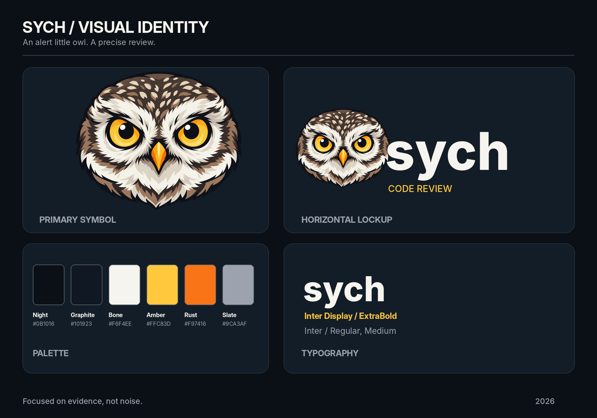

The mascot is a rounded **little owl head** (*сыч*), with no ear tufts, body or detached wings. The amber-yellow eyes
and rust-orange beak nod to Rust. Every asset is a raster PNG. None of them are editable vectors, so don't present them
as editable or run automated vector tracing without QA.

## Where each asset is used

| Asset | Used for |
|---|---|
| `readme-banner-2400x800.png` | the hero image of the root [README](../../README.md) |
| `preview-readme.png` | a smaller 1200×400 copy of the banner for chat posts and link previews |
| `social-preview-1280x640.png` | the GitHub social preview (Settings → General → Social preview) |
| `avatar-night-1024.png` | the GitHub App and bot profile picture (App settings → Display information) |
| `avatar-night-256.png` | small avatar slots (badges, chats) |
| `avatar-{bone,amber,rust}-1024.png` | avatars for other services and light/accent backgrounds |
| `lockup-transparent-{dark,light}.png` | the header of [docs/README.md](../README.md), switched by the viewer's color scheme |
| `lockup-{dark,light}.png` | lockups on a solid background for slides and documents |
| `icon-transparent-{16…1024}.png` | favicons and app icons at each standard size |
| `symbol-transparent.png` | the standalone mascot at full resolution, the source for new artwork |

## Gallery

### Banner and previews

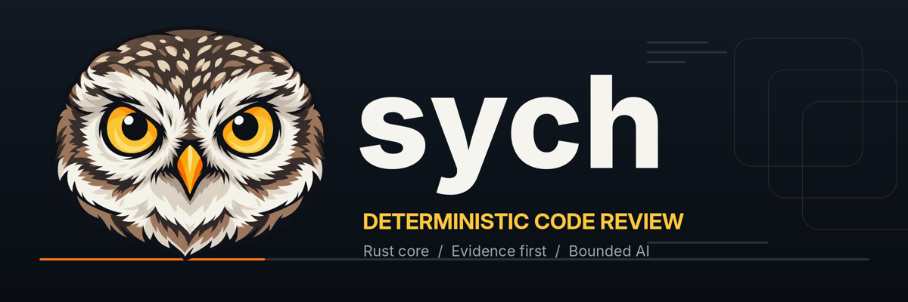 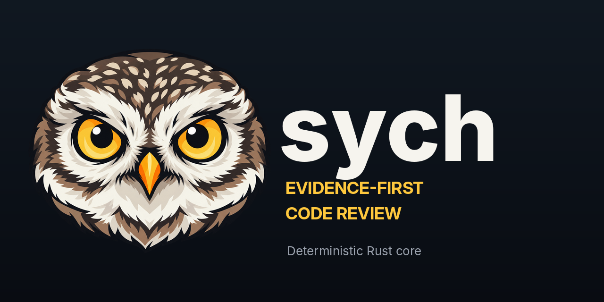

### Lockups

| On dark | On light |
|---|---|
| 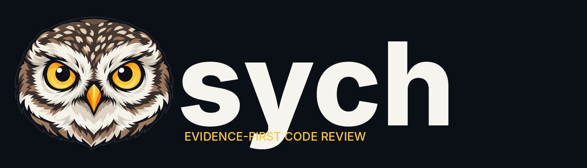 | 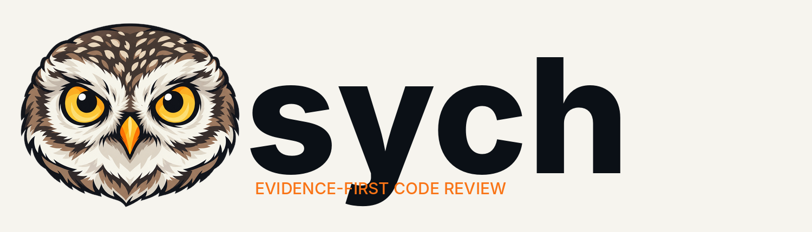 |
| 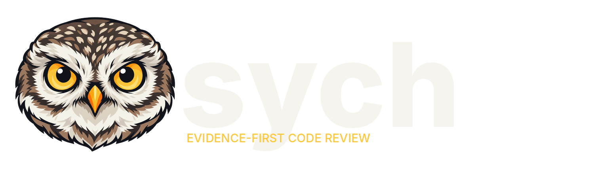 |  |

### Avatars

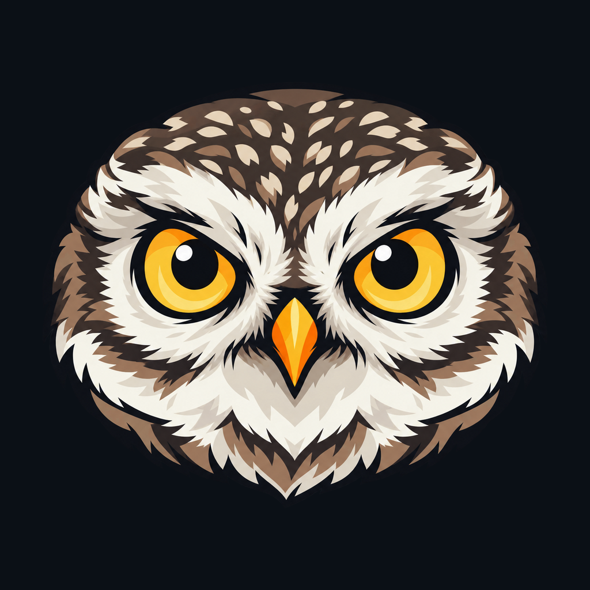 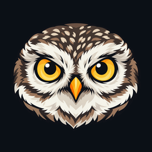
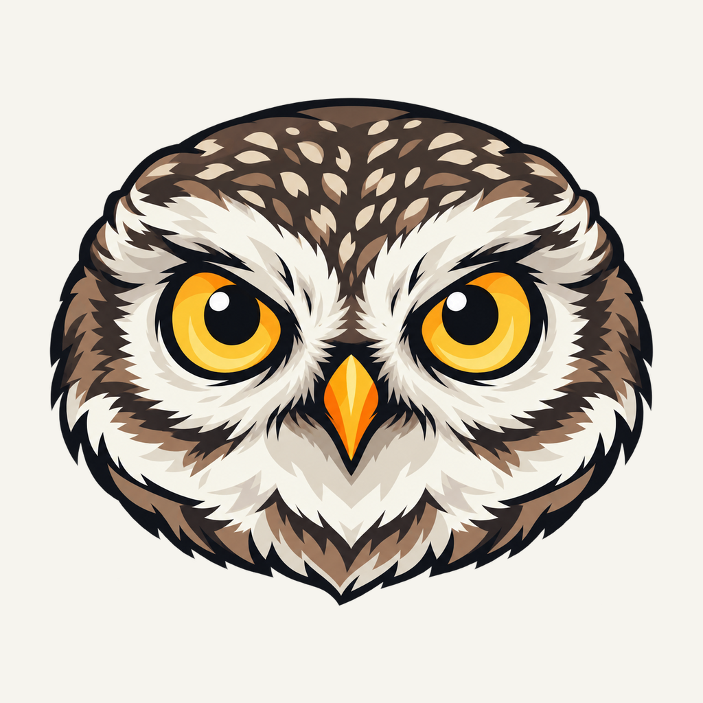 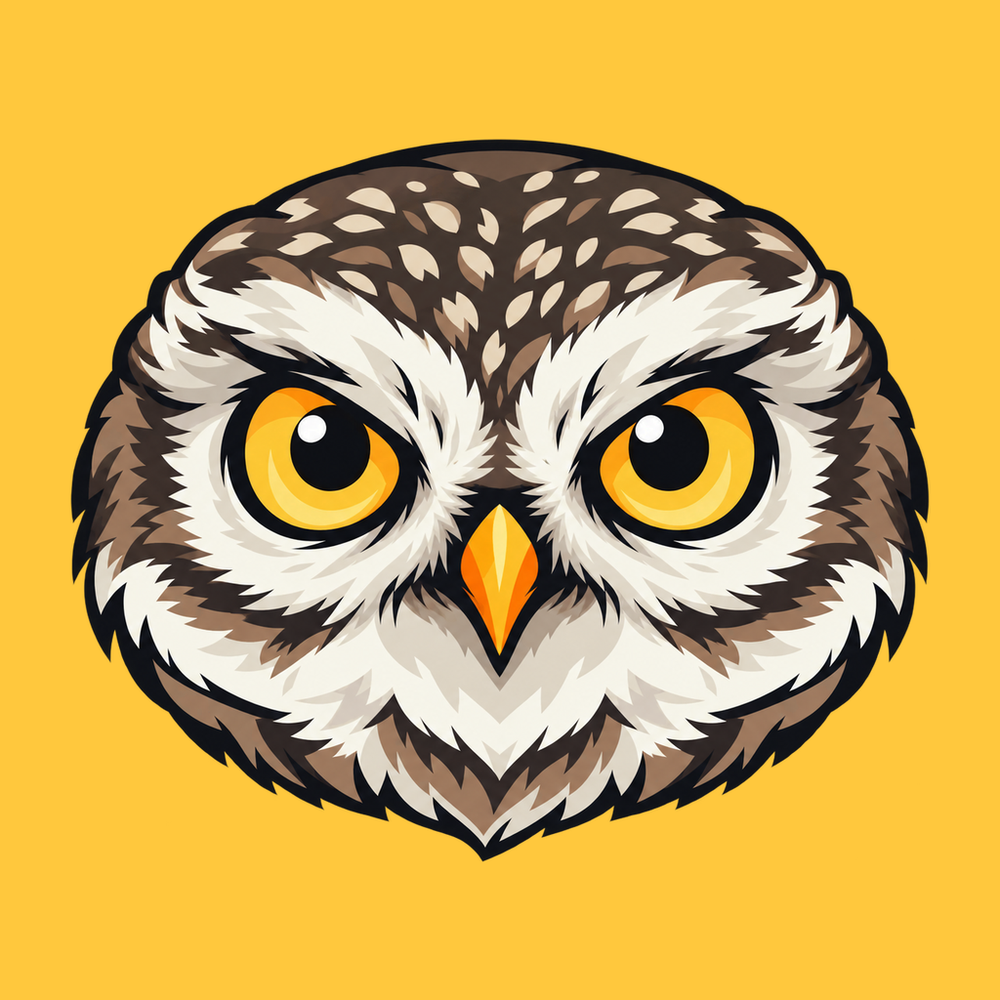
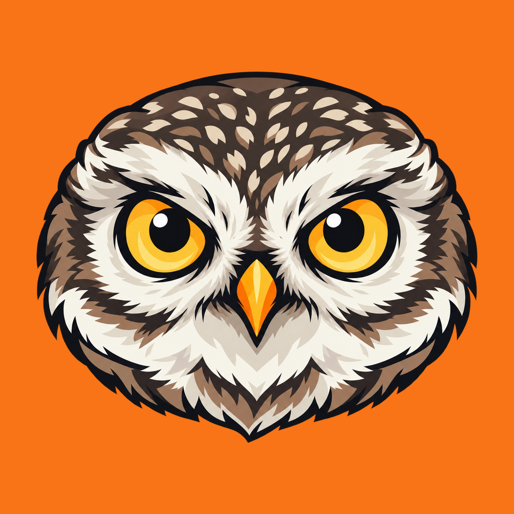

### Mascot and icons

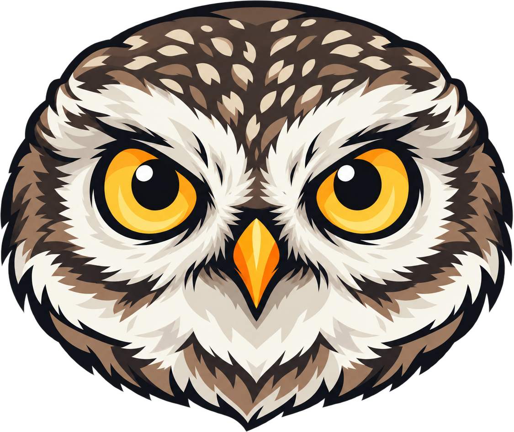

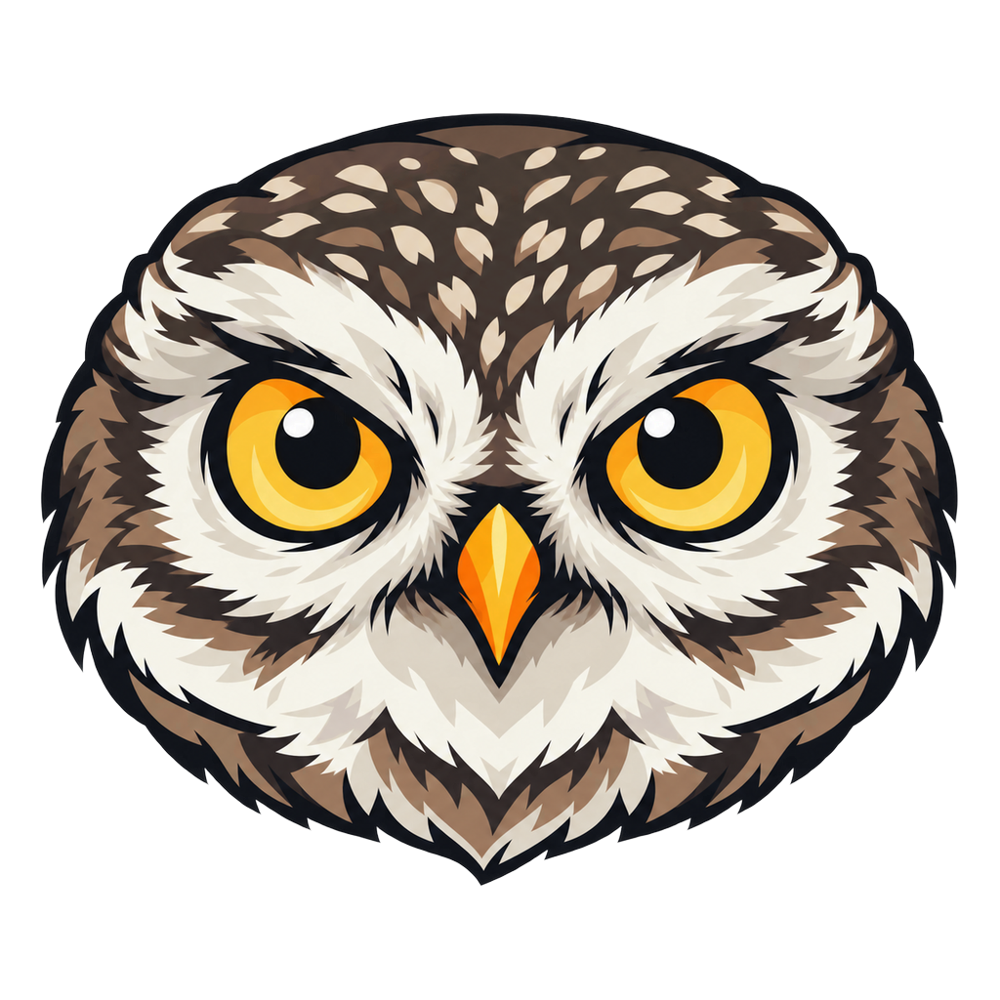 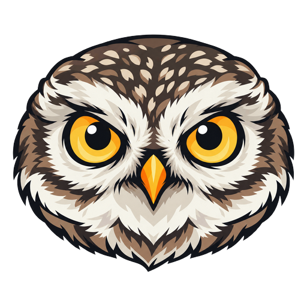
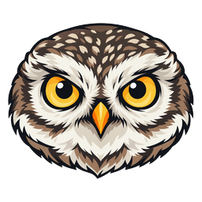 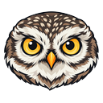
 
 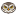

## Colors

| Name | HEX |
|---|---|
| Night | `#0B1016` |
| Graphite | `#101923` |
| Bone | `#F6F4EE` |
| Amber | `#FFC83D` |
| Rust Orange | `#F97416` |
| Slate | `#9CA3AF` |

Typography: Inter Display for headings and Inter for body text.
